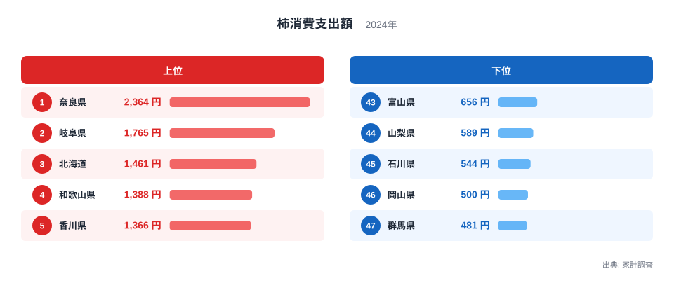
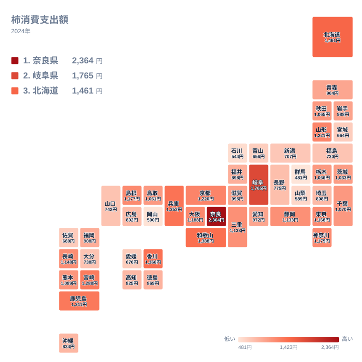

秋の果物の代表格である柿は、産地の近くで暮らす人ほど多く買うのでしょうか。それとも、地域の食習慣が支出の差を生んでいるのでしょうか。家計調査の2024年のデータを見ると、柿への支出は都道府県によって大きく異なります。1位の奈良県は2,364円、47位の群馬県は481円で、奈良県は群馬県の約4.9倍にあたります。

この記事では、柿への支出が多い県と少ない県を並べ、図から言える地理的な特徴を整理します。産地や食文化との関係については、データだけでは確かめられないため、仮説として分けて書きます。

## 柿への支出が最も多いのは奈良県

まず、上位5県と下位5県を図で確認します。

<source-link href="/ranking/persimmon-consumption-expenditure">柿への支出ランキングをもっと見る</source-link>

1位は奈良県で2,364円です。2位の岐阜県は1,765円、3位は北海道で1,461円、4位は和歌山県で1,388円、5位は香川県で1,366円です。1位と2位の差は599円あり、2位と3位の差である304円の約2倍になります。奈良県だけが、2位以下の集団から離れて先頭に立っている形です。

下位は、47位が群馬県で481円、46位が岡山県で500円、45位が石川県で544円です。44位は山梨県で589円、43位は富山県で656円となっています。最下位の群馬県は、1位の奈良県の5分の1ほどの水準です。

上位と下位の顔ぶれを見比べると、地理的なまとまりは単純ではありません。北海道が3位に入る一方で、下位には北陸や中国、関東の県が混ざっています。支出額が高い理由は、このデータだけでは分かりません。価格、購入する品目、世帯の構成など、複数の要因が重なっている可能性があります。

> [!NOTE]
> ここでの数値は、家計調査で二人以上の世帯が1年間に柿へ支出した金額です。消費した量ではなく支出額です。同じ量を買っても、購入する品目や単価によって金額は変わります。

## 地図で見る柿支出の地理分布

次に、都道府県の位置関係を保ったタイルマップで分布を確かめます。

地図にすると、近畿から東海にかけて支出の高い県が集まっている様子が見えます。奈良県が2,364円、和歌山県が1,388円、兵庫県が1,352円、京都府が1,220円、大阪府が1,188円です。ここに岐阜県の1,765円を加えると、近畿から東海へ続く高支出の帯が浮かびます。この傾向は図から直接読み取れる範囲の話です。

九州にも高めの県が並びます。鹿児島県は1,311円で7位、宮崎県は1,288円で8位、長崎県は1,148円で15位です。一方で大分県は738円で37位、佐賀県は680円で40位と、同じ九州でも差があります。地域ブロックで一括りにできない点が、この指標の特徴です。

東日本では、山形県が1,221円で9位と上位に入ります。一方、福島県は730円で38位、宮城県は664円で42位です。関東では神奈川県が1,175円で13位、東京都が1,168円で14位ですが、埼玉県は808円で33位、群馬県は481円で47位です。首都圏の中でも差が大きく開いています。

> [!TIP]
> 中位では隣り合う県の差が小さく、静岡県と三重県はともに1,133円です。順位の1つ2つの違いに意味を求めすぎず、上位・中位・下位という大きな塊と、地図上の帯で読むのがコツです。

## 産地や食文化との関係は仮説として読む

近畿から東海に高支出の県が集まる背景として、まず考えられるのは、柿が地域の食卓や贈答に根づいているという見方です。奈良県や和歌山県、岐阜県は、柿の産地や加工食品で知られる地域として語られることがあります。ただし、これは一般に言われる話にすぎず、今回のデータで検証したものではありません。

もう一つの見方は、産地でなくても支出が多くなる県がある、という点に注目するものです。北海道は1,461円で3位ですが、データからは理由を判断できません。家計調査には品目ごとの内訳や購入先の情報がなく、栽培地との距離が支出に関係しているかどうかも、この数字からは確かめられません。

下位の県についても同様です。岡山県は500円で46位、山梨県は589円で44位です。他の果物の存在感が大きいために柿が選ばれにくい、という説明も考えられますが、他の果物の支出は今回の実データに含まれていません。根拠を示せない説明は避け、「産地の印象と支出の多さは必ずしも一致しない」という事実の確認にとどめます。

> [!WARNING]
> 家計調査は標本調査で、都道府県ごとの対象世帯数は限られます。柿のように購入時期が秋から冬に偏る品目では、1年分の値が天候や不作・豊作、価格の変動に左右されることがあります。2024年の1年だけで、その県の長期的な傾向と断定することはできません。

## 上位2県と他の品目への広げ方

1位と2位の差が599円、2位と3位の差が304円という点は、奈良県の突出ぶりを示しています。柿への支出が多い県に共通する背景を探るなら、まず自分の関心のある県の他の統計を見比べるのが近道です。[奈良県のデータ](/areas/29000)や[岐阜県のデータ](/areas/21000)では、ほかの統計と合わせて地域の姿を確認できます。

また、柿が他の果物と比べて地域差の大きい品目なのかどうかは、今回の実データだけでは判断できません。みかんやりんごなど、ほかの食料品との比較には、それぞれの支出額を並べる必要があります。[同じカテゴリの統計一覧](/category/economy)から関連する統計を探し、同じ年の値で見比べると、柿の位置づけがより明確になります。

なお、都市部の動きも参考になります。大阪府は1,188円で11位、東京都は1,168円で14位、神奈川県は1,175円で13位と、大都市圏の県は中位より上に並びます。ただし、人口の多さが原因かどうかは、人口のデータを使っていないため、この記事では断定しません。

## データについて

この記事で使った統計は、家計調査の柿消費支出額です。対象年は2024年で、単位は円です。二人以上の世帯が1年間に柿へ支出した金額を、都道府県ごとに集計したものです。

数値は標本調査に基づくため、誤差を含みます。順位の近い県同士の差は、実態の違いというより調査のばらつきの範囲に収まることがあります。そのため、1位と47位のような大きな差に注目し、中位の細かな順位は参考程度に見るのが適切です。

## まとめ

柿への支出は、1位の奈良県が2,364円、47位の群馬県が481円で、奈良県が約4.9倍です。高支出の県は近畿から東海に集まり、九州や山形県、北海道にも高い県が見られます。

一方で、なぜその県で支出が多いのかは、このデータだけでは説明できません。産地や食文化との関係は、仮説として頭に置きながら、地図とランキングを眺めてみてください。
