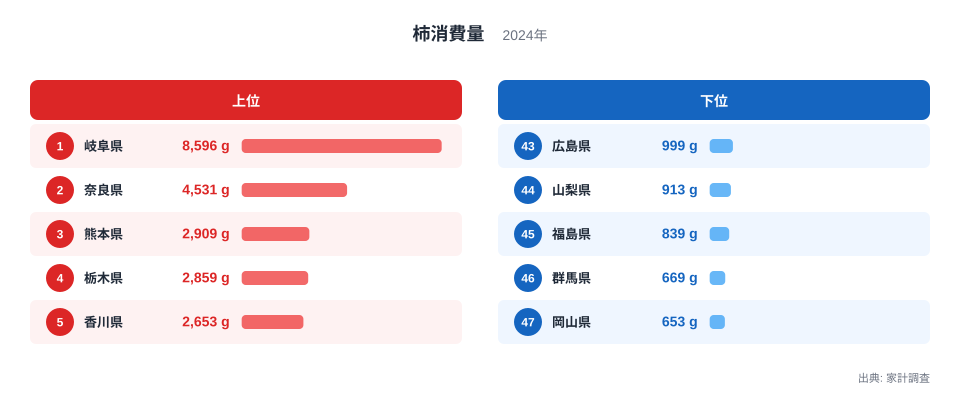
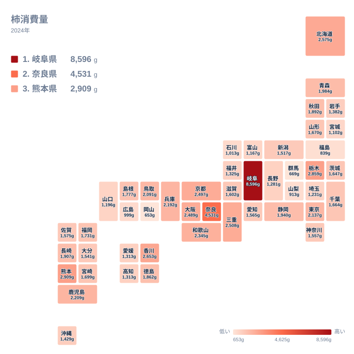

秋の果物といえば柿を思い浮かべる人が多いはずです。ところが、実際にどの県の家庭でどれだけ柿が食べられているかを見ると、地域の差は想像以上に大きいことが分かります。家計調査の2024年の結果では、1位の岐阜県が8,596g、2位の奈良県が4,531gでした。3位以下はいずれも2,909g以下に収まっており、上位2県の突出ぶりが際立ちます。

この記事では、柿の消費量が都道府県でなぜここまで違うのかを、食文化・産地・気候という3つの視点から整理します。みかんや梨といった関連する果物との違いにも触れながら、数字の背景を読み解いていきます。

## 柿の消費量で岐阜県が1位になった

まず結果を確認します。柿の消費量が最も多いのは岐阜県で、8,596gでした。2位は奈良県の4,531g、3位は熊本県の2,909gです。4位は栃木県で2,859g、5位は香川県で2,653gと続きます。

岐阜県の数字は、2位以下と比べて一段高い位置にあります。3位から10位までは2,909gから2,345gの範囲に密集しており、順位が一つ違うだけでも差はわずかです。一方で、1位と2位の間には大きな開きがあります。ランキングの上位は、実質的に岐阜県と奈良県が別格で、その後ろに多くの県が団子状に並ぶ構図です。

反対に最も少ないのは岡山県の653gでした。46位の群馬県が669g、45位の福島県が839gと続きます。1位の岐阜県と最下位の岡山県を並べると、同じ国内でも柿との付き合い方がまったく異なることが分かります。

## 上位と下位の顔ぶれを見る

次の図は、柿消費量の上位と下位を並べたものです。

<source-link href="/ranking/persimmon-consumption-quantity">柿消費量ランキングをもっと見る</source-link>

図で上位に並ぶのは、岐阜県、奈良県、熊本県、栃木県、香川県です。近畿や東海といった柿の歴史が長い地域だけでなく、九州の熊本県、関東の栃木県、四国の香川県も入っています。柿好きの県は特定の地方に固まっているわけではなく、全国に散らばっているのが特徴です。

下位には、岡山県、群馬県、福島県、山梨県、広島県が並びます。山梨県は913g、広島県は999gです。このうち福島県や山梨県は、干し柿やあんぽ柿のような加工品で知られる地域でもあります。生鮮の柿を買う量が少なくても、加工品や贈答品、自家消費で柿に親しんでいる可能性があり、数字だけで「柿を食べない県」と決めつけるのは早計です。

> [!NOTE]
> 家計調査の柿消費量は、世帯が1年間に購入した生鮮の柿の数量を示した指標です。庭先の柿や親戚からの贈り物のように、購入を伴わない柿は数字に含まれません。

## 地理分布から見える傾向

続いて、都道府県ごとの分布を地図で確認します。

地図では、近畿から東海にかけての色の濃さが目を引きます。岐阜県の8,596g、奈良県の4,531gに加えて、三重県が2,508g、京都府が2,497g、大阪府が2,489g、和歌山県が2,345gと、近畿圏の多くが10位以内に入っています。柿の産地と大消費地が近い地域では、旬の時期に店頭へ並ぶ量も多く、家庭の食卓に上りやすいと考えられます。

一方、東日本は様相が少し異なります。北海道は2,575gで6位、東京都は2,137gで13位と健闘していますが、群馬県の669g、福島県の839g、宮城県の1,102gなど、下位に沈む県も目立ちます。西日本でも岡山県の653g、広島県の999gが下位にあり、西高東低と単純には言い切れません。

大都市圏に目を向けると、大阪府の2,489gと東京都の2,137gは近い水準です。ただし神奈川県は1,557gで29位、愛知県は1,565gで28位と、都市部であれば一律に多いわけではないことも分かります。人口の多い地域でも、産地との距離や食習慣によって結果は変わります。

> [!TIP]
> 順位の差が小さい中位の県どうしは、数十gの違いで順位が入れ替わります。順位そのものよりも、上位に突出した県があること、下位に少量の県が固まっていることという全体の形を読むと、地域差をつかみやすくなります。

## 食文化・産地・気候との結びつき

岐阜県が突出する背景には、柿を日常的に食べる食文化と、地元で柿が手に入りやすい環境があると考えられます。岐阜県は渋柿を干し柿に加工する文化でも知られ、柿が身近な果物として根づいています。秋になると直売所や産直で柿が並び、家庭で買う習慣が定着していることが、数量の多さにつながっていると推測できます。

奈良県も、柿とのつながりが深い地域です。柿の葉で包む郷土料理があり、県内には柿の栽培が盛んな地域もあります。4,531gという数字は、産地の近さと食文化の両方が反映された結果といえそうです。隣接する和歌山県も2,345gで10位に入っており、紀伊半島から東海にかけて柿が食卓に根づいている様子がうかがえます。

気候の面では、柿は温暖から冷涼まで幅広い地域で育ちますが、甘柿は一定の積算温度を必要とし、渋柿は寒暖差のある地域で干し柿づくりに向きます。熊本県の2,909gや鹿児島県の2,209gのように九州にも上位の県があるのは、栽培に適した気候があるためでしょう。一方、北海道の2,575gは産地の近さでは説明しづらく、流通の発達や嗜好の影響も考えられます。

> [!WARNING]
> 家計調査は調査対象の世帯数が限られ、都道府県の結果は県庁所在市などの値が中心です。県全体の傾向をそのまま表すとは限らず、年によって順位が大きく動く場合もあります。ここで示した背景も、数字から導いた推測を含みます。

## みかん・梨など関連品目との対比

柿の消費量を、同じ秋冬の果物と並べて考えると特徴が見えてきます。みかんは、温暖な西日本や太平洋側の産地が多く、冬の家庭の定番として全国で広く食べられます。梨も、秋に産地周辺で消費が伸びる果物です。これらは全国的に消費が比較的ならされているのに対し、柿は岐阜県と奈良県に極端に偏っているのが特徴です。

この違いは、果物としての性格の差から説明できます。みかんや梨は皮をむく、切るという手軽さで全国どこでも売られています。柿は品種によって渋抜きや熟度の見極めが必要で、干し柿のような加工の楽しみ方もあり、食べ慣れた地域とそうでない地域で需要に差が出やすいのです。

だからこそ、柿の消費量は食文化の違いが数字に表れやすい指標だといえます。気候や産地に加え、子どもの頃から柿に親しんだかどうかという習慣が、購入量に響いているのでしょう。同じカテゴリの他の統計と見比べたい場合は、[同じカテゴリの統計一覧](/category/economy)も参考になります。

## 地域ごとの詳しいデータを見るには

岐阜県と奈良県の詳細は、地域ごとのページで確認できます。[岐阜県のデータ](/areas/21000)では、柿以外の統計も含めた県の特徴を、[奈良県のデータ](/areas/29000)でも同様に、県の姿を幅広く見渡せます。柿の消費量が多いことと、人口構成や所得、食料支出といった他の指標がどう関係するのかを調べると、数字の理由がより具体的に見えてくるはずです。

下位の県についても同じです。岡山県や群馬県の柿の消費量が少ないのは、他の果物が選ばれているためなのか、加工品が中心なのか、それとも流通の都合なのか。複数の統計を組み合わせることで、単なる順位表を超えた地域の姿が浮かび上がります。

## データについて

この記事で扱った数値は、家計調査の「柿消費量」の2024年の結果で、単位はgです。1世帯が1年間に購入した生鮮の柿の数量を示しており、干し柿などの加工品や、購入を伴わない柿は含まれません。そのため、柿を食べる量そのものというより、家庭が店で買った柿の量と読むのが正確です。

本文中の背景説明は、一般的に知られる産地や食文化の情報から導いた解釈です。統計だけで因果関係を証明できるものではないため、数値の読み取りと推測を区別してお読みください。

## まとめ

柿の消費量は、岐阜県の8,596gと奈良県の4,531gが突出し、最下位の岡山県の653gとは大きな開きがあります。近畿から東海に厚みがある一方、熊本県、栃木県、香川県、北海道も上位に入っており、地域の食文化と産地、流通が複雑に重なっていることがうかがえます。

順位を眺めるだけでなく、なぜその県で多いのか、少ない県は何を食べているのかを考えると、身近な果物からも地域の暮らしが見えてきます。ぜひ地域ごとのデータと合わせて、柿の地図を読み解いてみてください。
