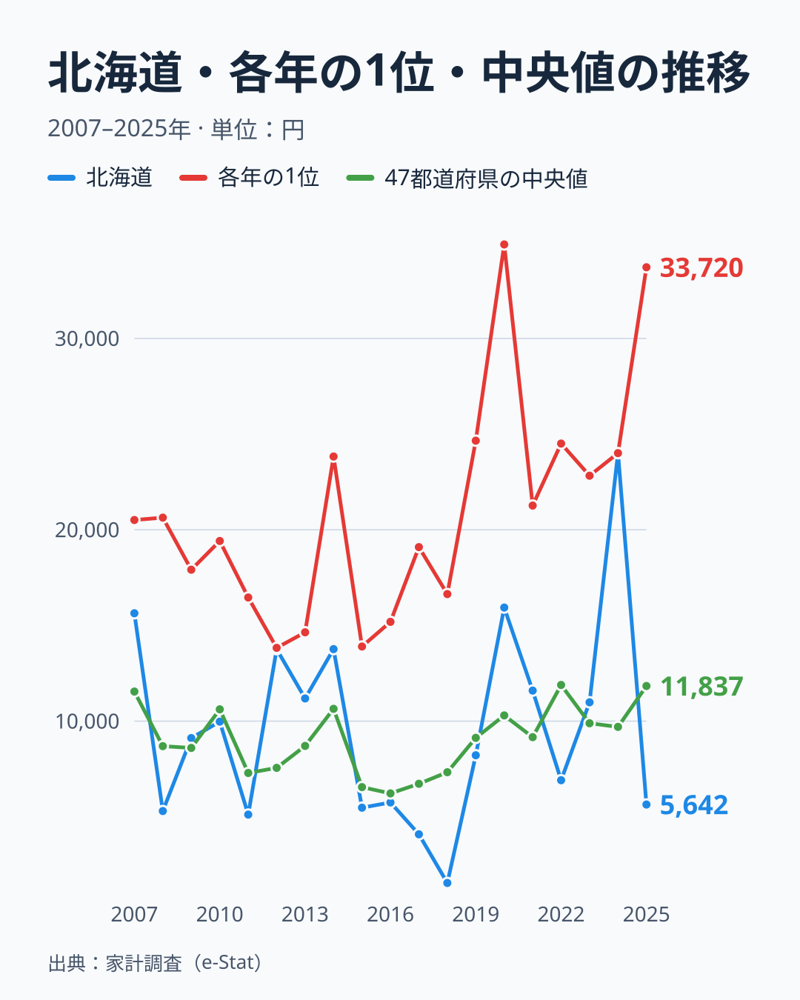

パソコンにいくら使っているかは、県によって驚くほど差があります。総務省「家計調査」による2025年のパソコン消費支出額（二人以上世帯の年間支出）を都道府県別に見ると、1位は埼玉県で33,720円、最下位は兵庫県で4,236円となり、その差は約8.0倍にのぼります。

面白いのは、この順位が「都市部が強い」という単純な図式にならないことです。東京都は28,207円で2位と健闘していますが、日本最大の製造業県である愛知県は16位、京都府は21位と中位にとどまります。さらに2024年に24,007円で首位だった北海道は、2025年は5,642円で45位まで下がりました。

この記事では、上位県と下位県の顔ぶれを見たうえで、2007年から2025年までの19年分の推移を使い、「前年首位がなぜ翌年に下位へ落ちるのか」を考えます。結論を先に書くと、この指標は1年ごとの順位が大きく入れ替わるため、単年の順位だけで県の特徴を決めるのは危険です。

> [!NOTE]
> この指標は総務省「家計調査」における、都道府県庁所在市の二人以上世帯の年間パソコン消費支出額（円）です。パソコンの購入・買い替え費用の実支出額を表し、保有率や利用時間とは異なる指標です。単身世帯は含まれません。

## 上位と下位

<source-link href="/ranking/personal-computer-consumption-expenditure">パソコン消費支出額ランキングをもっと見る</source-link>

1位の埼玉県は33,720円で、5位の愛媛県の25,761円を7,959円上回ります。上位5県の中で埼玉県だけが3万円を超えており、2位の東京都との差も5,513円あります。6位の栃木県まで広げると、埼玉県・東京都・茨城県・栃木県の4都県が関東です。首都圏とその周辺に支出が集まっていますが、埼玉県が突出する固有の理由は、このデータからは特定できません。

[仮説] 東京都・埼玉県は高所得・高学歴世帯が多く教育投資への意識が高いこと、茨城県・栃木県を含む首都圏周辺では在宅勤務やオンライン学習の環境整備が進んでいることが、支出を押し上げている可能性があります。

滋賀県は24,054円で7位に入っています。上位には東海の三重県、近畿の滋賀県、四国の愛媛県も並び、大都市圏に限らない広がりがあります。

一方、最下位の兵庫県は4,236円で、1位の埼玉県の8分の1ほどにとどまります。下位には大分県、北海道、沖縄県、富山県が続き、九州・沖縄、北海道、中部と地域はばらばらです。上位・下位とも地域のまとまりが弱いことは、この指標が県の構造よりも年ごとのぶれを強く受けている可能性を示しています。

## 北海道の首位は偶然か: 19年の推移

北海道の動きは、この指標の性格をよく表しています。北海道は2018年に1,544円で47位、2024年に24,007円で首位、2025年に5,642円で45位でした。6年で最下位から首位へ上がり、翌年にはほぼ最下位へ戻ったことになります。2024年は北海道の次に東京都が20,735円、埼玉県が19,596円と続き、北海道の首位は決して僅差ではありませんでした。

では、北海道だけが特別なのでしょうか。2007年から2025年までの各年の1位を並べると、富山県、奈良県、熊本県、徳島県、島根県、栃木県、埼玉県、高知県、福岡県、兵庫県、石川県、群馬県、東京都、北海道と、19年で14県が首位に立っています。同じ県が2年続けて1位になったのは、2013年と2014年の埼玉県だけです。2025年の1位である埼玉県も、2022年は41位、2012年は34位、2015年は37位でした。

全県の中央値は、2016年の6,225円から2022年の11,893円まで年によって2倍近く動きます。全国の水準そのものが上下するうえ、順位は各県の購入のタイミングで入れ替わります。家計調査は県庁所在市の標本が小さく、数世帯がパソコンを買い替えるかどうかで県の平均が変わるため、こうした振れが生じやすいと考えられます。

> [!WARNING]
> パソコンは毎年買うものではなく、数年おきに買い替える耐久消費財です。このため、調査年にたまたま買い替えが重なった県は跳ね上がり、買い替えのなかった県は落ち込みます。支出額は「その年に使ったお金」であり、保有率や、その県がパソコンを持っているかどうかを示す指標ではありません。

## 愛知・京都・大阪は中位、地図で見る地理

このマップを見ると、パソコン消費支出額は必ずしも「経済規模が大きい県」と一致しないことがはっきりします。愛知県は自動車産業を中心に日本有数の製造業県ですが、支出額は17,088円で16位です。京都府は13,406円で21位でした。大阪府は16,541円で18位、神奈川県は11,612円で27位と、大都市圏の府県でも順位に幅があります。

地理的な傾向として、関東では埼玉県から茨城県・栃木県へ、濃い色が連なっています。一方で西日本は、愛媛県が5位、鳥取県が8位に入る反面、隣の兵庫県が最下位という具合に、濃い県と薄い県が隣り合って散らばります。連なる地域があるのは関東だけで、全国に通じる「地域のパターン」は見えません。

上位に並ぶ埼玉県・茨城県・栃木県・滋賀県は、いずれも大都市圏の周辺に位置します。[仮説] こうした地域では共働き世帯や子育て世帯が多く、家庭用パソコンを整える世帯が多いのかもしれません。ただし、世帯構成のデータは使っておらず、この記事では確かめていません。

## 自分の県の順位をどう読むか

読者の家計にとっての含意は、順位を1年だけで判断しないことです。兵庫県は2025年こそ4,236円で最下位ですが、2007年から2025年の19年分の単純平均では10,433円で16番目でした。反対に北海道は2024年に首位でしたが、19年平均は9,685円で23番目にとどまります。埼玉県は19年平均でも15,176円で最も高く、東京都は14,380円で続きます。

つまり、1年の順位が示すのは「その年に買い替えが重なったか」であって、「その県の人がパソコンにお金をかけるか」ではありません。自分の世帯の支出を見るときも、昨年の出費が大きかったからといって来年も同じ額が続くとは限りません。数年に一度の買い替え費用を、年ごとに積み立てるイメージで家計に組み込むと、突発的な出費に慌てずにすみます。地域別に比較するときも、複数年を並べたうえで読むのが安全です。

> [!TIP]
> 数千円の差や1〜2位の入れ替わりは、地域の実態の差というより偶然の範囲かもしれません。順位は大まかな位置として読み、可能なら複数年を並べて確かめてください。詳しくは[埼玉県の地域データ](/areas/11000)や[兵庫県の地域データ](/areas/28000)も合わせてご覧ください。

家計の消費支出全体をより広く見たい方は、[経済カテゴリのランキング一覧](/category/economy)や[家計・くらしをテーマにしたページ](/themes/consumer-prices)もあわせてご参照ください。

## データについて

総務省「家計調査」の都道府県庁所在市における二人以上世帯の値で、県全体の平均ではありません。標本が限られるため、単年の順位はぶれが大きくなります。倍率は、最大の埼玉県33,720円を最小の兵庫県4,236円で割った値です。推移の図は、2007年から2025年までの各年の値を、同じ指標のデータから年ごとに並べ替えて作りました。19年平均は各年の値の単純平均で、筆者が計算した参考値です。

## まとめ

- 1位は埼玉県で33,720円、最下位は兵庫県で4,236円となり、約8.0倍の格差
- 2位は東京都で28,207円、3位は茨城県で27,012円と、関東勢が上位に多い
- 2024年に24,007円で首位だった北海道は、2025年は5,642円で45位に下がった
- 2007年から2025年の19年で、1位に立った県は14県あり、順位は年ごとに大きく入れ替わる
- 兵庫県は2025年は最下位でも19年平均では16番目で、単年の順位だけで県の傾向は決められない
