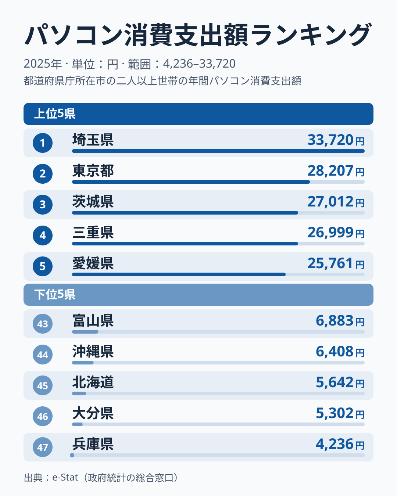
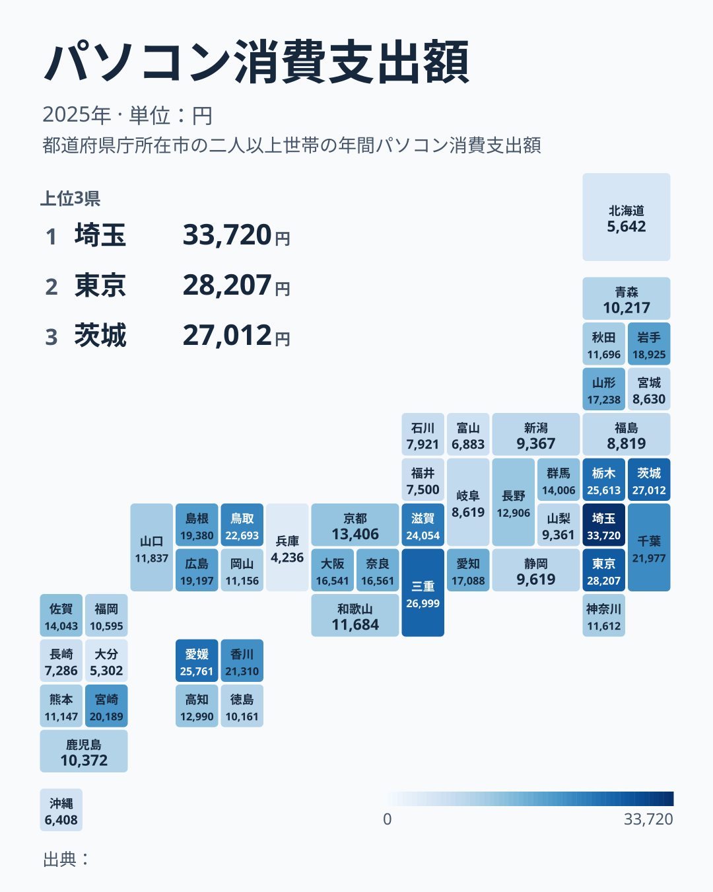

パソコンにいくら使っているかは、県によって驚くほど差があります。総務省「家計調査」による2025年のパソコン消費支出額（二人以上世帯の年間支出）を都道府県別に見ると、1位は埼玉県で33,720円、最下位は兵庫県で4,236円となり、その差は約8.0倍にのぼります。

面白いのは、この順位が「都市部が強い」という単純な図式にならないことです。東京都は28,207円で2位と健闘していますが、日本最大の製造業県である愛知県は16位、京都府は21位と中位にとどまります。さらに前年は首位だった北海道は、今回5,642円で45位まで下がりました。パソコン購入は所得だけでなく、買い替えの時期や子どもの教育環境、世帯構成の違いも関わっている可能性があります。

この記事では、上位県と下位県の顔ぶれを比較しながら、埼玉県が1位になり、前年首位の北海道が下位に落ちた結果の背景を探ります。

> [!NOTE]
> この指標は総務省「家計調査」における、都道府県庁所在市の二人以上世帯の年間パソコン消費支出額（円）です。パソコンの購入・買い替え費用の実支出額を表し、保有率や利用時間とは異なる指標です。単身世帯は含まれません。

## 上位と下位

<source-link href="/ranking/personal-computer-consumption-expenditure">パソコン消費支出額ランキングをもっと見る</source-link>

1位の埼玉県は33,720円で、5位の愛媛県の25,761円を7,959円上回ります。上位5県の中で埼玉県だけが3万円を超えており、2位の東京都との差も5,513円あります。6位の栃木県まで広げると、埼玉県・東京都・茨城県・栃木県の4都県が関東です。首都圏とその周辺に支出が集まっていますが、埼玉県が突出する固有の理由は、このデータからは特定できません。

[仮説] 東京都・埼玉県は高所得・高学歴世帯が多く教育投資への意識が高いこと、茨城県・栃木県を含む首都圏周辺では在宅勤務やオンライン学習の環境整備が進んでいることが、支出を押し上げている可能性があります。

滋賀県は24,054円で7位に入っています。上位には東海の三重県、近畿の滋賀県、四国の愛媛県も並び、大都市圏に限らない広がりがあります。県庁所在市の標本が小さい家計調査では、特定の年に買い替えが重なった地域が上位に出やすい点も考慮が必要です。

一方、最下位の兵庫県は4,236円で、1位の埼玉県の8分の1ほどにとどまります。下位には大分県、北海道、沖縄県、富山県が続き、九州・沖縄、北海道・東北、中部と地域はばらばらです。パソコンは他の家電と違い「今すぐ壊れて困る」わけではないため、買い替えが後回しにされやすい耐久消費財です。[仮説] 前年に買い替えが済んだ世帯が多かった地域は、この年の支出が小さく出やすいと考えられます。

> [!WARNING]
> パソコン消費支出額は年ごとの変動が大きい指標です。パソコンは平均5〜7年程度で買い替えられる耐久消費財のため、たまたま調査年に買い替えが集中した県は跳ね上がり、逆に前年に買い替えが済んだ県は落ち込みます。単年の順位だけで「その県はパソコンを持っていない」と結論づけることはできません。支出額はあくまで「その年に使ったお金」であり、保有率そのものを示す指標ではない点に注意してください。

## 発見: 北海道は首位から下位へ、愛知・京都は中位

このマップを見ると、パソコン消費支出額は必ずしも「経済規模が大きい県」と一致しないことがはっきりします。愛知県は自動車産業を中心に日本有数の製造業県ですが、支出額は17,088円で16位です。京都府は13,406円で21位でした。大阪府は16,541円で18位、神奈川県は11,612円で27位と、大都市圏の府県でも順位に幅があります。

とくに目を引くのが北海道です。前年は首位でしたが、2025年は45位に落ちました。順位がここまで動くことは、この指標が県の構造的な特徴よりも、その年の買い替えのタイミングに左右されやすいことを示唆しています。[仮説] 北海道では前年に買い替え需要が集中し、その反動が出た可能性があります。ただし、本記事のデータだけでは断定できません。

上位に並ぶ埼玉県・茨城県・栃木県・滋賀県は、いずれも大都市圏の周辺に位置します。[仮説] こうした地域では共働き世帯や子育て世帯が多く、家庭用パソコンを整える世帯が多いのかもしれません。ただし、世帯構成のデータは使っておらず、この記事では確かめていません。

> [!TIP]
> 家計調査は県庁所在市の二人以上世帯が対象で、標本が小さい指標です。数世帯の高額なパソコン購入が平均を押し上げることもあるため、数千円の差や1〜2位の入れ替わりは、地域の実態の差というより偶然の範囲かもしれません。順位は大まかな位置として読むのが安全です。詳しくは[埼玉県の地域データ](/areas/11000)や[兵庫県の地域データ](/areas/28000)も合わせてご覧ください。

家計の消費支出全体をより広く見たい方は、[経済カテゴリのランキング一覧](/category/economy)や[家計・くらしをテーマにしたページ](/themes/consumer-prices)もあわせてご参照ください。

## データについて

総務省「家計調査」の都道府県庁所在市における二人以上世帯の値で、県全体の平均ではありません。標本が限られるため、単年の順位はぶれが大きくなります。倍率は、最大の埼玉県33,720円を最小の兵庫県4,236円で割った値です。

## まとめ

- 1位は埼玉県で33,720円、最下位は兵庫県で4,236円となり、約8.0倍の格差
- 2位は東京都で28,207円、3位は茨城県で27,012円と、関東勢が上位に多い
- 前年は首位だった北海道は、2025年は5,642円で45位に下がった
- 製造業県の愛知県は16位、伝統産業の京都府は21位で、経済規模とは必ずしも一致しない
- パソコンは買い替えサイクルが長い耐久消費財のため、単年の順位変動には注意が必要
