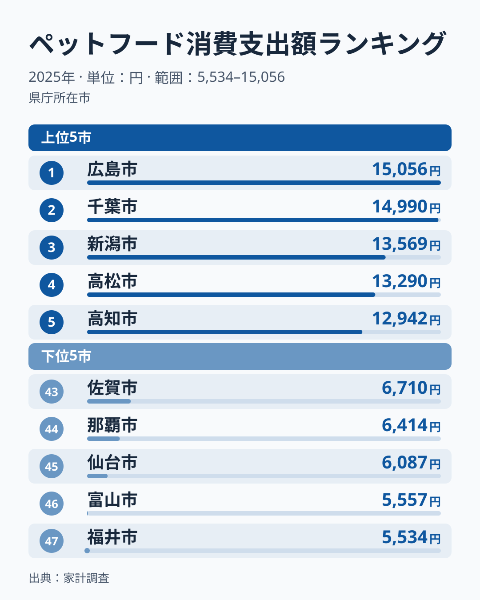
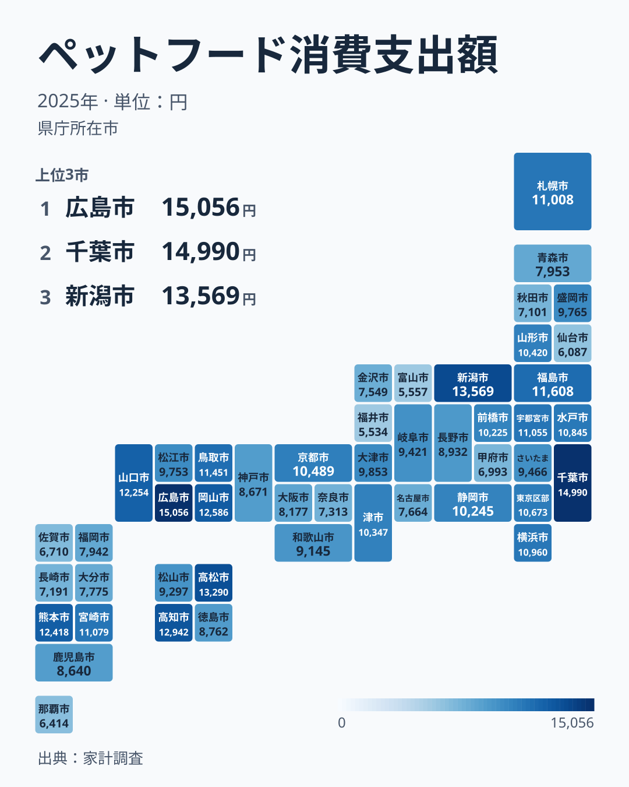

ペットフードへの支出は、統計で見ると長い目で増え続けています。家計調査の47市の値を単純に平均すると、ペットフードへの年間の支出は2007年の5,370円から2025年の9,685円へ、18年で1.8倍に増えました。

2025年に最も多かったのは広島県で15,056円、最も少なかったのは福井県で5,534円でした。その差は2.72倍です。ただ、この順位は年ごとに大きく入れ替わります。2023年と2024年に最も多かった福島県は、2025年は9位でした。この記事では、2025年の順位と、年を重ねて見たときに残る傾向を分けて整理します。

> [!NOTE]
> この数字はペットフードの購入に使った金額であり、ペットを飼っている世帯の割合そのものではありません。家計調査は飼っていない世帯も含めた二人以上世帯の平均を出すため、飼育率が高い市と、飼育世帯が高価な餌を選ぶ市のどちらでも数字は上がります。値は都道府県庁所在市のもので、本文の県名はその県の県庁所在市を指します。

## 支出が多い県と少ない県

上位と下位を確認します。

<source-link href="/ranking/pet-food-consumption-expenditure">ペットフードの消費支出ランキングをもっと見る</source-link>

2025年のペットフード消費支出額の上位は、広島県が15,056円、千葉県が14,990円、新潟県が13,569円、香川県が13,290円、高知県が12,942円と並びます。2位に千葉県が入っており、大都市圏の県が上位に来ないわけではありません。

下位は福井県が5,534円、富山県が5,557円、宮城県が6,087円、沖縄県が6,414円、佐賀県が6,710円です。北陸の2県が最も少ない側に並びました。

上位にも下位にも地方の県と都市圏の県が混ざっており、都市と地方で単純に分かれているわけではありません。1位の広島県と2位の千葉県の差は66円しかなく、上位どうしはほとんど横並びです。

## 中国・四国に固まる上位、入れ替わる首位

地図で分布を見ると、中国・四国に上位が固まっていることがわかります。

2025年の上位10県のうち6県は、中国・四国の県（広島・香川・高知・岡山・山口・鳥取）でした。中国地方と四国の合わせて9県の値を平均すると47市の平均の1.21倍で、2021年から2025年まで5年続けて47市の平均を上回っています。2007年から2020年までは0.86倍から1.05倍の間で、平均と同じくらいかやや下でした。中国・四国への集まりは、ここ5年ほどの新しい動きです。一方、北陸では富山県と福井県が最も少ない側に並びました。

地方のまとまりが見える一方で、個々の県の順位は大きく入れ替わります。2007年から2025年までの19年間で、最も多かった県は14の県に分かれます。首位が前の年と同じだったのは、福島県が続けて最多になった2016年と2024年の2回だけです。福島県は2012年・2015年・2016年・2023年・2024年の5回最多になりましたが、2010年は31位まで下がった年もあります。2025年の広島県も、2019年には43位でした。2位の千葉県は、2024年の23位から一気に上がっています。

入れ替わりは首位だけではありません。2024年に上位5位だった県の2025年の順位は、9位・5位・6位・29位・10位でした。前の年と次の年の順位がどれだけそろうかを順位相関係数（1なら全く同じ順位、0なら無関係）で見ると、2024年と2025年の間は0.46で、2008年以降の隣り合う年どうしでは-0.03から0.61の間にとどまります。前の年の順位から次の年の順位を当てるのは難しい指標だといえます。

[仮説] 順位がこれほど動くのは、ペットフードを買う世帯が限られるため、抽出された世帯の中に飼育世帯がどれだけ含まれたかで値が大きく変わるからかもしれません。家計調査の値だけでは標本の揺れと暮らしの変化を分けられないので、1年の首位から「ペットにお金をかける県」を決めるのは避けたほうがよさそうです。

> [!WARNING]
> 家計調査は世帯を抽出して集計する調査です。ペットフードのように購入する世帯が限られる品目では、単年の順位を県の特徴として固定的に読むのではなく、複数年で同じ位置に居続けるかを確かめてから傾向として捉えるのが適切です。

## 下位に残り続ける沖縄と島根

首位が入れ替わる一方で、下位にはほぼ毎年名前が出る県があります。沖縄県は2007年から2025年までの19年間で7回最下位になりました（2008年・2013年・2015年・2016年・2018年・2023年・2024年）。2025年も44位で、2011年と2012年の30位台前半を除けば、毎年36位以下にいます。

19年間で下位5位（43位以下）に入った回数を数えると、沖縄県が12回で最も多く、島根県が10回、富山県が9回、福井県が8回と続きます。島根県は中国地方の県ですが、2019年から2021年まで3年続けて最下位でした。2025年は24位です。2025年に最下位だった福井県は、2023年には22位にいたこともあります。

[仮説] 沖縄県が下位に残り続ける理由としては、集合住宅の多さなど飼育の条件や、飼われている動物の種類・大きさの違いが考えられます。ただし家計調査には住まいの形や飼育頭数の内訳が無いため、この記事のデータからは確かめられません。

## 18年で1.8倍に増えた支出

県ごとの順位よりはっきりしているのは、全体の水準の上昇です。いずれも物価の上昇を差し引かない名目の金額で、47市の単純平均は2007年の5,370円から、2012年の5,579円、2018年の6,826円、2022年の7,838円と増え、2024年には10,023円まで上がりました。2025年は9,685円と少し下がりましたが、18年前の1.8倍の水準です。2007年から2018年までの11年間の伸びは約1.3倍で、伸びの多くは2018年以降に起きています。

[仮説] 支出が増えた背景には、ペットを飼う世帯の広がりのほか、療法食や高齢期向けの餌など価格の高い製品の普及、餌そのものの値上がりが考えられます。家計調査の金額だけでは、飼う世帯が増えたのか、1世帯あたりの餌代が上がったのかは分けられません。

> [!TIP]
> この数字を自分の飼育費用の見積もりに使うことはできません。飼っていない世帯を含む全世帯の平均であるため、飼っている世帯が実際にかけている餌代はこの金額よりも大きくなります。あくまで県ごとの水準や年ごとの動きを比べるための指標として読んでください。

## 数字から見えること

ペットフードへの支出は、2025年に広島県と福井県で2.72倍の差がありました。ただし首位は年ごとに入れ替わり、19年で14の県が最多になっています。1年の順位よりも、ここ5年ほど中国・四国が平均を上回っていること、沖縄県が下位に残り続けること、47市全体で1.8倍に増えた水準のほうが、確かな傾向として読めます。

家計の支出全体を見るなら[同じカテゴリの統計一覧](/category/economy)が参考になります。1位の[広島県のデータ](/areas/34000)や、下位に残り続ける[沖縄県のデータ](/areas/47000)も、県ごとの暮らしの条件を確かめる手がかりになります。
