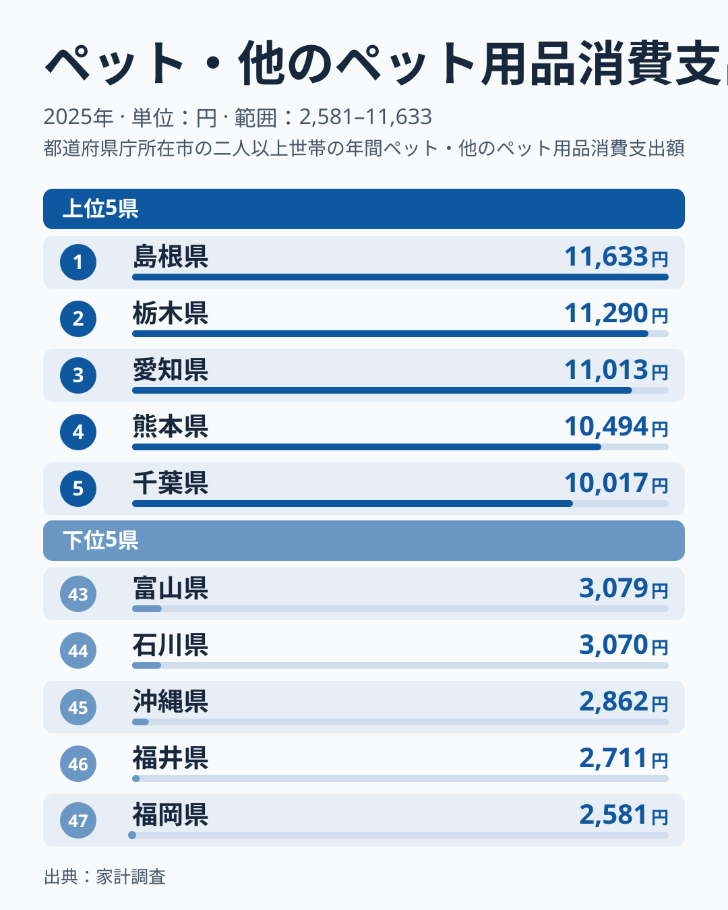
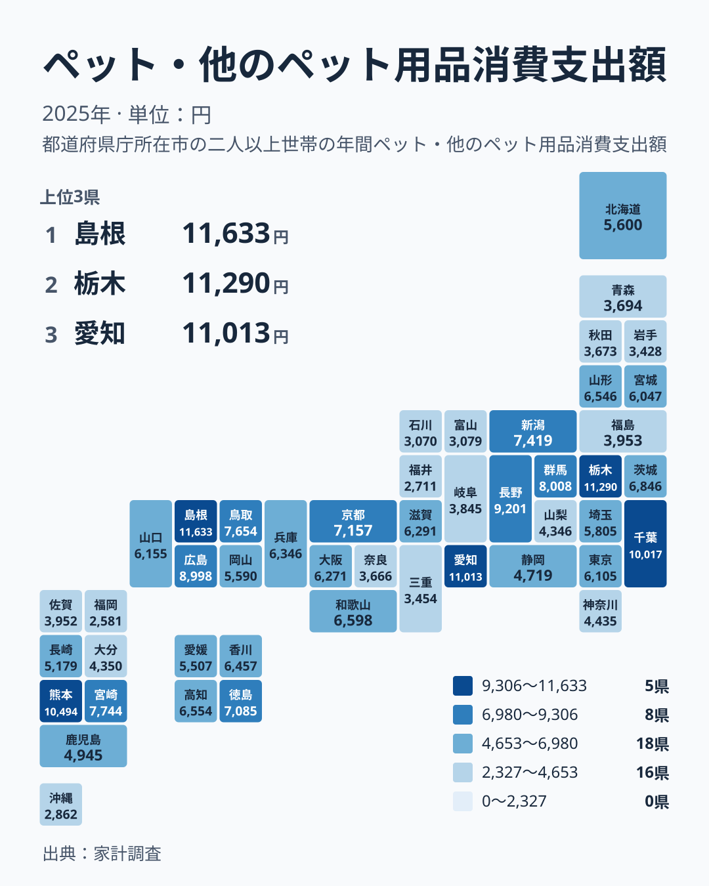

ペットを飼う家庭にとって、フードや日用品の出費は毎月の家計にじわじわ効いてきます。ところが、その金額は住む場所によって大きく違って見えます。2025年の家計調査によると、ペット・他のペット用品への支出が最も多かったのは島根県の11,633円でした。最も少なかったのは福岡県の2,581円です。最大と最小の比はおよそ4.5倍になります。

この記事では、上位と下位の「幅」に注目しながら、この数字が暮らしにとって何を意味するのかを考えます。「ペット好きが多い県」と単純に片づけてよいのか、それとも調査の性質が数字に影響しているのかを、実データの範囲でたどっていきます。

## 上位5県と下位5県の「幅」を読む

まず、全国の両端を図で確認します。

<source-link href="/ranking/pet-supplies-consumption-expenditure">ペット・他のペット用品への支出ランキングをもっと見る</source-link>

注目したいのは、各グループの内側のそろい方です。上位5県は、1位の島根県が11,633円、5位の千葉県が10,017円で、5県すべてが10,000円を超えています。1位から5位までの開きは、1,616円にとどまります。上位は互いに近い水準に固まっているといえます。

下位5県も同じです。47位の福岡県が2,581円、43位の富山県が3,079円で、5県すべてが3,100円を下回っています。こちらも幅は小さく、下位の5県はほぼ横並びです。

つまり、全国の差の大半は、グループの内側ではなく、上位グループと下位グループの間に生まれています。5位の千葉県の10,017円と、43位の富山県の3,079円のあいだには大きな隔たりがあります。ランキングの1つ2つの順位差より、どちらの層に入っているかのほうが重要だと読めます。

> [!NOTE]
> この指標は家計調査で把握した、1世帯あたりの年間のペット・他のペット用品への支出額です。ペットの購入費や動物病院の診療費ではなく、フードや用具などの用品が対象です。県民全体の総額ではなく世帯あたりの金額で、ペットを飼っていない世帯も平均に含まれます。

## 地図で見ると、どこに高い県が集まるのか

次に、地理的な分布を確認します。

地図を見ると、特定の地方だけが高いわけではないことが分かります。関東では、栃木県が2位の11,290円、千葉県が5位の10,017円と、上位に2県が入っています。一方で、東京都は23位の6,105円、埼玉県は25位の5,805円、神奈川県は32位の4,435円で、中位から下位寄りです。関東は県による差が大きい地方です。

九州・沖縄でも同じ現象が起きています。熊本県は4位の10,494円、宮崎県は9位の7,744円と上位ですが、福岡県は47位、沖縄県は45位の2,862円で、下位に並びます。同じ地方の中で上位と下位が分かれているため、地方単位の傾向というより、県ごとの数字のばらつきが強く出た分布です。

中部も同様です。愛知県は3位の11,013円、長野県は6位の9,201円ですが、福井県は46位の2,711円、石川県は44位の3,070円、富山県は43位の3,079円で、同じ地方に上位と下位が同居しています。中国地方では、島根県が1位、広島県が7位の8,998円、鳥取県が10位の7,654円と上位寄りに並び、岡山県は27位の5,590円、山口県は22位の6,155円で中位です。

> [!TIP]
> 順位の近い県どうしは金額差がわずかです。たとえば2位の栃木県は11,290円、3位の愛知県は11,013円です。順位が1つ違うだけで大きな差があると受け取らず、金額の開きとあわせて読むのがコツです。

## 数字の裏側:なぜ県ごとに違って見えるのか

ここからは、実データだけでは裏づけられない部分を含みます。仮説として読んでください。

ひとつの可能性は、ペットを飼う世帯の割合や、1世帯あたりの飼育頭数の違いです。ただし、飼育世帯数や住居の形態を示すデータは今回の材料に含まれません。たとえば住宅の条件が関係しているかもしれませんが、東京都は23位の6,105円、大阪府は21位の6,271円と中位です。都市部が一様に低いわけではないため、住まいの条件だけで説明するのは難しいといえます。店舗の数や価格競争の影響も同様に、今回のデータでは検証できません。

もう一つ、無視できないのが調査の性質です。家計調査は限られた世帯を対象にした標本調査です。数字が小さい標本から出ている場合、数世帯の違いが平均を大きく動かすことがあります。1位の島根県と2位の栃木県の差は343円、3位の愛知県とは620円で、わずかです。こうした差は、実態の違いというより標本のぶれの範囲に収まる可能性もあります。

> [!WARNING]
> 家計調査は都道府県庁所在市を中心とした標本調査で、県全体の実態を完全に代表するものではありません。また、単年のデータは世帯のわずかな入れ替わりで順位が動きやすく、1年だけの順位を県民の気質の違いと結びつけて断定するのは避けてください。

## 自分の家計と比べるときの注意

県の平均値を、自分の家計の目安にしてよいのでしょうか。この指標では、慎重に考える必要があります。

第一に、平均には飼育していない世帯も含まれます。ペットを飼う世帯だけで見れば、実際の負担は平均より重いはずです。たとえば東京都の6,105円は、飼っている家庭の支出額ではありません。

第二に、調査が県庁所在市を中心にした標本であるため、県内の郊外や町村部の暮らしを反映していない可能性があります。県平均と自分の支出を比べて「多い」「少ない」と判断しても、根拠は弱くなります。

この数字は、家計を見直す基準というより、地域によって数字にこれだけの幅が出る、という全体像をつかむ材料として使うのが適切です。より詳しい県別の値は、[島根県のデータ](/areas/32000)や[栃木県のデータ](/areas/09000)で確認できます。ほかの家計関連の指標とあわせて見たい方は、[同じカテゴリの統計一覧](/category/economy)も参考にしてください。

## データについて

この記事で使ったのは、家計調査の「ペット・他のペット用品消費支出額」です。2025年の値で、単位は円、1世帯あたりの年間の支出額を指します。全47都道府県の値が公表されており、本文の数値と順位はすべてこのデータによるものです。

最大の島根県は11,633円、最小の福岡県は2,581円で、この比がおよそ4.5倍です。1年分の標本調査にもとづく数字ですので、傾向を見る目安として扱うのが適切です。

## まとめ

ペット用品への支出は、島根県の11,633円から福岡県の2,581円まで、大きく開いています。ただし、上位5県の内側も下位5県の内側も幅は小さく、差の大半は上位層と下位層のあいだに集中しています。

同じ地方の中に上位と下位の県が同居しており、都市部と地方のどちらかに偏る単純な構図ではありません。背景として、飼育世帯の多さや住まいの条件、標本調査という性質が関わっている可能性はありますが、今回のデータだけでは確かめられない仮説にとどまります。数字は県の傾向をつかむ目安として、慎重に読むことをおすすめします。
