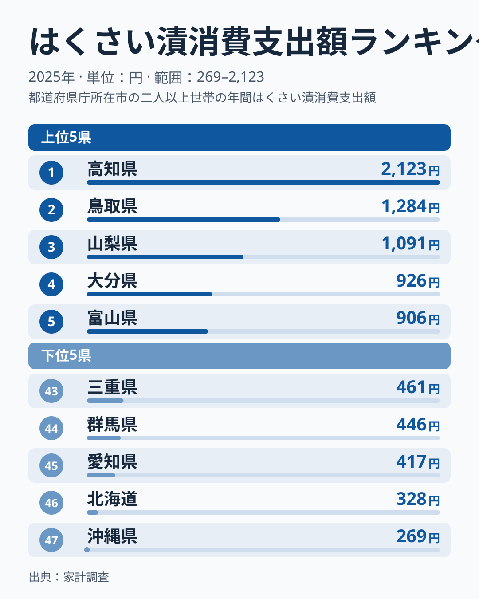
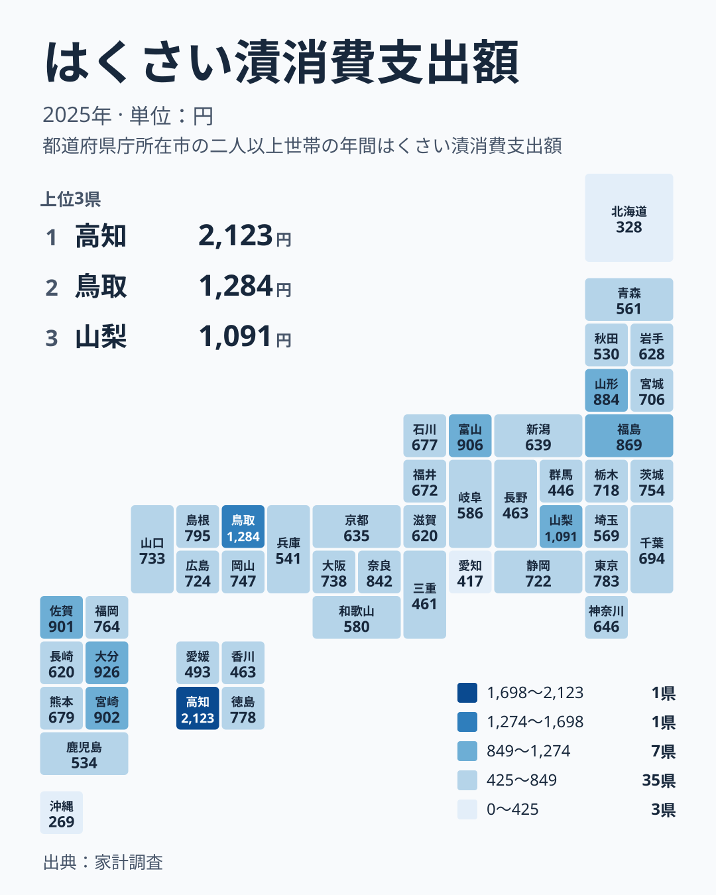

冬の食卓に欠かせない漬物といえば、はくさい漬を思い浮かべる方も多いはずです。ところが家計調査で2025年の支出額を見ると、47都道府県のあいだにはかなり大きな開きがありました。最も多い高知県は2,123円、最も少ない沖縄県は269円です。同じ漬物でも、暮らす土地によって家計での存在感が違うことがわかります。

この記事では、はくさい漬への支出を都道府県別に並べ、食文化や気候、産地との結びつきから差の背景を考えます。ただし、今回のデータは金額だけです。原因を断定できる材料はないため、背景に触れる箇所は仮説として書きます。たくあんや梅干しといった関連品目との対比にも触れます。

## 高知県が頭一つ抜けた2025年のランキング

まず、上位5県と下位5県を図で確認します。

<source-link href="/ranking/pickled-chinese-cabbage-consumption-expenditure">はくさい漬への支出ランキングをもっと見る</source-link>

図で注目したいのは、順位ごとの間隔が均等ではないことです。1位の高知県は2,123円、2位の鳥取県は1,284円、3位の山梨県は1,091円でした。1位と2位のあいだの開きは、2位と3位のあいだの開きよりずっと大きく、高知県だけが別の水準にいます。2位以下は、1,284円、1,091円、926円、906円と、段階的に下がっていきます。

4位の大分県は926円、5位の富山県は906円です。この先を見ると、6位の宮崎県は902円、7位の佐賀県は901円と、5位から7位までは数円刻みで並びます。5位までを上位として切ると境目がはっきりして見えますが、実際には5位の前後で水準はほとんど変わりません。図の「上位5県」という区切りは、見やすさのためのものと考えてください。

下位側は、最下位の沖縄県が269円、46位の北海道が328円です。45位の愛知県は417円で、46位の北海道とのあいだにも段差があります。下位5県には、このほか44位の群馬県が446円、43位の三重県が461円で入っています。上位が各地に点在していたのと同じく、下位も北海道・東北、関東、中部、近畿、九州・沖縄にまたがり、特定の地方に固まってはいません。

> [!NOTE]
> ここでの金額は、家計調査における「はくさい漬」への消費支出額で、単位は円、対象年は2025年です。調査に協力した世帯の購入金額を基にした値で、県民全体の消費量を表すものではありません。数量ではなく金額である点にも注意してください。

## 食文化と気候から読む消費の差

はくさい漬は、冬に収穫した白菜を塩で漬けて食べる保存食の流れをくむ食品です。寒い時期に野菜を長持ちさせる知恵として根づいてきたため、冷涼な地域ほど多く食べられていそうだと考えたくなります。

けれども2025年の結果は、その予想とは少し違いました。寒さが厳しい北海道は46位の328円にとどまっています。一方、温暖なイメージのある高知県が1位です。単純に「寒い県ほど漬物にお金を使う」とは言えないことが、データからはうかがえます。

背景として考えられる仮説の一つは、日常の食事での漬物の位置づけです。ご飯のお供や酒の肴として、食卓に漬物を添える習慣が強い県では、支出が大きくなるのかもしれません。もう一つは自家製との関係です。白菜を自宅で漬ける家庭が多い地域では、店で買うはくさい漬の支出は小さく出るはずです。ただし、これらを裏づける数値は今回のデータにありません。支出額が少ない県を「食べていない県」と読むことは避けたほうがよいでしょう。

> [!TIP]
> 463円で並ぶ香川県と長野県は、42位と41位に分かれています。同額でも順位が1つずれる例です。順位の差よりも、金額そのものの近さを見る習慣をつけると、小さな順位の違いに振り回されません。

## 地理分布でみる、同じ地方でも割れる順位

次に、47都道府県の分布をタイルマップで確認します。

この地図から読み取れる要点は一つです。濃淡は地方ごとにまとまらず、同じ地方のなかで順位が大きく割れています。隣り合う県同士でも、水準がかなり違います。

代表的なのが四国です。高知県は2,123円で1位ですが、同じ四国の香川県は463円で42位でした。徳島県は778円で13位、愛媛県は493円で40位です。1つの地方に、全国1位と下位寄りの県が同居しています。

関東でも同じことが言えます。東京都は783円で12位ですが、群馬県は446円で44位でした。九州・沖縄は、大分県が926円で4位、沖縄県が269円で47位です。地方という大きなくくりでは、はくさい漬への支出の差はほとんど説明できません。県ごとの個性が強く出る品目だといえます。

## 鳥取県はなぜ2位なのか、データから言えること

2位の鳥取県は1,284円でした。中国地方のほかの県を見ると、島根県が795円で11位、岡山県が747円で16位、山口県が733円で18位、広島県が724円で19位です。鳥取県の高さは、中国地方全体の傾向ではなく、この地方のなかで際立っています。1,091円の山梨県でさえ、鳥取県には届いていません。

ここから言えるのは、鳥取県の値は地理的な近さでは説明しにくいという点です。隣の島根県とも大きく離れているため、気候や地方の食習慣だけでなく、県内の購入先や家庭ごとの買い方といった、より局所的な事情が関わっている可能性があります。これも仮説で、今回のデータで確かめられるわけではありません。

高知県についても同様です。2位以下と大きく離れているのは確かですが、単年の標本調査の結果なので、翌年も同じ水準が続くかはこのデータからはわかりません。気になる方は、[高知県のデータ](/areas/39000)と[鳥取県のデータ](/areas/31000)で、ほかの指標と合わせて見てみてください。

## 産地・流通と近隣品目との対比

支出額の違いには、産地や流通の事情も影響すると考えられます。白菜は各地で栽培されており、地元産の野菜を使った漬物が店頭や産直に並びやすい地域では、買って食べる習慣が育ちやすいでしょう。山梨県の1,091円や富山県の906円には、そうした地元の漬物文化が関わっているのかもしれません。ただし、産地との因果関係を示す数値は今回のデータにないため、あくまで仮説です。

九州では、大分県が926円で4位、宮崎県が902円で6位、佐賀県が901円で7位と、上位に3県が並びました。福岡県も764円で14位です。一方、熊本県は679円で24位、長崎県は620円で32位、鹿児島県は534円で38位、沖縄県は269円で47位でした。

関連品目との対比も大切です。漬物には、たくあんや梅干し、キムチ、浅漬けなど多くの種類があり、地域によって好まれるものが異なります。はくさい漬の支出が少ない県は、漬物全体への関心が低いとは限らず、別の品目に好みが寄っているだけかもしれません。この記事のデータははくさい漬だけなので、他の品目との差は数値では示せません。関連する統計は、[同じカテゴリの統計一覧](/category/economy)から探せます。

> [!WARNING]
> 「はくさい漬」の範囲は、たくあんや浅漬けなど他の漬物とどう区分されるかで変わります。分類の境目にある商品は、はくさい漬に入る場合と別の漬物に入る場合があり、県によって買う商品が違えば順位にも影響しえます。また、6位の宮崎県は902円、7位の佐賀県は901円で、差はわずかです。この程度の差は、順位の優劣というより同水準と読むべきです。

## 中位の混み具合と、順位の読み方

中位にも目を向けます。10位の奈良県は842円、11位の島根県は795円、12位の東京都は783円、13位の徳島県は778円、14位の福岡県は764円でした。このあたりは700円台後半から800円台前半に県が密集しており、わずかな金額の差で順位が入れ替わります。

東北では、山形県が884円で8位、福島県が869円で9位と上位に入りました。一方で宮城県は706円で22位、岩手県は628円で30位、青森県は561円で36位、秋田県は530円で39位です。東北も、上位の県と下位寄りの県が混在しています。

こうして見ると、はくさい漬への支出は、1位の高知県と2位の鳥取県が突出し、その後に山梨県、大分県などが続き、中位は密集し、下位に北海道や沖縄県が並ぶ構図です。順位だけを見て「この県は多い、この県は少ない」と判断するのは避け、金額の近さと、同じ地方内でも割れる散らばりを合わせて読むのがおすすめです。

## データについて

この記事で使った指標の正式名称は「はくさい漬消費支出額」で、出典は家計調査、対象年は2025年、単位は円です。本文では読みやすさのため「はくさい漬への支出」と表記しました。値は調査で得られた金額をそのまま掲載しており、独自の加工や推計は加えていません。

はくさい漬への支出は、気候だけでは説明しきれない、県ごとの食習慣や買い方の違いを映しています。高知県と鳥取県の高さ、そして沖縄県や北海道の低さは、それぞれの暮らしのなかで漬物が占める位置の違いを考えるきっかけになります。
