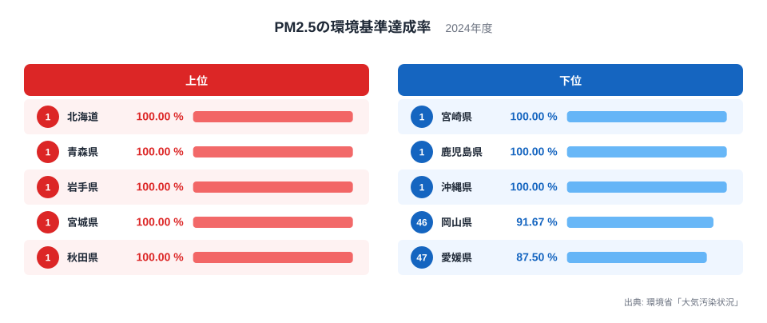
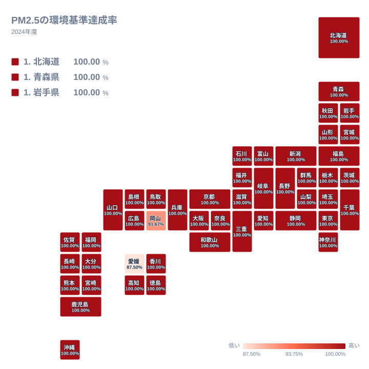

## 45都道府県が100%、届かなかったのは2県

PM2.5の環境基準達成率が最も高い県はどこでしょうか。2024年のデータで見ると、答えは1つに絞れません。1位の北海道から45位の沖縄県まで、45の都道府県がすべて100%で並びました。

その一方で、46位の岡山県は91.667%、47位の愛媛県は87.5%でした。100%と愛媛県の87.5%との差は12.5ポイントです。実データにある最大と最小の比は、100%を87.5%で割った関係になります。順位表の大半が同じ値になる、読み方に工夫がいる指標です。

この記事では、同値が並ぶ結果をどう読めばよいか、そして下位2県の値から何が言えて何が言えないかを、地理の面から整理します。ほかの環境・安全の指標は[同じカテゴリの統計一覧](/category/safetyenvironment)からも確認できます。

> [!NOTE]
> この指標は、県内の観測局ごとに環境基準を満たしたかどうかを判定し、基準を満たした局の割合を県単位で示したものです。つまり濃度の高低ではなく「基準を満たした局の割合」です。100%は県内の観測局がすべて基準を満たしたことを表し、濃度が低いことまでは意味しません。同率の順位は並び順にすぎず、1位と45位に優劣はありません。

## 上位と下位を並べて見る

まずは上位5県と下位5県を図で確認します。

<source-link href="/ranking/pm25-general-station-compliance-rate">PM2.5の環境基準達成率ランキングをもっと見る</source-link>

図で注目したいのは、上位と下位の顔ぶれの違いではありません。45県が同じ100%で、差があるのは岡山県と愛媛県の2県だけという点です。下位5県の中にも、宮崎県、鹿児島県、沖縄県は100%で含まれています。

この指標では、順位の数字よりも「満点から外れた県はどこか」を探すほうが実態に近い読み方になります。2024年時点では、多くの県が基準を満たしたというのが全体像です。

> [!TIP]
> 同値が並ぶ指標では、順位ではなく値そのものを見ます。まず100%未満の県を探し、次にその値が何を意味するかを考えると、数字を読み違えにくくなります。

## 地図で見る分布:違う色は中国と四国の1県ずつ

次に、地理的な広がりを地図で見てみましょう。

地図は、ほぼ全域が同じ色になります。違う色になるのは、中国地方の岡山県と四国地方の愛媛県の2県です。2県は瀬戸内海を挟んで対岸に位置しています。

地方ごとに見ると、北海道・東北の北海道、青森県、岩手県、宮城県、秋田県、山形県、福島県は、すべて100%でした。関東では東京都と神奈川県を含む7都県が100%で、近畿の大阪府や兵庫県、中部の愛知県も100%です。人口が集まる大都市圏を含む地域でも、未達成の県は出ていません。したがって、北か南か、大都市か否かといった単純な区分では、この結果は説明できません。

中国地方の中でも、鳥取県、島根県、広島県、山口県は100%です。四国でも徳島県、香川県、高知県は100%でした。同じ地方、同じ海域に面した県でも結果が分かれているため、地理的な近さだけで2県を一括りにはできません。

北端の値は[北海道のデータ](/areas/01000)、続く本州北部は[青森県のデータ](/areas/02000)で詳しく見られます。

## 下位2県をどう読むか

岡山県と愛媛県はなぜ100%に届かなかったのでしょうか。結論から言うと、この記事で使える2024年の都道府県別の値と順位だけでは、理由を特定できません。

考えられる仮説はいくつかあります。たとえば、気象の年ごとの違い、海を渡って運ばれる大気の影響、観測局の置かれた場所の特性などです。ただし、いずれも本記事のデータからは裏付けられません。工場や産業の集積との関係も同様で、愛知県、大阪府、福岡県のように製造業の集積が大きい県でも100%の県はあります。産業構造だけで説明できるとは言えません。

一方で、値の刻みには読み取れることがあります。91.667%は12分の11、87.5%は8分の7と表せる数値です。もし県内の観測局が12局のうち11局、あるいは8局のうち7局が基準を満たしたとすれば、この値になります。ただし局数は実データにないため、これは「分母が小さいとこの刻みになり得る」という仮説にとどまります。

仮にこの見方が当たっていれば、1局の結果が県全体の率を大きく動かします。達成率の数字は、観測局が少ない県ほど1局の影響を受けやすい点に注意が必要です。

> [!WARNING]
> この記事のデータは2024年の1年分だけです。年ごとの変化は読み取れず、岡山県と愛媛県の大気環境が継続して悪いとも、一時的なものだとも判断できません。観測局の数や配置が県ごとに異なる点にも注意が必要です。

## 数字を読み違えないために

この指標を見るときの要点を整理します。

- 45の都道府県が100%で、100%未満は2県だけです
- 46位の岡山県は91.667%、47位の愛媛県は87.5%です
- 100%と87.5%の差は12.5ポイントです
- 未達成の理由は、本記事のデータからは特定できません

2024年の結果は、多くの県で基準が満たされた年だったことを示しています。そのうえで、岡山県と愛媛県の値の背景を知るには、観測局ごとの測定結果や年ごとの推移、気象条件など、別の資料を組み合わせて調べる必要があります。

単年の順位だけで県の優劣を語るのではなく、満点から外れた県がどこかを確かめ、その値が何を測っているのかを理解したうえで読むことが、この指標の数字を正しく活かす近道です。

## データについて

この記事のデータは、環境省「大気汚染状況」に基づく2024年の「PM2.5の環境基準達成率」です。単位は%で、全47都道府県の値を使っています。達成率は、都道府県内の観測局のうち環境基準を満たした局の割合として示されます。観測局の数や配置は県ごとに異なるため、比較する際は、率の刻みが分母の大きさに左右される点に留意してください。
