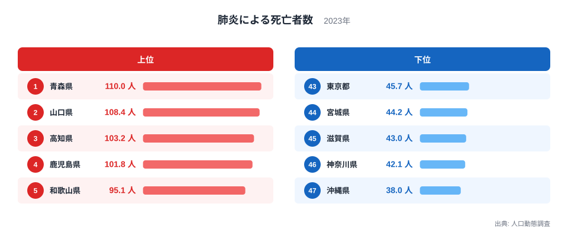
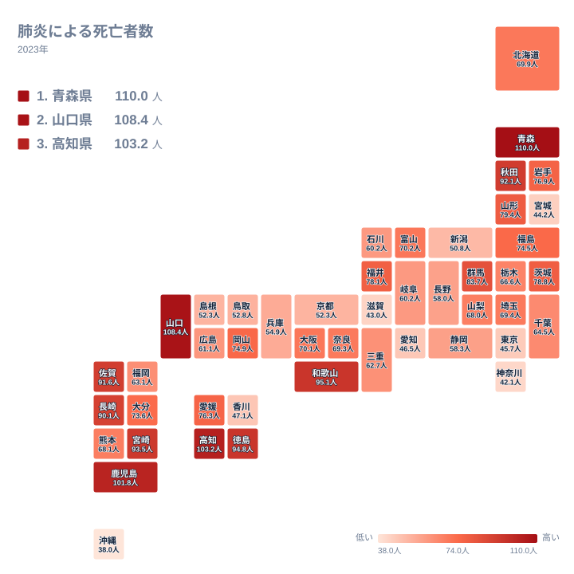

## 肺炎の死亡者数は県によってどれほど違うのか

肺炎は、高齢者にとって身近でありながら命に関わる病気です。2023年の人口動態調査で都道府県を並べると、最も多いのは青森県の110人、最も少ないのは沖縄県の38人でした。最大と最小の比は約2.9倍にあたり、同じ日本に暮らしていても、肺炎による死亡の水準には大きな開きがあります。

この記事の数値は単位が「人」で、小数点以下まで示されています。単純な死亡者の実数であれば小数は出ないため、人口規模などをそろえた値である可能性はありますが、手元のデータからは算出方法を確認できません。人口の多い県が上位に並ぶわけではなく、東京都は43位、神奈川県は46位にとどまっています。この点は、数字の読み方を考えるうえで手がかりになります。

> [!NOTE]
> 本文で扱う「肺炎による死亡者数」は、人口動態調査に基づく2023年の値で、単位は人です。小数を含むため、死亡者の実数そのものではなく、何らかの調整を経た値と見られますが、人口あたりの換算方法や年齢構成の調整の有無は、手元のデータでは確認できません。他の統計の「人数」と同じ感覚で足し合わせたり、実数と混同したりしないよう注意してください。

この記事では、データから確認できることと、背景として語られる仮説とを分けて整理します。まず上位と下位の顔ぶれを図で確認します。

<source-link href="/ranking/pneumonia-death-rate">肺炎による死亡者数ランキングをもっと見る</source-link>

## 上位と下位に見える分布の形

図を見て最初に気づくのは、上位の中でも先頭の4県が突き抜けている点です。青森県、山口県、高知県、鹿児島県は100人を超えていますが、5位の和歌山県は95.1人で、そこに一段の差があります。上位の先頭は、わずかな差で横並びというより、少数の県が高い位置に固まった形です。

一方、下位は45.7人の東京都から38人の沖縄県まで、40人台前半を中心に狭い範囲へ密集しています。最下位の沖縄県が38人と最も低く、下位5県の間の差は上位に比べて小さく見えます。上位は裾が長く伸び、下位は詰まっている、という非対称な分布です。

顔ぶれを地方で見ると、上位5県は北海道・東北の青森県、中国の山口県、四国の高知県、九州・沖縄の鹿児島県、近畿の和歌山県と、5つの地方に1県ずつ分かれます。下位5県も、関東の東京都と神奈川県、北海道・東北の宮城県、近畿の滋賀県、九州・沖縄の沖縄県と、地方をまたいでいます。つまり、地方単位では高低をきれいに説明できません。

## 上位10県の地方別の内訳

上位10県まで広げて数えると、北海道・東北が青森県と秋田県の2県、中国が山口県の1県、四国が高知県と徳島県の2県、九州・沖縄が鹿児島県、宮崎県、佐賀県、長崎県の4県、近畿が和歌山県の1県です。合計は10県で、西日本の県が8県、東北の県が2県という内訳になります。

西日本に偏りはあるものの、前節で見たとおり、上位5県の段階では地方がばらけています。「東日本か西日本か」の二分では説明しきれず、西日本に多めという程度の偏りがある、というのが実データから言える範囲です。関東は上位10県に1県も入っていません。

ここから先は、データでは確認できない背景の話です。高齢化が早く進んだ県が多いことや、冬の寒さ、医療機関までの距離といった要因が、一般には肺炎による死亡の多さと結びつけて語られます。ただし、今回手元にあるのは各県の値と順位だけで、年齢構成や気温、医療体制を示す数値はありません。どれがどの程度効いているのかは、このデータだけでは特定できません。

詳しくは [青森県のデータ](/areas/02000) や [山口県のデータ](/areas/35000) で、他の指標とあわせて確認できます。

> [!WARNING]
> 順位は2023年1年分の値で決まっています。肺炎による死亡は冬季の流行などで年ごとに変動しやすく、1年だけで「その県は恒常的に高い」とは言えません。また、死因は死亡診断書の記載に基づいて分類されるため、診断や記載の慣行の違いが数値に混じる可能性があります。原因を断定する材料にはなりません。

## 下位に都市部と沖縄県が並ぶ姿

下位には、東京都、神奈川県、愛知県といった大都市圏の県が並びます。41位の香川県が47.1人、42位の愛知県が46.5人と、下位の水準は連なって見えます。都市部で低い傾向と整合的ではありますが、都市であることが原因だと言い切る根拠はこのデータにはありません。

最下位の沖縄県は38人で、2位の神奈川県の42.1人よりさらに低い位置にあります。沖縄県は年齢構成が若い県として知られていますが、今回のデータに年齢の数値はないため、それが理由かどうかは確かめられません。気候や医療体制についても同様で、温暖な気候が影響するかもしれない、都市部は医療機関が多く早く受診できるかもしれない、といった仮説にとどまります。

宮城県は44位の44.2人で、北海道・東北の中では最も低い位置にあります。同じ地方の青森県が1位、秋田県が8位であることと比べると、地方内の差が大きいことが分かります。仙台市を抱える県であることとの関係は、都市部で低い傾向と整合的という程度に受け止めるのが妥当です。

次に、地理的な広がりを地図で見てみます。

## 地図で見る隣接県どうしの差

地図で見て際立つのは、隣り合う県でも色が大きく違う例が少なくないことです。九州では、4位の鹿児島県や10位の長崎県と、29位の福岡県が同じ地方に入っています。福岡県と、隣の佐賀県の9位とを比べると、順位で20位も離れています。

東北でも同じ構図が見られます。1位の青森県から44位の宮城県まで、同じ北海道・東北の中に高い県と低い県が混在しています。関東も、11位の群馬県と43位の東京都、46位の神奈川県で大きく分かれます。都道府県の境界を一つ越えるだけで、水準が大きく変わることがあるわけです。

この様子から、地域の気候や地形のような広い範囲で共通する要因だけでは、全体を説明しきれないことが示唆されます。もちろん、県庁所在地の規模や高齢者の割合など、県ごとの違いが関わっている可能性はありますが、それを裏づける数値は今回の範囲にはありません。地図は、背景を探る問いを立てる出発点として使うのが適切です。

## 数字を読むときの注意と見方

この統計から確実に言えるのは、2023年時点で青森県が最も高く沖縄県が最も低いこと、上位に西日本の県が多めに入っていること、都市部の県が下位に多いことです。ただし、順位の差が小さい中位の県どうしでは、順位が一つ違っても実質的な差はわずかです。たとえば石川県と岐阜県はともに60.2人で、京都府と島根県もともに52.3人です。

> [!TIP]
> 順位だけで判断せず、実際の値の間隔を見るのが読み解きのコツです。中位は60人台から70人台に多くの県が詰まっているため、数位の違いは誤差に近い場合があります。一方、上位の先頭4県と下位の端では間隔がはっきり開いています。差が大きい両端に注目し、中位は「ほぼ同水準」と受け止めると誤読しにくくなります。

また、ご自身の県の位置を確かめるときは、全国の分布の中でどこに当たるかとあわせて、隣接県との差も見てください。人口や年齢構成の傾向を合わせて確認したい場合は、[同じカテゴリの統計一覧](/category/population) から関連する指標を探すと、背景の理解が深まります。

## データについて

使用した統計は、人口動態調査の「肺炎による死亡者数」で、対象年は2023年、単位は人です。値は都道府県別に整理されており、全47件が比較の対象です。

小数を含む値であることから、人口規模などをそろえた値である可能性がありますが、算出方法は手元のデータでは確認できません。年齢構成の違いが調整されているかどうかも同様です。そのため、この記事では値と順位だけを根拠にし、原因に関わる記述は仮説として扱いました。

## まとめ

2023年の肺炎による死亡者数は、青森県の110人が最も多く、沖縄県の38人が最も少ない結果でした。比は約2.9倍で、上位の先頭は100人を超える4県が抜け、下位は40人台前半に詰まる非対称な形をしています。

上位10県には西日本の8県と東北の2県が入りますが、上位5県は地方がばらけており、地方単位の説明には限界があります。地図では隣接県どうしでも差が大きく、背景には県ごとの複数の事情が重なっていると推測されます。数字は1年分で原因の特定はできないため、断定は避けつつ、自分の県と周辺の位置を確かめてみてください。
