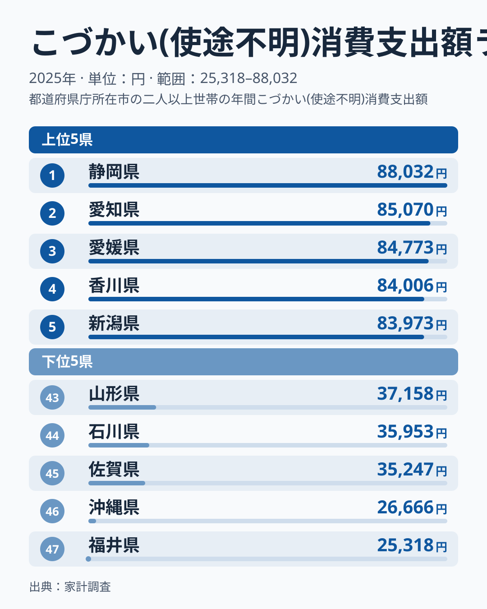
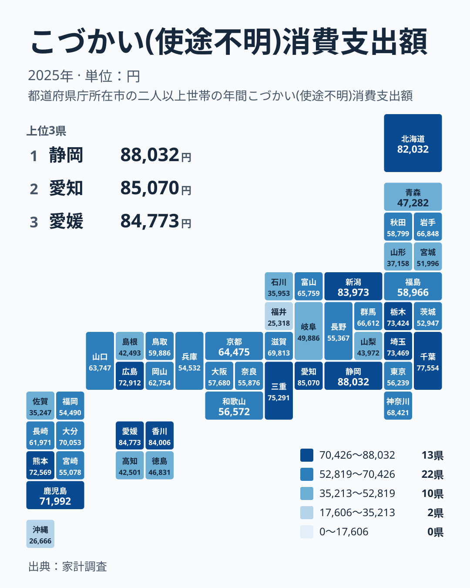

家計簿をつけていても、最後まで行き先がわからないお金があります。家計調査では、こうした支出が「こづかい(使途不明)」として集計されています。ちょっとした付き合いの出費や、世帯員に渡されたこづかいなどが、その中に入ります。

この支出が年間でどれくらいになるかは、県によって大きく違います。2025年のデータでは、1位の静岡県が88,032円、47位の福井県が25,318円でした。この記事では、順位の並びを確かめたうえで、金額の裏にある「記録されなかったお金」という性質を手がかりに、暮らしへの含意を考えます。

> [!NOTE]
> ここで扱う「こづかい(使途不明)」は、家計簿で使い道を特定できなかった支出と、世帯員に渡されたこづかいをまとめた項目です。食費や住居費のように品目がはっきりした支出ではありません。金額が大きいことは、使い道を説明できないお金が多く残ったことを示すだけで、ぜいたくの度合いを示すものではありません。

## 静岡県が1位、福井県が47位という大きな開き

まず全体像を確認します。次の図は、2025年の上位5県と下位5県を並べたものです。

<source-link href="/ranking/pocket-money-group-consumption-expenditure">こづかい(使途不明)への支出ランキングをもっと見る</source-link>

上位は、静岡県が88,032円で1位、愛知県が85,070円で2位、愛媛県が84,773円で3位、香川県が84,006円で4位、新潟県が83,973円で5位です。1位の静岡県と5位の新潟県の差は4,059円で、上位5県は近い水準に固まっています。6位の北海道も82,032円で、80,000円台に入るのは、この5県に北海道を加えた6県です。

下位は、福井県が25,318円で47位、沖縄県が26,666円で46位、佐賀県が35,247円で45位、石川県が35,953円で44位、山形県が37,158円で43位です。1位の静岡県と47位の福井県を比べると、約3.5倍の開きがあります。同じ全国の家計でも、この項目では水準がまるで違います。

上位には愛知県や静岡県のような工業の盛んな県だけでなく、愛媛県、香川県、新潟県、北海道も入っています。一方、東京都は29位で56,239円、大阪府は27位で57,680円と、どちらも中位です。大都市かどうかという一本の線では並んでいないことが、数字から読み取れます。

## 地図で見ると、同じ地方の中でも散らばる

次に、都道府県の位置関係を見ます。

地図を見ると、はっきりした一つの塊は見えにくいことがわかります。ここでは、本稿の地方区分に従って見ます。中部は新潟県、富山県、石川県、福井県、山梨県、長野県、岐阜県、静岡県、愛知県の9県です。この中に、静岡県の1位、愛知県の2位、新潟県の5位がある一方、福井県は47位、石川県は44位、山梨県は40位です。同じ中部の中に、全国の最上位と最下位の両方が入っています。

近畿では、三重県が8位で75,291円、滋賀県が15位で69,813円と上位から中位に入ります。一方、和歌山県は28位、奈良県は30位、兵庫県は33位で、中位から下位寄りに並びます。四国では、愛媛県が3位、香川県が4位と上位に並びますが、徳島県は39位、高知県は41位です。同じ四国でも、位置が大きく分かれています。

九州・沖縄では、熊本県が12位、鹿児島県が13位、大分県が14位と中位より上に入る一方、佐賀県は45位、沖縄県は46位です。この図から言えるのは、地方という大きなくくりで傾向を語るのは難しいということです。静岡県と愛知県の他の指標は、[静岡県のデータ](/areas/22000)と[愛知県のデータ](/areas/23000)で並べて確認できます。

> [!WARNING]
> この指標の数字は「実際に使った額」ではなく、「家計簿に使い道が書かれなかった額」を含みます。記入の習慣、書き忘れ、現金で払ったか電子的に払ったかによって、同じ支出でも使途不明に入るかどうかが変わります。そのため、支出の多さと記録されなかった額の多さは、切り分けて読む必要があります。

## 数字の裏にあるもの:記録されなかったお金という視点

使途不明のこづかいは、中身がわからないお金の合計です。そのため、「なぜ多いのか」を実データだけで断定することはできません。この記事のデータには、世帯の人数も、交際費の内訳も、収入も含まれていないからです。ここからは、仮説として考えられる切り口を挙げます。

一つ目は、付き合いや贈答の違いです。家計調査の「その他の消費支出」には交際費や仕送り金が含まれます。こうした支出の地域差は、親族や地域とのつながりの強さ、世帯の所得、年齢構成などで説明されることがあります。親族や近所との付き合いが多い県では、現金のやり取りが多くなる可能性があります。ただし、これは仮説にすぎず、本記事のデータで確かめられるものではありません。

二つ目は、世帯の構成です。複数人で暮らす世帯では、家族へ渡すこづかいが含まれるため、金額が大きくなる可能性があります。単身世帯が多い地域では、その分が小さくなるかもしれません。東京都が29位であることと世帯構成を結びつけたくなりますが、東京都の世帯構成はこの記事のデータにないため、関係があるかどうかは言えません。

三つ目は、支払い方法や記帳の習慣です。現金払いが多ければ、使い道が記録から抜け落ちやすいかもしれません。逆に、口座引き落としや電子決済が多ければ、使い道が残りやすいと考えられます。これも仮説であり、県ごとの違いを裏づけるデータは、ここにはありません。

> [!TIP]
> 順位の高低を、県民の気風や暮らしぶりの評価として読まないことが、この指標を使うコツです。1年分の標本調査の平均値なので、上位と下位の大きな開きは参考になりますが、近い順位同士の違いに意味を持たせるのは避けてください。まず、同じ県の数字が年ごとにどう動くかを確かめると安心です。

## 暮らしにどう響くのか:数字を自分の家計に引き寄せる

生活への含意として、まず押さえたいのは、この項目は見直しの手がかりが得にくい支出だということです。静岡県の88,032円は、年間に何度も出ていく少額の現金の合計かもしれません。1回ずつは小さくても、積み重なれば家計の中で無視できない金額になります。使い道がわからないため、節約の対象にもなりにくいのが難しいところです。

反対に、福井県の25,318円や沖縄県の26,666円のように低い県では、使い道が記録に残りやすい家計が多いのかもしれません。ただし、これも断定はできません。この数字だけでは、お金の出入りが少ないのか、記録が細かいのか、区別できないからです。大切なのは、金額の大小をそのまま善し悪しに結びつけないことです。

自分の家計に引き寄せるなら、次の三つが手がかりになります。

- 財布から出た現金は、その日のうちにメモかアプリで記録する
- 家族のこづかいは、あらかじめ月額を決めて渡す
- 付き合いの出費は、年間の予算を先に決めておく

使途不明の支出を減らすには、使い道を見える形にすることが第一歩です。同じ[同じカテゴリの統計一覧](/category/economy)に並ぶ指標と合わせて見ると、県ごとの家計の特徴がより立体的になります。食費や住居費など、品目がはっきりした項目と比べると、この項目の「見えにくさ」がいっそう際立ちます。

## 近い県でも位置が分かれる意味

ここまでの確認から、新しくわかることが一つあります。静岡県と愛知県が上位に並ぶ一方で、同じ中部に属する福井県、石川県、山梨県が下位に入ることです。さらに四国でも、愛媛県と香川県が上位、徳島県と高知県が下位に分かれます。つまり、隣り合う県で同じ傾向が出るとは限りません。

そのため、自分の県の数字を読むときは、近隣の県の傾向に引きずられず、自分の県の順位と金額を直接見るのがよいでしょう。そのうえで、自分の家計の中に、行き先が見えにくいお金がどれくらいあるかを確かめてみてください。

## データについて

この記事で使った指標は、家計調査の「こづかい(使途不明)消費支出額」です。出典は家計調査で、対象年は2025年、単位は円です。全国47都道府県の値が公表されています。

家計調査は、世帯を抽出して家計簿をつけてもらう標本調査です。そのため、数値は県全体の実態そのものではなく、調査世帯の平均として読む必要があります。また、こづかい(使途不明)は、使途を特定できなかった支出と世帯員へのこづかいを合わせた項目で、品目の明確な支出とは性質が異なります。地方の区分は、本稿では北海道・東北、関東、中部、近畿、中国、四国、九州・沖縄の7区分を使っています。
