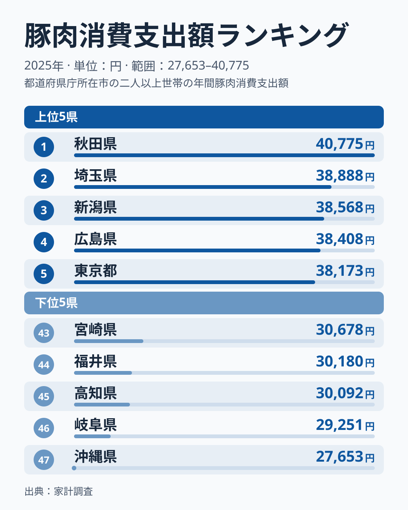

家計の豚肉支出を都道府県別に見ると、1位が頻繁に入れ替わります。2025年に最も多かったのは秋田県の40,775円で、最も少ない沖縄県の27,653円との差は13,122円、倍率にして1.47倍でした。ところが秋田県は2024年には10位で、2023年の3位から一度順位を落としたばかりです。

2007年から2025年までの19年分を並べると、1位になった県は新潟・埼玉・福島・神奈川・東京・秋田の6県にのぼります。豚肉の消費は「どこが好きか」という固定した地域性だけでは説明できません。標本調査である以上、年ごとの調査のぶれが混ざっている可能性が高いものの、データだけではぶれと実際の変化を切り分けられません。この記事では、2025年の順位を確認したうえで、ぶれる県と、複数年で上位に入る頻度が高い県を見分けます。

## 2025年ランキング——上位5県と下位5県

上位5県は秋田・埼玉・新潟・広島・東京の順です。1位の秋田県は40,775円で、2位の埼玉県の38,888円とは1,887円差、5位の東京都は38,173円でした。下位5県は沖縄・岐阜・高知・福井・宮崎で、最下位の沖縄県は27,653円、2番目に低い岐阜県は29,251円です。

目を引くのは、順位の間隔の狭さです。3位の新潟県は38,568円、20位の大阪府は35,192円で、その間の差は3,376円しかありません。47県の中央値は24位の熊本県の34,706円です。真ん中あたりは数百円の違いで順位が入れ替わるため、上位と下位の端を除くと、1つ順位が違うことにはほとんど意味がありません。

> [!NOTE]
> 本データは総務省「家計調査」の2025年(暦年)で、都道府県庁所在市の二人以上世帯が1世帯あたりに年間で支出した豚肉の金額です。県全体の平均や個人の消費額ではありません。市の中で購入する量や、値段の高い部位を選ぶかどうかも金額に混ざります。

<source-link href="/ranking/pork-consumption-expenditure">豚肉消費支出額の全47都道府県ランキングを見る</source-link>

上位10県には、秋田・埼玉・新潟・広島・東京・京都・千葉・神奈川・岡山・山梨が入りました。このうち4県を関東が占め、埼玉・東京・千葉・神奈川です。ただし、関東の中でも茨城は40位、群馬は41位で、同じ地方でも順位は大きく離れています。下位10県には三重・大分・茨城・群馬・岩手・宮崎・福井・高知・岐阜・沖縄が並び、地方でひとまとめにして語れる並びではありません。

## 頻繁にトップが替わる——19年の1位を並べると

2007年から2025年までの1位を順に見ると、新潟県と神奈川県が各5回、埼玉県が4回、福島県が3回、東京都と秋田県が各1回でした。新潟県の首位は2007年、2010年、2019年、2022年、2024年で、神奈川県は2012年、2013年、2015年、2016年、2020年です。連覇があるのは神奈川の2012年から2013年と2015年から2016年だけで、2年連続で首位に立ったのは19年間で2度しかありません。

> [!WARNING]
> 家計調査は都道府県庁所在市を対象にした標本調査で、年ごとに調べられる世帯が変わります。このため、1年の順位には標本のぶれが混ざっている可能性が高く、県の実態が変わっていなくても順位が動くことがあります。ただし、順位の変化が標本のぶれによるのか実際の変化によるのかは、このデータだけでは切り分けられません。前年比較で順位が10以上動いた県は2024年から2025年で16県あり、2007年から2025年までの846件の前年比較でも275件に上りました。1位や最下位を県の性格として読むのは避けてください。

では、順位が大きく動かない県はあるのでしょうか。埼玉県は19年のうち14年で上位5県に入り、18年で上位10県に入って、最も低い年でも11番目でした。新潟県も14年で上位5県、17年で上位10県に入っています。東京都も16年で上位10県に入りました。これらの県は、複数年で上位に入る頻度が高い県と言えます。ただし、単年ごとの順位には標本調査のぶれが含まれるため、豚肉への支出水準そのものが高いと断定はできません。

一方、順位の振れが大きい県もあります。秋田県は19年の間に1位から33位まで動きました。2021年以降は10位、6位、3位、10位、1位と5年続けて上位10県に入っています。この5年のうち上位5県に入ったのは2023年の3位と2025年の1位の2回です。この変化が調査のぶれなのか、食べ方の変化なのかは、このデータだけでは断定できません。[仮説]として、2021年以降の値の水準が変わった可能性があります。検証は、同じ指標の2026年分が公開されたときに、秋田県が上位10県にとどまるかで行えます。

2024年の1位だった新潟県は、2025年は3位に下がりました。それでも値は38,568円で、前年の38,809円との差は241円にとどまります。順位は2つ下がったものの、金額はほとんど変わっていません。順位だけを追うと大きな変化に見えても、金額で見るとぶれの幅が小さいことがあります。

## 岡山と茨城——順位が動く県の読み方

順位の動きが大きい県として、岡山県と茨城県を並べます。岡山県は2007年に42位で19,931円でしたが、2025年は9位の37,525円です。金額は19年で1.88倍になり、47県の単純平均が22,928円から34,499円へ1.50倍になった伸びを上回りました。

ただし、岡山の順位は一直線に上がったわけではありません。2015年以降の11年間でも、2016年の6位、2024年の3位と上位に入る一方で、2018年は38位、2020年は34位、2021年は39位まで下がっています。10位以内になったのは2015年、2016年、2024年、2025年の4回、30位以下になったのは3回です。値の水準は上がったと言えますが、その年の順位は標本の入れ替わりで上下にぶれている可能性があります。

茨城県は反対側から見えます。2007年は19位で23,552円、2010年には11位まで上がりましたが、2021年は44位、2024年は47位で最下位になりました。2025年は31,934円と前年より3,573円増え、順位も40位に上がっています。茨城の金額は19年で1.36倍で、47県の単純平均の伸びである1.50倍を下回りました。平均ほど伸びなかったことが、19年を通した順位の低下と同時に起きていますが、年ごとの順位は上下しており、伸び率の差だけで順位の動きを説明することはできません。

こうした動きの理由として、岡山・茨城のどちらも、地元の食材の違いや世帯構成といった説明を思いつきます。しかし、このデータにはそれらを裏づける項目がありません。[仮説]として、魚介や鶏肉など豚肉以外の肉類の選ばれ方が影響した可能性があります。検証するには、同じ家計調査の魚介類・鶏肉の支出額を、県庁所在市別に並べて比べる必要があります。

> [!TIP]
> 豚肉では、金額の順位と量の順位を並べると県ごとの違いが見えます。2025年の豚肉消費量では新潟県が27,092gで1位、秋田県が25,813gで2位、岡山県は5位でした。新潟県は金額が3位、秋田県は金額1位、岡山県は金額9位で、いずれも量の順位と大きくは離れていません。茨城県は金額40位、量38位で、こちらも近い位置にあります。この4県では、金額の順位が高い県は量でも上位、低い県は量でも下位という並びでした。[豚肉消費量ランキング](/ranking/pork-consumption-quantity)とあわせて確認できます。

## 地域パターン——食文化の説明はどこまで言えるか

北陸を例に取ると、地方のくくりで読むことの難しさが見えます。新潟県は3位で38,568円ですが、富山県は16位の35,576円、石川県は34位の32,569円、福井県は44位の30,180円と、4県が上位から下位までほぼ全域に散らばっています。「北陸は豚肉を多く食べる」とは言えず、新潟が複数年で上位に入る頻度が高いという見方のほうが実態に合います。

新潟県は豚肉の支出は3位、消費量は2025年に1位でした。一方で[牛肉消費量ランキング](/ranking/beef-consumption-quantity)では、新潟県は47位の2,681gで最も少なく、1位の京都府の8,679gとは3倍強の差があります。新潟県は、肉の中でも豚肉に偏った食べ方をしていると読めます。これは[仮説]で、肉の購入先や調理の習慣が関係している可能性があります。検証するには、肉類の内訳を県庁所在市別に比較する必要があります。

九州・沖縄では、沖縄県が47位、宮崎県が43位、大分県が39位と下位に集まる一方で、長崎県は14位、福岡県は25位、熊本県は24位と中位から上位に分かれます。鹿児島県は32位です。ここでも一括りにすると外れる県が多く、「九州は鶏肉文化だから豚肉が少ない」といった説明は、一部の県にしか当てはまりません。食文化による説明は、順位が数年続けて同じ方向にずれる県に限って検討するのが安全です。

関東では、埼玉・東京・千葉・神奈川が上位10県に入り、栃木は23位、茨城は40位、群馬は41位でした。首都圏の都市部で金額が高いのは複数年に共通していますが、茨城・群馬が下位に回る理由は、このデータからは説明できません。[群馬の地域特性](/areas/10000)や[茨城の産業構造](/areas/08000)をあわせて見ると、背景を考える手がかりになります。

## まとめ

- **1位は秋田県の40,775円、最下位は沖縄県の27,653円**で、差は13,122円、1.47倍です。1位と2位の差は1,887円しかなく、順位の間隔は狭くなっています。
- **1位は19年で6県が入れ替わり**、2年連続で首位に立ったのは神奈川の2度だけです。1年の順位には、調査のぶれが混ざっている可能性が高いと考えられます。
- **埼玉・新潟・東京は19年を通じて上位に入る頻度が高く**、複数年で見ると上位の常連です。秋田は2021年から5年連続で10位以内で、水準が変わった可能性があります。
- **岡山は19年で金額が1.88倍、茨城は1.36倍**で、47県の単純平均の1.50倍との違いが、順位の高低と同時に起きています。
- **北陸4県は3位から44位に散らばり**、地方のくくりで食文化を断定するのは危険です。理由は[仮説]として扱い、複数年の値で確かめてください。

豚肉の支出は、金額の違いが小さいため、1年の順位から地域の性格を読むと外れやすい指標です。複数年で上位に入る頻度が高い県と、単年で入れ替わる県を見分けると、数字の意味が読み取れます。[経済カテゴリの指標一覧](/category/economy)では、家計の支出に関連する他の指標も確認できます。
