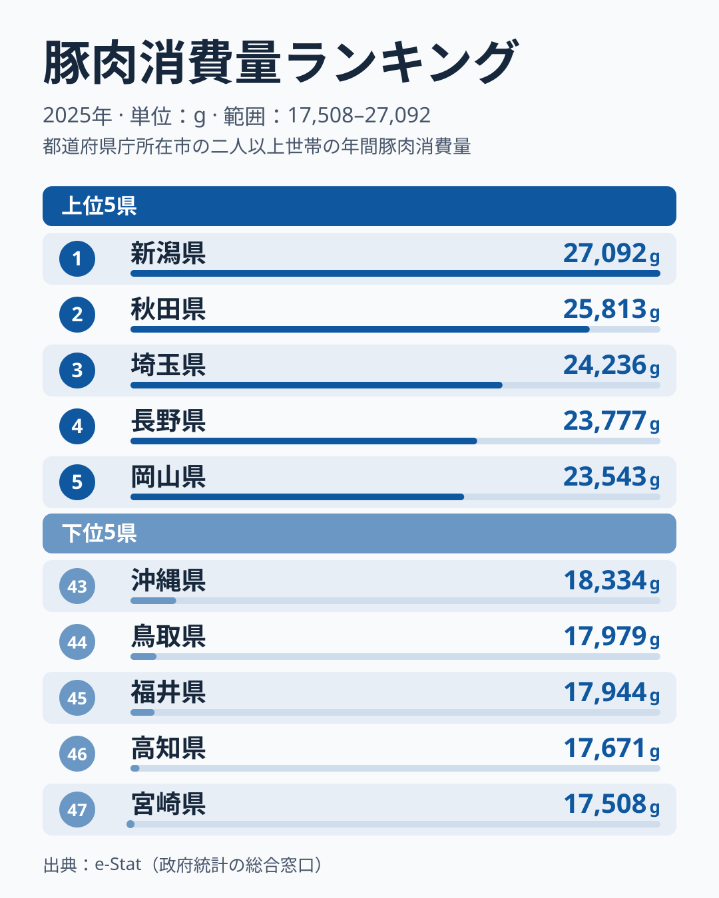

「米どころ新潟が、豚肉の購入量では全国トップ」——都道府県別の豚肉消費量データを見ると、この意外な事実が目に飛び込んできます。

総務省の家計調査（2025年）によると、都道府県庁所在市の二人以上世帯が1年間に購入する豚肉の量は、1位の新潟県は27,092g、最下位の宮崎県は17,508gで、約1.5倍の格差があります。しかも上位10県のうち9県が東日本に集中し、下位10県は西日本の県が多数を占めるという地域パターンが存在します。

この記事では、新潟が首位を保ってきた事実と、東西差を平均順位で確かめたうえで、東日本が高く西日本が低い背景として考えられることを、データで言える範囲と仮説に分けて整理します。

## 上位と下位：東西で分かれる豚肉消費

2025年の豚肉消費量上位5県と下位5県を見ると、地域の偏りが一目でわかります。

**上位5県**（2025年）：
1位・新潟県は27,092g、2位・秋田県は25,813g、3位・埼玉県は24,236g、4位・長野県は23,777g、5位・岡山県は23,543g

**下位5県**（2025年）：
43位・沖縄県は18,334g、44位・鳥取県は17,979g、45位・福井県は17,944g、46位・高知県は17,671g、47位・宮崎県は17,508g

1位の新潟県と最下位の宮崎県の差は9,584gで、倍率にすると約1.5倍です。豚肉の購入量にして約9.6kgの差があり、週に約180gの差に相当します。

上位10県を見ると、新潟・秋田・埼玉・長野・岡山・山梨・北海道・千葉・愛知・静岡で、岡山を除く9県が東日本（中部以東）に入ります。一方、下位10県のうち、福井・岐阜・茨城を除く7県は西日本で、九州の宮崎、四国の高知・徳島、中国の鳥取・山口、近畿の兵庫、沖縄が入ります。東日本の23道県の平均順位は約16位、西日本の24府県の平均順位は約32位で、東西差は個数だけでなく平均順位にも表れています（2015年・2020年・2024年も同じ水準でした）。

<source-link href="/ranking/pork-consumption-quantity">豚肉消費量ランキングをもっと見る（全47都道府県）</source-link>

> [!NOTE]
> 本データは総務省「家計調査」に基づく都道府県庁所在市の二人以上世帯の年間購入量（1世帯あたり）です。単身世帯は対象外で、自家消費は含まれません。県全体の消費量ではなく、各市の標本の購入行動を反映しています。標本が小さく単年の順位は動きやすいため、5位と10位の差が約460g（約2%）しかない上位の細かな順位より、複数年で続く傾向を見るのが安全です。

## 新潟は首位を保ち続けている：長年の安定とその理由の不明さ

新潟県は27,092gという全国首位の数値で、2007年から2025年までの19年間のうち10回で首位に立ち、最も低い年でも上位6位以内に入っています。2017年以降は、2020年に3位だったほかは毎年首位です。短期的な変動ではなく、長期にわたって上位が続いているという点が、新潟の特徴です。

題にある「米どころ」というイメージと豚肉の購入量の関係は、このデータでは確かめられません。新潟がなぜ豚肉を多く購入するのかは、家計調査の購入量だけでは説明できず、理由は分からないというのが現時点の答えです。

[仮説] 産地に近いほど鮮度の高い豚肉が手軽に入手でき、購入量も増える可能性があります。2位の秋田県は25,813gで、前年の2024年は22,593gでした。東北では山形県が11位、宮城県が12位、福島県が15位と続き、北海道は7位の23,383gです。ただし、養豚が盛んな県として知られる宮崎県が最下位、鹿児島県が37位にとどまっており、産地の近さだけでは説明できません。検証するには、都道府県別の豚肉の価格や産地の統計、流通の情報を別に確認する必要があります。

東日本の中でも順位は固定されていません。秋田県は2020年から2025年にかけて中位から2位まで上がりました。岡山県も2023年は下位寄りでしたが、2025年は5位です。単年の順位をそのまま地域の「食文化」と読むのは危険です。

豚肉の消費量が多い地域では、牛肉の消費量が少ない傾向があるかを、2025年の[牛肉消費量ランキング](/ranking/beef-consumption-quantity)と突き合わせて確認しました。豚肉の上位10県のうち、牛肉の順位が上位半分（24位以内）に入るのは岡山県だけで、47都道府県全体の順位相関は約-0.42です。向きは「豚肉が多い県ほど牛肉は少ない」ですが、関係は弱く、因果を示すものではありません。

## 下位の県は何が違うのか：安定した下位と年ごとの入れ替わり

下位グループを見ると、最下位の宮崎県は17,508g、高知県は17,671g、福井県は17,944g、鳥取県は17,979g、沖縄県は18,334gで、九州南部・四国・北陸・山陰・沖縄と、広い範囲に広がっています。その外側の下位10にも、徳島県が41位、山口県が40位、兵庫県が39位と並びます。

ただし、下位の顔ぶれには安定したものと、年ごとに入れ替わるものがあります。高知県と福井県は、2007年から2025年の19年間の大半で下位に並び続けており、安定して下位です。一方、宮崎県は2007年から2024年の間に上位10に近い年から下位寄りの年まで大きく動き、2025年に最下位まで下がりました。茨城県も2024年は下位でしたが、2025年は38位で、年による揺れが大きいと言えます。順位が大きく動く県は、2025年の1年の結果だけで「豚肉の食文化が薄い」とは言えません。

[仮説] 関西圏では牛肉がすき焼きや焼肉の「標準」として根づき、豚肉は牛肉の代替品という位置づけが歴史的に強いため、豚肉の購入量が伸びにくい可能性があります。ただし2025年のデータでは、近畿でも大阪府が18位、和歌山県が26位、京都府が29位、奈良県が32位と中位が多く、近畿全体が下位に集まっているわけではありません。牛肉との関係は上の順位相関のとおり弱く、地域ごとの個別の事情は、このデータからは読み取れません。

> [!WARNING]
> 下位に並ぶ県の豚肉購入量が「少ない」からといって、豚肉文化が薄いとは限りません。家計調査は家庭で購入した量であり、外食や給食の分は含まれません。たとえば沖縄県は43位の18,334gと下位5に入りますが、豚肉を皮・内臓まで丸ごと食べる文化があると言われており、統計に表れない部分があるかもしれません。

## 東日本優位の構造：産地・価格・食文化の関係は確かめられない

上位10県のうち9県が東日本に集中するという事実は、年ごとのぶれがあっても東西の平均順位に差が出ている以上、単なる偶然ではないと考えられます。

[仮説] 東日本の上位県は、豚肉の産地や大消費地に近く、豚肉が安価に手に入りやすい可能性があります。価格競争力の高さが購入量を底上げし、それが食習慣として定着している可能性があります。ただし、岡山県が5位に入り、宮崎県が最下位になるなど、東西だけでは割り切れない県もあります。検証するには、都道府県庁所在市ごとの豚肉の価格と、産地・出荷の統計を確認する必要があります。

長野県は4位の23,777gで、長野市の二人以上世帯の豚肉の購入量が高水準でした。前年の2024年も4位でした。理由はこのデータだけでは分からず、とんかつや生姜焼きなどの家庭料理が背景にあるかは、別の調査で確かめる必要があります。静岡県は10位の23,080gで、東日本と西日本の接点に位置します。

[新潟県の食文化をエリアページで見る](/areas/15000)や[秋田県の地域プロフィール](/areas/05000)でも、各県の食の特徴を確認できます。

> [!NOTE]
> 豚肉消費量の地域差は、価格・流通・産地との距離・食習慣・牛肉との関係など多面的な要因が重なって生まれると考えられますが、本記事の解釈はあくまで仮説であり、消費行動の決定的な因果関係を示すものではありません。

## まとめ

2025年の豚肉消費量（都道府県庁所在市の二人以上世帯・年間購入量）の全国ランキングから見えてきたポイントを整理します。

- **1位は新潟県の27,092g**：19年間のうち10回が首位で、長期の安定が特徴です。理由は確かめられません
- **2位は秋田県の25,813g**：前年の2024年は22,593gで、約3,200g増えました。3位は埼玉県で24,236gです
- **最下位は宮崎県の17,508g**：高知・福井・鳥取・沖縄が続きますが、安定して下位なのは高知と福井で、宮崎は年による入れ替わりが大きいです
- **1位と最下位の差は約1.5倍**（9,584g差）：週あたり約180gの購入量差です
- **東日本の平均順位は約16位、西日本は約32位**：上位10県のうち9県が東日本ですが、岡山の5位や岐阜・茨城の下位入りなど例外もあります

豚肉と牛肉の購入量を合わせて見ると、順位相関は約-0.42と弱い負の関係で、各地域の「肉食文化」の棲み分けの手がかりになります。[豚肉消費支出ランキング](/ranking/pork-consumption-expenditure)や[牛肉消費量ランキング](/ranking/beef-consumption-quantity)、さらに[経済・消費カテゴリの全ランキング](/category/economy)もあわせてご覧ください。
