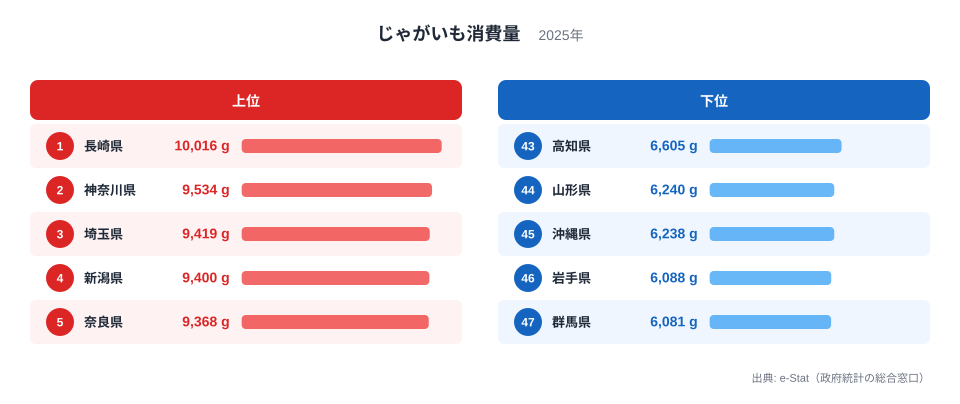

「じゃがいもを最も買う県」の座は、毎年のように入れ替わっています。2025年の家計調査で首位に立ったのは**長崎県の10,016g**で、前年は8,812gの21位でした。入れ替わりに首位から落ちたのが、2024年に10,467gで1位だった**岐阜県**で、2025年は8,133gの24位です。最下位は**群馬県の6,081g**で、トップとの差は1.65倍です。北海道は国内最大のじゃがいも産地として知られますが、購入量は8,726gの14位にとどまります。結論を先に言うと、首位が入れ替わるのは、全国の購入量が8年で約16%減って上位が団子状になり、わずかな差で順位が逆転するようになったためです。以下、2018〜2025年の年別値で順に確かめます。

## 上位5・下位5：首位は長崎、底は群馬

<source-link href="/ranking/potato-consumption-quantity">じゃがいも消費量ランキングの全件データを見る</source-link>

上位5県は、長崎が10,016g、神奈川が9,534g、埼玉が9,419g、新潟が9,400g、奈良が9,368gです。九州、首都圏、北陸、近畿と地域が散らばっており、「○○地方が強い」とは言えない並びです。しかも1位から5位までの差は648gしかありません。上位10県で見ると、神奈川が2位、埼玉が3位、千葉が6位（9,324g）の首都圏3県が入っています。一方で2024年に5位だった東京は8,127gの26位まで下がりました。同じ都市圏でも、年によって大きく動くことが分かります。

下位5県は、群馬が6,081g、岩手が6,088g、沖縄が6,238g（45位）、山形が6,240g（44位）、高知が6,605g（43位）です。最下位の群馬と46位の岩手の差は7gしかなく、下位も僅差の争いです。群馬は2024年の7,527gの36位から47位へ落ちました。

> [!NOTE]
> 本データは総務省「家計調査」の二人以上の世帯の年間**購入量（g）**です。調べているのは都道府県庁所在市（政令指定都市を含む）の値で、県全体の平均ではありません。本文の「長崎県」は長崎市、「群馬県」は前橋市の世帯と読んでください。自家栽培やもらい物、外食・業務用は含まれません。

## 首位が入れ替わる理由：水準が下がり、上位が団子になった

首位の顔ぶれを2018年から並べると、2018年は北海道、2019年は長崎、2020年は北海道、2021年と2022年は静岡、2023年は新潟、2024年は岐阜、2025年は長崎です。8年間で首位に立ったのは5道県で、同じ県が連続したのは静岡の2年だけです。長崎は2019年にも首位でしたが、2020年は13位、2024年は21位と中位を行き来しました。岐阜は2021年に37位まで下がった後、2024年に1位になり、翌2025年には24位に戻っています。

その理由を、各年の47都道府県の値から確かめました。第一に、全国の水準が下がっています。47都道府県の平均購入量は2018年の9,619gから2025年の8,096gへ、8年で約16%減りました。第二に、上位が団子になりました。1位と10位の差は、2018年の2,669gから2025年の952gへ縮まっています。2024年も964gで、直近2年は差が1,000g未満です。差が小さければ、わずかな買い方の違いで順位が入れ替わります。

第三に、順位そのものが前年から引き継がれにくくなっています。前年と翌年の順位の相関（1に近いほど順位が変わらない）は、2021→2022年と2022→2023年は0.82でしたが、2023→2024年は0.46、2024→2025年は0.52に下がりました。つまり直近の2年は、前の年に上位だった県が次の年も上位とは限らない状態です。

水準が下がり、差が縮み、順位の持ち越しも弱まった、という三つは年別値から直接確かめられた事実です。なぜ1都市の買い方がここまで揺れるのかは、県庁所在市1市あたりの調査世帯数が多くないためと考えられます[仮説]。家計調査が公表する標準誤差を市ごとに照らせば、首位と中位の差が誤差の範囲かを確かめられますが、この記事では行っていません。

> [!WARNING]
> 1年の順位だけで「この県はじゃがいもをよく食べる」と結論するのは危険です。1位の長崎が10,016g、10位の京都が9,064gで、差は952g（約9.5%）しかなく、年によって入れ替わります。2018〜2025年の平均順位では新潟、静岡、北海道の平均順位が小さく（それぞれ4.8、5.1、7.6）、年ごとの首位より、こちらのほうが安定した目安になります。

## 8年平均で見ると：本当によく買う県、買わない県

揺れを均すために、2018〜2025年の8年分の順位を県ごとに平均しました。平均順位が小さい順に、新潟県は4.8で平均10,738g、静岡県は5.1で11,003g、北海道は7.6で10,673g、神奈川県は8.9で10,134g、長崎県は9.3で10,222g、千葉県は9.6で9,928gです。2025年に首位の長崎も、8年平均では5番目で、年ごとの順位は1位から21位まで動いています。一方で新潟は8年とも47都道府県の上位3割以内に入り、中位以下に沈んだ年がありません。

平均順位が大きい順に、沖縄県は46.1で平均6,764g、長野県は42.8で7,169g、岩手県は42.4で7,285g、高知県は41.5で7,291g、青森県は39.8で7,348g、山形県は39.0で7,547gです。沖縄は8年間で最も高い年でも45位で、一度も40位台前半に上がっていません。単年の順位に振り回されず、「東日本の日本海側と静岡が安定して買い、東北北部と沖縄が安定して買わない」という輪郭が見えるのは、平均を取って初めて分かる点です。

## 「産地=消費地」ではない逆説：北海道は順位が年ごとにぶれる

北海道は国内最大のじゃがいも産地として知られますが、購入量では年によって大きく動きます。2018年から順に並べると、1、2、1、13、12、7、11、14です。8年のうち3年は首位か2位に立ち、2025年は14位でした。つまり「産地だから購入量が小さい」とも「産地だから多い」とも言えず、年ごとにぶれます。8年平均の順位は全国3番目に小さく、産地が必ず下位に沈むわけではありません。

ここから分かるのは、産地と消費地が一致するかどうかは、1年の順位では決まらないということです。家計調査が捉えるのは**お金を払って買った量**であり、自家栽培の収穫物やおすそ分け、直売所での入手といった市場を経由しない量は記録されません。産地の世帯ほどその割合が高く、購入量が小さく出る年がある可能性があります[仮説]。この調査には自家消費の量がないため、検証には別の統計が要ります。

一方、青森と岩手は産地論と切り離して、はっきり下位です。青森は2025年に6,715gの42位、岩手は6,088gの46位で、8年平均の順位でもそれぞれ39.8、42.4です。岩手は2018年に30位でしたが、2021年以降は44位から46位に定着しました。この2県の購入量が小さい理由は、このデータからは分かりません。

[経済・消費カテゴリのランキング](/category/economy)では、他の食品の購入量も同じ見方で比べられます。

> [!TIP]
> 産地の順位は品目によって逆の出方をします。2025年の[緑茶消費量ランキング](/ranking/green-tea-consumption-quantity)では産地の静岡が2位、[こんぶ消費量ランキング](/ranking/konbu-consumption-quantity)では青森が1位、岩手が2位です。品目と年ごとに産地の順位が違うので、1年のじゃがいもの順位だけで「産地は下位」と決めつけないでください。

## 最下位グループ：群馬と沖縄

最下位の群馬は6,081gで、2024年の7,527g（36位）から約1,450g減りました。1年でこれだけ動くのは、前節で見た「順位が前年から引き継がれにくい」状態と整合します。群馬の食卓で何が変わったのかは、このデータからは分かりません。

沖縄は2025年に6,238g（45位）です。2021年と2022年は46位、2023年と2024年は47位で、8年平均の順位は46.1と全国で最も大きい水準です。気候や食文化との関係は考えられますが、このデータでは検証できません。

## まとめ

- **1位は長崎の10,016g**——2024年の21位からの首位で、2019年にも首位に立っています。上位は九州・首都圏・北陸・近畿が混在します
- **最下位は群馬の6,081g**——前年36位から47位へ。岩手の6,088gとの差は7gで下位は僅差です
- **トップと最下位の差は約1.65倍**（10,016g÷6,081g）
- **首位が入れ替わる理由**——全国平均が8年で約16%減り、1位と10位の差が2,669gから952gに縮み、前年との順位相関も0.82から0.52に下がりました
- **8年平均の上位は新潟・静岡・北海道、下位は沖縄・長野・岩手**——単年の首位より安定した目安になります
- **産地の逆説**——北海道は首位から14位まで年ごとにぶれ、産地だから下位とは言えません

## データについて

2018〜2025年の順位・値は、総務省「家計調査」の同じ指標（`potato-consumption-quantity`）の年別値を県ごとに並べて集計しました（`data/potato-consumption-yearly.json`）。ランキング図は2025年の値です。平均順位は8年分の順位の単純平均、順位の相関は前年と翌年の順位（47都道府県）のピアソン相関です。
