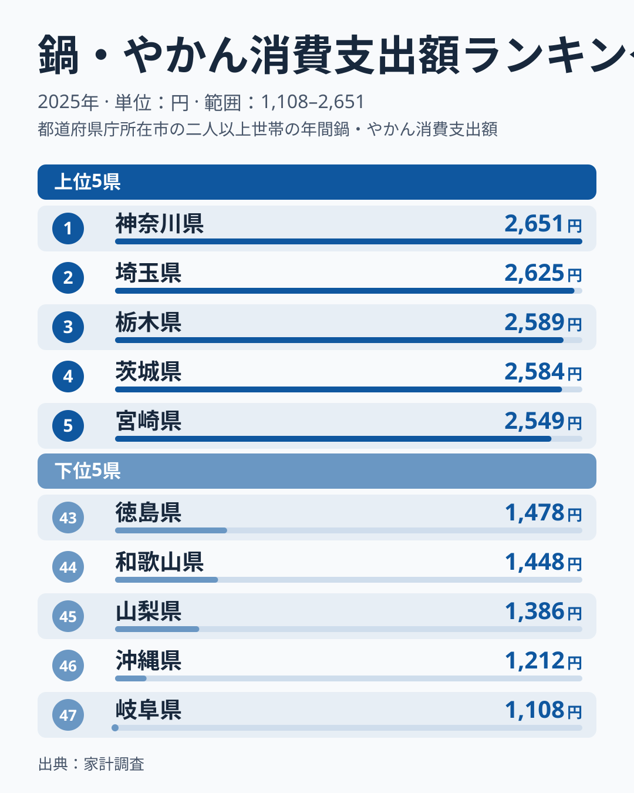
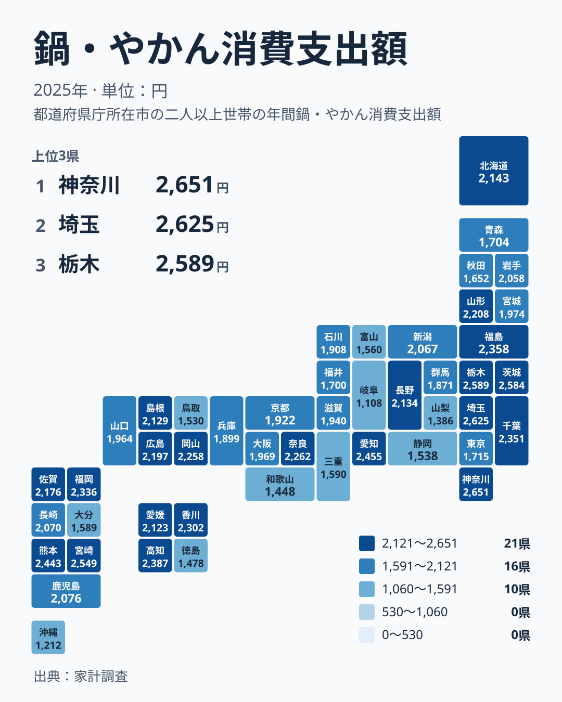

台所で毎日使う鍋ややかんは、一度買えば長く使える道具です。ところが家計調査で2025年の支出額を県別に見ると、金額は県によって大きく違います。この記事では、その差が地方という単位で括れるのかを確かめ、暮らしの読み方を仮説として整理します。

## 最多は神奈川県、最少は岐阜県

2025年の鍋・やかんへの支出が最も多かったのは神奈川県で、2,651円でした。最も少なかったのは岐阜県で、1,108円です。最大と最小を並べると約2.4倍の開きがあります。

<source-link href="/ranking/pots-kettles-consumption-expenditure">鍋・やかんへの支出ランキングをもっと見る</source-link>

図の上位5県は、神奈川県、埼玉県、栃木県、茨城県、宮崎県の順です。神奈川県は2,651円、埼玉県は2,625円、栃木県は2,589円、茨城県は2,584円、宮崎県は2,549円でした。5県のうち4県が関東で、宮崎県だけが九州・沖縄です。この記事では、地方の偏りを見るときの基準を上位5県に揃えます。

下位5県は、岐阜県の1,108円、沖縄県の1,212円、山梨県の1,386円、和歌山県の1,448円、徳島県の1,478円です。所属は中部、九州・沖縄、中部、近畿、四国に分かれ、特定の地方に集中してはいません。上位5県は関東に偏り、下位5県は散らばっているという非対称が、この指標の第一の特徴です。

> [!NOTE]
> この指標は「鍋・やかん」という一品目に対する年間の支出額です。すでに持っている鍋ややかんの数や、料理をする頻度を表すものではありません。使い続けている道具は、支出としては現れません。

## 地図で見る位置関係

次の図は、同じ数字を都道府県のタイルマップに置き直したものです。ランキングでは一列だった県が、地理の上でどう並ぶかを確かめられます。

上位5県の基準で見ると、関東の4県は栃木県、茨城県、埼玉県、神奈川県で、図の上では隣り合う位置に色の濃いタイルが並んで見えます。範囲を上位10県に広げると、千葉県が10位で入り、関東の高い県は5県になります。一方で、同じ関東でも群馬県は33位、東京都は34位と、順位が大きく下がります。

関東以外では、九州・沖縄の宮崎県が5位、熊本県が7位、中部の愛知県が6位、中国・四国では高知県が8位です。上位10県という広い範囲で数えると、関東5県のほかに、九州・沖縄が2県、中部が1県、四国が1県、北海道・東北が1県(福島県の9位)で、離れた地方にも点在しています。地図が示すのは、高い県が関東を中心にしつつも、一つの帯には収まらないということです。

> [!WARNING]
> 鍋・やかんは数年に一度の買い替えが中心で、購入頻度が低い品目です。家計調査は標本調査のため、県ごとの調査世帯数は限られ、たまたま買い替えた世帯が一つ入るだけでも県の平均が動きます。順位の細かな差は、暮らしの違いではなく、買い替えのタイミングの偏りかもしれません。単年の値として受け止めてください。

## 同じ地方の中の落差

地方で括っても、その中に大きな落差があります。ここでは三つの地方を例に挙げます。

- 中部では、愛知県が2,455円で6位、岐阜県が1,108円で47位です。順位の差は41です。
- 関東では、神奈川県が2,651円で1位、東京都が1,715円で34位です。順位の差は33です。
- 九州・沖縄では、宮崎県が2,549円で5位、沖縄県が1,212円で46位です。順位の差は41です。

三組の中では、中部と九州・沖縄の順位の差が同じ41で、関東の33より大きくなっています。ただし、これは地方ごとに最も差の開いた県を選んだ比較ではなく、目立つ二県を例に取ったものです。地方全体の傾向を語るには足りません。中部には静岡県が41位、富山県が40位の県もあり、関東でも群馬県は33位です。

データからは、地方という区分だけでは説明しにくい差があるようにみえます。食文化や気候の影響については、この実データには含まれていないため、ここでは判断しません。

> [!TIP]
> 県の順位を読むときは、順位の差よりも金額の幅を見るのがコツです。たとえば上位10位の千葉県は2,351円、中位の26位の宮城県は1,974円と、順位の間隔が大きくても金額の差は限られる場面があります。順位が一つ違うだけで、暮らしが違うと決めつけないでください。

## 暮らしに引き寄せて読む仮説

では、この数字を暮らしに引き寄せるとどう読めるでしょうか。ここからは実データで確かめたことではなく、読み解くための仮説です。確かめられない推測は多く挙げられますが、ここでは三点に絞ります。

一つ目は、買い替えの周期です。支出が多い県では、鍋ややかんを買い替える頻度や、買い足す機会が相対的に多いのかもしれません。最下位の岐阜県の1,108円は、壊れるまで使う暮らしの表れという読み方もできますが、周期のデータはここにないため推測にとどまります。

二つ目は、世帯の構成です。世帯の人数や、新しく暮らしを始める世帯の多さが関わる可能性があります。ただし、世帯のデータはこの実データに含まれていません。

三つ目は、同じ首都圏でも差があることです。神奈川県が1位、埼玉県が2位である一方、東京都は34位です。住まいの形や外食の機会などで説明できるかもしれませんが、これも仮説の域を出ません。支出が少ないことは、料理をしないという意味ではありません。

自分の家計と比べるときは、1年分の支出だけでは足りません。数年に一度の買い替えが今年に当たったかどうかで、金額は大きく変わります。県の平均より多く使ったからといって、使いすぎとは限りません。

詳しく調べたい方は、[同じカテゴリの統計一覧](/category/economy)から、他の家計関連の指標とあわせて見比べてみてください。首位の[神奈川県のデータ](/areas/14000)や、2位の[埼玉県のデータ](/areas/11000)では、ほかの項目の順位も確認できます。

## 見えてきたこと

実データから言えるのは、次の三点です。

- 上位5県のうち4県が関東で、宮崎県だけが九州・沖縄です。ただし、東京都は34位、群馬県は33位です。
- 九州・沖縄では宮崎県が5位、熊本県が7位ですが、沖縄県は46位です。
- 中部では愛知県が6位、岐阜県が47位で、順位の差は41です。

地方の区分だけでは説明しきれない差があるようにみえます。この指標は、気候や文化を直接示すものではなく、各家庭の買い替えの積み重ねが県の平均に映ったものです。世帯の状況が数字に影響している可能性はありますが、この実データからは確かめられません。数字を見るときは、順位の高低に一喜一憂せず、どんな暮らしがその金額をつくっているのかを想像してみてください。

## データについて

この記事で使った統計は、家計調査の「鍋・やかん消費支出額」で、2025年の値を円単位で示しています。調査は全国の世帯を対象にした標本調査で、県全体の姿を完全に表すものではない点に注意してください。また、記事中の順位は、公開されている実データの値をそのまま並べたものです。
