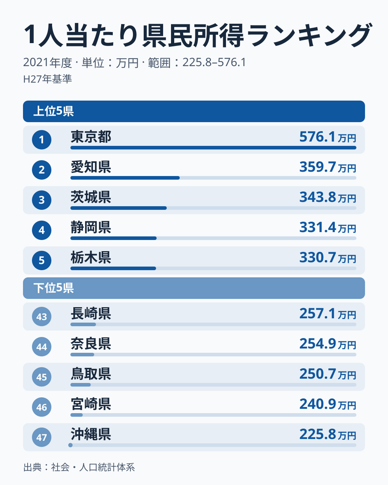
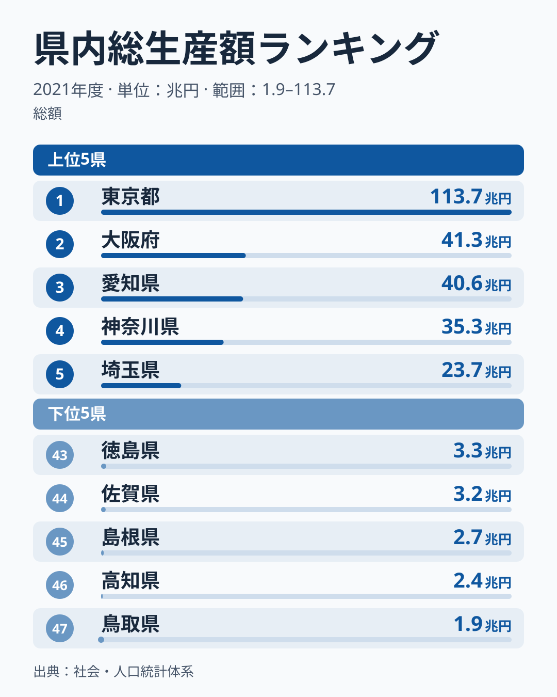
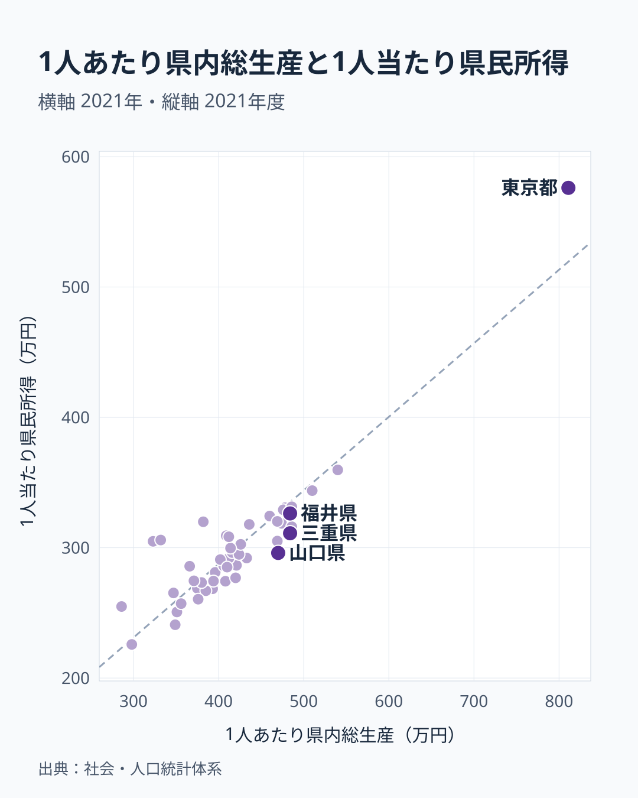

1人あたり県民所得で7位の福井県は、県内総生産（GDP）では41位です。徳島県も9位と43位に分かれます。反対に福岡県は所得が37位なのに、GDPは9位です。同じ県の経済を示す2つの数字で、なぜ順位がここまで入れ替わるのでしょうか。

答えの大部分は単純です。GDPは県全体の総額で、県民所得は1人あたりの額だからです。ただし、1人あたりにそろえても入れ替わりは消えません。残った差を見ると、埼玉県や千葉県のように、住んでいる場所と働いている場所が違う県が浮かび上がります。

> [!NOTE]
> 県民所得は県の居住者に分配された所得で、個人のほか法人企業や行政機関の分も含みます。これを総人口で割った値が1人あたり県民所得です。個人の給与や世帯の手取りではありません。数字は内閣府「県民経済計算」（平成27年基準）の2021年度で、GDPと年度をそろえています。

## 1人あたり県民所得──東京の次は愛知、茨城

1位は東京都の576万円で、2位は愛知県の360万円です。3位は茨城県の344万円で、静岡県と栃木県が331万円で続きます。6位の富山県は329万円、7位の福井県は326万円で、8位の山梨県、9位の徳島県まで、2位以下の差は小さくなっています。神奈川県は320万円で10位、大阪府は305万円で18位です。

最も低いのは沖縄県の226万円で、東京都との差は約2.6倍です。東京都を除いて愛知県と比べると、差は約1.6倍に縮まります。全国の格差として語られる数字の一部は、東京都1つの突出によるものです。下位には宮崎県が46位、鳥取県が45位、奈良県が44位で並びます。

<source-link href="/ranking/per-capita-prefectural-income-h27">1人当たり県民所得ランキングをもっと見る</source-link>

## 県内総生産──総額は人口の大きさに沿う

県内総生産は東京都が約113.7兆円で、2位の大阪府の約41.3兆円の約2.8倍です。3位の愛知県は約40.6兆円、4位の神奈川県は約35.3兆円、5位の埼玉県は約23.7兆円です。最も小さい鳥取県は約1.9兆円で、東京都の約59分の1です。

この順位は人口の順位に近いものです。県内総生産と総人口の相関係数は0.93で、人が多い県ほど総額が大きくなります。総額の大小は産業の良し悪しより先に、県の大きさを映しています。

<source-link href="/ranking/total-production-in-the-prefecture">県内総生産ランキングをもっと見る</source-link>

## 順位が入れ替わる県──差の大部分は人口

2つの順位を比べると、所得の順位がGDPより高い県と、その逆の県に分かれます。

所得の順位がGDPより高い主な県は次のとおりです。

- 福井県は所得7位、GDP41位で、34位の差があります
- 徳島県は所得9位、GDP43位で、同じく34位の差があります
- 山梨県は所得8位、GDP40位で、32位の差があります
- 富山県は所得6位、GDP28位で、22位の差があります

GDPの順位が所得より高い主な県は次のとおりです。

- 福岡県は所得37位、GDP9位で、28位の差があります
- 北海道は所得32位、GDP8位で、24位の差があります
- 大阪府は所得18位、GDP2位で、16位の差があります
- 兵庫県は所得21位、GDP6位で、15位の差があります

順位どうしで相関を計算すると、県民所得とGDPは0.48にとどまります。並んでいる顔ぶれには共通点があり、上の4県は人口が少なく、下の4道府県は人口が多いのです。割り算の分母が違うだけで、順位の差は生まれます。

そこでGDPを総人口で割り、1人あたり県内総生産にしてから比べます。

## 1人あたりにそろえると相関は0.91

1人あたり県内総生産と1人あたり県民所得の相関係数は0.91でした。東京都を除いても0.81あります。順位どうしの相関も、総額で比べたときの0.48から0.81へ上がります。福井県は1人あたり県内総生産が6位で、所得の7位とほぼ同じ位置です。福井県の「41位」は、1人あたりの生産が少ないのではなく、県の人口が小さいことの表れだと分かります。

それでも線から外れる県があります。最も目立つのは千葉県と埼玉県です。千葉県は所得が17位なのに、1人あたり県内総生産は44位です。埼玉県は19位と45位、神奈川県は10位と34位で、奈良県は44位と47位です。いずれも線より上にあり、県内で生まれる額に比べて、県民の所得が高い位置にあります。

この差には定義の違いが関わります。県内総生産は県内での生産を数えるのに対し、県民所得は県の居住者に分配された所得を数え、県外から受け取った分の差し引きも加えます。隣の都府県に通勤して働く人の給与は、働く先の生産として数えられ、所得としては住んでいる県に入ります。東京圏の3県と、大阪への通勤圏にある奈良県が線の上に来ることは、この仕組みと合っています。通勤者を受け入れる大阪府が線の下にあることも同じ向きです。ただし東京都は受け入れる側なのに線の上にあり、通勤だけでは説明できません。

反対に線より下にあるのは、山口県、三重県、滋賀県などです。三重県は1人あたり県内総生産が7位で所得が14位、滋賀県は4位と13位、山口県は11位と23位です。県内で生まれた額に比べて所得が低い位置にあります。県外に本社のある工場の利益が県外へ分配されている可能性がありますが、本記事ではそこまで検証していません。

> [!WARNING]
> 通勤の説明は定義と県の位置から読んだもので、通勤者数で計算した結果ではありません。1人あたり県内総生産は、県内総生産を総人口で割って本記事で計算した値で、順位は丸める前の値で決めています。

## 大企業比率で順位の入れ替わりは説明できない

所得と連動する指標として、企業の規模もよく挙げられます。2021年の[300人以上の事業所で働く人の割合](/ranking/employee-ratio-300plus-employee-establishments-private)と1人あたり県民所得の相関係数は0.82で、東京都を除くと0.66です。10〜29人の事業所で働く人の割合とはマイナス0.82で、規模の小さい事業所で働く人が多い県ほど所得は低い傾向があります。

ただし、この関係は所得の水準についてのもので、順位の入れ替わりの説明にはなりません。300人以上の事業所で働く人の割合は、東京都が1位、愛知県が2位、大阪府が4位です。所得7位の福井県は9.63%で29位、所得6位の富山県は11.85%で18位です。福井県と富山県はこの割合が高くないのに所得が高く、大阪府は割合が高いのに所得は18位です。

製造業の比率でも確かめました。2020年度の県内総生産に占める製造業の割合と、同じ2020年度の所得の相関係数は、47都道府県では0.20ですが、東京都を除くと0.73に上がります。東京都を別にすれば、製造業の比率が高い県ほど所得が高い傾向があります。割合が高いのは滋賀県、三重県、栃木県、静岡県、山口県、愛知県です。

## まとめ

- 2021年度の1人あたり県民所得は東京都が576万円で1位、愛知県が360万円で2位、茨城県が344万円で3位です
- GDPは人口に沿う総額で、総人口との相関係数は0.93です。順位の入れ替わりの大部分は、総額と1人あたりの違いから生まれます
- 1人あたりにそろえると、県民所得との相関係数は0.91になります
- それでも残る差には、千葉県・埼玉県・神奈川県・奈良県のように、居住地と生産の場所が分かれる県が現れます
- 300人以上の事業所で働く人の割合は所得の水準と連動しますが、福井県や富山県の順位を説明する指標ではありません

世帯の収入から見た姿は[勤労者世帯の月収ランキング](/blog/dual-income-reversal)、県民所得の格差そのものは[2020年度の数字で見た1人あたり県民所得の地域差](/blog/per-capita-income-gap)で扱っています。経済全般の指標は[経済カテゴリのランキング一覧](/category/economy)から比較できます。

## データについて

県民所得と県内総生産（名目）は内閣府「県民経済計算」（平成27年基準）の2021年度、製造業の比率は同じ統計の2020年度です。総人口と事業所の規模別の割合は、e-Stat「社会・人口統計体系」の都道府県別データを使いました。相関係数はピアソンの積率相関係数で、断りのない限り47都道府県で計算しています。
