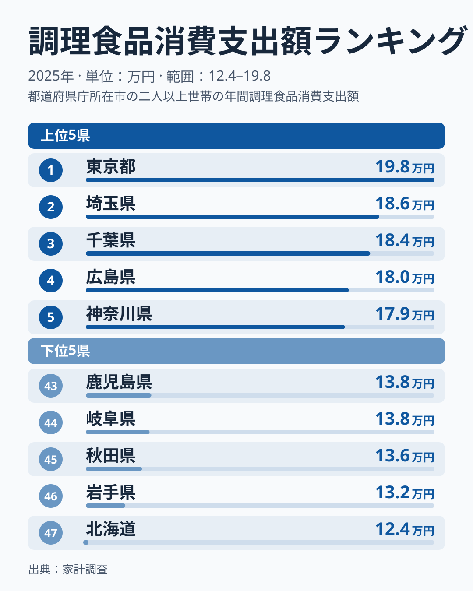
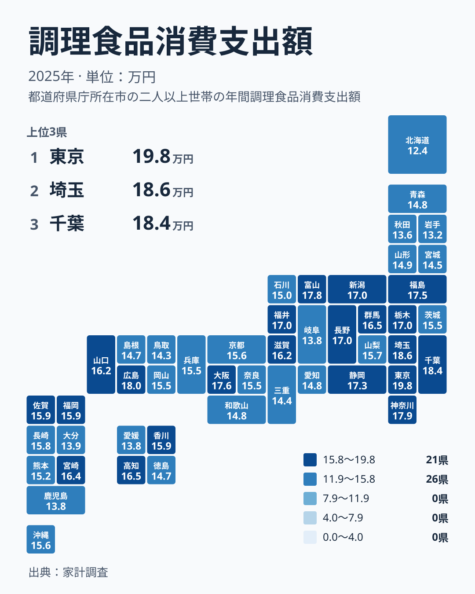

## 惣菜・弁当への支出は、どこで多くなるのか

スーパーやデパ地下で買う惣菜、コンビニの弁当、持ち帰りの揚げ物や寿司。こうした「買ってきてすぐ食べられる食べもの」にかける年間の支出は、都道府県によって大きく違います。2025年の家計調査では、最も多い東京都が197,940円でした。最も少ない北海道は124,109円です。同じ日本の家庭でも、調理済みの食品に回すお金には大きな開きがあります。

この差は、単純に「料理をするかしないか」では説明できません。通勤時間、近所にある店の種類、地域の惣菜文化、気候と食材の入手しやすさなど、さまざまな要因が重なっている可能性があります。ただし、この記事で確かめられるのは順位と金額までです。背景については、あくまで仮説として考えます。

なお、この記事で県を地方ごとにまとめるときは、北海道・東北、関東、中部、近畿、中国、四国、九州・沖縄の7区分を使います。三重県は近畿、福島県は北海道・東北に含めます。

> [!NOTE]
> この指標は、家計調査の「調理食品」への支出で、買ってすぐ食べられる惣菜や弁当などが対象です。レストランなどでの外食は含みません。また、家計調査は都道府県庁所在市などを単位に集計するため、県全体の平均とは異なる場合があります。単位は円で、1世帯あたりの年間支出額です。

## 上位と下位のランキング

まずは上位5都府県と下位5道県を図で見ます。

<source-link href="/ranking/prepared-foods-group-consumption-expenditure">調理食品への支出ランキングをもっと見る</source-link>

1位は東京都の197,940円です。2位は埼玉県の186,227円、3位は千葉県の184,335円と続きます。4位に広島県の179,791円、5位に神奈川県の178,963円が入っています。上位5つのうち4つが関東の都県で、広島県だけが関東以外から割って入っています。

反対に下位を見ると、47位が北海道の124,109円です。46位は岩手県の132,467円、45位は秋田県の135,997円で、東北の県が並びます。44位は岐阜県の137,601円、43位は鹿児島県の137,983円です。首位の東京都と最下位の北海道では、197,940円と124,109円という開きがあり、この比がおよそ1.6倍にあたります。

上位と下位をまとめて見ると、上位は関東に集中し、下位には北海道・東北のほか、岐阜県や鹿児島県も入っています。つまり下位は特定の地方だけに固まっているわけではありません。次の節で、地図を使って順位の割れ方を確かめます。

> [!TIP]
> 調理食品は外食を含まないため、順位が低い県が「食にお金をかけていない」とは限りません。外食や生鮮食品への支出は別の指標で、この順位とは切り離して読む必要があります。

## 地図で見る地理分布

次に、47都道府県の位置関係を地図で確かめます。

地図で目を引くのは、同じ地方の中でも順位が大きく割れる点です。関東では、東京都が1位である一方、茨城県は29位の154,972円です。栃木県は11位、群馬県は14位で、関東の中でも上位から中位へと段差があります。

中部は、割れ方がさらに大きい地方です。富山県が6位、静岡県が9位、長野県が10位、新潟県が12位、福井県が13位と上位に集まる一方で、愛知県は33位、岐阜県は44位です。同じ中部で、6位と44位が同居しています。

北海道・東北では、福島県が8位の175,215円と高く、山形県の32位、青森県の34位、宮城県の38位がそれに続き、秋田県が45位、岩手県が46位、北海道が47位です。東北の中でも福島県と他の県のあいだには大きな差があります。近畿では大阪府が7位で最も高く、滋賀県が17位、京都府が25位、奈良県が27位、兵庫県が28位、和歌山県が35位、三重県が39位と、順位が広く散らばっています。

> [!WARNING]
> 家計調査は限られた世帯を対象にした調査で、県ごとの調査世帯数は多くありません。順位が近い県どうしの差は、調査のぶれの範囲に収まる可能性があります。1年分の数字だけで、県民性や食習慣を断定することはできません。

## 食文化・暮らし方との結びつき（仮説）

ここから先は、データで確かめたものではなく、順位の並びから考えられる仮説です。

1つめの仮説は、惣菜を買える店の身近さです。東京都、神奈川県、大阪府のような都市圏では、スーパーの惣菜売り場や持ち帰りの店が多いと考えられます。買いに行く手間が小さいほど、調理済みの食品は食卓に入りやすくなるという見方です。

2つめは、世帯の事情です。通勤や通学に時間がかかる地域では、夕食づくりにかけられる時間が限られるという仮説が考えられます。埼玉県が2位、千葉県が3位に入っていることは、東京都に近い暮らし方と関係している可能性があります。

3つめは、地域に根づいた食文化です。広島県が4位の179,791円、富山県が6位の177,543円、福島県が8位の175,215円に入っていることは、都市圏だけでは説明しきれません。それぞれの地域で、持ち帰りの惣菜や総菜を食卓に取り入れる習慣が影響しているという仮説が考えられますが、この記事のデータからは確かめられません。

反対に、北海道や東北の下位については、買い物の方法や食材の入手しやすさが関係しているという見方もあります。ただし、岐阜県や鹿児島県も下位に入っていることから、地方だけで説明できるわけではありません。根拠を示せない部分は、今後ほかの指標と組み合わせて検討する必要があります。

## 順位から言えること

調理食品への支出は、東京都が197,940円で1位、北海道が124,109円で47位でした。上位には東京都、埼玉県、千葉県、神奈川県と関東の都県が並び、その中に広島県が4位で割って入っています。関東と中部では、同じ地方の中でも順位が大きく割れていました。

下位には北海道、岩手県、秋田県のほか、岐阜県と鹿児島県も入っています。この指標は、外食を含まない調理済み食品への支出だけを映したものです。順位の高低を良し悪しで判断せず、他の指標とあわせて読むことが大切です。気になる地域は、[東京都のデータ](/areas/13000)や[埼玉県のデータ](/areas/11000)のページで、ほかの指標も確かめてみてください。ほかの食料品や外食に関する指標は、[同じカテゴリの統計一覧](/category/economy)から探せます。

## データについて

この記事の数値は、家計調査の「調理食品消費支出額」で、2025年の1世帯あたり年間支出額です。単位は円です。都道府県庁所在市などを単位に集計した値であり、県全体の平均ではない点に注意してください。
