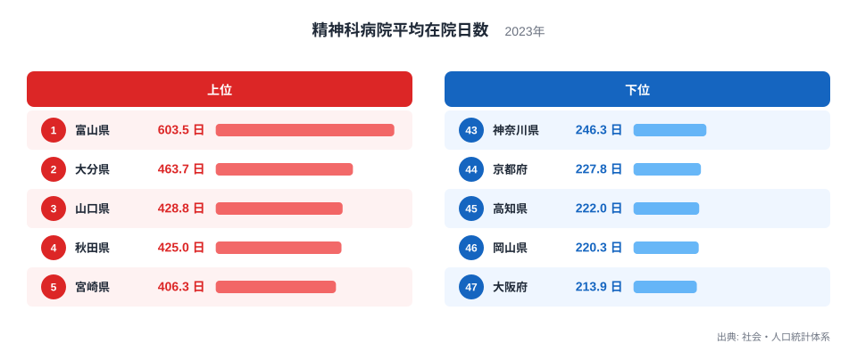
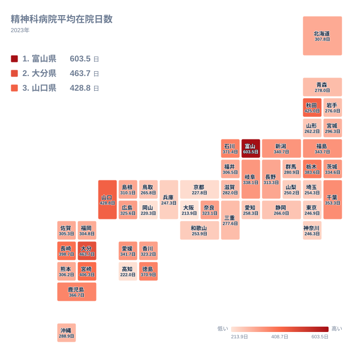

精神科病院に入院した人は、平均で何日ほど病院にとどまるのでしょうか。2023年のデータでは、最も長い富山県が603.5日、最も短い大阪府が213.9日でした。最大と最小の比は約2.8倍です。同じ日本の中で、入院の長さにこれほどの開きがあります。

この記事では、精神科病院の平均在院日数が最も多い県はどこなのかを確認し、上位と下位がその順になる背景を、地理や医療提供体制、歴史の面から考えます。ただし、実データから直接わかるのは県ごとの値と順位だけです。背景についての説明は、いずれも仮説として読んでください。

> [!NOTE]
> この指標は、精神科病院に入院した患者が退院するまでにかかる平均の日数を表します。正式な統計名は「精神科病院平均在院日数」で、出典は社会・人口統計体系、単位は日、年は2023年です。対象は精神科病院であり、一般病院の精神科病床を含むかどうかは、この数値だけでは確認できません。

## 上位と下位の差はどれほど大きいか

まず、上位5県と下位5県を図で確認します。

<source-link href="/ranking/psychiatric-hospital-avg-length-of-stay">精神科病院平均在院日数ランキングをもっと見る</source-link>

目を引くのは、1位の富山県が2位の大分県を大きく引き離している点です。富山県は603.5日、大分県は463.7日で、1位と2位の間にも長さの開きがあります。2位から5位の宮崎県までは463.7日から406.3日の間に収まっており、富山県だけが突出した位置にあります。

下位は47位の大阪府が213.9日、46位の岡山県が220.3日、45位の高知県が222日で、200日台前半に集まっています。上位と下位の両端では、およそ2.8倍の差になります。順位が一つ違うだけの差は小さくても、両端を並べると、入院の長さの地域差が相当に大きいことがわかります。

もう一つ注目したいのは、顔ぶれの地理的な広がりです。上位5県は北海道・東北の秋田県、中部の富山県、中国の山口県、九州・沖縄の大分県と宮崎県で、5県が4つの地方に分かれています。下位5県も近畿の大阪府と京都府、中国の岡山県、四国の高知県、関東の神奈川県と、地方がばらけています。

> [!TIP]
> 平均値は、入院が非常に長い患者が混じると押し上げられやすい性質があります。順位の高低を「どの県の精神医療が優れているか」という評価と混同せず、長期の入院がどの程度残っているかを映す一つの目安として読むのがコツです。

## 地理分布から見えるもの

次に、47都道府県の分布を地図で見てみます。

地図からは、九州・沖縄と中国で長い県が目立つことがわかります。大分県、宮崎県、長崎県、鹿児島県は、いずれも10位以内に入る九州・沖縄の県です。中国でも山口県が3位に入っています。西日本に長い県が集まっているように見えます。

しかし、西日本が一様に長いわけではありません。九州・沖縄でも、福岡県は304.8日で26位、沖縄県は288.9日で28位と中位です。同じ九州・沖縄の中に、上位の大分県に迫る県と中位の県が混在しています。地方という単位だけでは、並びは説明しきれません。

中国の中でも差は大きく、山口県は428.8日、岡山県は220.3日で、約200日の差があります。同じ地方に属しながら、3位と46位に分かれています。

東日本では、栃木県が7位、千葉県が11位と、関東でも上位寄りの県があります。一方で東京都は246.9日で42位、神奈川県は246.3日で43位です。同じ関東でも、栃木県の383.6日と神奈川県の246.3日では大きな差があります。地方ごとの傾向だけでは説明しにくく、県ごとの事情の違いが影響している可能性があります。

> [!WARNING]
> この数値からは、集計が病院の所在地ごとなのか、患者の居住地ごとなのかを確認できません。県境をまたいで入院する患者が多い場合、その影響が値に出る可能性があります。また、病院数の少ない県では、特定の病院の状況が県全体の値に反映されやすい点にも注意が必要です。

## 長い県の背景を考える

1位の富山県について、[富山県のデータ](/areas/16000)も合わせて見てみましょう。富山県の603.5日は、全国で飛び抜けた値です。ただ、ここで扱う実データには病床数や退院後の支援体制は含まれていません。そのため、なぜ富山県が最長なのかを、この記事のデータだけで断定することはできません。

一般には、入院期間の長さは、病床の多さ、長期入院患者の存在、退院後に暮らす場の確保といった要因に左右されるといわれます。富山県の値が高い背景にも、こうした要因が関わっている可能性はあります。ただし、あくまで仮説です。実際の要因を確かめるには、病床数や地域の支援施設など別の統計と突き合わせる必要があります。

2位の[大分県のデータ](/areas/44000)でも同じことが言えます。大分県は463.7日で、3位の山口県の428.8日、4位の秋田県の425日と近い水準です。2位から4位は、北海道・東北、中国、九州・沖縄の県が並んでおり、特定の地方に限られません。

上位10位には、富山県、大分県、山口県、秋田県、宮崎県、長崎県、栃木県、石川県、徳島県、鹿児島県が入ります。九州・沖縄が4県、中部が2県、中国、北海道・東北、関東、四国が各1県です。幅広い地域に散らばっており、単純な東西差とは言えません。

## 短い県の並びが示すこと

下位の大阪府は213.9日で、全国で最も短い値です。岡山県の220.3日、高知県の222日、京都府の227.8日と合わせて、200日台前半に並びます。大阪府と京都府は近畿、岡山県は中国、高知県は四国と、所属がばらけています。

大阪府や京都府は都市部ですが、都市部だから短いと言い切ることはできません。岡山県や高知県は大都市圏ではなく、それでも下位に入っています。さらに、東京都は42位、神奈川県は43位ですが、千葉県は11位で、同じ首都圏に近い関東でも位置が異なります。また近畿でも、兵庫県は41位で下位寄りですが、奈良県は19位、三重県は32位と、位置はそれぞれ異なります。

こうした並びを見ると、都市かどうか、東西のどちらかという分け方だけでは、短い県の共通点を示しにくいことがわかります。外来や訪問の支援が充実していて入院が長引きにくいという見方もありえますが、これも今回のデータでは確認できない仮説です。

歴史的な経緯についても、長期の入院を前提とした時代の名残が地域によって異なる可能性は指摘されます。ただし、富山県や大分県の値の高さと結びつけて示せる根拠は、実データにはありません。ここでは、可能性の一つにとどめます。

## 中位の県と読み解きのまとめ

中位の県も見ておきます。北海道は307.8日で22位、福岡県は304.8日で26位、宮城県は296.3日で27位です。1位の富山県の603.5日と比べると、半分前後の水準です。多くの県は200日台後半から300日台前半に集まっており、上位の県が全体の中でも特に長いことがわかります。

読み解くうえで大切なのは、この数字を良し悪しの序列としてではなく、各県の入院の長さの違いを示す手がかりとして使うことです。長い県では、長期入院から地域生活への移行がどう進んでいるかが気になります。短い県では、入退院の流れがどのように成り立っているかが気になります。いずれも、他の統計と組み合わせて初めて見えてくる論点です。

他の福祉・医療関連の指標もあわせて確認したい場合は、[同じカテゴリの統計一覧](/category/socialsecurity)から探せます。病床数や医療従事者数などと組み合わせると、在院日数の背景をより具体的に捉えられます。

## データについて

この記事で使ったのは、社会・人口統計体系に収録された「精神科病院平均在院日数」の2023年の値です。単位は日で、47都道府県すべての値がそろっています。

平均在院日数は、年によって算出の対象や方法が変わる場合があります。他の年の値と比べるときは、定義をよく確認してください。

富山県の603.5日と大阪府の213.9日という差は、精神科の入院の長さが地域によって大きく異なることを示しています。数字を入り口に、それぞれの県で入院から地域生活への移行がどう進んでいるのかを、調べてみてください。
