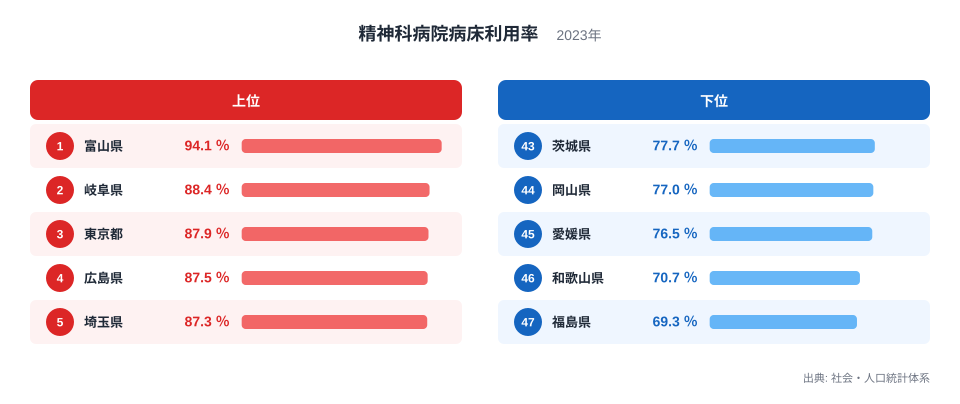
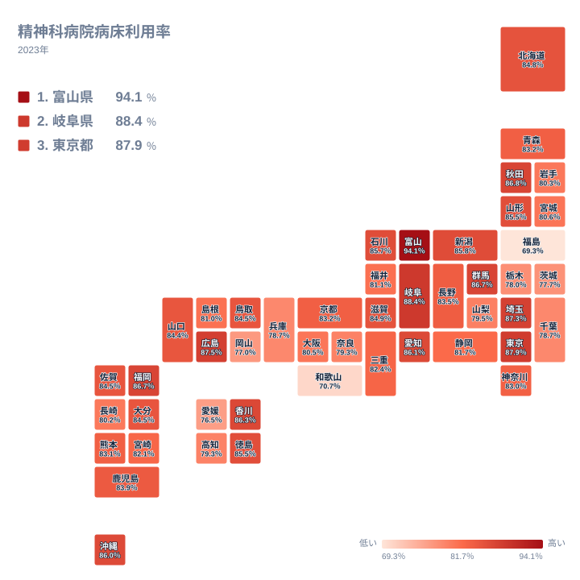

精神科病院の病床がどれだけ埋まっているかは、地域の医療体制や入院の長さを映す指標です。2023年の全国を見ると、最も高い富山県は94.1％で1位です。最も低い福島県は69.3％で47位でした。最大と最小の比は約1.36倍で、差は24.8ポイントあります。同じ制度の下にありながら、病床の使われ方には大きな開きがあります。

この記事では、精神科病院病床利用率の上位と下位を並べ、なぜその順になるのかを地理と歴史の面から考えます。ただし、この指標だけで原因を断定することはできません。見えている事実と、そこから言える範囲を分けて読み進めます。

## 上位と下位の顔ぶれ

まず、上位5県と下位5県を図で確認します。

<source-link href="/ranking/psychiatric-hospital-bed-occupancy-rate">精神科病院病床利用率ランキングをもっと見る</source-link>

上位は、富山県が94.1％で1位です。続いて岐阜県が88.4％で2位、東京都が87.9％で3位、広島県が87.5％で4位、埼玉県が87.3％で5位です。1位の富山県だけが90％を超えており、2位の岐阜県との間には明確な段差があります。

下位は、福島県が69.3％で47位、和歌山県が70.7％で46位、愛媛県が76.5％で45位、岡山県が77％で44位、茨城県が77.7％で43位です。上位5県は中部、関東、中国の県で、下位5県は東北、近畿、四国、中国、関東の県です。中国と関東は、上位にも下位にも顔を出しています。

特定の地方がまとまって高いわけではなく、県ごとの事情が大きいことがうかがえます。広島県は87.5％で4位、岡山県は77％で44位と、同じ中国の中でも対照的です。

> [!NOTE]
> 病床利用率は、病院が持つ病床のうち実際に患者が入っている割合を示す指標です。病床数そのものや、人口あたりの入院者数とは別の概念です。病床が多くても入院者が少なければ低く、病床が少なくても入院者が多ければ高く出ます。

## 地理分布を地図で見る

次に、47都道府県の分布を地図で確認します。

地図で目につくのは、高い県と低い県が同じ地方の中に混在している点です。東北では、秋田県が86.8％で6位、山形県が85.5％で14位と高めですが、福島県は69.3％で47位です。関東でも、東京都は87.9％で3位、埼玉県は87.3％で5位ですが、茨城県は77.7％で43位、栃木県は78％で42位です。

四国でも香川県は86.3％で9位、徳島県は85.5％で15位ですが、愛媛県は76.5％で45位です。九州・沖縄では福岡県が86.7％で8位、沖縄県が86％で11位と高い一方、長崎県は80.2％で36位でした。

このため、利用率の差は気候や距離といった自然条件、あるいは地方単位の違いだけでは説明しにくいと考えられます。各県の病院の規模や数、入院患者を受け入れる仕組みの違いが、数字に表れている可能性があります。ただし、これは仮説であり、この指標だけでは確かめられません。

> [!WARNING]
> この数値は病床の「埋まり具合」を示すだけで、医療の質や患者の状態の良し悪しを示すものではありません。利用率が高いことが、需要の大きさを表すのか、退院が進みにくい状況を表すのかは、この指標だけでは区別できません。

## 上位県の読み方

上位には、富山県の94.1％、岐阜県の88.4％のように、都市部とは言いきれない県が並びます。一方で東京都や埼玉県、愛知県も上位です。愛知県は86.1％で10位でした。一方、大阪府は80.5％で34位、神奈川県は83％で27位と、大都市圏でも位置はばらばらです。都市かどうかで順位が決まるわけではないことがわかります。

実データからは、入院期間や病床数の内訳まではわかりません。そのため、富山県が高い理由を断定することは避けます。歴史的には、精神科医療は長く入院中心で進められてきた経緯があり、近年は地域生活への移行が進められています。その進み方に県ごとの差がある可能性はありますが、別の統計で入院期間などを確認しなければ言えません。

## 下位県の読み方

下位の福島県は69.3％で47位、和歌山県は70.7％で46位でした。この2県は、45位の愛媛県の76.5％と比べても、さらに低い水準です。下位の中でも、最下位付近の2県は突出して低いことがわかります。

利用率が低い場合、病床に余裕があるとも読めます。ただし、その理由が病床の削減途中なのか、入院者の減少なのかは、この指標だけでは判断できません。

> [!TIP]
> 中位は80％台前半に多くの県が密集しており、順位が1つ違っても値はほとんど変わりません。たとえば青森県と京都府はどちらも83.2％で、24位と25位です。奈良県と高知県も79.3％で、38位と39位です。順位より値そのものを見て比べると、実態に近づけます。

## 地域の数字を確かめるには

自分の住む県の位置を確認するには、各県のページが役立ちます。上位の例として[富山県のデータ](/areas/16000)や[岐阜県のデータ](/areas/21000)を見ると、他の指標との組み合わせで背景を探る手がかりになります。

また、[同じカテゴリの統計一覧](/category/socialsecurity)には、医療や福祉に関する指標が並んでいます。病床数や入院期間など、関連する指標と合わせて読むと、利用率の高低がどのような状況から生まれているのかを、より具体的に考えられます。

## データについて

ここで扱った精神科病院病床利用率は、社会・人口統計体系に掲載された2023年の値で、単位は％です。病院が持つ病床に対する、実際の入院者の割合を示します。47都道府県すべてが掲載されており、最も高いのは富山県の94.1％、最も低いのは福島県の69.3％でした。

## まとめ

精神科病院の病床利用率は、富山県が94.1％で1位、福島県が69.3％で47位と、約1.36倍の開きがありました。上位5県は中部、関東、中国の県で、下位5県は東北、近畿、四国、中国、関東の県です。しかし、同じ地方の中でも高い県と低い県が混在しており、地方単位の傾向としては整理しにくい結果です。

数字の高低は、医療の良し悪しではなく、病床の規模や入院者の状況の違いを映しています。順位だけで判断せず、値の開きや他の指標と合わせて読むことが、地域の実情をつかむ近道です。
