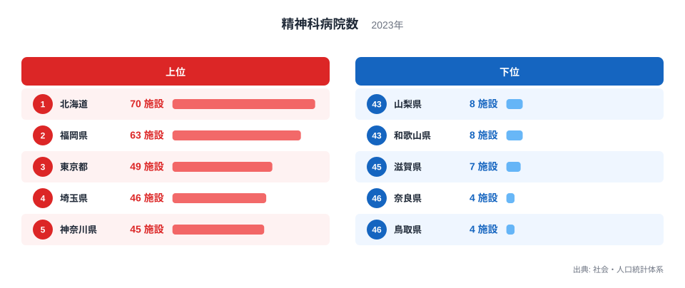
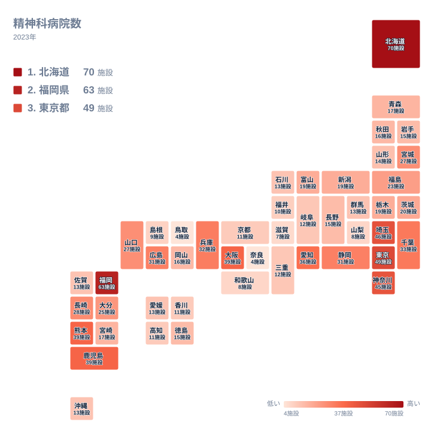

## 精神科病院が多い県と少ない県の開き

精神科病院の数は、都道府県によって大きく違います。2023年のデータでは、最も多い北海道が70施設、最も少ない奈良県と鳥取県が4施設です。最大と最小を比べると17.5倍の開きがあります。

この数字は、住民の心の健康状態をそのまま映したものではありません。病院という施設を数えただけの値なので、背景には地域の医療の組み立て方や、病院が立地してきた経緯などが重なっていると考えられます。ただし、手元にあるのは都道府県別の施設数だけです。そこでこの記事では、データから確認できることと、そう考えると説明しやすい仮説を分けて書きます。

まず上位5県と下位5県を図で確認します。

<source-link href="/ranking/psychiatric-hospital-count">精神科病院数ランキングをもっと見る</source-link>

図でまず目に入るのは、上位の棒の高さが一様ではない点です。北海道と福岡県は、3位以下の県から明らかに離れた位置にいます。3位の東京都から5位の神奈川県までは接近していて、トップ2とそれ以下の間に段差があることが上位の構造です。

上位に並ぶ顔ぶれにも注目できます。北海道、九州の福岡県、そして首都圏の東京都、埼玉県、神奈川県です。地方も都市の性格も異なる県が混じっているため、一つの要因で全体を説明するのは難しそうです。

下位は、上位とは性格が違います。棒の高さがどれも低く、互いの差も小さいので、わずかな施設数の違いで並びが入れ替わります。下位の順位は、実質的には「少ない県の集まり」として読むのが適切です。

> [!NOTE]
> ここでいう精神科病院数は、社会・人口統計体系の「精神科病院数」で、病院という施設の数です。病床数や医師数ではありません。小規模な病院も大規模な病院も同じ1施設として数えるため、施設数が多い県ほど入院の受け入れ力が高いとは限りません。

## 北海道と福岡県が上位に立つ背景

北海道が1位になる背景として、土地の広さが一因になっていると考えられます。広い道内に都市が離れて点在していれば、住民が通える範囲ごとに病院が置かれ、施設数が積み上がりやすくなる、という筋道です。ただし、面積や病院の立地を示すデータは今回ありません。これは仮説であり、確認できる事実ではありません。詳しい数値は[北海道のデータ](/areas/01000)で確認できます。

2位の福岡県は63施設です。九州・沖縄の各県を見ると、熊本県と鹿児島県が39施設で並び、長崎県が28施設、大分県が25施設、宮崎県が17施設です。佐賀県と沖縄県はともに13施設です。同じ九州・沖縄でも、福岡県の63施設に対して佐賀県と沖縄県は13施設と、県による差は大きく開いています。[福岡県のデータ](/areas/40000)とあわせて眺めると、この地方の中で福岡県が突出していることが分かります。

九州に熊本県や鹿児島県のような施設数の多い県が並ぶ理由として、民間の医療法人による病院整備の歴史が影響した可能性は考えられます。しかし、今回の指標には設立主体や開設時期の情報がなく、この説明を裏づけることはできません。歴史的な背景は、別の資料で確かめる必要がある仮説にとどまります。

> [!TIP]
> 順位表を読むときは、順位の数字よりも、値がどこで大きく変わるかに注目してください。この指標では、70施設と63施設の2道県、40施設前後から30施設台の県、10施設前後の県というように、いくつかの層に分かれています。段差の位置が分かると、県同士の距離感がつかめます。

## 大都市圏はどう並ぶか

関東では、東京都が49施設で3位、埼玉県が46施設で4位、神奈川県が45施設で5位です。千葉県は33施設で10位、茨城県は20施設、栃木県は19施設、群馬県は13施設です。同じ関東でも、上位に入る県と、中位から下位に入る県に分かれます。

近畿では、大阪府が39施設、兵庫県が32施設です。中部では、愛知県が36施設、静岡県が31施設です。大都市を抱える府県が上位から中位にまとまって入る傾向は、データからも確認できます。

一方で、東京都は49施設で、1位の北海道や2位の福岡県に及びません。東京都がこの位置にとどまる理由は、今回のデータだけでは分かりません。土地利用や地価の影響を挙げる見方もありますが、病院の立地の偏りは都道府県別の値からは確認できないため、推測の域を出ません。人口が多い地域が必ず施設数も最多になるわけではない、という点だけが、確かに言えることです。

## 下位に並ぶ県に見られる傾向

下位を見ると、奈良県と鳥取県が4施設で最少に並び、滋賀県が7施設、山梨県と和歌山県が8施設、島根県が9施設です。上位の70施設と比べると、下位の値はすべて一桁にとどまります。

近畿の中で見ると、大阪府の39施設と兵庫県の32施設に対し、京都府は11施設、和歌山県は8施設、滋賀県は7施設、奈良県は4施設です。大都市を抱える府県と、それ以外の府県の差が大きい地方です。中国でも、広島県が31施設、山口県が27施設である一方、島根県は9施設、鳥取県は4施設で、同じ地方の中で大きな開きがあります。

下位の県には、人口規模や隣接する大都市圏との関係が背景にある可能性はあります。たとえば、近隣の府県の病院を利用する人の流れがあれば、自県の施設数は少なくなるかもしれません。ただし、患者の流れや人口を示すデータは今回扱っていないため、こうした事情はあくまで可能性の一つです。確かなのは、下位の県が近畿、中国、中部などに散らばっているという事実です。

> [!WARNING]
> 施設数が少ない県は、精神科医療が不足しているとは限りません。1施設あたりの規模が大きければ、少ない施設数でも入院の受け皿は確保されます。外来を担う診療所や、他県の病院への通院は、この数字に含まれません。値の小ささを、そのまま医療の手薄さと読むのは避けてください。

## 地図で見る地理分布

次に、地図で地理的な広がりを確認します。

地図を見ると、北海道、九州、関東に、施設数の多い県がまとまって現れます。これに対して東北は、宮城県が27施設、福島県が23施設と比較的多く、青森県が17施設、秋田県が16施設、岩手県が15施設、山形県が14施設と続きます。宮城県と福島県が地方の中では高めで、残りの4県は10施設台前半から後半に収まっています。

中部は、愛知県の36施設から山梨県の8施設まで、県ごとの幅が大きい地方です。静岡県は31施設、新潟県と富山県は19施設、長野県は15施設、石川県は13施設、岐阜県は12施設、福井県は10施設と並びます。同じ地方に上位と下位が同居しているため、地方単位で「多い」「少ない」とひとくくりにはできません。四国は、徳島県の15施設から、愛媛県の13施設、香川県と高知県の11施設までに収まり、県同士の差が小さい地方です。

ここから言えるのは、精神科病院の多さが地方ごとにきれいに分かれているわけではない、ということです。北海道や福岡県のような突出した県がある地方もあれば、県ごとの差が小さい地方もあります。同じ地方の中でも差が大きい以上、「◯◯地方だから多い」という説明は成り立ちにくいといえます。

## 数字を読むときの視点

ここまでの内容を整理します。確認できる事実は、北海道と福岡県が突出していること、東京都、埼玉県、神奈川県が続くこと、下位は奈良県と鳥取県の4施設を最少に、一桁の県が並ぶこと、の三点です。面積、人口、歴史といった背景は、あくまで仮説として考える材料です。

この指標だけでは、医療の質や入院できる人数、通院のしやすさは分かりません。たとえば、大阪府、熊本県、鹿児島県は同じ39施設ですが、地域の成り立ちはまったく異なります。同じ数字でも、地域にとっての意味が同じとは限りません。

他の統計とあわせて読むと、解釈はより確かになります。医療や福祉の指標は、[同じカテゴリの統計一覧](/category/socialsecurity)から探せます。人口あたりの病床数や医師数などと照らし合わせれば、施設数の多さが医療の充実を意味するのかどうかを、別の角度から確かめられます。

## データについて

この記事で使ったのは、社会・人口統計体系の「精神科病院数」の2023年の値で、単位は施設です。全国47都道府県の値をそのまま使い、人口で割るなどの加工はしていません。倍率は、最大の北海道と最小の奈良県・鳥取県の比です。

同じ値の県は、優劣のない並びとして扱います。たとえば、大阪府、熊本県、鹿児島県は39施設で並び、静岡県と広島県は31施設、宮城県と山口県は27施設で並びます。奈良県と鳥取県は4施設で並びます。ランキングページでは同じ値の県が順に表示されることがありますが、順位の数字より施設数の値を優先して読んでください。

人口や面積で調整していない値は、地域の規模の違いを強く反映します。その点を踏まえて、数字の背景を考えてみてください。
