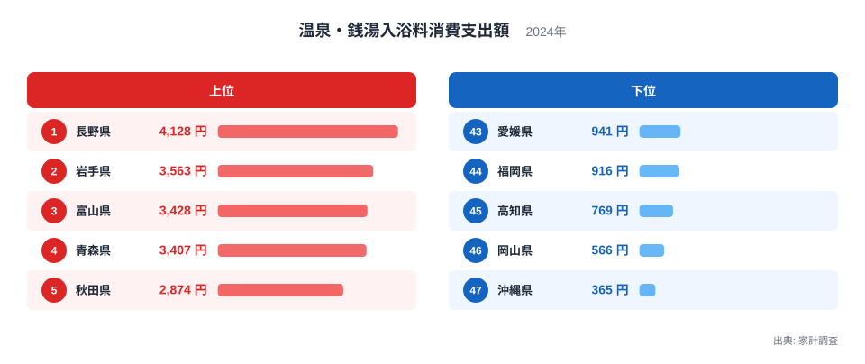
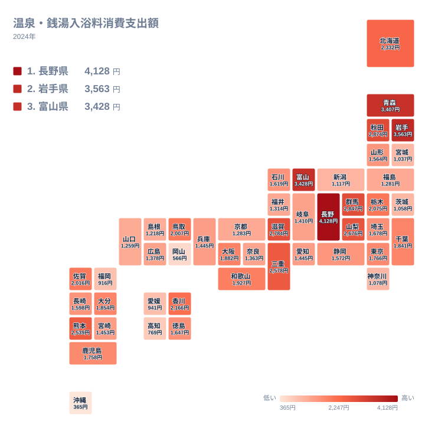

家に浴室がある時代でも、わざわざ温泉や銭湯に足を運んでお金を払う人は少なくありません。その支出額を都道府県で比べると、思いのほか大きな差が現れます。2024年の家計調査で最も多かったのは長野県の4,128円、最も少なかったのは沖縄県の365円でした。

この記事では、温泉・銭湯への支出が多い県と少ない県を並べ、気候や温泉地の分布、暮らし方との結びつきを考えます。ただし、支出額の順位だけでは原因までは確かめられません。そこで、背景についての話は「そう見ることもできる」という仮説として扱い、データから言えることと分けて書きます。

> [!NOTE]
> ここでの支出額は、家計調査の「温泉・銭湯入浴料」にあたる、1世帯あたりの年間支出額で、単位は円です。宿泊料金そのものではなく、入浴のために支払う料金が対象です。入浴の回数ではなく、支払った金額の大きさを表す指標です。

## 上位5県と下位5県の開き

まず、上位5県と下位5県を図で確認します。

<source-link href="/ranking/public-bath-consumption-expenditure">温泉・銭湯入浴料への支出ランキングをもっと見る</source-link>

上位は長野県、岩手県、富山県、青森県、秋田県の順です。このうち岩手県、青森県、秋田県は北海道・東北の県で、長野県と富山県は中部の県です。上位5県は、北海道・東北と中部の2つの地方に収まっています。

下位は47位の沖縄県から、岡山県、高知県、福岡県、愛媛県の順に並びます。下位5県は中国、四国、九州・沖縄にまたがっており、東日本の県は入っていません。1位の4,128円と47位の365円を比べると、入浴料への支出が県によって大きく異なることが分かります。

図から読み取れるのは、この2点です。上位は北海道・東北と中部に偏り、下位は西日本に偏っています。ただ、下位の福岡県のような県がなぜ低いのかは、このデータだけでは分かりません。温泉地の多さだけでは説明しきれない部分があることだけは確かです。

## 長野県と東北の県が上位に並ぶ背景

最も支出が多い長野県には、山あいに温泉地が点在しています。地元の人が日常的に使える入浴施設が身近にあることが、支出を押し上げているという見方もできます。ただし、これは仮説であり、今回の支出額だけで確かめられるわけではありません。詳しい指標は[長野県のデータ](/areas/20000)で確認できます。

岩手県は3,563円で2位、青森県は3,407円で4位、秋田県は2,874円で5位です。いずれも冬の寒さが厳しい地域であり、体を温める手段として入浴施設を使う機会が多いのかもしれません。ただし、気温や利用回数のデータは今回扱っていないため、寒さが支出の多さの理由だと言い切ることはできません。各県の他の指標は[岩手県のデータ](/areas/03000)のような地域ページと合わせて見ると、比較の材料が増えます。

北海道・東北の7県の中でも、結果は一様ではありません。北海道は2,332円で11位、山形県は1,564円で27位、福島県は1,281円で36位、宮城県は1,037円で42位でした。同じ地方に属していても、上位から下位寄りまで大きく割れています。「東北は温泉が好き」といった地方単位の見方では、この差を捉えられません。

> [!WARNING]
> 家計調査は標本調査で、調査の対象は県庁所在市などの世帯が中心です。県全体の実態をそのまま表すものではなく、標本数が限られるため、順位が近い県どうしの差は誤差の範囲かもしれません。1位や47位といった端の順位よりも、全体の傾向を重視して読むのが安全です。

## 地理分布で見る温泉・銭湯の地図

次に、47都道府県の分布を地図で確認します。

地図で眺めると、色の濃い県は北海道・東北と中部に集まっています。一方で、中国、四国、九州・沖縄の一部には色の薄い県が目立ちます。全体として、東日本の北側と中部で支出が多く、西日本の南側で少ない傾向が見えます。

ただし、地図は傾向を示すだけで、隣り合う県が同じ水準になるとは限りません。たとえば九州・沖縄では、熊本県が2,539円で10位に入る一方、沖縄県は365円で47位です。同じ地方の中でも、順位は大きく離れています。温泉資源の豊かな九州でも、県ごとの違いは大きいと言えます。

この図から読み取れるのは、地方という大きなくくりよりも、県ごとの違いが支出を左右している可能性です。次の節では、同じ地方の中での割れ方を、関東と中国で見てみます。

> [!TIP]
> 順位を読むときは、「温泉地として有名な県」と「住民が入浴施設にお金を使う県」を分けて考えるのがコツです。この指標は世帯の支出を集計したもので、旅行者が使った分は含まれていません。温泉地として知名度が高くても、順位が高いとは限らない点に気をつけてください。

## 同じ地方でも大きく割れる関東と中国

関東では、群馬県が2,847円で6位と、地方の中で突出しています。群馬県は草津や伊香保といった温泉地で知られており、その存在が支出と関係している可能性はあります。一方、同じ関東の神奈川県は1,078円で40位、茨城県は1,058円で41位でした。栃木県の2,075円で13位、東京都の1,766円で20位と比べても、関東の中で大きな差があります。

中国にも同じ傾向があります。鳥取県は2,007円で15位ですが、岡山県は566円で46位です。広島県は1,378円で32位、山口県は1,259円で37位、島根県は1,218円で38位で、中国の中でも二極化が見られます。隣り合う県でこれほど差があるのは、地方単位の気候や文化だけでは説明がつきにくいことを示唆しています。

また、近畿では滋賀県が2,784円で7位、三重県が2,578円で9位と上位に入る一方、京都府は1,283円で35位です。観光客の多い府県でも、住民の入浴料支出が多いとは限りません。この指標は観光地としての知名度ではなく、世帯の支出を映していると読むのが妥当です。

大都市では、大阪府が1,882円で17位、東京都が1,766円で20位、愛知県と兵庫県はどちらも1,445円で29位でした。福岡県は916円で44位です。大都市の間でも位置づけは異なり、都市部だからといって高い、あるいは低いとは言えません。理由はこのデータだけでは分かりません。

> [!NOTE]
> 同じ金額の県は同じ順位になります。愛知県と兵庫県はどちらも1,445円で、ともに29位です。順位は同順位の分だけ次の順位が飛ぶため、順位の数字だけでなく金額も合わせて見ると、実際の差を読み誤りにくくなります。

## 数字から言えること、言えないこと

ここまでの内容をまとめます。データから確かに言えるのは、支出額が県によって大きく異なること、そして上位が北海道・東北と中部に、下位が西日本に偏って見えることです。同じ関東や同じ中国の中でも、順位が大きく割れていることも確かめられました。

一方で、その理由については仮説にとどまります。寒さ、温泉資源、地域の入浴施設が身近にあるかどうかなどが関係している可能性はありますが、今回のデータは支出額と順位だけです。気候や施設数との関係を示す裏付けはないため、原因を断定することはできません。

また、入浴料は食料品のような必需的な支出とは異なり、余暇や健康づくりに近い性格を持つ支出です。そのため、地域の暮らし方や楽しみ方の違いが表れやすいとは考えられますが、これも仮説の域を出ません。他の分野の統計と合わせて検討したい場合は、[同じカテゴリの統計一覧](/category/economy)から関連する指標を探せます。

## データについて

この記事で使ったのは、家計調査の「温泉・銭湯入浴料消費支出額」の2024年の値です。単位は円で、47都道府県の値と順位を使いました。同じ金額の県は同じ順位として扱っており、愛知県と兵庫県はどちらも1,445円で29位です。

家計調査は世帯への聞き取りに基づく統計で、県庁所在市などの傾向が中心になります。県内の温泉地の人気や観光客の消費は含まれないため、解釈にはその点を意識してください。この指標は、各県の暮らしの中で入浴施設がどれだけ使われているかを知る手がかりであり、原因までを示すものではありません。
