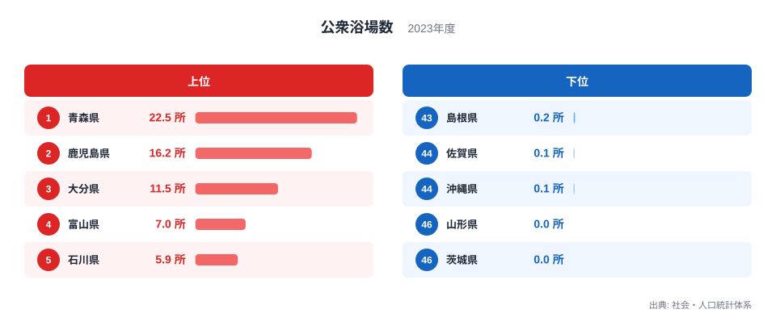
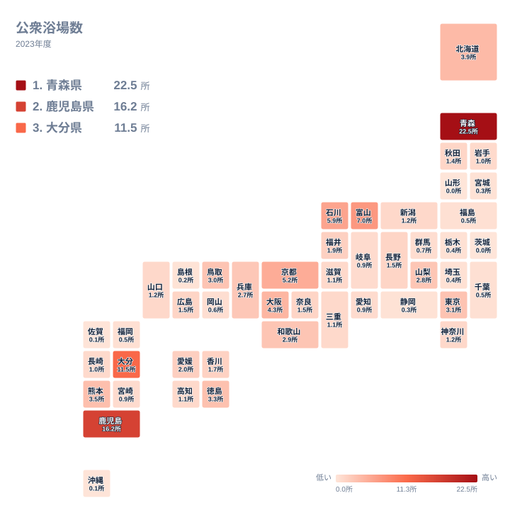

## 公衆浴場が最も多いのは青森県です

銭湯や温泉浴場といった公衆浴場は、家庭に風呂が行き渡った今も、地域の暮らしに残る施設です。ところが都道府県ごとに並べると、数字には大きな開きがあります。2023年の公衆浴場数で首位に立つのは青森県で、22.5所です。2位は鹿児島県の16.2所、3位は大分県の11.5所と続きます。

一方で、山形県と茨城県は0所です。首位と最下位の間には、数字の上で埋めようのない差があります。この記事では、上位と下位がなぜこの順になるのかを、地理や暮らしの面から考えます。ただし、このデータには温泉の数や人口、歴史の情報は含まれていません。そのため、理由については「データから言えること」と「仮説にとどまること」を分けて書きます。

<source-link href="/ranking/public-bath-count-per-100k">公衆浴場数ランキングをもっと見る</source-link>

> [!NOTE]
> 公衆浴場数の単位は「所」ですが、値が22.5所や0.9所のような小数になっています。そのため、施設の実数をそのまま並べた値ではなく、何らかの基準で換算した値と見られます。ただし、その基準(人口や面積など、何で割っているのか)は、この記事で使ったデータからは確認できていません。この記事では、各県の値を同じ尺度で並べたものとして、値と順位をそのまま読みます。

## 上位と下位を並べると見えるもの

図の上位には、青森県の22.5所、鹿児島県の16.2所、大分県の11.5所、富山県の7所、石川県の5.9所が並びます。まず目を引くのは、首位と2位の開きです。青森県は22.5所で、2位の鹿児島県は16.2所です。さらに3位の大分県は11.5所まで下がります。上位3県は、次の順位との間に大きな段差があります。

その一方で、4位の富山県の7所と5位の石川県の5.9所は差が小さく、ここから先は値が緩やかに下がります。つまり上位は、青森県が頭ひとつ抜け、鹿児島県と大分県が続き、富山県と石川県が追う形です。地方で見ると、北海道・東北の青森県、九州・沖縄の鹿児島県と大分県、中部の富山県と石川県という顔ぶれで、関東の県は上位5位に入っていません。

下位は、山形県と茨城県が0所です。佐賀県と沖縄県が0.1所、島根県が0.2所で続きます。最小値が0所なので、最大の22.5所との倍率は計算できません。上位は北と南に分かれて目立つのに対し、下位は関東、北海道・東北、九州・沖縄、中国と地方がばらばらで、地域的なまとまりは強くありません。

## 青森県と九州の県はなぜ多いのか

青森県が突出する理由として、温泉や日常の入浴習慣との結びつきを思い浮かべる人は多いはずです。ただし、このデータに温泉の数や入浴習慣の情報はなく、結びつきがあるかどうかは確かめられません。この記事で言えるのは、青森県が22.5所で全国の首位にあるという事実までです。詳しい値は[青森県のデータ](/areas/02000)でも確認できます。

鹿児島県と大分県は、温泉地として広く知られています。それぞれ16.2所と11.5所という値が、温泉と関係している可能性はあります。しかし、これも今回の数字だけでは裏づけられません。温泉が多い県でも、公衆浴場として数えられる施設が多いとは限らないからです。個別の数字は[鹿児島県のデータ](/areas/46000)から見られます。

> [!TIP]
> 公衆浴場という言葉には、街中の銭湯も温泉浴場も入りうるため、どの施設が数えられているかで印象が変わります。県の順位を読むときは、観光地として知られる温泉の多さではなく、統計上どの種類の施設が公衆浴場に入るのかという定義を、元の統計で確かめてから解釈してください。

## 地理分布のタイルマップで確認する

マップで新たに読み取れるのは、青森県の周りの様子です。青森県は22.5所と突出していますが、隣り合う東北の県は低い値にとどまります。秋田県は1.4所で22位、岩手県は1所、福島県は0.5所、宮城県は0.3所、山形県は0所です。多い県が地域全体を引き上げているのではなく、一つの県だけが飛び抜けているのです。

同じことは九州でも言えます。鹿児島県と大分県は上位ですが、熊本県は3.5所で9位、長崎県は1所、宮崎県は0.9所、福岡県は0.5所、佐賀県は0.1所です。地方という大きな単位で語るよりも、県ごとの事情を見る必要があることがわかります。

一方、近畿は比較的値がそろっています。京都府は5.2所で6位、大阪府は4.3所で7位、和歌山県は2.9所で13位、兵庫県は2.7所で15位です。大都市圏の府が上位に近い位置にあるのは目を引きますが、その理由を歴史に求められるかどうかは、このデータからは言えません。

## 下位の県はなぜ少ないのか

下位の県で公衆浴場が少ない理由を、データから説明することはできません。住宅に風呂が備わる前提で暮らしが組み立てられ、浴場に通う需要が小さい地域では、数が少なくなるのかもしれません。ただし、これはあくまで仮説です。

ここで注意したいのは、温泉地として知られる県でも値が小さいことです。山形県は温泉地として知られていますが、値は0所です。温泉が旅館や宿泊施設の中に集まり、住民が通う独立した公衆浴場として数えられる施設が少ないのかもしれません。観光資源としての温泉と、統計上の公衆浴場は、別の概念として見る必要があります。

また、関東の中でも差があります。東京都は3.1所で11位ですが、神奈川県は1.2所、千葉県は0.5所、埼玉県は0.4所、栃木県は0.4所、茨城県は0所です。同じ関東でも、東京都とそれ以外の県で大きな開きがあります。

> [!WARNING]
> 0所という値は、浴場がまったく存在しないことを意味するとは限りません。値は小数第1位までに丸められて表示されているため、ごく小さい値が0所と表示されている可能性があります。また、同じ値の県は順位の差に意味がありません。値が並んでいるときは、順位ではなく値そのものを見てください。

## 中位の県の並び方

中位に目を向けると、北海道は3.9所で8位、熊本県は3.5所で9位、徳島県は3.3所で10位、鳥取県は3所で12位、山梨県は2.8所で14位です。上位ほど突出していなくても、一定の水準を保つ県がここに集まっています。

さらに値を下ると、愛媛県が2所で16位、福井県が1.9所で17位、香川県が1.7所で18位です。長野県、奈良県、広島県はいずれも1.5所で並び、秋田県は1.4所で22位です。このあたりから、値の差はごくわずかになります。

そのため、中位から下位にかけては、わずかな差で順位が入れ替わりやすいことに注意が必要です。たとえば0.9所には岐阜県、愛知県、宮崎県が並びます。順位の違いだけで優劣を語るのは避け、値そのものを見ることが大切です。

## データについて

この記事で使った数値は、社会・人口統計体系の「公衆浴場数」の2023年の値で、単位は所です。全47都道府県の値をもとに、上位と下位を比較しました。値の換算の基準は、先の注記で触れたとおり確認できていません。そのため、県同士を比べる目安として読んでください。

数字を比べるときは、順位だけでなく値の大きさも合わせて確認してください。首位の青森県が22.5所であるのに対し、山形県と茨城県は0所です。同じ全国の中でこれほどの差があるのは、公衆浴場が地域ごとに異なる形で存在していることを示しています。

他の指標との比較に関心がある方は、[同じカテゴリの統計一覧](/category/commercial)もあわせてご覧ください。商業や生活に関わる統計を並べて見ることで、公衆浴場の数が地域のどんな特徴と重なるのかを考える手がかりになります。

## まとめ

2023年の公衆浴場数は、青森県が22.5所で首位、鹿児島県が16.2所で2位、大分県が11.5所で3位です。北と南の端に多い県が分かれていますが、その背景に温泉や暮らしの習慣があるかどうかは、今回のデータだけでは断定できません。

一方、下位は山形県と茨城県が0所、佐賀県と沖縄県が0.1所、島根県が0.2所でした。温泉地として知られる県でも値が小さい例があり、観光のイメージと統計は一致しない場合があります。数字は定義と合わせて読むことが欠かせません。
