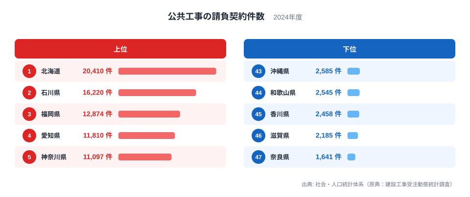
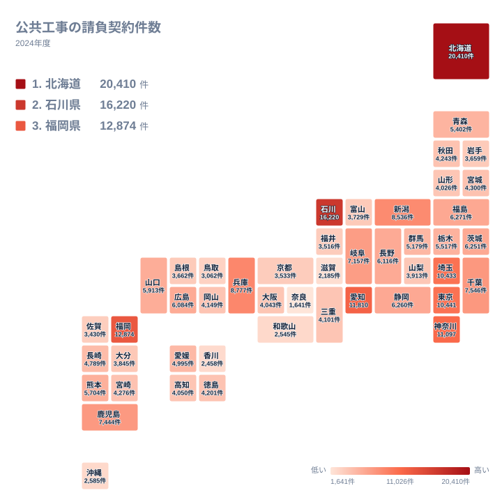

## 公共工事の契約件数は人口の順には並びません

公共工事の請負契約件数が最も多い県はどこでしょうか。人口の多い東京都や大阪府を思い浮かべる方が多いかもしれません。ところが2024年の結果を見ると、首位は北海道の20,410件で、2位は石川県の16,220件でした。3位が福岡県の12,874件、4位が愛知県の11,810件、5位が神奈川県の11,097件と続きます。

一方、下位は奈良県の1,641件が最も少なく、滋賀県の2,185件、香川県の2,458件、和歌山県の2,545件、沖縄県の2,585件が並びます。首位の北海道と最下位の奈良県を比べると、件数の開きは非常に大きいことがわかります。

この差は、単に人口や経済規模の大小だけでは説明できません。道路や河川、港湾、学校、上下水道といった公共施設をどれだけ抱えているか、災害からの復旧がどれだけ進行中か、発注の仕方が細かく分かれているか。そうした地理・産業・歴史の違いが、件数という形で表れます。この記事では、上位と下位がなぜその順になるのかを順に見ていきます。

<source-link href="/ranking/public-construction-contract-count">公共工事の請負契約件数ランキングをもっと見る</source-link>

上の図は、上位と下位を並べたものです。まず目に入るのは、上位に並ぶ県の性格がまちまちなことです。北海道は広大な面積を持つ地方、石川県は北陸の中規模県、福岡県・愛知県・神奈川県は大都市を抱える県です。同じ上位でも、件数を押し上げている理由は一つではありません。

下位側を見ると、近畿の奈良県・滋賀県・和歌山県、四国の香川県、九州・沖縄の沖縄県が顔をそろえます。面積が比較的小さい県が多いものの、それだけが理由とは言えません。同じように面積の小さい県でも、順位が中位に収まる例があります。件数は、工事の大きさではなく契約の数を数えた値だという点を、あらためて意識する必要があります。

> [!NOTE]
> ここでの件数は、契約した工事の本数を数えたものです。契約額の大きさは反映されません。巨大なダム工事も、小さな舗装補修も、同じ1件として数えます。件数の多さは、工事が細かく分かれて発注されていることの表れでもあります。

## 北海道が首位に立つ地理的な理由

北海道が20,410件で1位になる最大の理由は、道路や河川、港、農業基盤などの公共施設が広い範囲に点在していることです。人が少ない地域でも、道路は雪から守り、橋や堤防は維持しなければなりません。管理する施設の総量が大きければ、補修や更新の工事も数多く発生します。

もう一つは、冬の気候の影響です。積雪や凍結で傷んだ道路や排水施設は、毎年のように手当てが必要になります。大規模な新設よりも、維持・補修といった小規模な工事が積み重なる構造が、件数を押し上げていると考えられます。農業や漁業を支える基盤整備も、道内各地で継続的に行われています。

詳しい地域の数字は、[北海道のデータ](/areas/01000)で確認できます。ほかの指標と並べて眺めると、広さと件数の関係がより立体的に見えてきます。

## 石川県が2位に入った背景

意外に映るのは、石川県が2位の16,220件に入っていることです。石川県は中部に属する県で、人口や経済規模の面では、福岡県や愛知県、神奈川県より小さい県です。それでも件数では、福岡県の12,874件、愛知県の11,810件、神奈川県の11,097件を上回っています。

背景として大きいのは、2024年に起きた能登半島地震とその復旧です。道路、水道、港、住宅地まわりの施設など、被害を受けた公共インフラの復旧工事が一斉に動き出すと、小さな工事が短期間に多数発注されます。災害復旧は、被害の範囲が広く、箇所ごとに契約が分かれやすい性格を持つため、件数が膨らみやすいのです。

つまり、石川県の2位は、平時の工事量が多いことを示すものではなく、特別な事情が重なった結果と読むのが自然です。翌年以降に順位がどう動くかで、復旧の進み方も見えてきます。石川県の他の統計は[石川県のデータ](/areas/17000)にまとめています。

> [!WARNING]
> 2024年は能登半島地震の年にあたり、石川県の件数には災害復旧の発注が含まれている可能性があります。この年の1年分だけで、石川県の平常時の工事量を判断するのは危険です。前後の年と合わせて読む必要があります。

## 大都市圏の件数はどう読むか

福岡県、愛知県、神奈川県の3県が上位に入るのは、人口と都市機能が集中しているためと説明できます。道路・鉄道・上下水道・学校・公営住宅など、更新が必要な施設の量が多く、発注の本数もそれに比例して増えます。東京都は10,441件で6位、埼玉県は10,433件で7位、兵庫県は8,777件で8位でした。

注目したいのは、東京都と埼玉県が、わずかな差で隣り合っていることです。東京都は民間工事の比重が大きく、国や都が発注する大型事業が目立つ一方、埼玉県は住宅地が広がる県で、市町村の発注する生活基盤の工事が数多く並びます。性格の異なる両者が近い件数になっているのは興味深い点です。

一方、大阪府は4,043件で32位、京都府は3,533件で39位にとどまります。人口の多い大都市圏でありながら、件数が少ないのです。大阪府は市街地がすでに高度に整備され、新規の公共工事が相対的に少ないことや、発注が大きな単位にまとまりやすいことが影響している可能性があります。人口が多いからといって、件数が多いとは限りません。

## 地理分布から見える地方ごとの違い

タイルマップで全体を眺めると、件数の多い県が一か所に固まっていないことがわかります。北海道・東北では、北海道の20,410件が突出し、福島県が6,271件で13位、青森県が5,402件で21位と続きます。東北の各県は、おおむね中位から下位寄りに散らばっています。

関東は、神奈川県の11,097件、東京都の10,441件、埼玉県の10,433件、千葉県の7,546件と、上位から中位に集まっています。人口が集中する地域に件数も集まる、いわば予想どおりの形です。中部は、石川県の16,220件、愛知県の11,810件、新潟県の8,536件が上位に入る一方で、富山県は3,729件で36位、福井県は3,516件で40位と、同じ地方でも順位が大きく割れています。

近畿では、兵庫県の8,777件が8位で最高です。三重県の4,101件は30位、大阪府は32位、京都府は39位で、和歌山県、滋賀県、奈良県が最下位付近に並びます。同じ地方の中で、これほど順位が散らばるのは、県ごとの事情の違いが大きいからです。

中国は山口県の5,913件が18位、広島県の6,084件が17位です。四国は愛媛県が4,995件で23位、香川県が2,458件で45位。九州・沖縄は、福岡県が3位、鹿児島県が7,444件で11位、熊本県が5,704件で19位、沖縄県は43位と、上位と下位の両方に県が入っています。

## 下位に並ぶ県に共通するもの

最下位の奈良県は1,641件で、滋賀県の2,185件、香川県の2,458件、和歌山県の2,545件、沖縄県の2,585件が続きます。これらの県の背景は同じではありません。

奈良県と滋賀県は海に面さない内陸の県で、港湾や海岸の工事がそもそも少なく、公共工事の種類が限られます。香川県は面積が小さく、管理する道路や河川の総延長が限られます。和歌山県は海岸線を持ちますが、人口規模が小さいことが影響していると考えられます。沖縄県は島しょ県で、本土とは異なる事情があり、公共工事は国の事業として大きくまとまって発注されることもあります。

こうして見ると、下位の理由は「公共事業が少ない」という単純な話ではありません。工事が大きな単位にまとめられていれば、同じ予算でも件数は少なくなります。面積や人口、発注の仕方、地形の違いが組み合わさって、この順位が決まっているのです。

> [!TIP]
> 件数を読むときは、金額や工事の規模とセットで見るのがコツです。件数が多い県は、小さな補修が多いのか、災害復旧が重なったのかを考えましょう。件数が少ない県は、大型の工事を少数の契約にまとめている可能性があります。同じ順位でも、中身は大きく異なります。

## 件数の順位を人口やくらしと結びつけて読む

この指標を見るときは、人口あたりでも面積あたりでもなく、契約の本数をそのまま数えたものだという前提を忘れないようにします。北海道の20,410件と石川県の16,220件は、地理の広さと災害復旧という、まったく別の理由で押し上げられた数字です。

一方で、都市部の福岡県、愛知県、神奈川県は、更新が必要な公共施設の量が多いことを素直に映しています。老朽化した橋やトンネル、上下水道は、これから先も更新が続きます。件数が多い県は、それだけ維持管理の負担が大きい県とも言えます。

同じカテゴリの別の統計と組み合わせると、読みがさらに深まります。[同じカテゴリの統計一覧](/category/construction)では、工事の金額や着工に関する指標も確認できます。件数と金額の順位が食い違う県を探すと、その県の工事の性格が浮かび上がってきます。

## データについて

この記事の数値は、社会・人口統計体系に収録された、建設工事受注動態統計調査を原典とする公共工事の請負契約件数です。年は2024年、単位は件です。都道府県ごとの契約の本数を示すもので、金額や工事の規模は含みません。順位は、この件数の多い順に付けています。

本文で述べた地理的・歴史的な背景は、数値そのものから導いたものではなく、一般に知られる事情をもとにした解釈です。そのため、各県の順位の理由は、あくまで可能性として読んでください。
