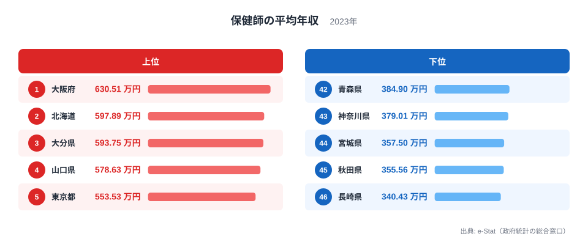
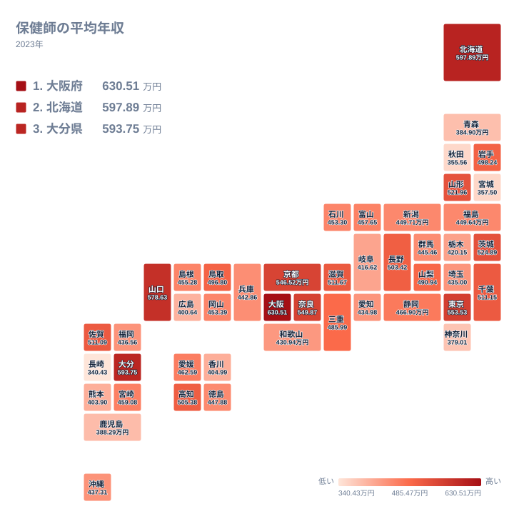

## 保健師の平均年収は県でどれほど違うのか

保健師は、地域住民の健康づくりや感染症対策、母子保健、高齢者支援などを担う専門職です。主な勤め先は市区町村や都道府県の役所、保健所ですが、企業や学校で働く人もいます。同じ資格で似た仕事をしていても、平均年収は県によって異なります。

2023年の保健師の平均年収を見ると、最も高いのは大阪府の630.51万円です。2位は北海道の597.89万円、3位は大分県の593.75万円でした。最も低いのは長崎県の340.43万円で、45位の秋田県は355.56万円、44位の宮城県は357.5万円です。最上位と最下位の間には、とても大きな開きがあります。

この記事では、上位と下位の顔ぶれを並べ、地理や産業、歴史の面から考えられる背景を探ります。ただし、使えるのは県ごとの平均値だけです。背景として挙げる事柄は仮説にとどまり、理由を証明するものではありません。記事の中では、データから「分かること」と「分からないこと」を分けて書きます。

> [!NOTE]
> この数字は、保健師という職種の平均年収を県ごとにまとめた値です。勤め先が自治体か企業か、常勤か非常勤か、賞与や手当をどこまで含むかといった内訳は、この記事で使うデータには含まれていません。そのため、一人ひとりの年収や、特定の自治体の給与表の水準と同じものとして読むことはできません。

## 上位5県と下位5県の顔ぶれ

まず、上位と下位をそれぞれ5県ずつ図で確認します。

<source-link href="/ranking/public-health-nurse-annual-income">保健師の平均年収ランキングをもっと見る</source-link>

上位は大阪府、北海道、大分県、山口県、東京都の順です。4位の山口県は578.63万円、5位の東京都は553.53万円でした。大都市の府や都が入る一方で、北海道、大分県、山口県といった県も並んでいます。人口が多い都市ほど高い、という単純な並びにはなっていません。

下位は、42位の青森県が384.9万円、43位の神奈川県が379.01万円、44位の宮城県が357.5万円、45位の秋田県が355.56万円、46位の長崎県が340.43万円です。東北の青森県、宮城県、秋田県の3県と、九州の長崎県、そして関東の神奈川県が入っています。

ここで注目したいのは、1位の630.51万円と46位の340.43万円という両端の距離です。この2つの値を並べるだけで、同じ職種でも県によって水準がかなり違うことが分かります。一方で、この開きがなぜ生まれたのかは、データだけでは断定できません。分かるのは「県別の平均値にこれだけの幅がある」という事実までです。

神奈川県が下位に入っている点も、人口や都市の大きさだけでは並びを説明しにくいことを示しています。大都市圏だから高い、地方だから低い、という見方は、このデータでは成り立ちません。

> [!WARNING]
> 県別の平均値は、集計対象の保健師が少ない県ほど、一部の人の年収に引きずられやすくなります。このデータからは各県の対象人数が分からないため、1位や46位という順位が、わずかな偏りで入れ替わる可能性を否定できません。順位の差を、そのまま県の待遇の優劣と読むのは避けてください。

## 上位に入る県を地理と産業から考える

1位の大阪府は、近畿の中核となる大都市圏です。保健所や市町村の組織が大きく、医療機関や企業も多い地域です。そのため、保健師が多様な職場で経験を積める環境があるのかもしれません。ただし、勤め先別の年収は示されていないので、これが高さの理由かどうかは確かめられません。詳しい数字は[大阪府のデータ](/areas/27000)でも確認できます。

2位の北海道は、広い面積に市町村が散らばる地域です。広域で働く人材を確保する事情や、地域ごとの手当の仕組みが水準に関わっているのかもしれません。これも仮説であり、データに手当の内訳はありません。[北海道のデータ](/areas/01000)もあわせてご覧ください。

3位の大分県と4位の山口県は、大都市圏ではありません。それでも593.75万円と578.63万円という高い値が出ています。理由として、年齢構成や勤続年数の違いが考えられるかもしれません。しかし、人数も勤続年数もこのデータにはないため、確かなことは言えません。大分県と山口県が上位に入っているという事実だけを、ここでは押さえておきます。

近畿では、6位の奈良県が549.87万円、7位の京都府が546.52万円、10位の滋賀県が511.67万円でした。大阪府を含めると、近畿の4府県が上位10位以内に入っています。大阪府を中心とした広い生活圏が水準に影響しているかどうかは、このデータだけでは判断できません。

> [!TIP]
> 中位は値が接近しています。たとえば32位の福岡県は436.56万円、33位の埼玉県は435万円、34位の愛知県は434.98万円です。順位が1つ違っても、値の差はごくわずかです。順位の上下に一喜一憂せず、値が近い県は同じ水準のグループとして見るのが、この指標の読み方です。

## 地理分布のタイルマップで見る偏り

次に、全国の分布を地図の形で眺めます。

地図を見ると、高い県が特定の地方にまとまっているわけではないことが分かります。近畿には大阪府、奈良県、京都府、滋賀県が並びます。中国の山口県、九州の大分県、北海道も高い側にあります。地方ごとの傾向というより、県ごとの違いが目立つ分布です。

東北を見ると、山形県が521.96万円で9位、岩手県が498.24万円で15位と、上位から中位に位置します。一方で、青森県は42位、宮城県は44位、秋田県は45位です。同じ東北でも、順位に大きな開きがあります。東北全体が低いとは言えず、県ごとの違いが背景にあるのかもしれません。

関東もばらつきがあります。茨城県が524.89万円で8位、千葉県が511.15万円で11位と高めです。一方、神奈川県は43位、栃木県は420.15万円で36位です。首都圏に近いからといって、年収が高くなるとは限りません。

九州・沖縄でも、大分県が3位、佐賀県が511.09万円で12位と高い一方、長崎県は46位でした。福岡県は32位、熊本県は403.9万円で39位、鹿児島県は388.29万円で41位です。同じ九州内でも順位は大きく分かれています。

## 歴史と制度から考える：分かることと分からないこと

保健師の配置は、戦後の保健所制度や結核対策、母子保健の取り組みの中で広がってきたと言われています。その後、保健活動の担い手が市町村へ移る中で、自治体ごとの採用や配置の考え方に違いが生まれた可能性があります。こうした歴史の違いが、現在の人員構成に影響しているのかもしれません。

自治体の給与は、地域手当や独自の給与表によって差が出る仕組みです。職員の年齢構成が高い県では平均が高く、若い職員が多い県では低く出ることも考えられます。ただし、保健師の多くが公務員として働いているかどうかを示すデータは、ここにはありません。そのため、自治体の給与制度が順位を決めていると言い切ることはできません。

産業構造の面でも同様です。企業で働く産業保健師が多い地域では、民間の賃金水準が平均に混ざる可能性があります。ただし、長崎県や秋田県、宮城県、青森県が下位にある理由は、このデータからは分かりません。人口減少や自治体の財政など、別の資料で確かめる必要のある論点です。

分かることをまとめます。県別の幅は大きく、大都市圏だけが高いわけではなく、同じ地方でも県によって位置が違います。分からないことは、その理由です。勤め先、年齢、勤続年数、手当の内訳がないため、順位の背景は仮説にとどまります。

## 数字を読むときの注意点

保健師の平均年収は、大阪府や東京都のような大都市だけでなく、北海道、大分県、山口県でも高く出ました。反対に、神奈川県のような大都市圏の県が下位に入る例もあります。人口や景気の指標とは別の動きをしているように見えますが、その理由は今回のデータでは確かめられません。

年収は、仕事の内容や責任の重さ、暮らしやすさを測る唯一の物差しでもありません。進路や転職を考えるときは、各自治体の募集要項や給与表を直接確認することをおすすめします。

他の経済指標と見比べたいときは、[同じカテゴリの統計一覧](/category/economy)から、ほかの県別ランキングも探せます。賃金や所得の指標と並べると、保健師の年収の位置づけが見えやすくなります。

## データについて

この記事で使ったのは、e-Stat（政府統計の総合窓口）に掲載されている2023年の保健師の平均年収です。単位は万円で、46件の都道府県別の値を対象にしています。正式な統計名は「保健師の平均年収」です。

本文の数値は、データに載っている値と順位をそのまま用いています。調査の範囲や算出方法の詳細は、元の統計の定義でご確認ください。値が近い県どうしの順位は、小さな差で入れ替わる可能性があるため、解釈にご注意ください。
