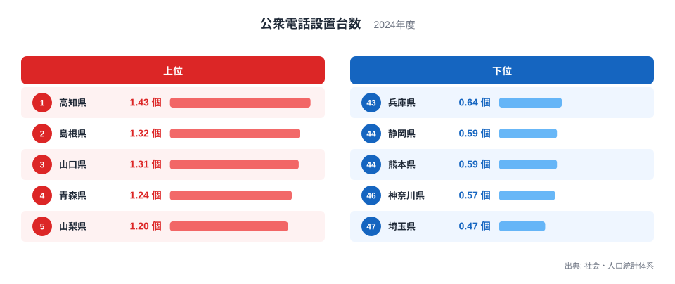
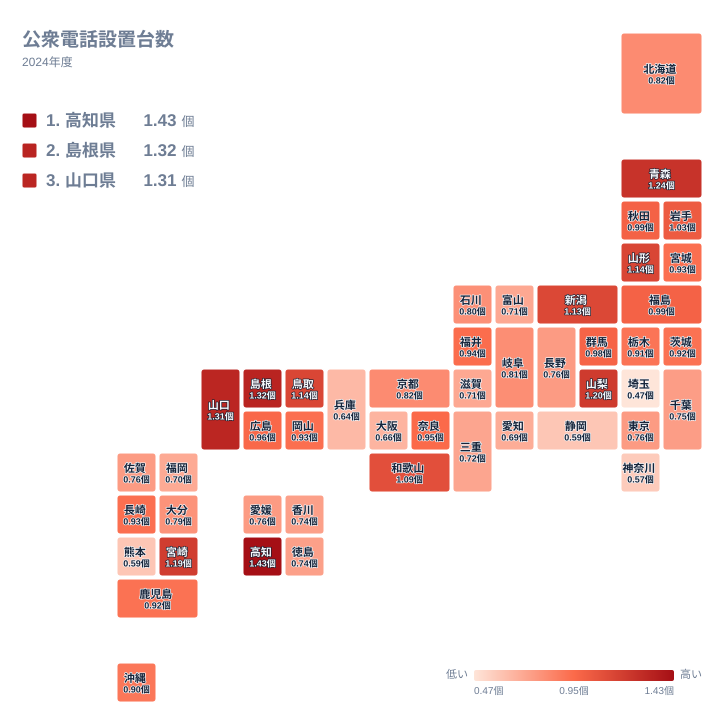

スマートフォンが普及した今、公衆電話を使う機会はめっきり減りました。それでも災害時の通信手段として、公衆電話は街角に置かれ続けています。ところが、その数を都道府県ごとに並べると、はっきりとした地域差が見えてきます。

この記事では、2024年の公衆電話設置台数を使い、どの県で多く、どの県で少ないのかを確かめます。そのうえで、地理や産業構造、歴史の面から、なぜその順になるのかを考えます。ただし、データから直接言えることと、あくまで仮説にとどまることは分けて書きます。

## 公衆電話が多い県と少ない県

1位は高知県で1.43個です。2位は島根県で1.32個、3位は山口県で1.31個、4位は青森県で1.24個、5位は山梨県で1.2個と続きます。

一方、下位では47位の埼玉県が0.47個で最も少なく、46位の神奈川県が0.57個、45位の熊本県が0.59個、44位の静岡県が0.59個、43位の兵庫県が0.64個です。

<source-link href="/ranking/public-phone-count-per-1000">公衆電話設置台数ランキングをもっと見る</source-link>

1位の高知県は1.43個、47位の埼玉県は0.47個で、実データにある最大と最小の比は約3倍です。ただし、この図で目に付くのは両端の差だけではありません。上位5県は1.2個から1.43個の範囲に収まり、下位5県は0.47個から0.64個の範囲に収まっています。両端は、それぞれ小さな幅の中に県が固まっているのです。

上位5県は四国の高知県、中国の島根県と山口県、東北の青森県、中部の山梨県に分かれ、6位に九州の宮崎県が続きます。一つの地方に偏らず、全国に散らばっています。

下位側は、47位の埼玉県と46位の神奈川県が関東、45位の熊本県が九州・沖縄、44位の静岡県が中部、43位の兵庫県が近畿です。こちらも地方はばらばらですが、この五つには人口の多い都市部を抱える県が目立ちます。ただし、図の数値だけで都市化との関係を証明することはできません。

> [!NOTE]
> この指標は設置されている公衆電話の台数をもとにした値で、通話回数や利用率ではありません。単位は「個」と示されていますが、何で割った値なのかは提供データに明記されていません。このため、人口当たりか面積当たりかを断定せず、あくまで県同士を比べるための指標として読んでください。

## 上位の県に共通する地理的な背景

上位の県には、山や海に囲まれた地形が目立ちます。高知県は四国山地と太平洋の間に細長く開けた県で、島根県も中国山地と日本海の間に集落が連なります。山口県も海に面した細長い地形を持っています。

こうした県では、谷あいや海沿いの集落で携帯電話の電波が届きにくい場所が残り、その補いとして公衆電話が維持されてきたのかもしれません。山梨県も盆地と山岳地帯が多く、山間部を訪れる旅行者の緊急連絡に備える設備が残っている可能性があります。

青森県は1.24個で4位、山形県は1.14個で7位です。雪が深い地域では、停電や通信障害への備えとして電話が残されているとも考えられます。いずれも背景の推測であり、データそのものから確かめられた理由ではありません。

> [!TIP]
> 設置台数は「公衆電話が置かれているかどうか」を示すもので、使われているかどうかは別の話です。上位の県でも利用は少ないかもしれませんし、下位の県でも残された電話が役立つ場面はあります。数字は設備の厚みとして読み、利用実態とは切り分けてください。

## 地理分布をタイルマップで見る

タイルマップで全国を眺めると、上位と下位が一つの地方にきれいにまとまっているわけではないことが分かります。同じ地方の中でも、順位が大きく離れる例があります。

四国では高知県が1位ですが、徳島県は0.74個で35位、香川県も0.74個で36位です。東北では青森県が4位、山形県が7位、岩手県が11位と上位に並びます。中国では島根県が2位、山口県が3位、鳥取県が8位です。

図でもう一つ大切なのは、上位と下位の間の中間層です。実データを見ると、24位の沖縄県が0.9個、25位の北海道と26位の京都府が0.82個、27位の岐阜県が0.81個、28位の石川県が0.8個、29位の大分県が0.79個と続きます。24位から29位までの6県は、0.79個から0.9個の間にひしめいています。

さらに、30位の東京都、31位の長野県、32位の愛媛県、33位の佐賀県は、いずれも0.76個で並びます。東京都は30位で、都市部の県として下位にいると思われがちですが、順位の上では中位の後半です。首都圏でも、千葉県は0.75個で34位、神奈川県は0.57個で46位、埼玉県は0.47個で47位と、位置はそれぞれ異なります。

> [!WARNING]
> 小数第2位の差は、順位に大きく響きます。たとえば27位の岐阜県は0.81個、28位の石川県は0.8個で、差は0.01個です。30位から33位は同じ0.76個で並んでおり、順位の違いは小さな差の反映にすぎません。順位だけで優劣を決めつけないでください。

## 都市部で少ない理由を産業と歴史から考える

下位には、41位の愛知県が0.69個、42位の大阪府が0.66個、43位の兵庫県が0.64個、44位の静岡県が0.59個、46位の神奈川県が0.57個、47位の埼玉県が0.47個と、製造業や商業が盛んな県が並んでいます。40位の福岡県も0.7個です。

都市部ではコンビニエンスストアや駅、商業施設が多く、携帯電話の電波も安定しているため、公衆電話の必要性が低く見られたのかもしれません。その結果、撤去が進んだ可能性もあります。これらはデータで裏付けられたものではなく、仮説です。

歴史的には、公衆電話は携帯電話の普及とともに利用が減り、設置数も減少してきたと言われます。都市部では代わりの手段が身近にあり、地方では乏しかったために差が生じたのかもしれません。ただし、この記事の実データには過去の推移が含まれていないため、確かめることはできません。

埼玉県が0.47個で最下位である理由も、データからは示せません。東京に隣接する住宅地が広がる県であることが関係している可能性はありますが、推測にとどまります。

一方で、必ずしも大都市圏だけが低いわけではありません。熊本県は0.59個で45位です。九州の他の県を見ると、宮崎県は1.19個で6位、長崎県は0.93個で20位、鹿児島県は0.92個で22位と、県ごとに差があります。

## 数字をどう受け止めるか

公衆電話は普段は目立たない設備ですが、災害時には頼れる通信手段になります。上位の県では、山間部や沿岸部で今も残る設備が多いのかもしれません。下位の県では、数が少ない分、どこに置かれているかを知っておくことが大切です。

自分の住む県の順位を確かめるときは、[同じカテゴリの統計一覧](/category/ict)も合わせて見てみてください。1位の[高知県のデータ](/areas/39000)や、2位の[島根県のデータ](/areas/32000)を見ると、地域の特徴をより細かくつかめます。

## データについて

ここで使った公衆電話設置台数は、社会・人口統計体系に収録された2024年の値で、単位は個です。数値は小数第2位まで示されており、県ごとの水準を比べられる形になっています。

> [!NOTE]
> 提供データには、設置場所や設備の種類、割り算の分母は示されていません。駅や病院、避難所にある電話と路傍の電話が同じ数え方なのかどうかも分かりません。したがって、この記事の順位は県同士の相対的な位置を見るためのもので、設置の目的や利用の多さを示すものではありません。

県全体の値は、同じ県内の市街地と山間部の違いを隠します。ここに挙げた背景は、地形や産業にもとづく読み方の一例であり、実データから証明されたものではないことを、最後にもう一度お伝えしておきます。
