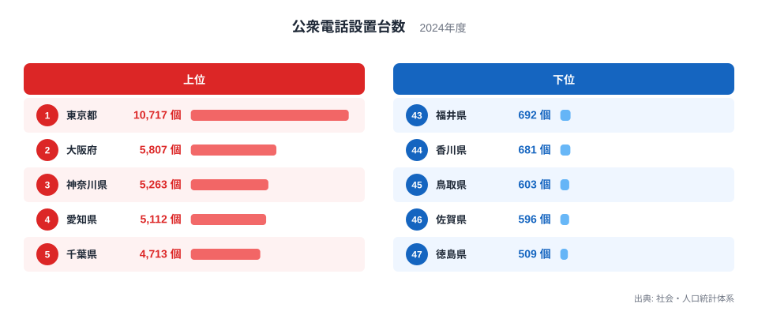
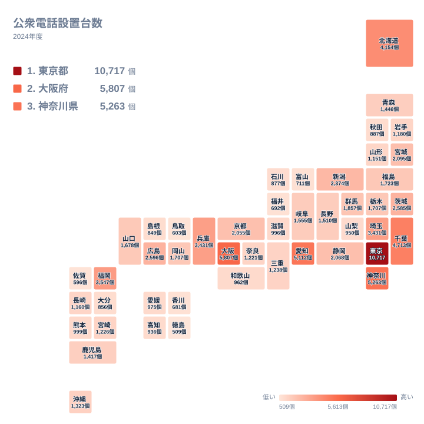

## 公衆電話が最も多いのは東京都

スマートフォンが暮らしに行き渡った今も、駅や公共施設、街角には公衆電話が残っています。では、その公衆電話は都道府県ごとにどれだけ置かれているのでしょうか。

2024年の公衆電話設置台数で最も多いのは東京都で、10,717個です。2位は大阪府の5,807個、3位は神奈川県の5,263個、4位は愛知県の5,112個、5位は千葉県の4,713個です。東京都は、2位の大阪府の2倍近い台数を持っています。

最も少ないのは徳島県の509個です。東京都と徳島県の間には、非常に大きな開きがあります。この記事では、上位と下位がなぜこの順になるのかを、地理・産業構造・歴史の面から考えます。ただし、手元にあるのは都道府県別の台数と順位だけです。人口や昼間人口、過去の配置といったデータはないため、理由の説明は仮説として読んでください。

<source-link href="/ranking/public-phone-count">公衆電話設置台数ランキングをもっと見る</source-link>

## 上位5県と下位5県の顔ぶれ

図の上位には、東京都、大阪府、神奈川県、愛知県、千葉県が並びます。東京都、神奈川県、千葉県は関東、大阪府は近畿、愛知県は中部です。いずれも大都市を抱える地域で、この点が上位の共通点です。

下位は、徳島県の509個が47位、佐賀県の596個が46位、鳥取県の603個が45位、香川県の681個が44位、福井県の692個が43位です。四国から2県、中国と九州と中部から1県ずつが入っています。特定の一地方に偏っているわけではなく、各地方の中でも規模の小さい県が下位に集まっているように見えます。

図で注目したいのは、上位の中でも東京都が突出していることです。2位から5位までは4,713個から5,807個の範囲に収まっていますが、東京都だけが1万個を超えています。東京都には、住民だけでなく通勤や来訪で集まる人も多いはずです。そうした人の流れが台数を押し上げている可能性があります。

> [!NOTE]
> 公衆電話設置台数は、各県に置かれている電話機の個数そのものです。公衆電話には、NTT東日本・西日本が設置する形のほかに、災害時に無料で使える特別な扱いの電話機もあります。この統計が両者をどう扱っているかは、ここに示した値からは分かりません。台数の差が、そのまま利用のしやすさの差になるとは限りません。

## なぜ大都市圏に多いのか

大都市圏に台数が多い理由として、まず考えられるのは、駅、病院、学校、官公庁、大型商業施設といった公衆電話の置き場所が多いことです。置き場所が多ければ、設置が続いている電話機も多くなりやすいはずです。

大阪府は5,807個で2位です。近畿の中心として、東京都と似た事情が働いているのかもしれません。神奈川県の5,263個と千葉県の4,713個は、どちらも東京都に隣り合っています。鉄道網を通じて東京都とつながる地域で、駅や公共施設が広い範囲に点在していることが、台数に影響している可能性があります。

愛知県の5,112個は4位です。名古屋を核とした都市圏であることが関係しているとも考えられますが、産業の中身と台数を結びつけるデータはありません。ここでは、大都市圏の規模が台数と並んで大きい、という事実の確認にとどめます。

福岡県は3,547個で7位、北海道は4,154個で6位です。北海道は広い県域に市街地が分かれているため、台数が多くなっているのかもしれません。一方、福岡県は九州の中で突出しています。北海道・東北の中でも、北海道は群を抜いています。

詳しい統計は[同じカテゴリの統計一覧](/category/ict)から確かめられます。

> [!TIP]
> 上位の県は、人口の多い県と重なりやすいと予想されます。そこで見るべきは、順位の並びが人口の並びとどこまで同じか、という点です。たとえば北海道は6位ですが、人口規模が上の県を上回る台数を持っています。こうした「予想より高い、または低い」県を探すと、台数の背景に地理や歴史が関わっているかを考える手がかりになります。

## 地理分布で見る地方ごとの差

タイルマップで全体を見ると、台数の多い県は関東、近畿、中部の一部に固まっています。反対に、四国や中国の一部の県は少ない側に寄っています。

北海道・東北では、北海道が4,154個で6位、宮城県が2,095個で13位、福島県が1,723個で17位です。青森県は1,446個で23位、岩手県は1,180個で29位、山形県は1,151個で31位、秋田県は887個で38位です。北海道と東北の他県の間には、台数にかなりの開きがあります。東北の中では、宮城県が最も多くなっています。

中部では、愛知県が5,112個で4位と、地方内で飛び抜けています。新潟県は2,374個で12位、静岡県は2,068個で14位です。一方、福井県は692個で43位、富山県は711個で42位です。同じ中部でも、上位と下位が大きく分かれる地方です。

九州・沖縄では、福岡県が3,547個で7位です。鹿児島県は1,417個で24位、沖縄県は1,323個で25位、宮崎県は1,226個で27位、長崎県は1,160個で30位です。熊本県は999個で32位、大分県は856個で40位、佐賀県は596個で46位です。福岡県と他県の差が大きい地方です。

> [!WARNING]
> 公衆電話は、携帯電話の普及とともに利用が減り、全国的に見直しが進んできたといわれています。2024年の1時点の台数は、その時点の配置を切り取ったものです。過去と比べた増減はこのデータからは分からないため、「減っている県」「守られている県」を読み取ることはできません。

## 下位の県を地方ごとに見る

下位の県は、四国と中国に目立ちます。四国では、愛媛県が975個で34位、高知県が936個で37位、香川県が681個で44位、徳島県が509個で47位です。四国の4県は、34位から47位の間に収まっています。四国には、台数を大きく押し上げる大都市圏がないことが一因かもしれません。

中国では、広島県が2,596個で10位と上位にいます。岡山県は1,707個、山口県は1,678個で20位です。これに対して、島根県は849個で41位、鳥取県は603個で45位です。同じ地方でも、広島県と鳥取県では大きな差があります。広島県のような中心都市の有無が、地方内の差につながっているのかもしれません。

近畿では、大阪府の5,807個のほか、兵庫県が3,431個、京都府が2,055個で15位です。奈良県は1,221個で28位、和歌山県は962個で35位、滋賀県は996個で33位です。近畿の中でも、大阪府を中心とした地域と、そこから離れた地域で台数が大きく変わります。

大阪府の統計は[大阪府のデータ](/areas/27000)、東京都は[東京都のデータ](/areas/13000)で、ほかの指標とあわせて見られます。人口や面積などの指標と並べて読むと、台数の差の背景がつかみやすくなります。

## 歴史と災害時の役割から考える

公衆電話は、かつて外出先で連絡を取るほぼ唯一の手段でした。そのため、駅や商店街、学校、役所など、人が集まる場所に置かれてきたと考えられます。今の分布にその名残がある可能性はありますが、過去の配置データがないため、確かめることはできません。

携帯電話が広まると、利用の少ない電話機から見直しが進んだといわれます。利用の見込みが小さい地域ほど、見直しの影響が出やすかったかもしれません。ただし、これも2024年の1時点のデータから導いた推測にすぎません。

それでも公衆電話が残る理由として、災害時の備えという役割が挙げられます。停電や回線の混雑で携帯電話がつながりにくいとき、公衆電話が連絡手段になることがあります。ただし、台数の多い県ほど災害への備えが手厚い、とは言えません。避難所への配置や無料化の対応は、台数とは別の仕組みで決まるためです。災害時の備えを比べるには、台数だけでなく、設置場所や運用の情報が必要になります。

## 中位の県をどう読むか

上位と下位の間には、中位の県が並びます。茨城県は2,585個で11位、群馬県は1,857個で16位です。栃木県と岡山県は、どちらも1,707個です。岐阜県は1,555個で21位、長野県は1,510個で22位、三重県は1,238個で26位です。

中位の県は、中核となる都市と、郊外や山間部の両方を持つことが多いと見られます。台数は、都市部の拠点と、地域に点在する公共施設の合計として決まるのでしょう。長野県や岐阜県のように山がちな県では、市街地が谷や盆地に分かれるため、台数に影響しているのかもしれません。

## データについて

この記事で使った公衆電話設置台数は、社会・人口統計体系に載る2024年の値で、単位は個です。本文の数値はすべて公表値で、人口あたりへの換算などは行っていません。

順位は、公表された個数の大きい順です。県同士を比べるときは、順位だけでなく実際の個数も見てください。1,707個の栃木県と岡山県のように、個数が同じ県もあります。台数が人口、人の流れ、地理的な広がり、撤去の方針のうち何に最も左右されるのかは、このデータだけでは決められません。

> [!NOTE]
> 公衆電話の設置や撤去の判断は、地域の需要や事業者の方針で変わります。単年の台数は、その時点の配置を示す断面です。

台数の多さと少なさの背景には、人口の集まり方や地理的な条件があるのかもしれません。数字を見るときは、ほかの指標とも重ねて読むことをおすすめします。
