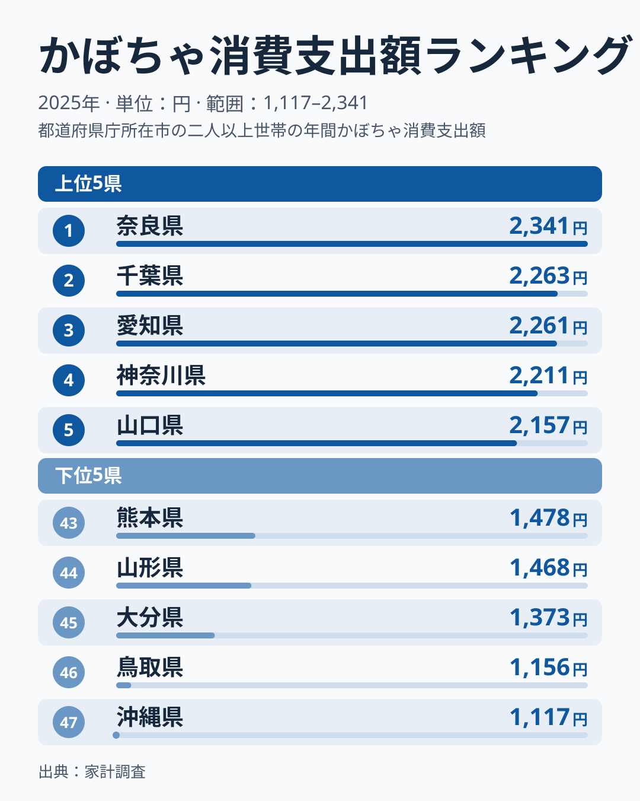
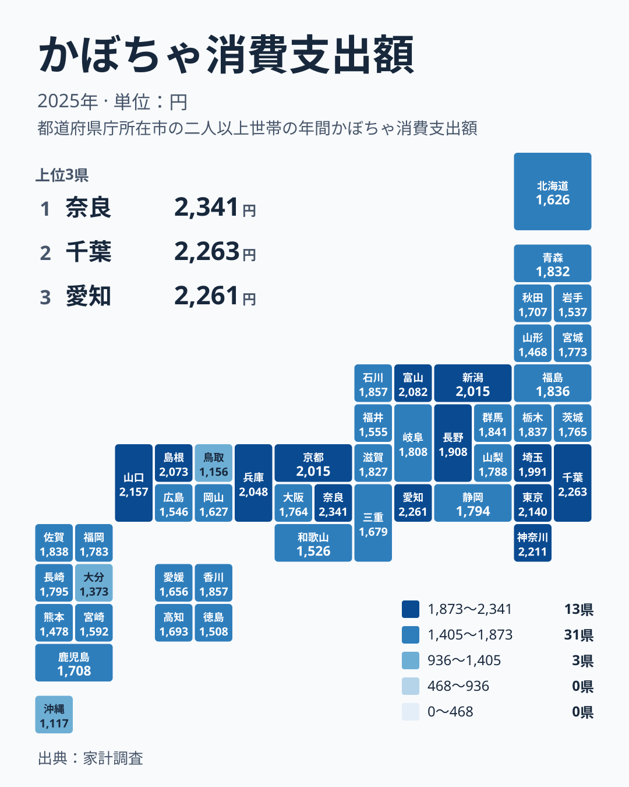

かぼちゃは煮物や天ぷら、汁物など、家庭の食卓で幅広く使われる野菜です。2025年の家計調査では、かぼちゃへの支出が最も多かったのは奈良県の2,341円でした。いっぽう最下位の沖縄県は1,117円にとどまり、実データにある最大と最小の比は約2.1倍です。この記事では、47都道府県の金額と順位を丁寧に読み、どこまでが数字から言えることで、どこからが仮説にとどまるのかを分けて整理します。

## 上位と下位の顔ぶれ

まず、支出額の上位5県と下位5県を図で確かめます。

<source-link href="/ranking/pumpkin-consumption-expenditure">かぼちゃへの支出ランキングをもっと見る</source-link>

上位は、1位の奈良県が2,341円、2位の千葉県が2,263円、3位の愛知県が2,261円、4位の神奈川県が2,211円、5位の山口県が2,157円です。2位と3位の差はわずか2円で、順位こそ違うものの、金額としてはほぼ同じ水準です。上位5県には関東の千葉県と神奈川県、中部の愛知県、近畿の奈良県、中国の山口県が入っており、4つの地方にまたがっています。

下位は、43位の熊本県が1,478円、44位の山形県が1,468円、45位の大分県が1,373円、46位の鳥取県が1,156円、47位の沖縄県が1,117円です。顔ぶれは九州・沖縄の3県、東北の山形県、中国の鳥取県で、上位と同じく特定の地方に偏っているとは言えません。

金額の並びで目立つのは、段差の位置です。43位の熊本県と44位の山形県は10円差ですが、44位から45位の大分県までは95円下がります。さらに45位の大分県から46位の鳥取県までは217円下がっています。一方、46位の鳥取県と47位の沖縄県の差は39円です。下位の中でも、鳥取県と沖縄県は1,100円台で、1,300円台以上の他県から一段離れていることが読み取れます。

> [!NOTE]
> この指標は家計調査で集計されたかぼちゃへの年間支出額で、単位は円です。購入した量ではなく支払った金額なので、価格の高い地域や時期では、同じ量でも金額が大きくなります。支出額の差が、そのまま食べている量の差を表すわけではありません。

## 地図で見る地域差のかたち

次に、47都道府県の位置関係をタイルマップで確かめます。

地図で最初に気づくのは、色の濃い県が一つの地方にまとまっていないことです。上位10位までを見ると、関東の千葉県・神奈川県・東京都、中部の愛知県・富山県・新潟県、近畿の奈良県・兵庫県、中国の山口県・島根県が入っています。北海道・東北、四国、九州・沖縄からは1県も入っていません。上位10位が関東・中部・近畿・中国に集まっているのは確かですが、その中でも地方内の差は小さくありません。

同じ地方の中で、順位の幅を見てみます。関東は、2位の千葉県から28位の茨城県までに散らばっています。中間には、16位の群馬県が1,841円、18位の栃木県が1,837円と入り、茨城県は1,765円です。つまり、関東の都県が一様に高いのではなく、東京湾岸の都県が上位に並び、北関東は中位にあります。

近畿では、1位の奈良県と41位の和歌山県が同じ地方にいます。和歌山県は1,526円で、奈良県とは815円の開きがあります。中国でも、5位の山口県と46位の鳥取県が同居しています。地方別に傾向を語ろうとすると、同じ地方内の最大差が全国の差とほぼ同じ大きさになることがあり、ひとくくりにする説明は成り立ちにくいことがわかります。

> [!WARNING]
> 家計調査は標本調査で、都道府県ごとに調べられる世帯の数には限りがあります。そのため、順位が近い県どうしの金額差は、調査のぶれの範囲に収まっている可能性があります。2位と3位の2円差のような違いを、実力差として読むのは避けてください。また、この記事にある値は1年分のため、継続的な傾向かどうかは判断できません。

## 中位の幅と、差のつき方

全体の分布を見ると、中位の県も一様ではありません。19位の福島県が1,836円、28位の茨城県が1,765円で、この10県の間では71円しか違いません。このあたりの順位は、わずかな金額差で入れ替わりやすい帯です。14位の石川県と15位の香川県はどちらも1,857円で、10位の新潟県と11位の京都府もともに2,015円と、同額の組み合わせもあります。

いっぽう、上位の端では差の開き方が異なります。5位の山口県は2,157円、6位の東京都は2,140円で、その後の7位の富山県は2,082円、8位の島根県は2,073円です。10位の新潟県の2,015円から、13位の長野県の1,908円まで、金額は少しずつ下がっていきます。一方で1位の奈良県は2位の千葉県との間に78円の開きがあり、トップ層の中でも頭一つ抜けています。

ここまでで言えるのは、全国の差が「上位に少数の高い県、中位に大きなかたまり、下位に少数の低い県」という形をしていることです。中位は金額差が小さいので、順位の上下より、上位や下位の端の県に注目したほうが、違いの意味をつかみやすくなります。

> [!TIP]
> 順位表は、金額差が小さい帯と大きい帯が混ざっています。28位の茨城県から19位の福島県までは、10県分の順位差で金額差が71円です。いっぽう44位の山形県から45位の大分県は、1つの順位差で95円離れています。順位の差ではなく金額の差で読むと、違いの大きさを取り違えにくくなります。

## 食文化・気候・産地との関係をどう考えるか

ここで、ランキングを食文化や気候、産地と結びつけたくなります。ただ、今回使える実データは、都道府県別の支出額と順位だけです。食文化、気候、産地の統計は含まれていないため、数字そのものから因果を確かめることはできません。以下は、あくまで読み解きの視点として挙げる仮説です。

たとえば産地との関係です。かぼちゃの産地として知られる北海道は、36位の1,626円で、全国の中では下のほうに入っています。産地であることと、家計での購入額が多いことは、必ずしも結びつかないことがわかります。産地では購入以外の入手手段があるのかもしれませんが、これも今回のデータでは確かめられません。

沖縄県が最下位であることについても、同様です。気候や食習慣の違いが背景にあるのではないかと考えたくなりますが、データには根拠がありません。奈良県が1位であることも、地域の食文化と結びつけて語られることがありますが、同じように、金額と順位だけでは裏付けにならないのです。

東北に目を向けると、この点が見えやすくなります。19位の福島県が1,836円、20位の青森県が1,832円、27位の宮城県が1,773円、31位の秋田県が1,707円、40位の岩手県が1,537円、44位の山形県が1,468円です。同じ東北でも、19位から44位まで広がっています。気候や食文化を地方単位で語ろうとしても、こうした県ごとの差を説明することはできません。

四国と九州・沖縄でも同様のことが言えます。四国では、15位の香川県が1,857円、32位の高知県が1,693円、34位の愛媛県が1,656円、42位の徳島県が1,508円です。九州・沖縄は、17位の佐賀県が1,838円、23位の長崎県が1,795円、26位の福岡県が1,783円と中位で、43位の熊本県、45位の大分県、47位の沖縄県が下位です。地方でひとくくりにできる傾向はなく、県ごとの事情を見る必要があります。

## 奈良県と千葉県を入り口に、ほかの統計と見比べる

最上位の奈良県については、[奈良県のデータ](/areas/29000)で他の統計も確認できます。2位の[千葉県のデータ](/areas/12000)とあわせて見ると、かぼちゃへの支出が多い県が、他の指標でも共通した特徴を持つのかどうかを調べる手がかりになります。ただし、そこで見つかる関係も、あくまで並んで現れているというだけで、原因と結果を示すものではありません。

また、[同じカテゴリの統計一覧](/category/economy)から、食料や家計に関する別の指標を探すこともできます。かぼちゃの支出が多い県が、ほかの品目でも多いのかどうかを見比べることで、かぼちゃだけの傾向なのか、食料支出全体の傾向なのかを切り分けられます。今回の記事ではそうした比較はできていませんが、読者が次に確かめられる問いとして残しておきます。

## データについて

ここで扱ったのは、家計調査の「かぼちゃ消費支出額」で、2025年の金額（円）です。順位は金額の大きい順に付けています。家計調査は調査対象の世帯から得た結果をもとにしているため、県全体の実態を完全に表すとは限りません。調査の対象範囲や集計の細かな条件は、公表元の説明で確認してください。

同額の県がある点にも注意が必要です。新潟県と京都府はどちらも2,015円、石川県と香川県はどちらも1,857円で、順位は別々に付いています。順位の違いを、金額の違いと同じ意味で読まないようにしてください。

## まとめ

2025年のかぼちゃへの支出は、1位の奈良県が2,341円、47位の沖縄県が1,117円で、約2.1倍の開きがありました。上位10位には関東、中部、近畿、中国の県が入り、北海道・東北、四国、九州・沖縄からは入っていません。ただし、近畿の奈良県と和歌山県、中国の山口県と鳥取県のように、同じ地方の中でも順位は大きく分かれています。

下位は熊本県、山形県、大分県、鳥取県、沖縄県で、特に鳥取県と沖縄県は1,100円台と、他県から一段離れています。食文化や気候、産地との関係は、今回の実データだけでは確かめられません。順位は金額差の大小とあわせて読み、調査のぶれの可能性も踏まえて、慎重に解釈することが大切です。
