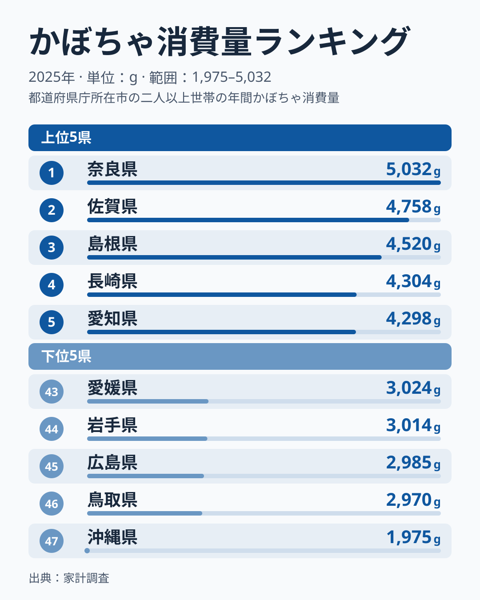
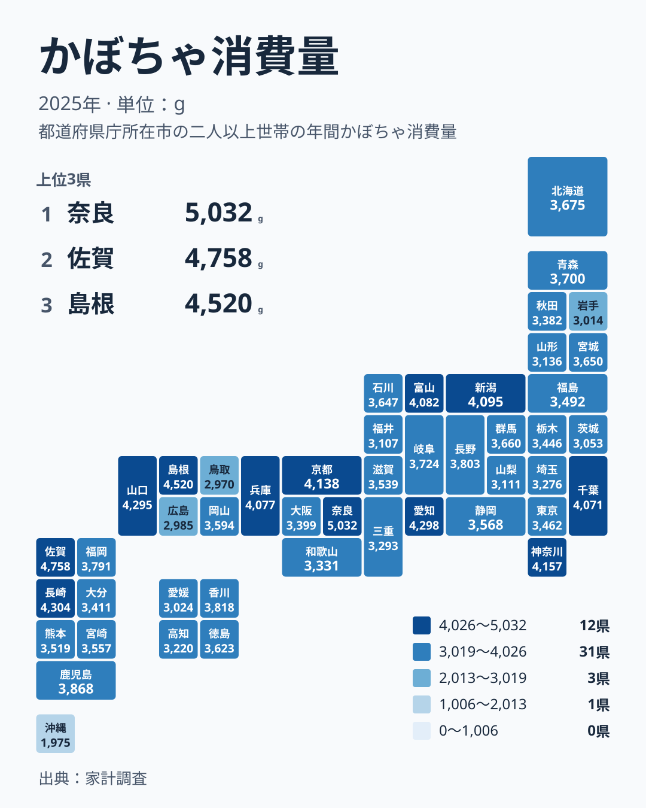

かぼちゃは煮物、天ぷら、冬至の行事食など、日本の食卓に長く根づいてきた野菜です。ところが家計調査の2025年のデータを見ると、都道府県によって購入量にかなりの差があります。1位は奈良県の5,032g、最下位は沖縄県の1,975gで、その差は3,057g、1位は最下位の2.55倍です。

この記事では、どの県が多く、どの県が少ないのかを順位で確かめ、地方ごとの並び方を見たうえで、食文化や気候との結びつきを仮説として考えます。

## 上位と下位を並べてみる

まずは上位5県と下位5県を図で確認します。

<source-link href="/ranking/pumpkin-consumption-quantity">かぼちゃ消費量ランキングをもっと見る</source-link>

首位は奈良県の5,032gです。2位は佐賀県で4,758g、その差は274gにとどまります。3位は島根県の4,520g、4位は長崎県の4,304g、5位は愛知県の4,298gと続きます。4位から6位までは長崎県4,304g、愛知県4,298g、山口県4,295gとほぼ横一線で、数g単位の差で順位が入れ替わる接戦です。

一方、下位は沖縄県の1,975gが47位で、46位の鳥取県2,970gとも大きく離れています。45位は広島県の2,985gです。46位と45位の間はわずかですが、最下位だけが突出して少ないという形です。中央値は3,594gで、24位の岡山県がこの値にあたります。

つまり、全体は3,000g台を中心に密集し、上に奈良県と佐賀県が抜け、下に沖縄県が大きく離れる分布です。差の大きさの多くは両端の県が生み出しています。

[奈良県のデータ](/areas/29000)や[佐賀県のデータ](/areas/41000)では、ほかの指標も確認できます。

> [!NOTE]
> ここでの数値は家計調査の「かぼちゃ」の購入数量で、2025年、単位はgです。収穫量や実際に食べた量ではなく、家庭が購入した量を表します。外食や惣菜、冷凍食品として口にする分は含まれません。

## 地方でみると上位はどこに偏るか

上位10県を地方別に数えると、中部が3県(愛知県、新潟県、富山県)、近畿が2県(奈良県、京都府)、中国が2県(島根県、山口県)、九州・沖縄が2県(佐賀県、長崎県)、関東が1県(神奈川県)です。北海道・東北と四国からは1県も入っていません。

次に地図で全体を見ます。

地図からは、一つの地方がまとまって高いわけではないことがわかります。たとえば近畿は奈良県が1位、京都府が8位、兵庫県が11位と上位に並ぶ一方、大阪府は33位、和歌山県は35位、三重県は36位です。同じ地方の中で上位と下位に割れています。

中国も同様です。島根県は3位、山口県は6位ですが、岡山県は24位、広島県は45位、鳥取県は46位です。隣り合う県でも、順位が40位近く離れる例があります。

このため「西日本は多い」「東日本は少ない」といった単純な説明は当てはまりません。関東では神奈川県が7位、千葉県が12位と高い一方、茨城県は42位です。気候だけでなく、県ごとの食習慣や流通の違いが重なっていると考えるのが自然です。

> [!WARNING]
> 家計調査は都道府県庁所在地などの世帯を対象にした標本調査です。標本の数が限られるため、数十g程度の差は誤差の範囲かもしれません。順位の細かな上下は断定せず、大きな傾向として読んでください。

## 下位の県に共通する背景を仮説として考える

下位10県の内訳は、北海道・東北が2県(山形県、岩手県)、中部が2県(山梨県、福井県)、中国が2県(広島県、鳥取県)、四国が2県(高知県、愛媛県)、関東が1県(茨城県)、九州・沖縄が1県(沖縄県)です。特定の地方に集中せず、全国に散らばっています。

ここで最も目立つのは沖縄県の1,975gです。仮説として、沖縄県では冬至にかぼちゃを食べる習慣が本土ほど強くなく、ゴーヤーや島野菜、芋類など別の食材が日常の食卓を占めていることが考えられます。ただし、これはデータから確認できたことではなく、あくまで推測です。

また、かぼちゃには産地と季節の問題もあります。収穫後に保存して食べる野菜のため、県内の産地の有無や直売所での購入が多い地域では、家計調査の購入量に現れにくい場合があります。自家消費や贈答が多い県は、数字の上で低く出る可能性があります。

> [!TIP]
> 順位だけでなく中央値の3,594gと比べると位置づけがつかめます。たとえば東京都は30位の3,462g、大阪府は33位の3,399gで、中央値を下回る一方、極端に低いわけではありません。「少ない」と見えても、全国的には平均的な層に含まれる県が多数あります。

## 関連品目や行事との対比で読む

かぼちゃは、同じ煮物に使われる根菜類や、天ぷらの具材になる野菜とも用途が重なります。購入量が多い県では、かぼちゃが日常の煮物や惣菜の定番になっていると考えられます。反対に、他の野菜や芋類が同じ役割を担う県では、かぼちゃの購入量は小さくなりやすいでしょう。

上位の県を見ると、奈良県、京都府、島根県、山口県のように、古くから伝わる家庭料理や行事食の文化が根づいた県が目立ちます。佐賀県と長崎県も、いわゆる「いとこ煮」のような小豆とかぼちゃを合わせる郷土の煮物が知られる地域です。これらは地域の食文化の例として挙げたもので、今回のデータが直接証明しているわけではありません。

一方で、愛知県が5位の4,298g、神奈川県が7位の4,157gと、大都市圏の県も上位に入っています。人口が多く、スーパーでのカット売りや冷凍品が手に入りやすい環境が購入量を押し上げている可能性があります。食文化だけでなく、買いやすさという流通面も効いていると見られます。

北に目を向けると、北海道は19位の3,675g、青森県は18位の3,700gです。北海道は国内有数の産地として知られますが、購入量では中位にとどまります。産地であることと、家庭での購入量が多いことは別の話だと分かります。

## データについて

この記事の数値は、家計調査の「かぼちゃ消費量」(2025年、単位g)を用いています。全47都道府県の値を比較しており、1位と最下位の差は3,057g、倍率は2.55倍です。地方の区分は、北海道・東北、関東、中部、近畿、中国、四国、九州・沖縄の7区分を用いました。

調査は世帯への聞き取りと家計簿の記入に基づくため、購入した量だけが反映されます。年によって天候や価格が変われば順位は動きます。1年分の結果として読み、複数年の傾向とは区別してください。

ほかの食料品の指標を比べたいときは、[同じカテゴリの統計一覧](/category/economy)も参考になります。

## まとめ

かぼちゃの購入量は、奈良県の5,032gから沖縄県の1,975gまで、2.55倍の開きがありました。上位には奈良県、佐賀県、島根県、長崎県、愛知県が並び、中央値は3,594gです。

地方でまとめて語れるほど単純ではなく、同じ地方でも順位が大きく割れていました。背景には食文化、産地、買いやすさなどが重なっていると考えられますが、本稿で示した理由は仮説です。自分の住む県の順位を確かめ、食卓の習慣と照らし合わせてみてください。
