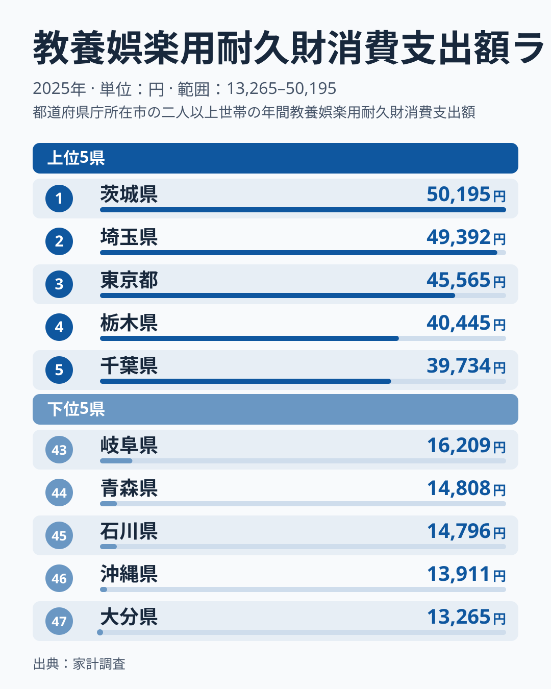
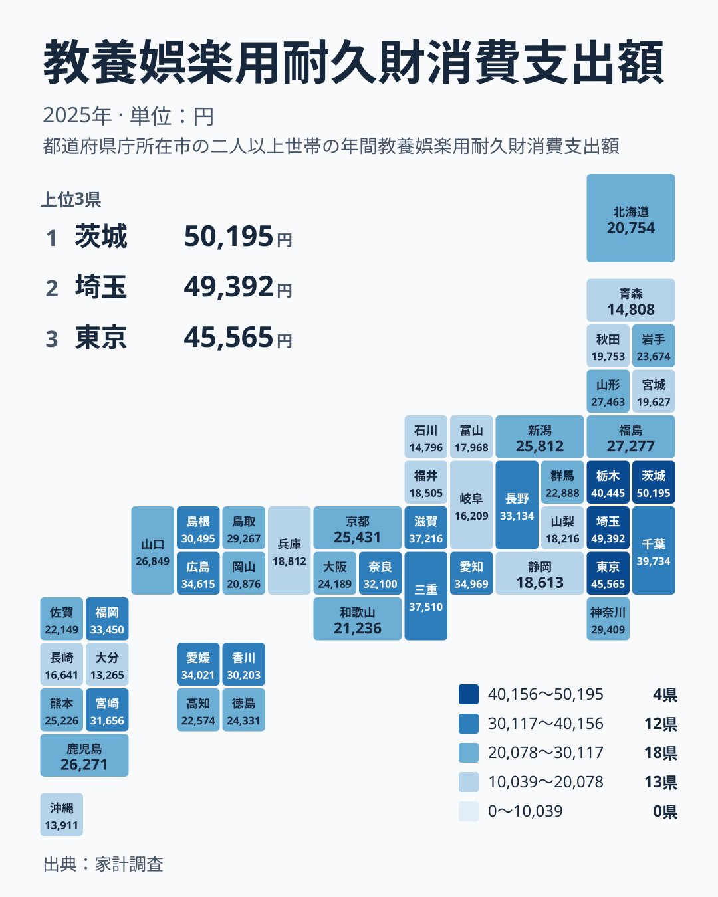

家計の中で、毎月かならず出ていくお金ではなく「たまに大きく買う」お金は、県ごとの暮らしぶりを映す手がかりになります。この記事で取り上げるのは、教養娯楽用の耐久財への支出です。テレビやパソコン、楽器、スポーツ用品、ゲーム機のように、長く使う趣味や娯楽の道具を買うときの金額を指します。

2025年の家計調査では、最も多い茨城県が50,195円でした。最も少ない大分県は13,265円です。最大と最小の比は、実データにある2つの値を並べると、茨城県の水準が大分県を大きく上回っていることがわかります。この記事では、上位と下位の顔ぶれ、地理的な広がり、順位のばらつきの順に、数字から言えることと言えないことを整理します。

## 上位と下位の顔ぶれ

<source-link href="/ranking/recreational-durables-group-consumption-expenditure">教養娯楽用耐久財への支出ランキングをもっと見る</source-link>

1位は茨城県で50,195円です。2位は埼玉県の49,392円、3位は東京都の45,565円、4位は栃木県の40,445円、5位は千葉県の39,734円と続きます。上位5つはすべて関東の県で、茨城県、埼玉県、東京都、栃木県、千葉県が並びます。

とくに目を引くのは、1位と2位がほぼ並んでいることです。茨城県の50,195円と埼玉県の49,392円は近い水準で、順位は違っても生活感覚としては同じ程度の支出と見てよさそうです。3位の東京都は45,565円で、そこから4位の栃木県の40,445円までにも、もう一段の開きがあります。

一方、47位は大分県で13,265円です。46位は沖縄県の13,911円、45位は石川県の14,796円、44位は青森県の14,808円、43位は岐阜県の16,209円と続きます。下位5県を地方でみると、九州・沖縄の大分県と沖縄県、中部の石川県と岐阜県、北海道・東北の青森県に分かれます。上位が関東に固まるのに対し、下位は特定の地方に集中していません。

> [!NOTE]
> この指標の正式な統計名は「教養娯楽用耐久財消費支出額」で、家計調査にもとづく2025年の年間支出額(円)です。食料品のように毎月買うものではなく、テレビや楽器など数年に一度の購入が中心の費目なので、金額は「習慣的な出費」ではなく「その年に買った量」を表しています。

## 地理分布で見ると何が見えるか

タイルマップにすると、関東の濃さが際立ちます。茨城県、埼玉県、東京都、栃木県、千葉県が上位5位を占める一方、同じ関東でも神奈川県は29,409円で17位、群馬県は22,888円で29位です。関東といっても一枚岩ではなく、7県の中で順位が大きく分かれています。

関東以外にも、上位に入る県があります。近畿では三重県が37,510円で6位、滋賀県が37,216円で7位です。中部の愛知県は34,969円で8位、中国の広島県は34,615円で9位、四国の愛媛県は34,021円で10位に入ります。上位10位には、関東、近畿、中部、中国、四国の5つの地方の県が顔を出しています。

大都市を抱える県の順位もそろいません。東京都は3位ですが、大阪府は24,189円で27位、兵庫県は18,812円で37位です。京都府は25,431円で24位でした。図から言えるのは、大都市を持つ県の順位がそろっていないという点までです。この違いがなぜ生じるのかは、本データからは言えません。

> [!TIP]
> 順位だけでなく、値の間隔にも注目してください。たとえば10位の愛媛県は34,021円、11位の福岡県は33,450円で、順位が違っても金額は近い水準です。中位は僅差が連なっているので、1つか2つの順位差を過度に重く見ないことが大切です。

## 生活への含意:耐久財は「まとめ買い」の性格が強い

教養娯楽用の耐久財は、食料品や光熱費と違い、毎月ほぼ同じ額が出ていく支出ではありません。数年に一度、大型テレビやパソコンを買い替えるような出費が、特定の年に偏って現れることがあります。

そのため、この数字は「その県の人が娯楽にお金をかける習慣」だけでなく、「たまたまその年に買い替えが重なったか」にも左右される可能性があります。茨城県の50,195円という高さが、地域の趣味文化を表しているのか、買い替えの時期が重なった結果なのかは、この1年分のデータだけでは確かめられません。

関東の周辺の県が上位に並ぶ背景についても、住まいの条件や暮らし方の違いといった個別の事情が関わっている可能性はあります。ただし、この指標だけではそれを裏づけることができず、仮説の域を出ません。購入の機会や選択肢の多さといった環境面の理由も、本データからは言えません。

下位の大分県、沖縄県、石川県、青森県についても同様です。耐久財への支出が少ないことが、娯楽全体への支出が少ないことを意味するとは限りません。体験や外出への支出など、他の費目を合わせて見なければ、生活の姿は見えてきません。

> [!WARNING]
> 家計調査は標本調査で、県ごとの対象世帯数は多くありません。耐久財のように買う頻度が低い品目は、少数の世帯の大きな買い物で平均が動きやすく、1年だけの順位を県の「実力」とみなすのは危険です。

## 中位の県と、地方内のばらつき

中位の県も見ておきます。16位の香川県は30,203円、17位の神奈川県は29,409円、18位の鳥取県は29,267円です。20位の福島県は27,277円、25位の熊本県は25,226円、30位の高知県は22,574円となっています。

北海道・東北では、山形県が27,463円で19位、福島県が27,277円で20位、岩手県が23,674円で28位、北海道が20,754円で34位、宮城県が19,627円で36位、青森県が14,808円で44位です。同じ地方の中でも、順位は大きくばらつきます。

九州・沖縄でも同じです。福岡県は33,450円で11位、宮崎県は31,656円で14位と上位に入ります。ところが長崎県は16,641円で42位、沖縄県は46位、大分県は47位です。同じ地方に、上位と最下位が同居しています。

地方という大きな単位でひとまとめにしても、この指標は説明しきれません。県ごとの違いには個別の事情が背景にある可能性がありますが、この指標だけでは確かめられません。地方別の傾向を断定するより、県ごとの数字を一つずつ見るほうが、読み違いは少なくなります。

## この数字を暮らしにどう生かすか

家計の見直しをするとき、他県との比較で一喜一憂するよりも、自分の世帯の耐久財の買い替えサイクルを把握するほうが実用的です。テレビやパソコンなど、いつ買い替えるかを先に見通しておけば、突然の出費に慌てずに済みます。

県別のデータは、地域の傾向を知る入り口です。支出が多い県が豊かで、少ない県が不足しているとも言い切れません。耐久財は買う時期が偏る費目なので、単年の差は参考値として受け止めるのが妥当です。

他の経済指標とあわせて読むと、理解が深まります。[同じカテゴリの統計一覧](/category/economy)から、家計や消費に関する指標をあわせて確認できます。また、1位の[茨城県のデータ](/areas/08000)や、2位の[埼玉県のデータ](/areas/11000)を開くと、他の分野の数字との関係も見えてきます。

## データについて

この記事の数値は、家計調査の「教養娯楽用耐久財消費支出額」(2025年、単位は円)を用いています。47都道府県の値を、金額の大きい順に並べた順位です。

耐久財は買う頻度が低く、単年の値は振れやすい性質があります。数年分の推移とあわせて読むと、より確かな傾向がつかめます。

最後にもう一度まとめます。上位は茨城県、埼玉県、東京都、栃木県、千葉県の関東勢が占め、下位は大分県、沖縄県、石川県、青森県、岐阜県でした。大都市を持つ県でも、東京都は3位、大阪府は27位、兵庫県は37位と順位がそろいません。順位の背景は、この指標だけでは確かめられません。数字は暮らしを読み解く手がかりであり、答えそのものではないという姿勢で眺めるのがよさそうです。
