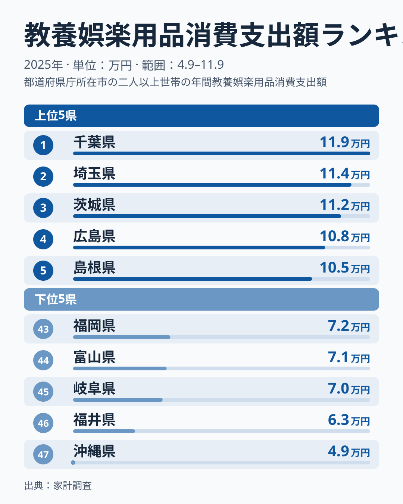
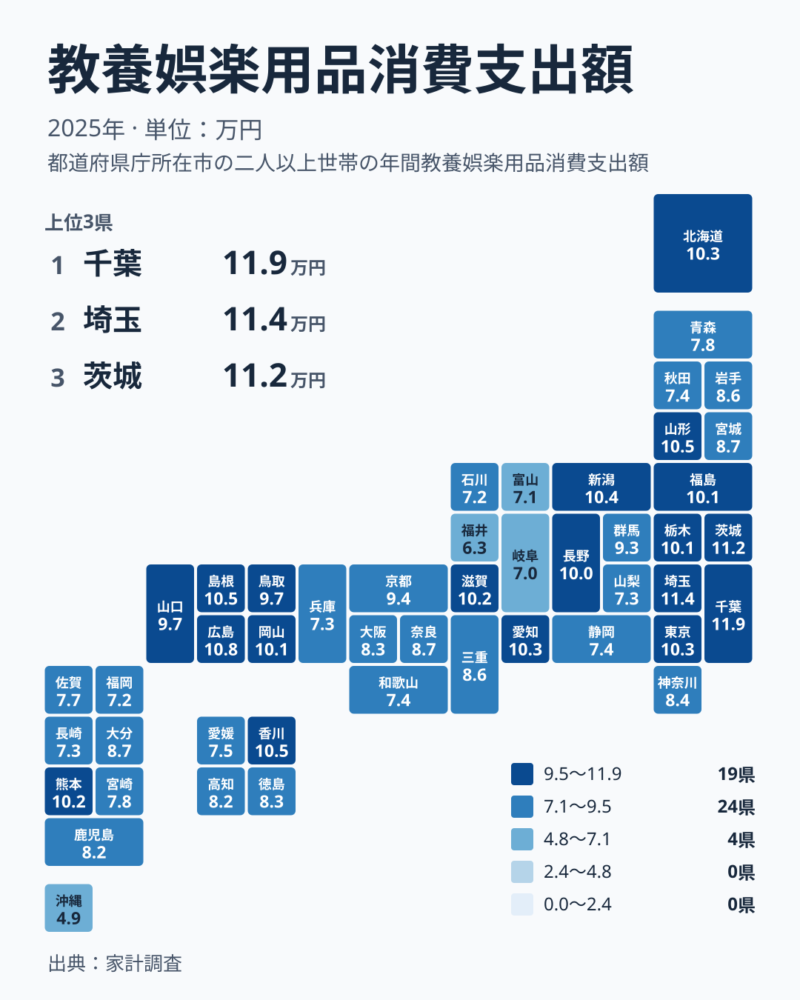

趣味や遊びにかけるお金は、暮らしの余裕をはかる一つの物差しです。ゲーム機、玩具、スポーツ用品、書籍、文房具といった教養娯楽用品への支出を、2025年の家計調査で都道府県別に見ると、予想以上に大きな差が表れました。

1位は千葉県の118,855円です。最下位の沖縄県は48,538円で、2倍を超える開きがあります。この記事では、この差を地方ごとの並びという別の切り口で分解し、読者の暮らしにどう引き寄せて読めばよいかを考えます。

## 上位と下位に見える地方の偏り

まず、上位5県と下位5県を並べた図を見てください。

<source-link href="/ranking/recreational-goods-group-consumption-expenditure">教養娯楽用品への支出ランキングをもっと見る</source-link>

図で注目したいのは、個々の金額よりも、どの地方の県が両端に集まっているかです。上位5県のうち3県は関東の千葉県、埼玉県、茨城県です。残る2県は中国地方の広島県と島根県です。上位は、関東と中国に偏っています。

下位5県を見ると、中部の福井県、岐阜県、富山県が並び、そこに福岡県と沖縄県が加わっています。上位に関東と中国、下位に中部が目立つという構図です。ただし、中部には新潟県のように8位の県もあります。この点は次の節で詳しく見ます。

もう一つ見逃せないのは、大都市圏が上位に入っていないことです。東京都は9位、大阪府は29位です。人口が多い都市の支出が高いとは限らず、教養娯楽用品への支出は、都市の大きさだけでは説明できないことがわかります。

> [!NOTE]
> この指標は、家計調査にもとづく1世帯あたりの年間支出額です。教養娯楽用品は、教養娯楽の中でも「モノ」にあたる部分を指します。旅行やレジャーのサービス、月謝、入場料といった「サービス」への支出は、別の項目として扱われるため含まれません。「娯楽にどれだけ使うか」ではなく、「娯楽に関わる品物にどれだけ使うか」を示す数字です。

## 同じ地方の中でどれだけ散らばるか

次に、47都道府県を地図の形に並べた図です。

地図で色の濃淡を見ると、関東に濃い県が集まる一方、同じ地方の中でも色が分かれている地域が目に入ります。ここで一点に絞って確かめたいのは、同じ地方の中で順位がどこまで離れるかです。

もっとも大きく離れているのは中部です。新潟県は8位で103,949円、福井県は46位で63,177円なので、同じ地方の中で38位の差があります。上位の県と下位の県が同じ地方に同居していることになります。

次に大きいのは九州・沖縄です。熊本県は13位で101,904円、沖縄県は47位で48,538円なので、34位の差があります。九州・沖縄にも、全国の上位に近い県と最下位の県が並んでいます。

関東は、本文で順位を示せる県に絞ると、千葉県が1位、埼玉県が2位、茨城県が3位、東京都が9位、神奈川県が27位です。千葉県と神奈川県の間には26位の差があります。上位に固まって見える関東でも、県によって位置は変わります。地方名だけで県の水準を言い当てることは、どの地方でも難しいと言えます。

> [!TIP]
> 地図を読むときは、地方の色合いよりも、同じ地方の中での濃淡の差に注目してください。「関東は高い」「中部は低い」とひとくくりにすると、新潟県のように上位に入る県や、神奈川県のように中位の県を見落とします。自分の県を見るときも、隣の県ではなく全国の順位で位置を確かめるのが近道です。

## 数字を暮らしに引き寄せて読む

ここからは、数字を暮らしの面からどう読めるかを考えます。ただし、使えるのは都道府県別の支出額だけです。世帯構成、店舗の数、所得、他の娯楽への支出といったデータはこの記事にありません。以下は仮説であり、原因を言い当てるものではありません。

一つ目の可能性は、子どものいる世帯の多さです。玩具、学習用の書籍、文房具、スポーツ用品は、子育て世帯の支出に関わりやすい品目です。千葉県、埼玉県、茨城県が上位に並ぶ背景に、こうした世帯の多さがあるのかもしれません。ただし、この記事のデータでは確かめられません。

二つ目の可能性は、買い物の場所です。車で行く大型店が身近な地域では、日用品とあわせて玩具や本、趣味の道具を買う機会が増えるかもしれません。広島県が4位、島根県が5位、香川県が6位という並びにも、そうした面があるかもしれませんが、これも推測の域を出ません。

三つ目の可能性は、ネット通販や他の娯楽との使い分けです。旅行や体験型の娯楽にお金を回す世帯が多い地域では、モノへの支出は相対的に小さくなることがあります。沖縄県の48,538円という低さについても、複数の要因が重なっている可能性がありますが、この記事のデータからは特定できません。

> [!WARNING]
> 教養娯楽用品には、ゲーム機やパソコン周辺機器、自転車、スポーツ用品のように、数年に一度まとめて買い替える高額な品物が含まれうる点に注意してください。そうした品物が1年の中でたまたま買われたかどうかで、県の金額は上下しやすくなります。2025年という1年の順位は、その県の恒常的な水準とは限りません。

## 中位の県は混み合っている

中位から上位にかけては、順位が違っても金額がほとんど変わらない県が多くあります。たとえば、5位の島根県は105,109円、6位の香川県は105,096円で、差はわずかです。18位の鳥取県は97,332円、19位の山口県は97,148円で、こちらも近い値です。

24位の奈良県は86,512円、25位の岩手県は86,470円と、ほぼ並んでいます。こうした近接した順位では、1つ順位が違うだけで大きな意味を読み取る必要はありません。順位よりも、金額の水準そのものを見るほうが適切です。

一方で、20位の京都府は93,939円、22位の宮城県は87,201円と、順位が少し離れるだけで金額が大きく動く箇所もあります。順位表は、どこで金額が緩やかに下がり、どこで一気に下がるかを教えてくれません。金額の並びを合わせて確認すると、見え方が変わります。

## 暮らしへの含意

この結果から言えるのは、教養娯楽用品への支出が、地方名や都市の大きさだけではきれいに説明できないということです。関東の県が上位に並び、中国地方の県も上位に入る一方、大阪府は29位の82,687円、神奈川県は27位の84,215円です。大都市圏だから多い、とも言い切れません。

読者の生活にとって大切なのは、自分の暮らす県の位置を知り、家計の中で趣味や学びにどれだけ割くかを考える材料にすることです。県の値が全国で高いか低いかは、買い物の環境や世帯の事情などが関わっている可能性がありますが、この記事のデータだけでは理由までは判断できません。

自分の家計と比べるときは、品物の支出だけを見ていることにも気をつけてください。旅行や習い事にお金を使う家庭は、この数字に表れにくいからです。千葉県や埼玉県の詳しい数字は、[千葉県のデータ](/areas/12000)や[埼玉県のデータ](/areas/11000)で確認できます。ほかの経済指標と合わせて見たい場合は、[同じカテゴリの統計一覧](/category/economy)も参考になります。

## データについて

この記事で使った数値は、家計調査の「教養娯楽用品消費支出額」で、2025年の年間支出額(単位は円)です。全47都道府県の値をもとに、順位と金額を並べて比較しました。

倍率に触れたのは、実データの最大である千葉県と最小である沖縄県の比較だけです。地方ごとの見方は、北海道・東北、関東、中部、近畿、中国、四国、九州・沖縄の7区分を使いました。

地方の中での散らばりは、同じ地方に属する県の順位の差で示しています。金額そのものの差ではなく順位の差で比べているため、順位が近くても金額が大きく違う場合がある点にご注意ください。
