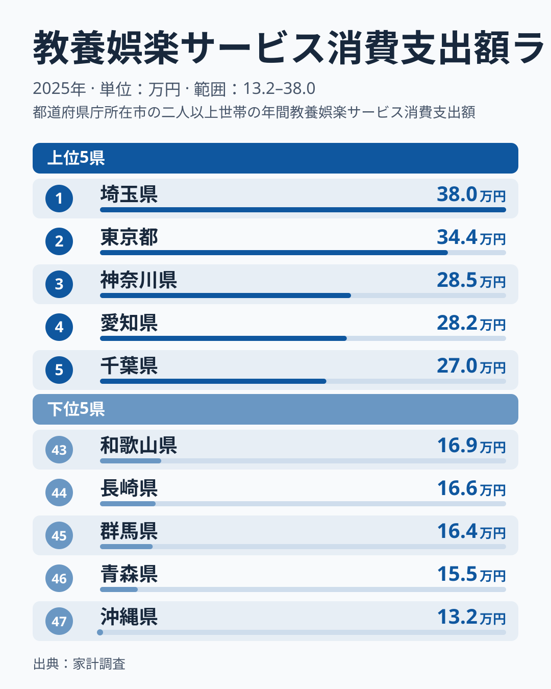
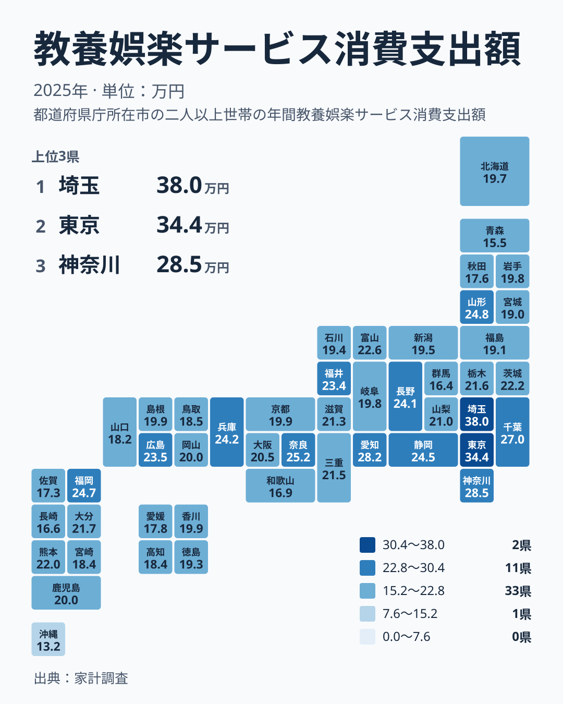

## 教養娯楽サービスへの支出で首位に立ったのは埼玉県

旅行や習い事、映画やスポーツ観戦、レジャー施設の利用など、暮らしを豊かにするサービスにいくら使っているかは、地域の生活スタイルをよく映します。2025年の家計調査をもとに、教養娯楽サービスへの支出を都道府県ごとに並べてみました。

首位は埼玉県で379,767円です。2位は東京都で344,223円、3位は神奈川県で285,072円、4位は愛知県で282,494円、5位は千葉県で270,002円でした。「娯楽の支出は東京が一番」と思われがちですが、実際の1位は埼玉県で、東京都は2位です。

一方、最下位の47位は沖縄県で131,805円でした。46位は青森県の154,851円、45位は群馬県の163,985円、44位は長崎県の165,777円、43位は和歌山県の169,210円です。1位の埼玉県と47位の沖縄県を比べると、約2.9倍の開きがあります。

<source-link href="/ranking/recreational-services-group-consumption-expenditure">教養娯楽サービスへの支出ランキングをもっと見る</source-link>

上の図は、上位5県と下位5県を並べたものです。上位には埼玉県、東京都、神奈川県、愛知県、千葉県が入りました。下位には沖縄県、青森県、群馬県、長崎県、和歌山県が並びます。上位5県のうち4県は関東ですが、下位5県は北海道・東北、関東、近畿、九州・沖縄にまたがっていて、特定の地方だけが低いわけではありません。

段差の位置にも注目してください。1位の埼玉県と2位の東京都の差は35,544円です。これに対して、2位の東京都と3位の神奈川県の差は59,151円で、こちらのほうが大きく開いています。つまり、埼玉県と東京都は近い水準で並び、その下の神奈川県との間に大きな段差があります。突出しているというより、埼玉県と東京都の2県が一段高い位置に並んでいると読むほうが実態に合います。

> [!NOTE]
> この指標は教養娯楽サービスへの支出で、1世帯あたりの年間支出額です。テレビやゲーム機などの耐久財や書籍といった「モノ」は含まれず、月謝、旅行の費用、入場料、会員料金などサービスの対価が対象です。1人あたりの金額ではない点に注意してください。

## 東京都より埼玉県が上になる背景を考える

なぜ東京都ではなく埼玉県が首位なのでしょうか。家計調査は世帯を単位に集計されます。そのため、世帯の人数や構成が支出額に影響している可能性があります。人数の多い世帯は、子どもの習い事や家族での旅行などが増え、世帯全体のサービス支出が膨らみやすくなると考えられます。

東京都は単身世帯が多いと言われる地域です。単身世帯は世帯あたりの支出が小さくなりやすく、娯楽を楽しむ機会が多くても、1世帯の合計額には表れにくい面があります。対して埼玉県は、家族で暮らす世帯が多い住宅地を抱えているのかもしれません。ただし、世帯構成の数字は今回の実データに含まれていないため、ここでは可能性の指摘にとどめます。

つまり、この順位は「どこが娯楽に熱心か」というより、「どんな世帯が多いか」を映している可能性があります。自分の県の順位を見るときは、家族の人数や子どもの有無が近い世帯の暮らしを思い浮かべながら読むと、数字の意味をつかみやすくなります。

詳しい数字は [埼玉県のデータ](/areas/11000) や [東京都のデータ](/areas/13000) のページでも確認できます。

> [!WARNING]
> 世帯あたりの額は、世帯の人数が多い県ほど大きくなる方向に働く可能性があります。そのため、高い県が「1人ひとりが娯楽に多く使っている県」とは限りません。逆に低い県が、個人の楽しみを控えている県だとも言い切れません。人数で割った金額ではないため、1人あたりの感覚で読むと誤解のもとになります。

## 地理分布で見ると関東の濃さが際立つ

次に、都道府県の位置関係を地図の形で見てみましょう。

関東の7都県を確認すると、埼玉県が1位、東京都が2位、神奈川県が3位、千葉県が5位と上位に集中しています。茨城県は15位で221,768円、栃木県は18位で216,142円です。一方で群馬県は45位で163,985円にとどまり、同じ関東でも差が大きい点が目を引きます。

中部では、愛知県が4位で282,494円、静岡県が9位で244,744円、長野県が11位で241,415円、福井県が13位で234,030円と、中位から上位に入る県が多くなっています。近畿では、奈良県が6位で251,624円、兵庫県が10位で242,391円です。一方で大阪府は22位で204,757円、京都府は25位で199,201円と、中位にとどまります。

意外なのは、近畿の中心である大阪府が中位に位置する点です。大都市だから高いという単純な図式は成り立たないことが分かります。

## 同じ地方の中でも順位は大きく散らばる

地方ごとの傾向を探りたくなりますが、数字は「同じ地方でも順位が大きく散らばる」ことを示しています。

代表的なのが北海道・東北です。山形県は7位で247,784円と全国でも上位ですが、青森県は46位で154,851円です。同じ地方の中で、順位が39も離れています。

九州・沖縄も同じです。福岡県は8位で247,494円ですが、沖縄県は47位で131,805円と最下位です。

このため、「東北は低い」「九州は高い」といった地方単位の一括りは、実態を取りこぼします。暮らしの面では、地方の平均的なイメージよりも、隣り合う県との違いに目を向けるほうが、数字を正しく読めます。

> [!TIP]
> 世帯あたり額の高低を見るときは、金額そのものよりも「2位と3位の間のような段差」を探すと読みやすくなります。この指標では、埼玉県と東京都の差は35,544円ですが、東京都と神奈川県の差は59,151円です。順位が1つ違うだけでも差の大きさは違うため、順位の並びだけでなく金額の間隔まで見ると、グループの境目が見えてきます。

## 数字を暮らしにどう生かすか

ここまでの内容を、生活の視点でまとめます。

- 首位の埼玉県は379,767円で、世帯あたりのサービス支出が最も大きい県です。
- 東京都は344,223円で2位です。世帯構成の影響を考える必要があります。
- 最下位の沖縄県は131,805円で、最大の埼玉県との差は約2.9倍です。
- 大阪府は22位、京都府は25位と、大都市でも順位は中位です。
- 山形県は7位、福井県は13位と、大都市圏以外でも上位に入る県があります。

教養や娯楽への支出は、収入だけで決まるものではないと考えられます。近くに利用できる施設やサービスがあるか、通える教室があるか、移動の手段が整っているかといった要因が関わる可能性もあります。ただし、今回のデータだけでは、どの要因がどれだけ効いているかまでは確かめられません。

家計を見直す際は、全国の順位に一喜一憂するのではなく、自分の世帯と似た条件の県を探して比べるのが現実的です。支出が少ないからといって、暮らしが貧しいとは限りません。無料や低価格で楽しめる環境が整っている地域もあるかもしれません。

ほかの暮らしの指標も合わせて確認したい方は、[同じカテゴリの統計一覧](/category/economy) をご覧ください。支出の別の側面を並べて見ると、地域の特徴がより立体的に見えてきます。

## データについて

この記事は、家計調査の2025年の結果をもとにしています。指標の正式名称は教養娯楽サービス消費支出額で、単位は円です。1世帯あたりの年間の支出額を、都道府県別に並べています。

本文で述べた「約2.9倍」は、1位の埼玉県と47位の沖縄県の値を比べたものです。順位や金額は、すべて上記の実データに基づいています。世帯の人数や構成といった背景の説明は、数字から確定できるものではなく、読み解きのための仮説です。
