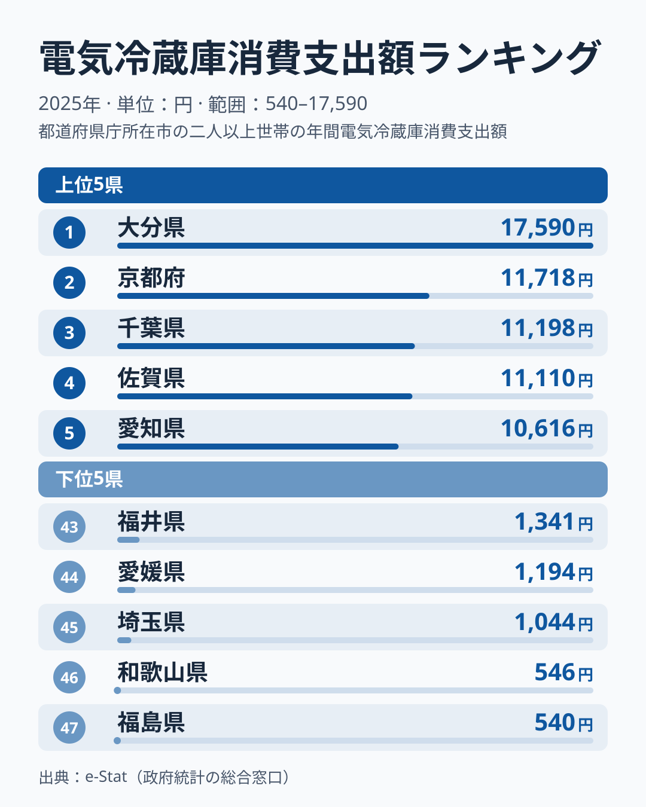
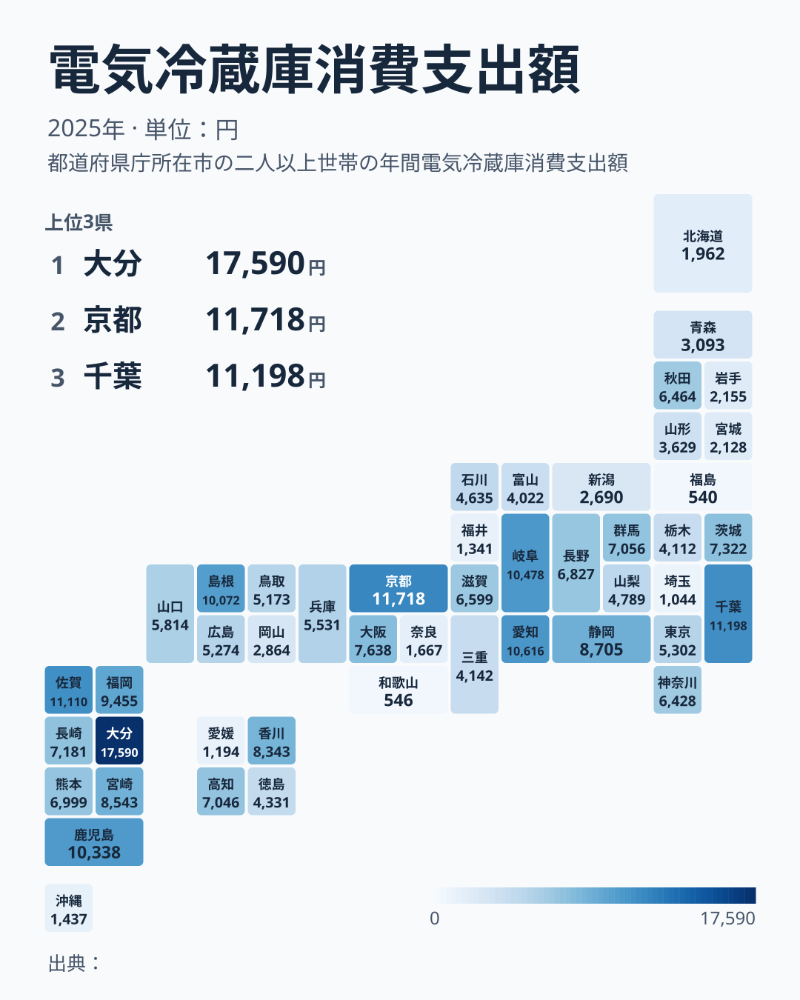

2025年の電気冷蔵庫消費支出額を都道府県庁所在市で比べると、1位の大分県は17,590円、最下位の福島県は540円で、その差は約32.6倍に達します。冷蔵庫は毎日使うのに滅多に買わない品目なので、1年分の平均支出額はもともと大きく揺れます。それでも47県を並べると、九州が上位に集まり、東北と北海道が下位に偏るという地域の傾向が見えてきます。

この記事では、電気冷蔵庫の支出額ランキングを上位・下位・全国地図の順に確認します。数字の開きがどこまで地域の特徴で、どこから単年の標本の揺れなのかを分けて読むことが目的です。この統計だけでは、大分県がなぜ1位なのかという理由までは特定できません。理由を断定せず、データから言えることと言えないことを分けて書きます。

> [!NOTE]
> このランキングは総務省「家計調査」の品目別支出額のうち、電気冷蔵庫（耐久消費財に分類）を都道府県庁所在市の二人以上世帯について集計したものです。冷蔵庫は数年から十数年に一度しか買い替えない商品のため、食料品のように毎月一定額を使うタイプの支出とは性質が異なります。

## 上位と下位

<source-link href="/ranking/refrigerator-consumption-expenditure">電気冷蔵庫消費支出額ランキングをもっと見る</source-link>

2025年の電気冷蔵庫消費支出額は、1位が大分県の17,590円です。2位の京都府は11,718円、3位の千葉県は11,198円、4位の佐賀県は11,110円、5位の愛知県は10,616円と続きます。2位から5位までは1万1千円前後に集まっており、大分県と京都府の比は約1.5倍で、大分県が頭一つ抜けています。

上位5府県の顔ぶれは九州の大分県と佐賀県、近畿の京都府、関東の千葉県、中部の愛知県です。ここだけを見るとばらばらに見えますが、47県全体で見ると九州の偏りがはっきりします。九州本土の7県は、大分県が1位、佐賀県が4位、鹿児島県が7位、福岡県が9位、宮崎県が11位、長崎県が15位、熊本県が18位と、すべて18位以内に入っています。九州で下位に沈むのは、42位の沖縄県だけです。

この偏りの理由は、今回のデータだけでは判断できません。気候や住宅事情、買い替えの時期が重なった結果など、複数の仮説が考えられますが、いずれも冷蔵庫の買い替え世帯数や複数年の推移がなければ検証できないからです。ここでは「九州で高い県が多い」という事実の確認にとどめます。

> [!WARNING]
> 家計調査は都道府県庁所在市の世帯を抽出した標本調査で、冷蔵庫のような耐久財は購入した世帯がごく少数でも平均が大きく動きます。1年だけの順位差を、そのまま地域の暮らしぶりの違いと読むのは慎重にしてください。

## 最下位グループの実像

下位を見ると、45位埼玉県が1,044円、46位和歌山県が546円、47位福島県が540円という結果でした。46位と47位はわずか6円差で、ほぼ並んでいます。1位の大分県との比では、福島県が約32.6倍、和歌山県が約32.2倍の開きです。

下位の顔ぶれには、東北と北海道の低さが目立ちます。東北6県のうち、秋田県は21位です。残る5県は、山形県が34位、青森県が35位、岩手県が38位、宮城県が39位、福島県が47位で、いずれも下位14県に入っています。北海道は40位でした。一方、中部・四国・関東の県も下位に並んでいます。43位の福井県が1,341円、44位の愛媛県が1,194円、45位の埼玉県が1,044円で、いずれも1,000円台前半です。

つまり、下位は東北・北海道に偏りつつも、それだけでは説明しきれない顔ぶれです。同じ関東でも千葉県は3位、埼玉県は45位と大きく離れています。東北と北海道の低さが続く地域差なのか、この年の標本のぶれなのかは、単年のデータだけでは切り分けられません。

## 全国地図で見る地域のばらつき

47都道府県を地図で並べると、九州に濃い色（支出額が高い県）が集まり、東北から北海道にかけて薄い色（支出額が低い県）が目立ちます。九州本土の7県はいずれも18位以内に収まり、東北と北海道は地図の上で薄い色が続いています。この2つの傾向は地図から素直に読み取れます。

一方で、関東は地域としてのまとまりがありません。千葉県が3位の11,198円、茨城県が14位の7,322円、群馬県が16位の7,056円、神奈川県が22位の6,428円、東京都が25位の5,302円、栃木県が32位の4,112円、埼玉県が45位の1,044円と、同じ地方のなかで幅が非常に広くなっています。近畿でも京都府が2位、大阪府が13位の7,638円、奈良県が41位、和歌山県が46位と散らばっており、大都市圏が一様に下位へ沈んでいるわけでもありません。

[仮説] 九州で高く東北・北海道で低い傾向は、世帯人数や持ち家率、住宅の広さの違いと関係している可能性があります。ただし、本記事のデータにはこれらの統計は含まれていません。検証するには、同じ指標を複数年で並べて順位が続くかを見たうえで、持ち家率や世帯人数の統計と突き合わせる必要があります。耐久消費財全体の傾向は、[家庭用耐久財の都道府県差](/blog/household-durables-group-consumption-expenditure-prefecture)や[家具・家事用品費の都道府県差](/blog/furniture-household-expenditure-total-prefecture-gap)の記事で確認できます。

> [!TIP]
> 冷蔵庫のような耐久消費財の地域差は、単年ではなく複数年の推移を確認すると、継続的な傾向なのか、その年の標本のぶれなのかを見分けやすくなります。ランキングページの年次セレクタで過去の年も合わせて確認してみてください。

## まとめ

- 2025年の電気冷蔵庫消費支出額は1位大分県が17,590円、2位京都府が11,718円、3位千葉県が11,198円
- 最下位は47位福島県の540円、46位和歌山県が546円、45位埼玉県が1,044円で、1位大分県との比は約32.6倍
- 九州本土の7県はすべて上位18位以内で、東北は秋田県を除く5県が下位14県に入り、北海道も下位に位置する
- 関東や近畿は上位から下位まで幅が広く、大阪府は13位、東京都は25位と、大都市が一様に下位になるわけではない
- 単年の標本調査のため、順位差を地域の特徴と読むには複数年での確認が必要で、大分県が1位の理由はこのデータからは特定できない

## データについて

総務省「家計調査」の品目別支出額（電気冷蔵庫、耐久消費財）を、都道府県庁所在市の二人以上世帯を対象に集計した数値です。e-Stat（政府統計の総合窓口）経由で取得したデータをもとに構成しています。家計にまつわる他の指標は[経済カテゴリ](/category/economy)でも確認できます。
