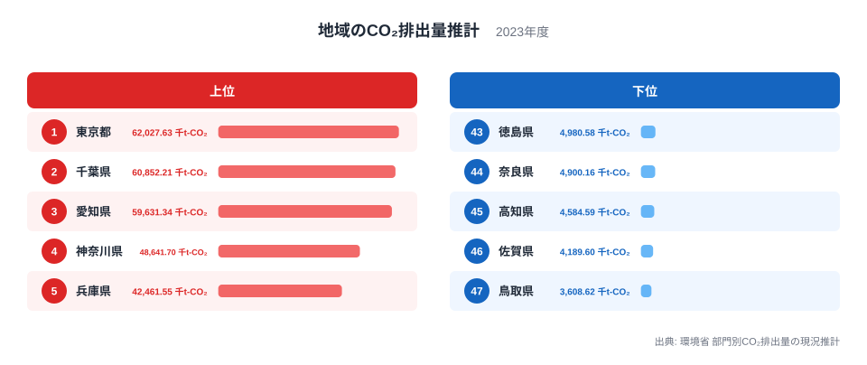
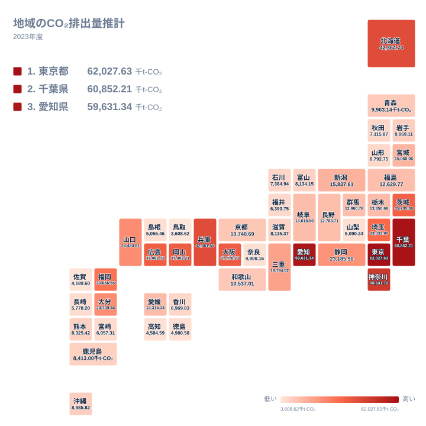

## 排出量の多い県と少ない県

二酸化炭素の排出量は、エネルギーの需要がどこに集まっているかを映す数字です。2023年の地域のCO₂排出量推計を見ると、都道府県ごとの違いははっきり表れます。

最も多いのは東京都で、62,027.629千t-CO₂です。2位は千葉県で60,852.21千t-CO₂、3位は愛知県で59,631.344千t-CO₂でした。4位は神奈川県で48,641.701千t-CO₂、5位は兵庫県で42,461.555千t-CO₂です。6位の北海道は42,364.741千t-CO₂で、5位の兵庫県とほぼ並んでいます。

最も少ないのは鳥取県で、3,608.621千t-CO₂です。次いで佐賀県が4,189.603千t-CO₂、高知県が4,584.586千t-CO₂、奈良県が4,900.155千t-CO₂、徳島県が4,980.582千t-CO₂と続きます。1位の東京都は、47位の鳥取県の約17倍にあたります。

> [!NOTE]
> この統計は、県内で推計された排出量の合計値です。人口あたりでも面積あたりでもありません。人口が多い県や産業が集中する県ほど大きな値になりやすく、一人ひとりの排出が多いかどうかは、この数字だけでは判断できません。

## 上位5県と下位5県を並べて見る

まず、上位5県と下位5県を1枚の図で確認します。

<source-link href="/ranking/regional-co2-emissions-estimate">地域のCO₂排出量推計ランキングをもっと見る</source-link>

上位5県の所属を地方で見ると、関東が東京都、千葉県、神奈川県の3都県を占めています。残りは中部の愛知県と近畿の兵庫県です。大都市圏を抱える都県が並ぶ形で、人口や経済活動の規模の大きさが、合計値の大きさに結びついている可能性があります。ただし、この記事で使えるのは合計値と順位だけで、内訳までは確かめられません。

1位の東京都と2位の千葉県は、62,027.629千t-CO₂と60,852.21千t-CO₂で、近い水準です。なぜ両都県が並ぶのかについて、データから答えは出せません。仮説は複数あります。東京都は業務や住宅、交通が密集していること、千葉県は東京湾岸に工業が集まっていることです。どちらも一般的な見方で、この記事のデータで検証したものではありません。それぞれの詳しい数字は[東京都のデータ](/areas/13000)と[千葉県のデータ](/areas/12000)で確認できます。

下位5県は、鳥取県が中国、佐賀県が九州・沖縄、高知県と徳島県が四国、奈良県が近畿に属します。地方はばらばらで、特定の地方に偏ってはいません。規模の大きな排出源が少ないことが背景にあるかもしれませんが、これも仮説にとどまります。

> [!TIP]
> 順位を読むときは、隣り合う県の値も見てください。5位の兵庫県と6位の北海道は、42,461.555千t-CO₂と42,364.741千t-CO₂で、順位は違っても値はほとんど変わりません。順位の差と値の差は別物です。

## 地理分布から見る地方ごとの幅

次に、47都道府県の位置関係を地図形式で見ます。

関東は7都県すべてが22位以内に入っています。東京都が1位、千葉県が2位、神奈川県が4位、茨城県が35,705.359千t-CO₂で10位、埼玉県が33,033.905千t-CO₂で11位です。栃木県は13,350.661千t-CO₂で19位、群馬県は12,960.757千t-CO₂で22位でした。関東の中でも、1位の東京都と22位の群馬県では値に大きな差があります。それでも地方全体の水準は高く、この地図で最も濃い色が集まっている地方です。

中国地方は、順位の幅が最も大きい地方の一つです。岡山県が37,402.211千t-CO₂で8位、広島県が37,062.719千t-CO₂で9位、山口県が24,430.814千t-CO₂で14位と上位に並びます。一方、島根県は5,056.455千t-CO₂で42位、鳥取県は47位です。5県の中に、8位と47位が同居しています。

九州・沖縄も同じです。福岡県が30,656.55千t-CO₂で12位、大分県が24,739.475千t-CO₂で13位ですが、佐賀県は46位、長崎県は5,778.199千t-CO₂で40位です。熊本県は8,325.421千t-CO₂で31位、鹿児島県は8,413.002千t-CO₂で30位、沖縄県は8,985.815千t-CO₂で29位と、中位から下位寄りに集まります。

> [!WARNING]
> この数字は環境省による推計値で、個々の工場や事業所の排出量を積み上げた実測値ではありません。推計の前提しだいで、値の近い県どうしの順位は入れ替わる可能性があります。小さな差に大きな意味を読み込まないでください。

## 北海道・東北、中部、近畿、四国の順位の幅

北海道・東北は7道県で、北海道が6位と突出しています。宮城県が15,060.061千t-CO₂で18位、福島県が12,629.773千t-CO₂で24位、青森県が9,963.143千t-CO₂で27位、岩手県が9,069.108千t-CO₂で28位、秋田県が7,115.867千t-CO₂で35位、山形県が6,792.748千t-CO₂で37位です。北海道を除く6県は、18位から37位の間に収まっています。北海道がなぜ上位なのかは、このデータからは説明できません。

中部は9県で、幅がとても広い地方です。愛知県が3位、静岡県が23,185.903千t-CO₂で15位、新潟県が15,837.612千t-CO₂で17位となる一方、山梨県は5,090.338千t-CO₂で41位です。福井県は6,393.752千t-CO₂で38位、石川県は7,384.941千t-CO₂で34位、富山県は8,134.153千t-CO₂で32位でした。岐阜県は13,018.495千t-CO₂で21位、長野県は12,783.711千t-CO₂で23位です。

近畿は7府県で、兵庫県が5位、大阪府が37,476.266千t-CO₂で7位、三重県が19,794.024千t-CO₂で16位です。京都府は10,740.686千t-CO₂で25位、和歌山県は10,537.013千t-CO₂で26位、滋賀県は8,115.367千t-CO₂で33位、奈良県は44位でした。上位5位以内と下位5位以内の両方に県がある地方は、近畿だけです。

四国は4県で、愛媛県が13,314.336千t-CO₂で20位、香川県が6,969.833千t-CO₂で36位、徳島県が43位、高知県が45位です。愛媛県だけが20位と上位寄りにあり、他の3県は30位台後半から40位台に並びます。

> [!NOTE]
> 順位が近くても、値の差はまちまちです。19位の栃木県は13,350.661千t-CO₂、20位の愛媛県は13,314.336千t-CO₂で、ほとんど同じ水準です。中位は値が密集しているため、少しの違いで順位が動きます。

## 数字をどう読めばよいか

ここまでの内容を整理します。

- 上位3位は、東京都の62,027.629千t-CO₂、千葉県の60,852.21千t-CO₂、愛知県の59,631.344千t-CO₂です
- 最多の東京都と最少の鳥取県の比は約17倍です
- 関東は7都県すべてが22位以内で、中国や九州・沖縄は同じ地方の中で順位が大きく分かれます

この指標は、県の規模や産業の集まり方を反映した合計値です。排出量が少ない県が環境対策に熱心だとは言えず、多い県が環境に配慮していないとも言えません。人口や産業の規模が違う県どうしを、合計値だけで優劣づけることはできません。

背景について、この記事では産業の集積や都市の規模といった仮説を挙げましたが、いずれもデータで確かめたものではありません。部門別の内訳や人口あたりの値と合わせて読むと、見え方が変わります。関連する統計は[同じカテゴリの統計一覧](/category/safetyenvironment)から探せます。

> [!TIP]
> 自分の県を調べるときは、全国順位だけでなく同じ地方の県と並べてください。たとえば10位の茨城県は35,705.359千t-CO₂、11位の埼玉県は33,033.905千t-CO₂です。同じ関東の中での位置を見ると、県の特徴がつかみやすくなります。

## データについて

この記事で使ったのは、環境省の部門別CO₂排出量の現況推計に基づく、2023年の地域のCO₂排出量推計です。単位は千t-CO₂で、47都道府県すべての値を使いました。順位は、値の大きい県を1位としています。

県ごとの合計値だけを比べており、産業、家庭、運輸などの部門別の内訳は扱っていません。したがって、ある県の排出量が多い理由を特定の部門に断定するものではありません。本文中の背景説明は、一般的な見方にもとづく仮説です。
