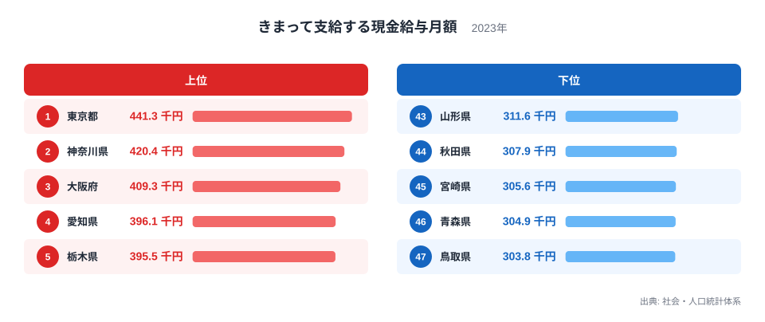
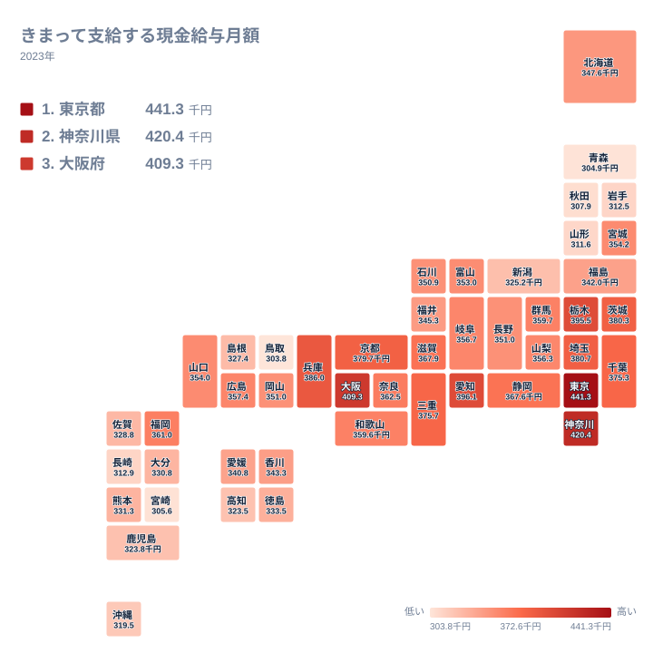

毎月決まって受け取る給与の水準は、暮らす県によって大きく違います。2023年のデータで見ると、1位の東京都は441.3千円、47位の鳥取県は303.8千円でした。その差は137.5千円です。同じ国で働いていても、毎月の給与の土台にこれだけの開きがあります。

この記事では、きまって支給する現金給与月額が高い県と低い県を並べ、順位の並びが地理的にどう広がっているかを確認します。そのうえで、産業構造などの面から考えられる背景を、あくまで仮説として整理します。ここで使う指標には時間外手当が含まれる点にも注意が必要です。この点は後ほど詳しく触れます。

## 上位と下位の差を読み解く

まずは上位5県と下位5県を図で確認します。

<source-link href="/ranking/regular-cash-salary-male">きまって支給する現金給与月額ランキングをもっと見る</source-link>

図の値そのものよりも、注目したいのは差の形です。1位の東京都と47位の鳥取県の差は137.5千円ありますが、この差は上位と下位で均等に生まれているわけではありません。上位では、東京都が441.3千円、2位の神奈川県が420.4千円で、差は20.9千円あります。神奈川県と3位の大阪府の409.3千円との差は11.1千円です。東京都と神奈川県の間は、神奈川県と大阪府の間のおよそ2倍の開きがあり、東京都が一段高い位置にあることが数字から確かめられます。

一方、下位は密集しています。47位の鳥取県の303.8千円から43位の山形県の311.6千円までは、わずか7.8千円の幅です。5県のあいだで順位が入れ替わっても、実際の金額差は小さいことが読み取れます。上位の5県が441.3千円から395.5千円まで45.8千円の幅に広がっているのと比べると、下位は横並びに近い状態です。

つまり、全国の差の大部分は「上位の中での開き」と「上位と中位の間の開き」から生まれています。下位の県同士を細かく比べるよりも、どの水準の帯に位置しているかを見るほうが、この指標の実態に近い読み方です。

> [!NOTE]
> 「きまって支給する現金給与月額」は、労働契約などで定められた支給条件・算定方法によって毎月支給される給与の額です。基本給や家族手当、通勤手当に加えて、時間外手当(残業代)も含まれます。一方、賞与などの特別給与は含まれません。このため、所定内の給与水準だけでなく、残業の多さによっても額が上下します。年収の比較とは別物として読む必要があります。

## 東京都と神奈川県はなぜ高いのか

東京都が最上位になる背景には、産業構造の違いがあると考えられます。本社機能、金融、情報通信、専門サービスといった、一般に給与水準が高いとされる業種が集まっていることが、仮説のひとつです。ただし、この記事で使っているのは都道府県別の賃金の値だけで、業種別の内訳は手元にありません。そのため、あくまで可能性として捉えてください。

もうひとつ考えられるのは、時間外手当の影響です。この指標は残業代を含むため、労働時間の長さが平均を押し上げている可能性もあります。ただし、残業時間のデータは今回の実データにありません。賃金の高さが基本給の高さによるものか、残業の多さによるものかは、この数字だけでは切り分けられません。

2位の神奈川県は、東京都に隣接する県です。値は420.4千円で、3位の大阪府や4位の愛知県の396.1千円を上回っています。東京都との距離の近さが影響している可能性はありますが、この記事のデータからは断定できません。個別の値は[東京都のデータ](/areas/13000)や[神奈川県のデータ](/areas/14000)で、他の指標とあわせて確認できます。

## 地理分布で見る高賃金地域の広がり

続いて、全国の分布を地図で見ます。

地図からは、まず首都圏の高さが読み取れます。東京都、神奈川県に続き、7位の埼玉県が380.7千円、8位の茨城県が380.3千円、11位の千葉県が375.3千円です。栃木県は395.5千円で5位に入っており、三大都市圏の中心県ではない県が、首都圏の外縁で上位に位置しています。群馬県は359.7千円で16位です。

もうひとつの山は、東海から近畿にかけての帯です。愛知県の396.1千円を中心に、京都府が379.7千円で9位、三重県が375.7千円で10位、滋賀県が367.9千円で12位、静岡県が367.6千円で13位と続きます。6位の兵庫県は386千円、3位の大阪府は409.3千円で、近畿の中心部も上位に入っています。東海道沿いに高い県が連なっていることが、地図から読み取れます。

西日本の他の地域に目を向けると、状況は変わります。福岡県は361千円で15位ですが、九州の他県は下位側に偏っています。熊本県は331.3千円で33位、大分県は330.8千円で34位、佐賀県は328.8千円で35位、鹿児島県は323.8千円で38位です。九州の中では福岡県だけが突出している構図です。四国では、香川県が343.3千円で29位、愛媛県が340.8千円で31位、徳島県が333.5千円で32位、高知県が323.5千円で39位と、いずれも中位から下位に並んでいます。

> [!WARNING]
> この指標は「きまって支給する」給与であり、残業の多寡に左右されます。残業が多い県は額面が高く出る一方、時間あたりの賃金が高いとは限りません。また、賞与は含まれないため、賞与の厚い県や業種では、年収ベースの順位がこの表と入れ替わる可能性があります。順位の差を、そのまま基本給や年収の差として読むことはできません。

## 下位の県に見られる傾向

下位5県は、鳥取県、青森県、宮崎県、秋田県、山形県です。地域で見ると、青森県、秋田県、山形県の3県が東北、鳥取県が中国、宮崎県が九州に属しています。東北では他にも、岩手県が312.5千円で42位に入り、下位の集まりの中に位置しています。

一方で、宮城県は354.2千円で21位、福島県は342千円で30位、新潟県は325.2千円で37位と、東北・北陸の中でも位置は分かれます。宮城県は中位に入っており、同じ地方の中でも差があることが分かります。

こうした差が生まれる理由として、企業規模や業種構成の違いが考えられます。大企業の本社や大規模な工場が少ない県では、中小企業が雇用の中心になりやすく、賃金水準にも影響する可能性があります。ただし、事業所の規模や業種に関するデータは今回の数字に含まれていません。歴史的な産業の発展の経緯や人口の移動が影響している可能性も指摘されることがありますが、この記事で示した賃金の値だけでは検証できないため、ここでは仮説の域を出ません。

北海道は347.6千円で27位、沖縄県は319.5千円で40位です。いずれも全国の中位から下位に位置しています。ただし、その背景を説明できるだけのデータは手元にないため、理由には踏み込みません。

> [!TIP]
> 順位だけでなく、隣り合う県との値の差にも注目してください。下位5県は303.8千円から311.6千円の範囲に収まっており、順位が1つ違っても実際の差は小さいことが分かります。逆に、東京都と神奈川県の間のように、順位は1つ違いでも20.9千円も開いているケースがあります。

## データについて

ここで使っているのは、社会・人口統計体系に収録された「きまって支給する現金給与月額」の2023年の値で、単位は千円です。47都道府県すべての値を比較しています。

この指標は、時間外手当を含み、賞与を含まないという性格を持ちます。このため、基本給の水準を直接比べたものではありません。賃金に関する他の指標とあわせて見ると、地域の姿はより立体的になります。気になる方は[同じカテゴリの統計一覧](/category/laborwage)もご覧ください。

## まとめ

きまって支給する現金給与月額は、東京都が441.3千円で1位、鳥取県が303.8千円で47位でした。両者の差は137.5千円です。この差の中身を見ると、上位では東京都と神奈川県の間に20.9千円の開きがある一方、下位5県は7.8千円の幅に収まっていました。

地図では、首都圏と東海・近畿の帯に高い県が集まり、東北や九州の多くの県が下位側に位置している様子が確認できました。背景としては、産業構造や企業規模の違い、残業の多寡などが考えられますが、本記事のデータだけでは検証できません。数字を見るときは、順位の差だけでなく、値の差と指標の定義にも目を向けてみてください。
