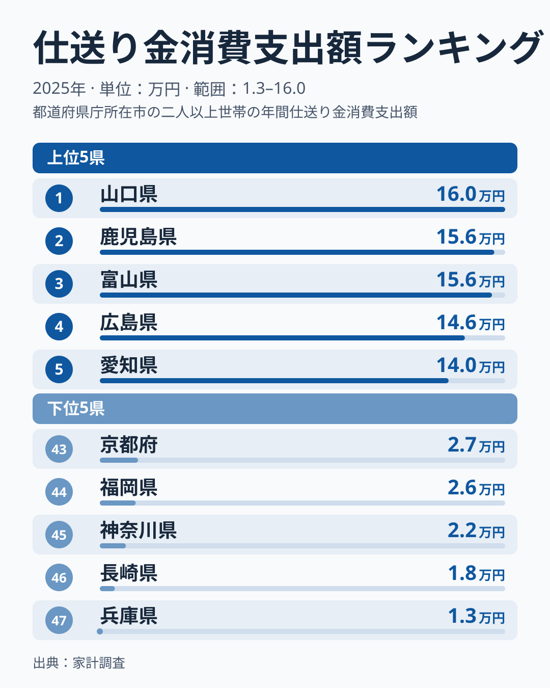
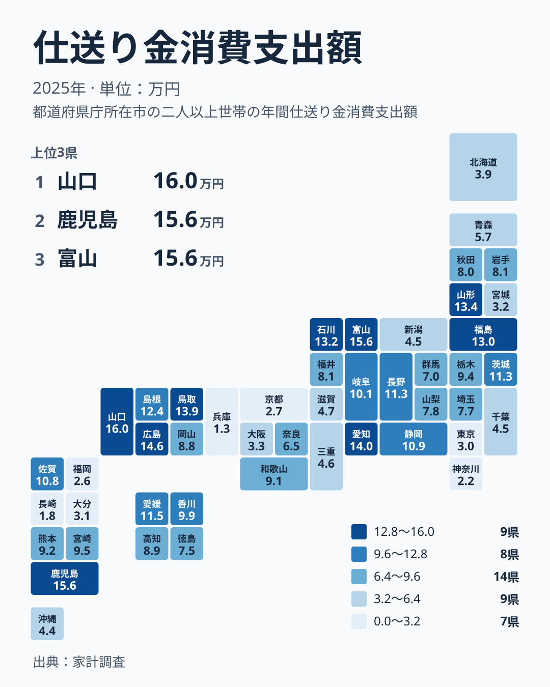

## 仕送り金の地域差は、暮らしの何を映しているのか

子どもや親族への仕送りは、家計の中では目立たない支出です。けれども、都道府県ごとに並べてみると、家族の暮らし方の違いがうっすらと見えてきます。

この記事では、家計調査の2025年の結果をもとに、仕送り金への支出を都道府県別に見ていきます。1位は山口県で160,382円、47位は兵庫県で12,685円です。1位と47位では桁が違うほど開いていることが、図でも確かめられます。

読み方の前提として、仕送りは「多いほど豊か」「少ないほど冷たい」といった単純な物差しではありません。この数字が何を数えたものなのかを押さえたうえで、地域ごとの並び方を見ていきます。

> [!NOTE]
> 仕送り金消費支出額は、家計調査で世帯が別居中の家族などへ送った生活費や教育費などを数えた支出額です。仕送りをした世帯だけの平均ではなく、調査対象の世帯全体で見た値です。送らなかった世帯も含めて平均されるため、仕送りをする世帯が多いのか、1世帯あたりの額が大きいのかは、この数字だけでは分かりません。

同じ経済カテゴリには、ほかの家計関連の統計もあります。あわせて見たい方は [同じカテゴリの統計一覧](/category/economy) をご覧ください。

## 上位と下位を並べて見る

まずは、上位5県と下位5県を図で確認します。

<source-link href="/ranking/remittances-group-consumption-expenditure">仕送り金への支出ランキングをもっと見る</source-link>

図にない比較を二つ加えます。上位5県の中では、1位の山口県160,382円と5位の愛知県139,768円の差が、約2万円あります。一方、下位5県の中では、47位の兵庫県12,685円と43位の京都府26,592円の差が約1.4万円です。上位は5県の中でも幅があり、下位は1万円台から2万円台に密集しています。

上位には、山口県、鹿児島県、富山県、広島県、愛知県が並びます。愛知県を除くと、いずれも大都市圏の中心ではない県です。ただし、この並びを進学による県外流出と結びつけるのは、ひとつの見方にとどまります。データだけでは、仕送りの使い道も、送り先も確かめられません。

下位には、兵庫県、長崎県、神奈川県、福岡県、京都府が入ります。東京都は42位の30,062円、大阪府は39位の32,509円で、やはり下位寄りです。大都市圏の数字が小さい理由については、自宅から通える範囲が広いからかもしれない、という仮説は立てられますが、この数字だけでは確かめられません。

> [!TIP]
> 仕送り金は、送る側の世帯の支出として数えられています。大学が多い県の数字が小さくても、その県に仕送りが入っていない、という意味ではありません。「その県の世帯が外へ送った額」と読むと、誤読を避けられます。

## 地図で見る地域の偏り

次に、47都道府県の分布をタイルマップで見てみましょう。

濃い色が並ぶのは、中国地方と中部の一部、そして九州の南部です。反対に、近畿と関東の都市部には、薄い色が目立ちます。ただ、隣り合う県でも色が大きく違う場所があり、きれいな帯状にはなっていません。

中国地方は5県のうち4県が10位以内です。山口県が1位、広島県が4位、鳥取県が6位、島根県が10位で、岡山県だけが23位の88,406円と中位にとどまります。中部では、富山県が3位、愛知県が5位、石川県が8位と上位に3県が入ります。一方、同じ中部の新潟県は36位の45,343円です。

地図からは、地方のくくりだけでは地域差を説明しきれないことも分かります。次の節では、各地方の中でのばらつきを順位順に見ていきます。

## 同じ地方の中でも分かれている

九州・沖縄は、とくに差が大きい地方です。鹿児島県が2位の156,404円、佐賀県が15位の107,671円、宮崎県が18位の95,493円、熊本県が20位の91,923円と続きます。その後に、沖縄県が37位の43,842円、大分県が41位の30,605円、福岡県が44位の25,756円、長崎県が46位の18,159円と、下位に回る県もあります。

関東は、茨城県が13位の112,709円、栃木県が19位の93,701円、埼玉県が28位の77,172円、群馬県が30位の69,848円、千葉県が35位の45,414円、東京都が42位の30,062円、神奈川県が45位の22,168円です。おおむね東京都や神奈川県に近い県ほど順位が低めですが、例外もあります。埼玉県は東京都に隣接しながら28位で、群馬県の30位より上です。

北海道・東北は、山形県が7位の134,051円、福島県が9位の130,445円、岩手県が24位の81,379円、秋田県が26位の79,914円、青森県が32位の57,048円、北海道が38位の39,185円、宮城県が40位の32,189円です。東北の中でも、山形県と福島県が上位、宮城県が下位寄りと、かなり開いています。

近畿は、和歌山県が21位の91,414円、奈良県が31位、滋賀県が33位、三重県が34位、大阪府が39位、京都府が43位、兵庫県が47位です。近畿の中では和歌山県が最上位で、全体に下位寄りです。

> [!WARNING]
> 家計調査は標本調査で、都道府県別の値は限られた調査世帯をもとにしています。調査世帯が少ない県では、少数の世帯の事情で平均値が大きく動くことがあります。数位の違いで実態が変わったと読むのは危険ですので、順位は参考にとどめてください。

## この数字から言えること、言えないこと

地方の中でも差が大きい理由について、大学の地域偏在や若者の県外への移動、世帯の所得水準、地域のつながりの強さなどが背景にあるのではないか、という見方が家計調査の解説などで挙げられています。ただし、この記事で使える実データは仕送り金の値と順位だけです。所得や進学先のデータとは突き合わせていませんので、これらは仮説の域を出ません。

暮らしの側から読むときに、この数字だけで分かることは限られます。

- 上位の県では、世帯全体で平均した仕送りの支出が大きくなっています。ただし、仕送りをする世帯の割合と、1世帯あたりの額のどちらが効いているかは分かりません。
- 下位の県は、仕送りの支出が小さいだけです。教育費全体の負担が軽いかどうかは、この数字からは判断できません。
- 隣り合う県でも順位が大きく違う例があります。自分の県の位置は、地方のくくりではなく、実際の順位で確かめるのが確実です。

県ごとの詳しい数字は、[山口県のデータ](/areas/35000) や [鹿児島県のデータ](/areas/46000) からも確認できます。仕送りの多い県の家計が、ほかの支出とどう組み合わさっているかを見ると、理解が深まります。

## データについて

この記事で使った統計は、家計調査の「仕送り金消費支出額」です。2025年の結果を、円単位で都道府県別に並べています。仕送り金は、家計調査の「その他の消費支出」に含まれる項目の一つで、別居している家族などへ送る生活費や教育費にあたります。調査の対象は世帯で、都道府県別の値は県庁所在地などの調査結果をもとにしているため、県全体の実態をそのまま表すとは限りません。順位は参考にとどめ、数字の大きな開きや全体の傾向を読み取る材料として活用してください。
