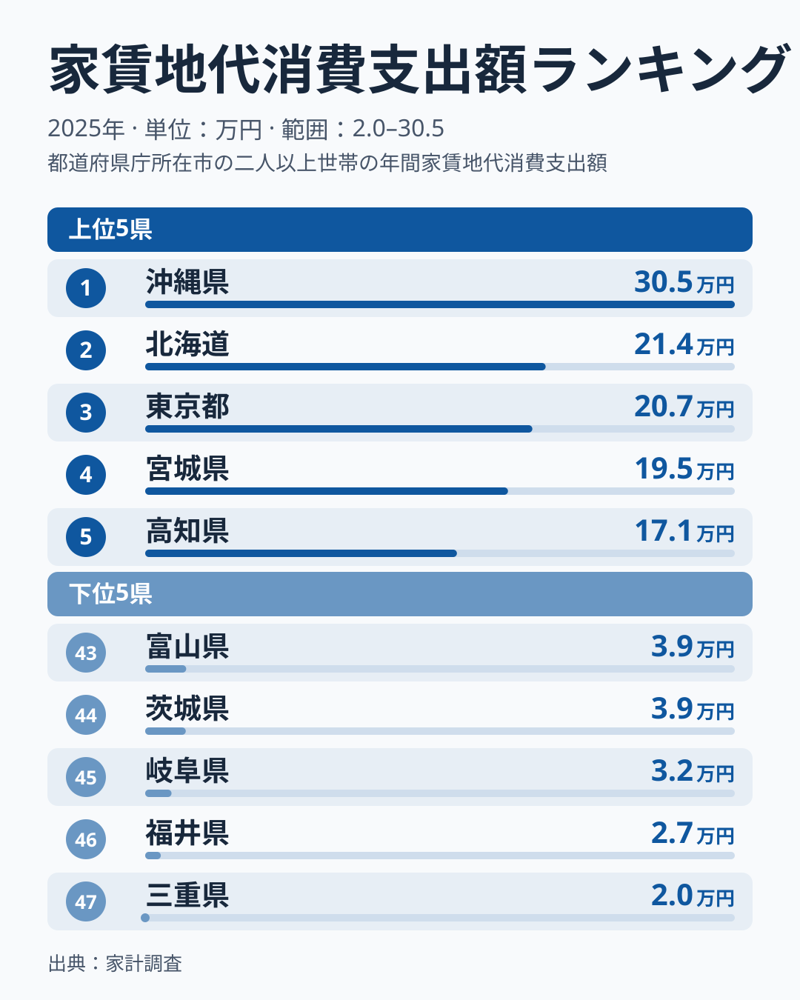
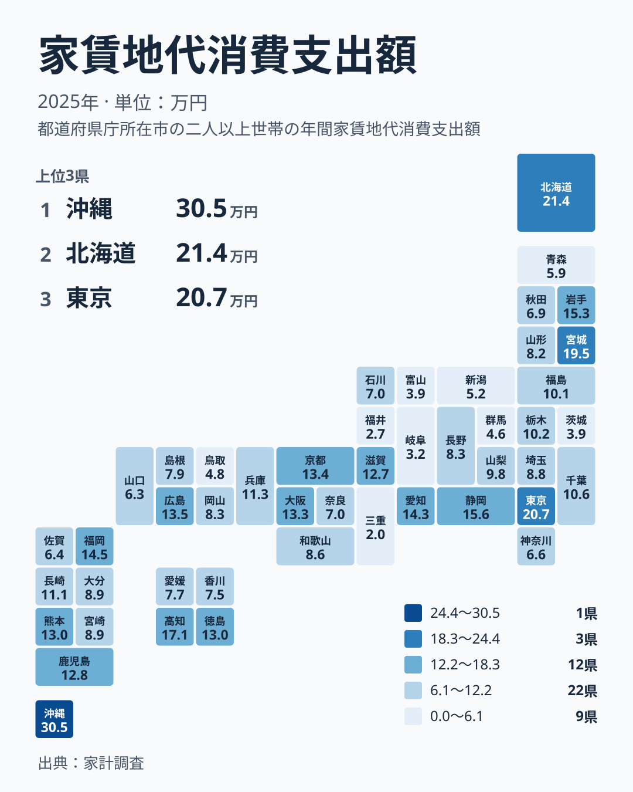

## 家賃地代への支出は沖縄県が最多

家賃地代への支出で最も多いのは沖縄県で、305,313円です。2位は北海道で213,636円、3位は東京都で207,194円と続きます。東京都が首位ではないことに、意外さを覚える方も多いのではないでしょうか。

反対に、最も少ないのは三重県で19,551円です。46位は福井県で27,131円、45位は岐阜県で32,320円です。最多の沖縄県と最少の三重県を並べると、その開きは約15.6倍にもなります。同じ日本の中で、家賃や地代に回すお金がこれほど違うのです。

この記事では、図の形から言えることを順に読み解きます。なお、数字の背景にある理由までは、手元の統計だけでは確かめられません。その限界も最後にまとめます。

> [!NOTE]
> この記事で扱う家賃地代消費支出額(家計調査、2025年、単位は円)は、家賃や地代として支払った額を、世帯あたりで平均した値です。地代は、住宅のために借りている土地の代金を指します。持ち家で家賃を払っていない世帯が平均に含まれるかどうかで、数字の意味合いは大きく変わります。

## 上位は分散し、下位は低い値に密集している

まず、上位5位と下位5位を図で確認します。

<source-link href="/ranking/rent-group-consumption-expenditure">家賃地代への支出ランキングをもっと見る</source-link>

上位5位は、沖縄県、北海道、東京都、宮城県、高知県です。注目したいのは、1位と2位の落差です。沖縄県の305,313円は、2位の北海道の213,636円から大きく離れています。2位から5位までは、北海道が213,636円、東京都が207,194円、宮城県が195,381円、高知県が170,640円と、なだらかに下がっています。つまり上位は、沖縄県だけが突き抜け、その後ろを数県が緩やかに追う形です。

下位5位は、三重県が19,551円、福井県が27,131円、岐阜県が32,320円、茨城県が39,222円、富山県が39,438円です。こちらは、47位から43位までが19,551円から39,438円の範囲に収まっています。茨城県と富山県は200円も違わない並びで、下位は低い値の中に密集しているといえます。

上位が分散し、下位が密集している点は、図から確実に読み取れることです。上位には北海道、東北、四国、九州・沖縄から1県ずつ、そして関東の東京都が入っています。「家賃が高いのは東京都」という図式だけでは、この並びは説明できません。

> [!WARNING]
> この指標の最大の落とし穴は、家賃を払っていない世帯を含む平均かもしれない点です。もしそうなら、持ち家の多い県では値が低く出る可能性があります。逆に、家賃や地代を払う世帯が多い県では高く出ます。ただし、各県の持ち家の割合は今回のデータに含まれていないため、どの程度影響しているかは検証できません。

## 同じ地方でも差が大きい

次に、地理的な分布を図で見ます。

図から読み取れる一番大きな点は、東日本が低い、西日本が高いといった単純な色分けにならないことです。同じ地方の中でも、高い県と低い県が混在しています。

典型は関東です。東京都は3位で207,194円ですが、同じ関東の茨城県は44位で39,222円です。千葉県は19位で105,905円、埼玉県は25位で88,189円、神奈川県は36位で66,424円と、関東の中でも段階的に分かれています。

中部も同じです。静岡県は6位で155,694円、愛知県は9位で142,925円ですが、岐阜県は45位で32,320円、福井県は46位で27,131円、富山県は43位で39,438円です。同じ地方の中に、上位と下位の両方が存在しています。このため、地方単位で「この地方は高い」と言い切るのは難しいといえます。県ごとの違いを個別に見る必要があります。

近畿では、京都府が11位で133,585円、大阪府が12位で132,914円、滋賀県が16位で127,087円と、上位から中位にかけて並んでいます。近畿の中では、兵庫県が17位で113,366円、和歌山県が26位で86,362円、奈良県が34位で69,620円と、順に下がっていきます。

## 沖縄県と北海道の位置をどう見るか

沖縄県の305,313円は、2位の北海道の213,636円を大きく上回っています。詳しくは[沖縄県のデータ](/areas/47000)も参照してください。九州・沖縄の中で見ても、2位以下の福岡県が8位で145,350円、鹿児島県が15位で128,088円と、沖縄県は群を抜いています。

北海道は2位で、東京都の207,194円を上回っています。[北海道のデータ](/areas/01000)もあわせて確認してください。北海道・東北では、宮城県が4位で195,381円、岩手県が7位で152,789円と、上位に複数の県が入っています。一方で青森県は39位で59,489円、秋田県は35位で69,217円です。北海道・東北の中でも、地域内の幅は大きいのです。

賃貸で暮らす世帯が多いことや、地代を払う世帯が多いことが背景にあるのではないか、と想像することはできます。ただし、これは仮説の域を出ません。この数字の中には、「家賃の高さ」と「家賃や地代を払う世帯の多さ」が混ざっている可能性があります。

> [!TIP]
> 順位が高い県を見たとき、「家賃が高い」と即断せず、「払っている世帯が多い」可能性も同時に考えてください。逆に順位が低い県は、「家賃が安い」だけでなく「持ち家が多い」可能性があります。どちらなのかは、持ち家率など別の統計と重ねて初めて判断できます。

## 暮らしの読み方:この数字からできること

では、この差を生活の中でどう受け止めればよいでしょうか。まず、この数字は「その県の家賃相場」ではありません。持ち家などで支払いのない世帯が含まれる場合、これから部屋を借りる人の実感とはずれます。物件探しでは、実際の募集家賃を確かめることが欠かせません。

次に、この数字から家計全体の余裕を語ることもできません。他の費目や収入のデータがないためです。上位の県は住居費の負担が重い、と断定することは避けましょう。

そのうえで、この統計の使い道は、都道府県の違いを入口に、さらに調べたい問いを立てることです。たとえば、持ち家率の違いや、賃貸住宅の割合を示す別の統計と見比べれば、数字の意味が見えてきます。関連する指標は[同じカテゴリの統計一覧](/category/economy)から探せます。

最後に、この記事で言えることをまとめます。

- 家賃地代への支出は、沖縄県が305,313円で最多、三重県が19,551円で最少です。最多は最少の約15.6倍です。
- 上位は沖縄県が突き抜け、2位から5位は緩やかに下がります。下位は19,551円から39,438円に密集しています。
- 上位には東京都のほか、北海道、宮城県、高知県、沖縄県が入り、大都市だけが高いわけではありません。
- 同じ地方の中でも県ごとの差が大きく、地方単位の傾向では語れません。
- 最多となった理由は、今回のデータでは特定できません。

## データについて

ここで使った家賃地代消費支出額は、家計調査の2025年の結果で、単位は円です。家賃地代には、住宅の家賃に加えて、住宅のために借りている土地の地代が含まれます。

集計は世帯あたりの平均です。そのため、借家に住む世帯だけの家賃とは異なります。順位の近い県同士を比べる際は、数字の差を過大に受け取らないようにしてください。
