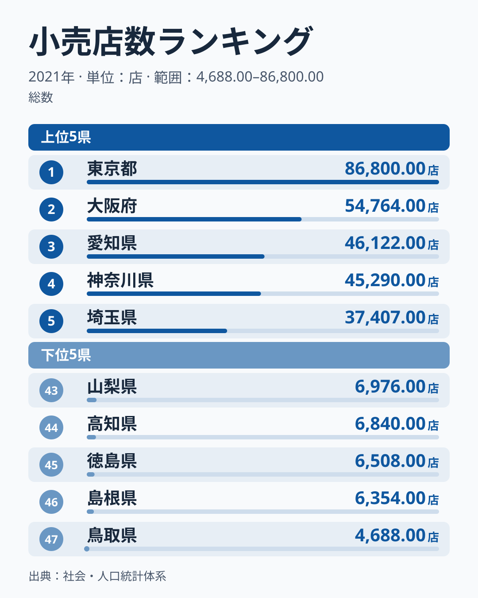
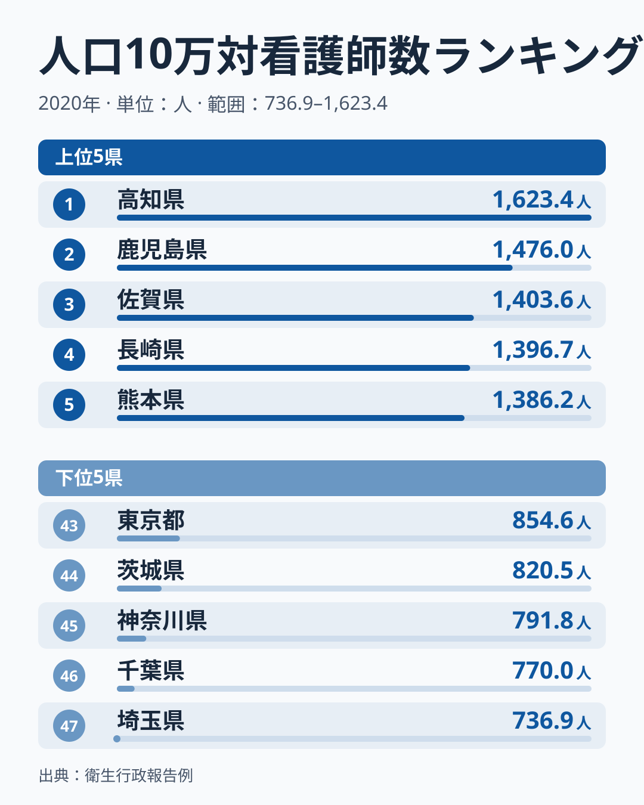
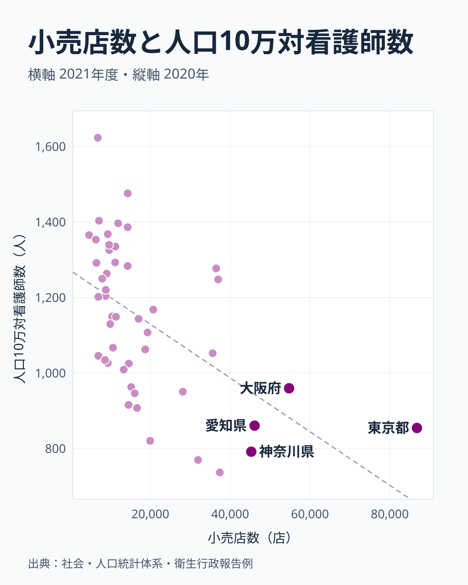
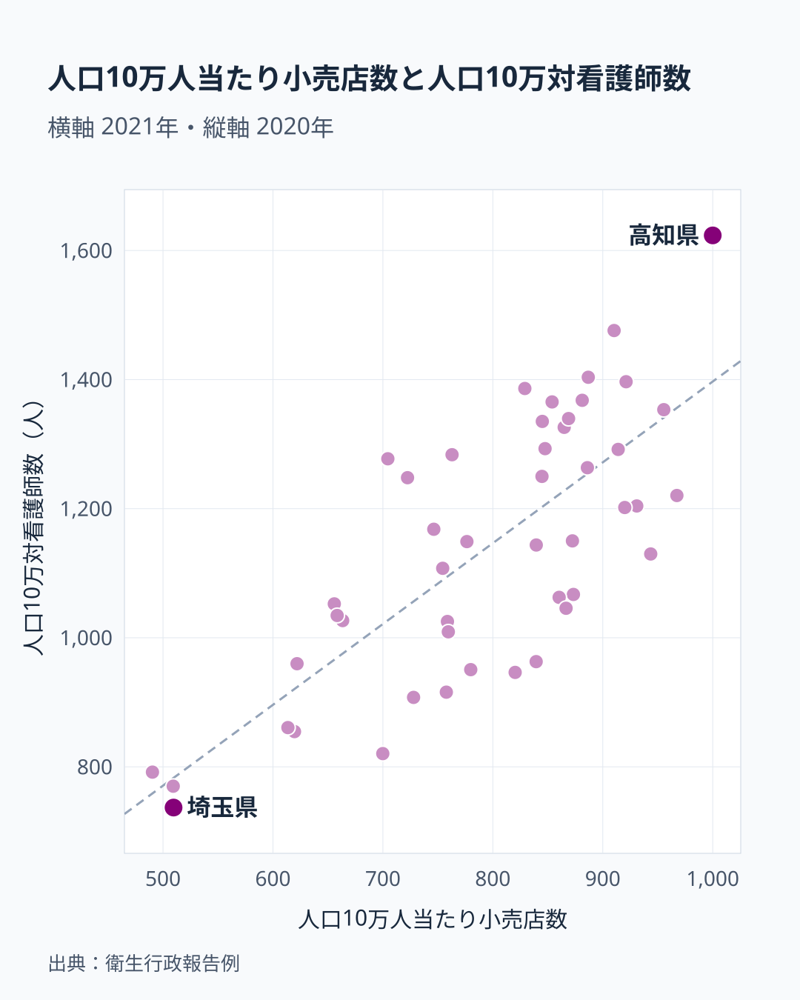

小売店の数と看護師の数を47都道府県で並べると、小売店が多い県ほど人口当たりの看護師は少ない、という傾向が出ます。相関係数は-0.54です。ところが小売店の数を人口10万人当たりに直すと、相関係数は+0.76に変わり、向きがちょうど逆になります。同じ2つの話題を比べているのに、実数で見るか人口当たりで見るかで、結論が反転するのです。

この記事では、小売店数と人口10万対看護師数の順位をそれぞれ確かめたうえで、散布図を2枚使って、反転がどこで起きるのかを追います。最後に、この相関から言えることと言えないことを分けて整理します。

## 小売店数は東京都が86,800店、鳥取県は4,688店

<source-link href="/ranking/retail-store-count">小売店数ランキングをもっと見る</source-link>

2021年の小売店数は、東京都が86,800店で1位です。大阪府の54,764店、愛知県の46,122店、神奈川県の45,290店、埼玉県の37,407店と続き、上位5都府県はいずれも大都市圏を抱える地域です。最下位は鳥取県の4,688店で、島根県の6,354店、徳島県の6,508店、高知県の6,840店、山梨県の6,976店と、人口の少ない県が下位に並びます。東京都の86,800店を鳥取県の4,688店で割ると約18.5倍です。

この指標は人口で割っていない実数です。人口が多い都府県ほど店の数も増えるため、順位は地域の大きさをほぼそのまま映していると見るのが自然です。実際、のちに人口10万人当たりに直すと、上位5都府県はすべて順位を大きく落とします。東京都は店数こそ1位ですが、人口当たりでは619.6店で43位です。この記事で言う「小売店が多い県」とは、まず「大きな県」のことだと押さえておくと、後の結果を読み違えにくくなります。

## 人口10万対看護師数は高知県が1位、東京都は43位

<source-link href="/ranking/nurses-per-100k-population">人口10万対看護師数ランキングをもっと見る</source-link>

2020年の人口10万対看護師数は、高知県が1,623.4人で1位です。鹿児島県の1,476人、佐賀県の1,403.6人、長崎県の1,396.7人、熊本県の1,386.2人と続き、1位の高知県を除く上位4県はすべて九州です。最下位は埼玉県の736.9人で、千葉県の770人、神奈川県の791.8人、茨城県の820.5人、東京都の854.6人と、下位5都県はすべて関東地方にあります。1,623.4人を736.9人で割ると約2.2倍で、実数の小売店数の約18.5倍と比べて差はずっと小さくなっています。人口で割った指標は、地域の大きさの違いを取り除いた比較になるためです。

小売店数の順位と並べると、顔ぶれが入れ替わっているのが分かります。店数で1位から5位の東京都、大阪府、愛知県、神奈川県、埼玉県は、看護師数ではそれぞれ43位、37位、42位、45位、47位で、すべて37位以下に沈みます。逆に店数が最も少ない鳥取県は看護師数で7位の1,365.4人、店数で46位の島根県は8位の1,353.4人です。店数が44位の高知県は、看護師数で1位です。

> [!NOTE]
> 小売店数は2021年、人口10万対看護師数は2020年の値で、調査年が1年ずれています。小売店数は人口で割っていない実数で、看護師数だけが人口10万人当たりです。この非対称が、次の節で見る向きの違いの出発点になります。

## 実数で比べると、店が多い県ほど看護師は少ない

横軸を小売店数、縦軸を人口10万対看護師数にして47都道府県を並べると、点は右下がりに散らばります。相関係数は-0.54で、小売店が多い県ほど人口10万対看護師数が少ない傾向です。図の右端には東京都が単独で離れて位置し、その東京都の看護師数は854.6人にとどまります。店数が4万店を超える大阪府、愛知県、神奈川県も、看護師数は959.8人、860.8人、791.8人と、いずれも全国の中位より下です。左上には高知県、鳥取県、島根県、佐賀県が集まり、店は少なくても看護師数は多い県です。

ただし、-0.54は「はっきり右下がり」と言えるほど強くはありません。店数が7位の北海道は看護師数が15位の1,277.3人、店数が6位の福岡県は18位の1,248人で、店数が多くても看護師数が多い県もあります。傾向は大都市圏の埼玉県、千葉県、神奈川県、東京都が看護師数の下位に固まっていることに強く引っ張られており、地方の中核都市を抱える道県は例外になっています。

[仮説] 人口が密集する大都市圏では、人口の増加に看護師の確保が追いついていないか、県境をまたいだ勤務が多いために、住んでいる人の数に対する看護師数が低く出ている可能性があります。この記事のデータは県ごとの値だけなので、勤務地や人口の構成までは確かめられません。

## 人口当たりに直すと、向きが逆になる

小売店数を2021年の総人口で割って人口10万人当たりに直し、同じ看護師数と並べたのが上の図です。人口10万人当たり小売店数の1位は高知県で1,000店です。和歌山県の967.4店、島根県の955.5店、山形県の943.6店、秋田県の930.9店と続き、いずれも人口の少ない県です。最下位は神奈川県の490.4店で、千葉県の509.3店、埼玉県の509.6店、愛知県の613.6店、東京都の619.6店と、大都市圏が並びます。1,000店を490.4店で割ると約2.0倍で、実数の約18.5倍からは大きく縮みます。

この図では点が右上がりに並び、相関係数は+0.76です。実数のときは-0.54だったので、符号が反転しています。人口当たりの店数が最も少ない神奈川県、千葉県、埼玉県は、看護師数でもそれぞれ45位、46位、47位です。逆に人口当たりの店数が1位の高知県は、看護師数でも1位です。この高知県は図の右上端にあたりますが、高知県を除いて計算し直しても相関係数は0.74で、傾向は一つの県に頼ったものではありません。

反転の仕組みは割り算にあります。実数の店数は県の大きさを表すので、東京都のような大きな県は右端に、人口の少ない県は左端に並びます。人口で割ると、東京都は右端から43位の位置に動き、人口の少ない県が右側に移ります。看護師数はもともと人口当たりなので縦軸は動きません。結果として、大都市圏は左下、地方は右上に集まり、符号が入れ替わります。

> [!TIP]
> 同じ組み合わせで実数と人口当たりの相関の向きが逆になるときは、実数の指標が「人口の大きさ」を代わりに測っていないかを疑います。一方の軸だけが人口で割られていると、その比較は「規模」と「密度」の比較になっています。

## 相関から言えること、言えないこと

実数の-0.54と人口当たりの+0.76は、どちらも47都道府県の点の並び方を数字にしたものです。2つの値が反対向きなのは、2つの指標の間の関係が途中で変わったからではなく、横軸が測っているものが「県の大きさ」から「人口当たりの店の多さ」に変わったからです。実数で見た「店が多い県は看護師が少ない」は、「大きな県は人口当たりの看護師が少ない」の言い換えに近いものです。

> [!WARNING]
> 相関係数は2つの値が一緒に動く傾向を示すだけで、一方が他方の原因であることは示しません。小売店が増えれば看護師が増える、あるいは減るという意味ではありません。

人口当たりで見た+0.76についても、小売店が看護師を呼ぶ、またはその逆といった因果は、このデータからは読み取れません。[仮説] 人口の少ない県は、人口当たりの店も看護師も大きな値になりやすく、人口という共通の分母が見かけの相関を作っている可能性があります。この点は、人口の影響を除いた分析をしていないため確かめていません。確かなのは、人口10万人当たりの店が多い県ほど、人口10万対看護師数も多い県が多い、という並び方があることまでです。

高知県の地域データは[高知県の地域ページ](/areas/39000)、東京都は[東京都の地域ページ](/areas/13000)で、ほかの指標も含めて確かめられます。小売業に関する統計は[商業のカテゴリ](/category/commercial)にまとまっています。

## まとめ

- 小売店数は東京都の86,800店が1位、鳥取県の4,688店が最下位で、約18.5倍の差です。
- 人口10万対看護師数は高知県の1,623.4人が1位、埼玉県の736.9人が最下位で、約2.2倍の差です。
- 小売店数と人口10万対看護師数の相関係数は-0.54で、店が多い県ほど看護師は少ない傾向ですが、大都市圏に強く引っ張られています。
- 小売店数を人口10万人当たりに直すと相関係数は+0.76になり、向きが逆になります。人口当たり店数の1位は高知県の1,000店です。
- 向きが変わるのは、実数の店数が県の大きさを映し、人口当たりの店数が密度を映しているためです。いずれも因果を示すものではありません。
