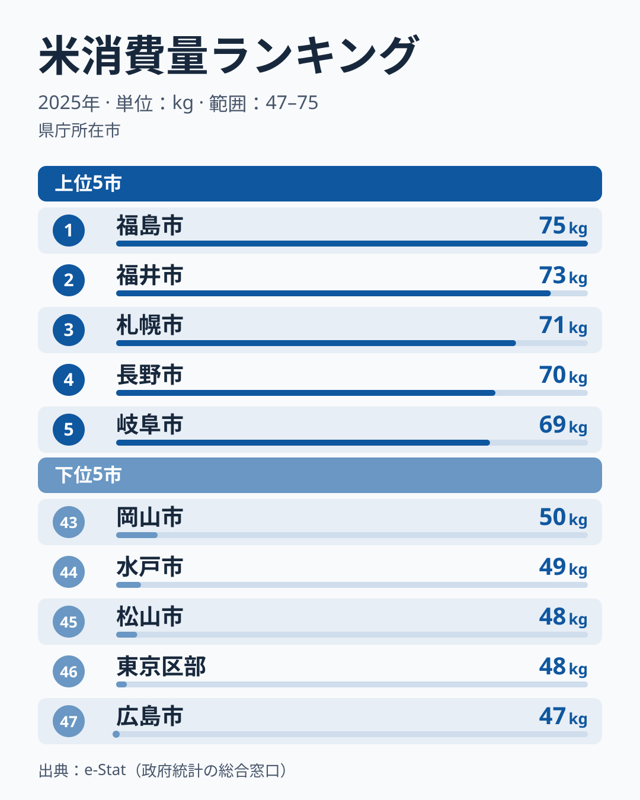

「ごはん党」と聞いて真っ先に思い浮かぶ県はどこでしょうか。[新潟](/areas/15000)や秋田のような米どころを想像する人が多いかもしれませんが、2025年の家計調査（二人以上世帯・都道府県庁所在市）で最も多かったのは福島県でした。福島市の世帯は年間75kgで、最も少ない広島市（広島県）の47.24kgの1.6倍にのぼります。新潟市（新潟県）は61.53kgで20位でした。

この指標が示すのは「収穫量」ではなく「家庭がどれだけ米を買って食べているか」という消費側の実態です。米どころ=消費量トップとは限らない、というねじれがこのデータの面白さです。この記事では、どの県が毎年のように上位に残るのか、そして全国的な「米離れ」がどこまで進んでいるのかを、都道府県別データから読み解きます。

> [!NOTE]
> このランキングは総務省「家計調査」の品目別支出・購入数量データが元になっています。調査対象は**都道府県庁所在市の二人以上世帯**で、県内全域の消費実態そのものではありません。また外食・中食（コンビニ弁当など）で食べた米は含まれない「家庭内の購入量」ベースの数字です。

## 上位と下位の対比

<source-link href="/ranking/rice-consumption-quantity">米消費量ランキングをもっと見る</source-link>

2025年は福島県が75kgで1位、福井県が72.82kgで2位、北海道が70.77kgで3位、長野県が69.56kgで4位、岐阜県が69.24kgで5位でした。上位5県は東北・北陸・北海道・中部に散らばり、「有名な米どころほど家庭で米を食べる」という単純な図式にはなっていません。

福島県は2023年・2024年・2025年と3年続けて1位です。ただ値そのものは2024年の87.54kgから75kgへ下がっています。1位を保てたのは、2024年に2位から5位だった新潟県・宮崎県・岐阜県・福井県もそろって値を下げたためです。47市全体では22県が減り25県が増えており、平均はむしろ少し上がっています。もう一つ目を引くのは福井県で、2018年から2025年までの8年間、2021年（6位）を除いて毎年5位以内に入り、2位は4回あります。1年ごとの順位がよく入れ替わるこの指標のなかで、上位に居続ける県は多くありません。

米どころとして知られる新潟県も、2025年は20位でした。2024年の2位から大きく順位を下げています。新潟の値は年による振れがとても大きく、2019年は49.96kgで44位まで下がり、2021年には82.99kgで1位になりました。米どころだからといって毎年安定して上位というわけではありません。

下位は、広島県が47.24kgで47位、東京都が47.87kgで46位、愛媛県が48.48kgで45位、茨城県が48.7kgで44位、岡山県が49.68kgで43位という顔ぶれです。このうち東京都は、2008年から2025年までの18年間、毎年41位から46位の間にとどまっています。下位の中で順位がほとんど動かない県です。一方、2024年に最下位だった山口県は、2025年は55.6kgで35位まで戻りました。山口県は2019年・2022年・2024年に47位でしたが、2021年と2023年には18位まで上がっています。1年だけの最下位から「米を食べない県」と決めつけることはできません。

## 地域差をどう読むか

福島県・福井県・北海道が上位に残る理由は、この調査の値だけでは説明できません。一方、下位の側には読み筋があります。家庭での米消費量には、「食文化としての主食依存度」と「パン・麺・中食への置き換えの進み方」という2つの軸が働いている可能性があります。東京都が18年間ずっと下位にとどまることは、後者の説明と矛盾しません。単身や共働きの世帯が多い大都市ほど、米を炊かずに弁当や外食で済ませる機会が多いと考えると筋が通ります。ただしこの調査は二人以上世帯だけが対象なので、単身世帯の多さそのものは数字に入っていません。

[仮説] 東京都が下位に固定されている理由は、パンや麺類、調理済み食品への支出の多さにある可能性があります。家計調査の米消費量だけでは確かめられないため、[パン消費量ランキング](/ranking/bread-consumption-expenditure)や[米に対する支出金額ランキング](/ranking/rice-consumption-expenditure)と突き合わせて確かめる必要があります。

> [!WARNING]
> 家計調査は毎年の抽出調査であり、サンプル世帯の入れ替わりによって順位が大きく動きます。新潟県が2024年の2位から2025年の20位へ、山口県が47位から35位へ動いたように、1年だけの順位を「その県の実力」と断定するのは早計です。福島県や福井県、東京都のように、複数年で同じ位置に居続けるかを見るほうが確かです。

## 全国的な「米離れ」はどこまで進んだか

47市の値を年ごとに単純平均すると、2007年の82.8kgから2025年には59.7kgまで低下しています。18年間で約28%の減少です。平均は2019年に60.8kgまで下がったあと、2020年に63.3kgへ持ち直し、2023年の56.9kgで底を打ちました。2024年は59.2kg、2025年は59.7kgと、ここ2年はわずかに戻っています。

> [!TIP]
> 家庭での米消費が減った分、外食・中食（コンビニおにぎり・弁当など）で米を摂取している可能性があります。家計調査の「購入数量」だけでは食生活全体の米離れの実態はつかみきれない点に注意してください。

最も多い県と最も少ない県の倍率は、2007年以降1.5倍から2.2倍の間で上下してきました。2024年は2.18倍とこの期間で最も大きかったのに対し、2025年は1.59倍と、2007年の1.53倍に次ぐ小ささです。1位の福島県が大きく減り、最下位の広島県の値が47kg台だったため、上と下の差が縮まりました。ただ、この倍率は両端の2県だけで決まるので、1年の縮小を「地域差が解消に向かった」と読むのは早すぎます。

## まとめ

- 2025年の米消費量は福島県が75kgで最多、広島県が47.24kgで最少となり、1.6倍の差
- 福島県は2023年から3年連続の1位。福井県は2018年以降、ほぼ毎年5位以内に入る
- 新潟県は2024年の2位から2025年は20位へ。年による振れが大きい県です
- 東京都は2008年から18年間、毎年41〜46位にとどまる。山口県は2024年の47位から35位へ戻った
- 47市の平均は2007年82.8kgから2025年59.7kgへ、18年間で約28%減少

## データについて

本文の県名は、その県の県庁所在市（東京都は東京区部）の値を指します。総務省「家計調査」の品目別データを、e-Stat（政府統計の総合窓口）経由で取得・集計しています。集計年は2007年〜2025年、対象は都道府県庁所在市の二人以上世帯です。平均値は47市の値を単純平均したもので、世帯数で重み付けした全国平均ではありません。
