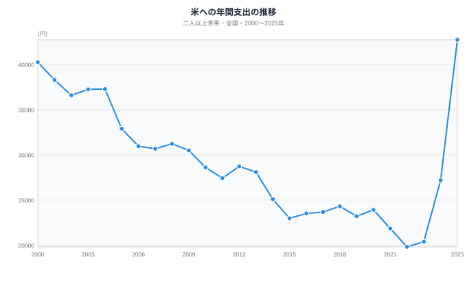
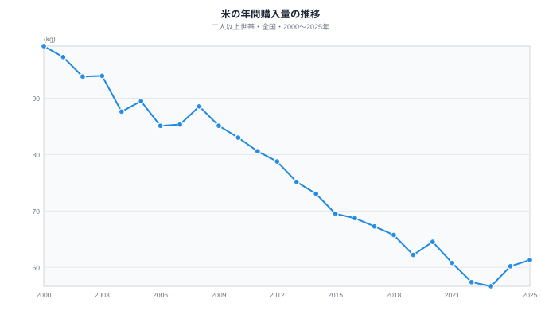
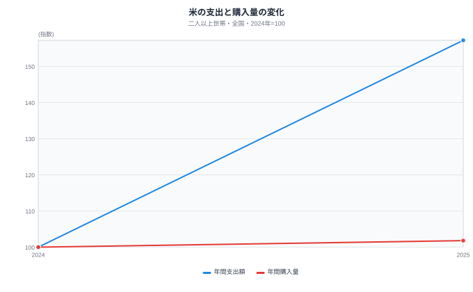
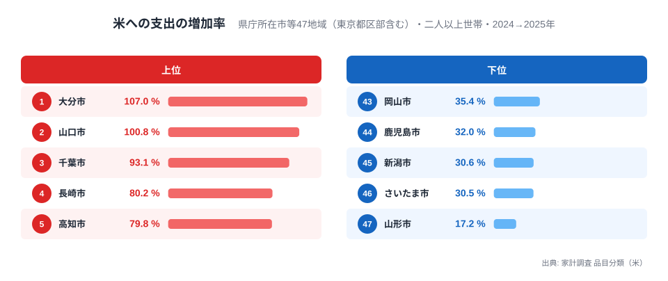

米への支出が増えたと聞くと、食卓で米を食べる量も増えたように感じるかもしれません。しかし、家計調査の全国値を支出額と購入数量に分けて見ると、2024年から2025年の動きは大きく異なります。二人以上世帯の米への年間支出は27,196円から42,739円へ増えました。一方、年間購入量は60.20kgから61.31kgへの変化です。支出の増加を購入量だけで説明するのは難しいと分かります。

この記事で使うのは、総務省統計局「家計調査」の品目分類にある「米」の公式全国値です。対象は二人以上世帯で、年次の値はその年の**合計**です。県庁所在市のランキングを平均して全国値と見なしたものではありません。二つの系列は同じ品目と世帯区分を選び、金額と数量の表を別々に取得しました。

## 支出額は2025年に前年から大きく伸びた

<source-link href="/japan/household-food-spending">米への支出の全国時系列を見る</source-link>

支出額の図では、2023年の20,397円から2024年の27,196円、2025年の42,739円へと上がっています。2024年から2025年の増加は15,543円で、前年の約1.57倍です。2015年の22,981円と比べても、2025年はかなり高い水準です。ただし支出額は「家計が米に使ったお金」であり、価格そのものの統計ではありません。購入した量、選んだ商品、支払った価格の変化が一緒に入ります。

長期の線を見ると、2000年の支出額は40,256円で、2025年の42,739円に近い数字です。しかし、二つの年に同じ量の米を買ったわけではありません。後で見る数量の線では、2000年の購入量のほうがずっと多くなっています。金額が似ているという一つの事実だけで、米をめぐる家計の状況も同じだったと考えるのは早計です。時点をまたぐ解釈には、数量と価格水準の変化に加え、調査表の品目分類の改定も確認する必要があります。

この違いは、家計の負担を考えるときに大切です。支出額だけを見て「米をよく食べるようになった」と読むと、数量の動きを見落とします。逆に、数量だけを見て家計の金銭的な変化を推測することもできません。まず二つの単位を分け、同じ年にどう動いたかを確かめる必要があります。

## 購入量は支出額と同じ勢いでは増えていない

<source-link href="/japan/household-food-spending">米の購入量の全国時系列を見る</source-link>

購入量は2023年に56.65kg、2024年に60.20kg、2025年に61.31kgです。2024年から2025年の増加は1.11kgで、約1.8％にとどまります。同じ期間の支出額は約57％増えているため、二つの線の変化幅は対照的です。なお、2000年の購入量は99.24kgでした。長期の下がり方を見ても、2025年の支出増を「昔より米を多く買うようになった」という説明に置き換えることはできません。

数量の系列を一緒に見る理由は、変化の向きだけでなく、変化の**大きさ**を確かめるためです。2024年から2025年に数量が少し増えたことは事実です。しかし、支出額の大幅な増加と同じ強さで数量が増えたと書けば、図の読み方を誤ります。米に限らず、家計調査で支出と数量の両方がある品目なら、この二段階の確認ができます。支出だけが増えたときに「消費が伸びた」と短くまとめてしまう前に、何を消費の代理とするのかを決める必要があります。

二つの全国平均を割ると、購入1kg当たりの支出の**目安**は2024年の約452円から2025年の約697円へ変わります。これは二つの集計値から計算した比で、各世帯の単価を平均したものではありません。銘柄・購入先・時期を固定した店頭価格でもなく、価格上昇の寄与率を示すものでもありません。それでも、支出と数量の伸びが大きく離れたことを一つの尺度で確認する補助にはなります。

<source-link href="/japan/household-food-spending">元の金額と数量を全国時系列で見る</source-link>

この小図では、2024年をそれぞれ100としたとき、2025年の支出額は157.2、購入量は101.8です。円とkgをそのまま同じ軸に重ねず、変化率に直したので、両者の開きが一目で分かります。100を超えた分だけを見ると、支出の伸びは数量の伸びを大きく上回ります。この指数は2024年からの変化を比べるための加工値であり、円やkgの実数は上の二つの図で確認してください。

## 都市の変化は一様ではない

<source-link href="/ranking/rice-consumption-expenditure">県庁所在市等の米への支出額を比較する</source-link>

全国値の変化が各地域で同じ幅だったわけでもありません。県庁所在市等の47地域（東京都区部を含む）の2024年と2025年の米消費支出額を同じ条件で比べると、47地域すべてで増えました。ただし増加率は、大分市の約107.0％から山形市の約17.2％まで幅があります。図は増加率の高い5地域と低い5地域を示します。「全国で支出が増えた」と言えても、どの地域でも約57％増えたという意味ではありません。

購入量の地域差を合わせて見ると、さらに違いが分かります。47地域のうち2024年から2025年に購入量が増えたのは25地域、減ったのは22地域です。山形市では米への支出額が増えた一方、購入量は72.36kgから51.25kgへ減りました。全国の購入量がわずかに増えたというだけでは、各地域の動きを代表できません。地域別の調査世帯数や購入時期による振れもあるため、1年の増減を地域の固定した性質とは見なしません。

全国の推移を確かめたあと、どの地域で米への支出や購入量が多いかを見たい場合は、[米への年間支出額ランキング](/ranking/rice-consumption-expenditure)と[米の年間購入量ランキング](/ranking/rice-consumption-quantity)を使えます。この二つは県庁所在市等（東京都区部を含む）の二人以上世帯を並べたページです。この記事の全国値とは地域の集計単位が違うため、順位を全国平均の内訳のように読むことはできません。[家計調査の案内ページ](/survey/kakei-chousa)では、調査の対象と、関連する全国・都市のページをまとめています。

年収別に比べるときにも単位が重要です。米の支出・購入量は年間合計ですが、用途分類の食費は**1か月平均**です。米だけを見るのか食料費全体を見るのか、年間合計か月平均かを確認すると、グラフの読み違いを減らせます。

## 年収別の違いを読むなら、同じ米でも二つの軸が要る

全国の年次推移は「いつ変わったか」には答えますが、「どの世帯で違うか」には答えません。家計調査には、同じ米を年間収入五分位で分けた2025年の表もあります。二人以上世帯の第1五分位では年間支出が40,807円、購入量が64.24kgでした。第5五分位では支出が44,180円、購入量が59.11kgです。支出が高い層の購入量が必ず多いわけではないことが、ここでも分かります。

ただし五分位は世帯の年間収入による区分です。世帯人数や年齢構成を同じにそろえた比較ではありません。高所得層が高価な米を選んだ、とこの表だけから断定することもできません。購入量と支出額を両方見ることで、そうした仮説と、表が直接答える事実とを切り分けられます。年収別の棒グラフは[食費と食品購入の全国ページ](/japan/household-food-spending)に置いています。

家計調査は購入を記録した世帯の平均を示す統計です。個々の世帯が2025年にどれだけ購入したか、支出増がどの価格要因で生じたかまでは、この二系列だけでは分かりません。次に同じ表を調べるときは、金額の図だけで結論を出さず、数量の図を並べて確認するのが出発点になります。
