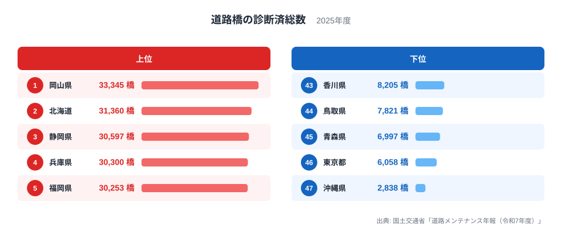
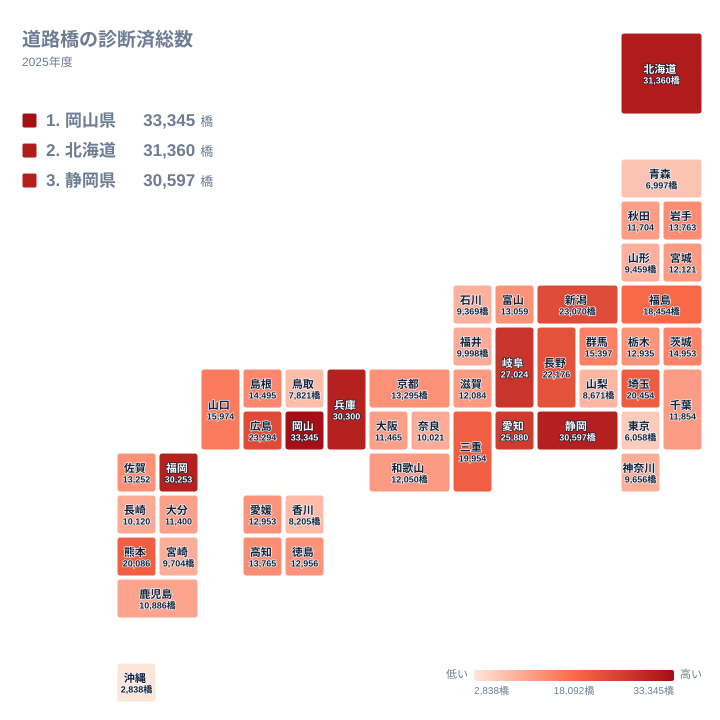

## 首位は北海道ではなく岡山県

道路橋の診断済総数で全国1位になったのは、岡山県の33,345橋です。2位は北海道の31,360橋、3位は静岡県の30,597橋で、上位は互いに近い値で並んでいます。一方、最下位の沖縄県は2,838橋で、首位とのあいだには大きな開きがあります。

最大の岡山県と最小の沖縄県を実データの値で並べると、33,345橋と2,838橋です。この記事では、事実として確認できる順位の並びを軸に、地理や産業構造から考えられる仮説を、仮説と断ったうえで読み解きます。

<source-link href="/ranking/road-bridge-diagnosed-count">道路橋の診断済総数ランキングをもっと見る</source-link>

上位5県は、1位の岡山県、2位の北海道、3位の静岡県、4位の兵庫県、5位の福岡県です。1位から5位までの値は33,345橋から30,253橋のあいだに収まっており、上位は接戦です。北海道のように面積の広い道県が入る一方、岡山県が北海道を上回っている点は意外な結果です。

下位5県は、47位の沖縄県、46位の東京都、45位の青森県、44位の鳥取県、43位の香川県です。東京都が下から2番目にいることは、橋の数が人口の多さとは単純に結びつかないことを示しています。ただし、その理由まではこの統計だけでは確認できません。

> [!NOTE]
> 「診断済総数」は、点検を終えて健全性の判定区分が付いた橋の数です。傷んでいる橋の数ではありません。また、管内にある橋の全数でもないため、診断済総数の順位がそのまま「橋の多さ」の順位になるとは限りません。

岡山県の個別の数値は[岡山県のデータ](/areas/33000)、北海道については[北海道のデータ](/areas/01000)で確認できます。

## 岡山県が首位に立つ背景を仮説で考える

岡山県が首位である理由は、この統計だけでは断定できません。確かなのは、岡山県が33,345橋で1位、同じ中国地方の広島県が23,294橋で8位、山口県が15,974橋で15位、島根県が14,495橋で18位、鳥取県が7,821橋で44位という事実です。中国地方の5県のなかでも、岡山県と鳥取県のあいだには大きな差があります。

仮説としては、河川が南へ流れて平野や丘陵を形づくる地形のもとで、市町村道などの生活道路にも多くの橋が架かっている可能性が考えられます。ただし、こうした地形は他の県にも見られるため、岡山県だけが突出する理由を説明するには、橋の管理者別の内訳や道路の延長といった別の資料が必要です。

もう一つ注意したいのは、診断済総数が「点検が進んだ橋の数」でもあることです。実際に架かっている橋が多い県も、点検と診断が進んでいる県も、数値が大きくなります。首位という結果は、この二つが重なった姿であり、どちらの影響がどれだけ大きいかは、この数字からは分かりません。

> [!TIP]
> 診断済総数を読むときは、全橋数との違いを意識してください。診断済総数が少ない県は、橋が少ないのか、診断が済んでいない橋が多いのか、この数字だけでは区別できません。全橋数に対する診断済みの割合が分かる資料と組み合わせると、読み違いを避けられます。

## 地理分布で見る地方ごとのばらつき

タイルマップを見ると、上位の県は特定の地方に固まっていません。上位5県の所属を地方別に整理すると、岡山県は中国、北海道は北海道・東北、静岡県は中部、兵庫県は近畿、福岡県は九州・沖縄です。5県が5つの異なる地方に分かれています。

中部は上位に入る県が目立つ地方です。静岡県が3位、岐阜県が6位、愛知県が7位、新潟県が9位、長野県が10位と、上位10位のうち5県を占めます。その一方で、石川県は41位、山梨県は42位、福井県は37位と、同じ中部でも下位寄りの県があります。中部は全9県のなかで、上位と下位に大きく分かれる地方です。

近畿では兵庫県が4位と高く、三重県が13位で続きます。ところが大阪府は32位、奈良県は36位です。同じ近畿でも、4位から36位まで開いており、地方でひとくくりにはできません。

関東では埼玉県の11位が最も高く、東京都は46位、神奈川県は39位です。関東の7都県のなかでも、上位の埼玉県と下位の東京都・神奈川県の差が目立ちます。

## 北海道と沖縄、両端の読み方

北海道は2位の31,360橋です。北海道は面積の広い道ですが、この統計に面積や道路延長は含まれていません。したがって、北海道の順位の高さは、道路網の長さと関係している可能性があるにとどまり、実データからは裏付けられません。

東北の県を見ると、福島県が14位、岩手県が20位、宮城県が27位、秋田県が31位、山形県が40位、青森県が45位です。北海道・東北の7道県は、2位から45位まで広く散らばっています。同じ地方でも、北海道と福島県が上位、青森県と山形県が下位という具合に、地方内の差が大きいことが分かります。

最下位の沖縄県は2,838橋で、46位の東京都の6,058橋と比べても、さらに低い値です。島しょ部が多いことが影響している可能性はありますが、これもあくまで仮説です。この統計だけで、沖縄県の橋が構造的に少ないとは言い切れません。

> [!WARNING]
> この数値は、点検と診断が行われた橋の数に限られます。橋の長さや規模、管理者ごとの内訳は反映されていません。小さな橋も長大橋も同じ1橋として数えるため、順位の差を維持管理の負担の差とみなすことはできません。

## 中位の県をどう読むか

中位では、19位の高知県が13,765橋、20位の岩手県が13,763橋と、ほぼ並んでいます。差はわずか2橋です。四国と東北という離れた地域の県が同水準にあるため、順位の近さと地域の特徴は必ずしも結びつかないことが分かります。

四国では高知県が19位、徳島県が24位、愛媛県が25位、香川県が43位です。香川県だけが下位に位置し、他の3県は中位にとどまります。九州・沖縄では福岡県が5位、熊本県が12位と上位に入り、大分県が33位、鹿児島県が34位、長崎県が35位、宮崎県が38位、沖縄県が47位と下位寄りの県が続きます。九州・沖縄の8県は、上位の福岡県・熊本県と、それ以外の県で分かれる形です。

こうして見ると、地方という大きな区分よりも、県ごとの事情の違いのほうが順位に強く表れています。なお、ここで見ているのは診断済みの橋の数であり、順位の背景にある理由は、別の資料で確かめる必要があります。

> [!TIP]
> 同じ地方の県どうしを比べるときは、地方内の最上位と最下位を並べると、ばらつきの大きさが分かります。中国では岡山県の1位と鳥取県の44位、近畿では兵庫県の4位と奈良県の36位が、その例です。

ほかの社会基盤の統計も知りたい方は、[同じカテゴリの統計一覧](/category/infrastructure)から探せます。

## データについて

この記事で扱う「道路橋の診断済総数」は、国土交通省「道路メンテナンス年報（令和7年度）」に掲載された、2025年の都道府県別の値です。単位は橋で、全47都道府県の数値を使っています。

診断済総数は、点検を実施し、健全性の診断が行われた橋の数です。人口や面積で割った値ではないため、県の大きさの違いがそのまま順位に影響している可能性があります。数値を比較するときは、次の点を意識してください。

- 順位は診断済みの橋の数を表すもので、傷み具合や安全性の優劣ではありません。
- 診断済総数は全橋数とは別の数字で、点検の進み具合も反映されます。
- この記事の背景の説明は仮説であり、実データだけでは原因を断定できません。

最多の岡山県と最少の沖縄県のあいだには、33,345橋と2,838橋という大きな差があります。順位の並びから、地方内でも県ごとに大きく違うことが読み取れます。
