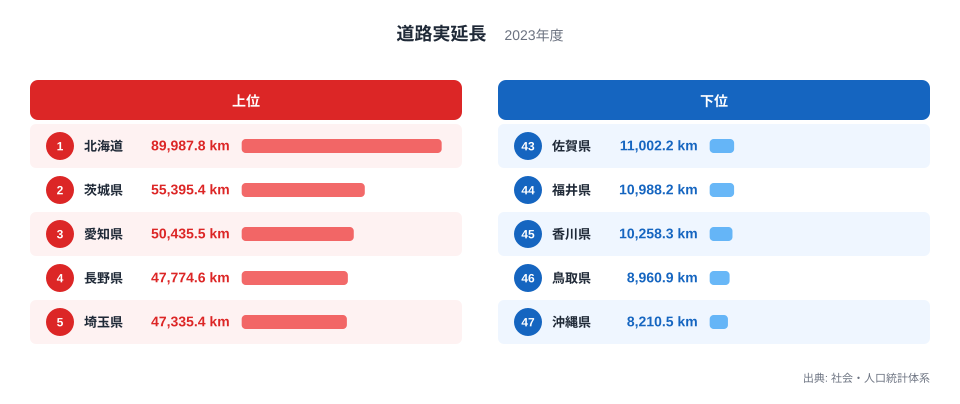
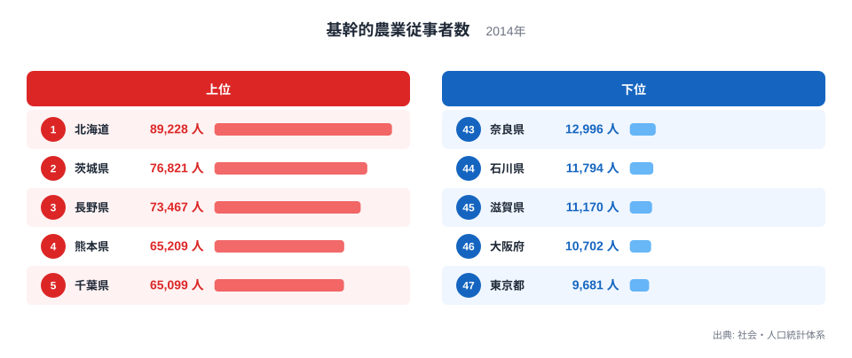
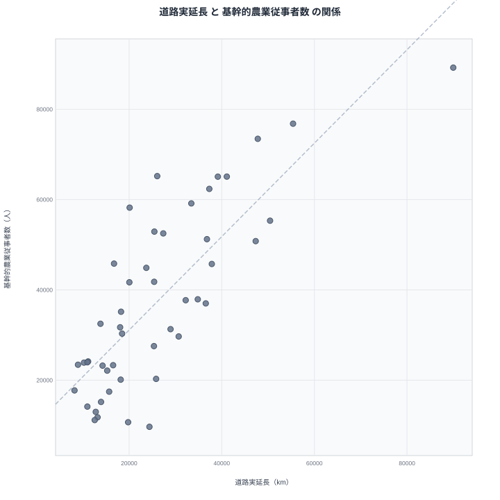

道路が長く延びている県には、農業を担う人も多いのではないか。そう考えたくなります。実際に数字を並べてみると、2つの指標にはある程度そろって動く傾向が見えます。ただし、その傾向が「道路が農業を支えている」ことや「農業が道路を増やしている」ことを意味するとは限りません。

この記事では、道路実延長と基幹的農業従事者数を都道府県ごとに比べます。まず各指標のランキングを確認し、次に散布図で関係を眺めます。最後に、このデータから言える範囲と、検証できない部分を分けて整理します。原因を特定する記事ではなく、考えられる説明を並べて限界を確かめる記事です。

## 道路が長い県はどこか

最初に、道路実延長のランキングを見ます。上位5県と下位5県を並べた図です。

<source-link href="/ranking/road-total-length">道路実延長ランキングをもっと見る</source-link>

> [!NOTE]
> 道路実延長は、道路の総延長を km で示した指標です。社会・人口統計体系の「道路実延長」で、2023年のデータを使っています。面積あたりの密度ではなく総延長なので、県の規模の影響を受けた値である点に注意が必要です。

図で目を引くのは、1位の北海道が89,987.8kmと、2位の茨城県の55,395.4kmを3万km以上引き離していることです。2位以下は数万km台の中で順位が詰まっており、北海道だけが別の水準にあります。

上位の顔ぶれも興味深い点です。茨城県や長野県のように農業の盛んな県がある一方、愛知県や埼玉県のように都市的な県も入っています。道路の長さには、農地へ延びる道路だけでなく、市街地の道路も含まれている可能性があります。

下位は沖縄県の8,210.5kmと鳥取県の8,960.9kmです。上位との開きは大きく、北海道は沖縄県のおよそ10倍以上の水準です。ただし、この差が県の広さによるものなのか、道路の整備の仕方によるものなのかは、このデータだけでは判断できません。

## 農業の担い手が多い県はどこか

次に、基幹的農業従事者数のランキングを見ます。こちらも上位5県と下位5県の図です。

> [!WARNING]
> 基幹的農業従事者数は2014年の値で、道路実延長の2023年とは9年の開きがあります。この間に状況が変わっている可能性があり、同じ時点の比較ではありません。また、道路は km、農業従事者は人数という別の単位の総量同士の比較です。

1位は北海道の89,228人で、2位の茨城県は76,821人です。道路実延長では3万km以上の差がありましたが、農業従事者数の差は約1.2万人にとどまります。北海道の突出は道路のほうが際立っており、農業従事者数では上位が比較的接近しています。

上位には長野県、熊本県、千葉県、福島県と、農業のイメージが強い県が並びます。道路実延長の上位に都市的な県が混ざっていたのとは、顔ぶれの性格が少し違います。

下位は東京都の9,681人、大阪府の10,702人で、大都市圏の府県が最も少ない側に並んでいます。この点は、人口が集中する地域では農業従事者の数が少ないという一般的な見方と合っています。

2つのランキングを見比べると、北海道が両方で1位、茨城県が両方で2位です。一方で愛知県は道路実延長が3位なのに、基幹的農業従事者数は10位です。熊本県は農業従事者数が4位ですが、道路実延長は18位です。順位がぴったり重なるわけではありません。

## 2つの指標の関係を散布図で見る

2つの指標を一枚の図に重ねたのが、次の散布図です。

> [!TIP]
> この散布図では、北海道が横軸にも縦軸にも突出した位置にあります。1点が両方の軸で外れていると、相関係数はその点に引っ張られやすくなります。また、どちらも総量なので、規模の大きな県が両方で大きくなる構造を含んでいます。北海道を除いた場合に傾向がどう変わるかを意識して読むと、読み違えにくくなります。

47都道府県で計算したピアソンの相関係数は0.80です。一般に強い正の相関と呼ばれる水準で、道路実延長が長い県ほど基幹的農業従事者数も多い傾向があるといえます。

ただし、この値は北海道のような突出した点の影響を受けている可能性があります。北海道を除いた相関係数は、手元のデータでは示されていないため、ここでは書けません。傾向があるという程度に受け止めるのが適切です。

もう一つ、散布図ならではの注目点があります。点が斜めに並ぶ全体の傾向から外れる県の存在です。愛知県のように道路実延長のわりに農業従事者数が少ない県や、熊本県のように道路実延長のわりに農業従事者数が多い県は、斜めの線から離れた位置に来ます。相関が強くても、すべての県が同じ関係に収まるわけではありません。

0.80という値は、関係の向きや原因を教えてくれるものではありません。2つの指標がそろって動く傾向を示しているだけです。

## 相関から言えること、言えないこと

では、なぜ道路が長い県は農業従事者も多い傾向があるのでしょうか。考えられる説明は3つあります。

- 道路が整備されたから農業の担い手が増えた、という説明
- 農業が盛んだから農道などの道路が増えた、という説明
- どちらも県の規模や土地の条件など、別の共通の要因に左右されている、という説明

3つ目については、そうした可能性があるという仮説にとどまります。県の面積や農地面積のデータをこの記事では使っていないため、共通の要因があるのかどうか、あるとしてどの程度効いているのかは、このデータだけでは検証できません。1つ目や2つ目の説明も、同様に支持も否定もできません。

実データから確認できるのは、北海道が両方で1位、茨城県が両方で2位という事実と、愛知県や熊本県のように順位が大きくずれる県もあるという事実までです。ずれる県の理由を、都市の人口や産業の厚みに求めることもできますが、それも仮説です。

つまり、道路が農業の担い手を増やすとも、担い手が道路を増やすとも、このデータだけでは言えません。相関は因果ではないという点を、ここで改めて確認しておきます。

## 北海道と茨城県を手がかりに読む

最後に、上位の2県を見ます。北海道のデータは[北海道のデータ](/areas/01000)、茨城県のデータは[茨城県のデータ](/areas/08000)で確認できます。

北海道は道路実延長が89,987.8kmで1位、基幹的農業従事者数が89,228人で1位です。茨城県は道路実延長が55,395.4kmで2位、基幹的農業従事者数が76,821人で2位です。2県とも両方の指標で上位に入っており、散布図の右上に位置します。

この2県が右上にあることが、相関係数を押し上げている面は否定できません。ただし、2県だけで関係の全体像は語れません。長野県のように両方で上位に近い県もあれば、東京都のように両方で下位寄りの県もあります。

より詳しく調べるなら、面積あたりの道路延長や、農地面積あたりの担い手数など、規模の影響を取り除いた指標を別に用意する必要があります。[基幹的農業従事者数ランキング](/ranking/core-agricultural-workers)や、[同じカテゴリの統計一覧](/category/infrastructure)から、ほかの指標も確認できます。

## データについて

道路実延長は2023年、基幹的農業従事者数は2014年の値で、いずれも出典は社会・人口統計体系です。相関係数は47都道府県の値から計算したピアソンの相関係数で、結果は0.80でした。

この数値は、2つの指標が同じ方向に動く強さを示すものです。因果の大きさや、一方が他方を説明できる割合を表すものではありません。年のずれと、総量で比べている点に注意して、傾向をつかむ材料として使ってください。

## まとめ

道路実延長と基幹的農業従事者数の相関係数は0.80で、道路が長い県ほど農業の担い手も多い傾向が見られました。北海道は両方で1位、茨城県は両方で2位です。ただし、北海道は道路実延長で特に突出しており、その影響を除いた傾向は、このデータからは確かめられません。

この関係は因果を示すものではありません。県の規模や土地の条件といった共通の背景が関わっている可能性はありますが、面積などのデータがないため検証はできません。愛知県や熊本県のように順位が大きくずれる県があることも、単純な図式を疑う理由になります。数字の並びだけで結論を出さず、何が言えて何が言えないのかを分けて読む姿勢が大切です。
