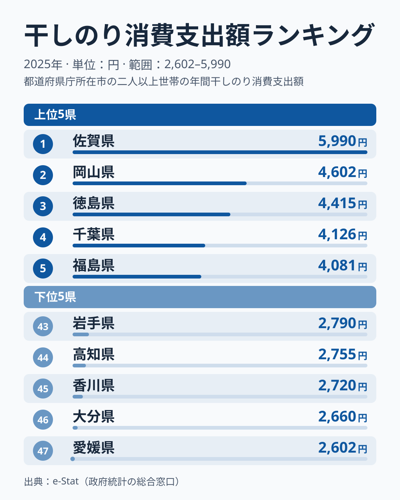
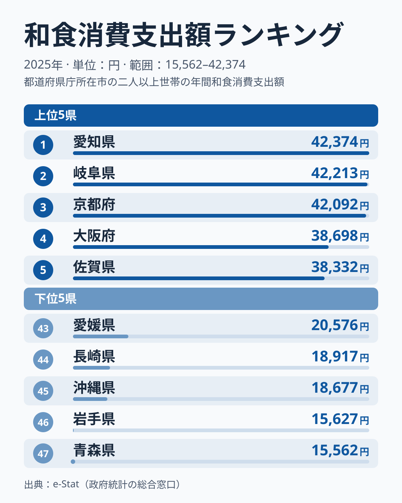
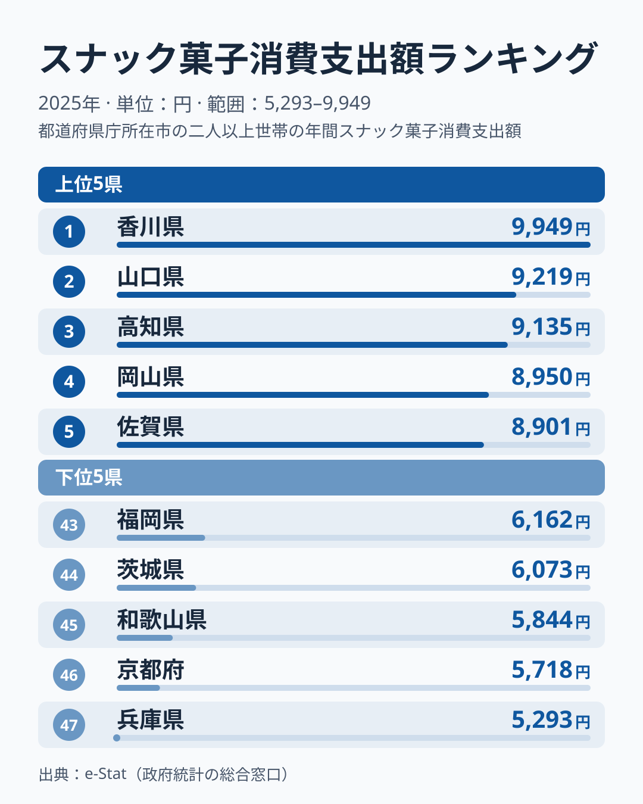
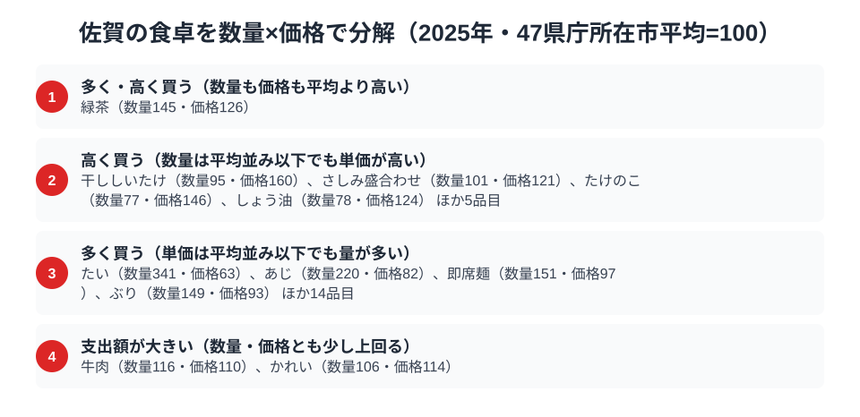

佐賀県の食卓と聞いて、すぐに具体的な料理を思い浮かべる人は多くないかもしれません。しかし家計調査の2025年の数字を見ると、佐賀の食卓には全国で図抜けた指標が隠れています。総務省の家計調査（品目別）で佐賀市の二人以上世帯を見ると、干しのりの消費支出額は5,990円で全国1位です。2位の岡山県4,602円を1,388円上回り、約1.3倍の開きがあります。

一方、和食の消費支出額は38,332円、スナック菓子は8,901円で、どちらも全国5位です。上位には入りますが、首位との差はわずかで、順位は僅差の混戦の中で決まっています。この記事では、干しのり・和食・スナック菓子という3つの品目を軸に、佐賀県民の食卓を読み解きます。なぜ干しのりだけが2位を大きく引き離すのか、データから探ります。

> [!NOTE]
> 家計調査の都道府県データは、県庁所在市（佐賀県は佐賀市）の二人以上世帯を対象にした年間支出額です。県全体ではなく佐賀市在住世帯の家計簿から見た傾向であり、支出「金額」であって消費「量」そのものではない点にご注意ください。

## 干しのり — 全国1位5,990円、2位に1.3倍の差

<source-link href="/ranking/dried-nori-consumption-expenditure">干しのり消費支出額ランキングをもっと見る</source-link>

干しのりの消費支出額では、佐賀県が5,990円で全国1位です。2位は岡山県の4,602円、3位は徳島県の4,415円で、1位と2位の差は1,388円あります。2位以下は4位の千葉県4,126円、5位の福島県4,081円と数百円刻みで続いており、佐賀だけが一段上に離れた形です。最下位の愛媛県は2,602円で、佐賀と比べると2.3倍の差があります。

佐賀県は有明海苔の産地として知られます。有明海は日本で最も干満差が大きい海域の一つで、栄養豊富な干潟が広がることから、色つや・柔らかさに優れた海苔が育つとされています。[仮説] 地元で新鮮な海苔が手に入りやすい環境や、家庭で海苔を使う頻度の高さが支出を押し上げている可能性があります。ただし家計調査の市別の値は単年のぶれが大きいため、産地であることと支出額の高さを直接結ぶ根拠は、このデータだけでは示せません。2位の岡山県や3位の徳島県も海苔に縁のある地域であり、どの年も佐賀が首位とは限らない点は押さえておく必要があります。

## 和食 — 全国5位38,332円、上位は僅差の混戦

<source-link href="/ranking/japanese-food-dining-consumption-expenditure">和食消費支出額ランキングをもっと見る</source-link>

佐賀県の和食消費支出額は38,332円で全国5位です。1位は愛知県の42,374円、2位は岐阜県の42,213円、3位は京都府の42,092円で、上位3県は4万2,000円台前半にひしめいています。4位の大阪府は38,698円で、佐賀とは366円差です。1位の愛知とは4,042円の差があり、順位がひとつ入れ替わるだけで大きく動く、混戦の中の5位といえます。最下位の青森県は15,562円で、佐賀と比べると2.5倍の開きがあり、地域による和食への支出の差は非常に大きいことがわかります。

佐賀は有明海・玄界灘という2つの海に面し、稲作も盛んな県です。[仮説] 米・魚・野菜が揃う土地柄や、城下町として古くから料亭文化が根づいてきた歴史が、和食を扱う店の利用頻度を高めている可能性があります。もっとも、愛知・岐阜・京都・大阪といった大都市圏の県庁所在市が上位を占める中で、地方の佐賀市が5位に入っていること自体が、和食への支出の厚みを示しています。

## スナック菓子 — 全国5位8,901円、中四国勢の中の九州代表

<source-link href="/ranking/snack-consumption-expenditure">スナック菓子消費支出額ランキングをもっと見る</source-link>

佐賀県はスナック菓子の消費支出額が8,901円で全国5位です。1位は香川県の9,949円、2位は山口県の9,219円、3位は高知県の9,135円、4位は岡山県の8,950円と続き、上位5県のうち4県を中国・四国が占めています。最下位の兵庫県は5,293円で、佐賀と比べると1.7倍、1位の香川とは1.9倍の開きがあります。

和食の支出が上位の佐賀が、同時にスナック菓子でも上位にいるのは一見意外に思えるかもしれません。[仮説] 大型商業施設や車社会の生活スタイルの中で、日常のちょっとした買い物にスナック菓子が組み込まれやすい地方都市圏の特徴が表れている可能性があります。和食への支出とスナック菓子への支出は、食卓の「格式」と「日常のおやつ」という別の軸で共存しているとみるのが自然でしょう。

> [!WARNING]
> 家計調査は支出金額の調査であり、消費量そのものではありません。物価や単価の違いも金額に影響します。また呼子のイカや小城羊羹といった佐賀の名物は、家計調査の主要品目として個別集計されないため、順位だけでは佐賀の食文化の全体像は測れない点にご注意ください。

## 佐賀の食卓を貫くもの

佐賀県民の食卓を貫くのは、「有明海・玄界灘の恵み」と「和食を大切にする食文化」だと読めます。干しのりの全国1位、和食とスナック菓子の5位という結果は、ひとつの品目だけでは語れませんが、海苔という特産品と、和食への支出、日常のスナック菓子が同居する食卓の輪郭を示しています。ただし市別の家計調査は単年のぶれが大きいため、ここでの理由づけは [仮説] にとどまります。

隣県の食卓も[熊本県の食卓](/blog/kumamoto-food-culture)で読めます。九州各県はそれぞれ異なる品目で上位に入っており、佐賀の場合はその軸のひとつが干しのりです。

> [!TIP]
> 1位が圧倒的な品目（干しのり）と、僅差の混戦で5位に入る品目（和食・スナック菓子）では、順位の意味合いが異なります。順位だけでなく、2位との差や首位との差をあわせて読むと、その県の特徴がどれだけ際立っているかがわかります。

## 数量×価格で分解する佐賀市の食卓

<source-link href="/ranking/sea-bream-consumption-quantity">たい消費量ランキングをもっと見る</source-link>

> [!NOTE]
> ここでの指数は、家計調査で数量と支出額の両方が調べられている138品目について、47都道府県庁所在市の二人以上世帯（2025年）の単純平均を100とした値です。全国計そのものではなく、価格指数は品種やブランドの違いも反映するため、指数が高いからといって単純に「割高」を意味するとは限りません。

支出額は「数量×価格」に分解できます。佐賀市の食卓をこの物差しで見ると、干しのり・和食・スナック菓子だけでは見えなかった、買い方の癖が浮かび上がります。138品目のうち、数量・価格のどちらも平均を20%以上上回るのは緑茶だけです（数量指数145・価格指数126）。そのほかの品目は「量で稼ぐ」系統と「単価の高いものを選ぶ」系統に分かれます。

数量が突出して多いのは魚介と麺類です。たいの消費量は数量指数341で全国1位につけながら、価格指数は63と平均よりかなり安く買われています。あじも数量指数220・価格指数82、即席麺も数量指数151・価格指数97、ぶりも数量指数149・価格指数93と、いずれも「たくさん買うが単価は平均並みかそれ以下」という同じ形です。[仮説] 有明海・玄界灘という2つの漁場が近く、鮮魚が日常的に手に入りやすいことが、量を確保しながら単価を抑えられる背景にある可能性があります。この系統は「他の〜」といった家計調査上の残余分類を除いて18品目にのぼり、柿（数量指数186）、れんこん（数量指数181）、砂糖（数量指数139）なども含まれます。

逆に、数量は平均以下でも単価が高い品目には、干ししいたけ（数量指数95・価格指数160）、たけのこ（数量指数77・価格指数146）、ウイスキー（数量指数66・価格指数145）、しょう油（数量指数78・価格指数124）、さしみ盛合わせ（数量指数101・価格指数121）が並び、残余分類を除いて9品目です。日常的に大量には買わないものの、買うときは質の高いものを選ぶ傾向がうかがえます。数量・価格のどちらも突出せず、少しずつ両方で平均を上回るのは牛肉（数量指数116・価格指数110）とかれい（数量指数106・価格指数114）の2品目で、量だけ・単価だけの突出とは違う伸び方をしています。

> [!TIP]
> 「数量指数が高く価格指数は平均以下」という組み合わせは、地元で新鮮な食材が手に入りやすい産地でよく見られるパターンです。逆に「価格指数だけが高い」品目は、量より質を選んで買っている可能性を示しています。佐賀市の食卓は、この2つのパターンが魚介と乾物・調味料でくっきり分かれているのが特徴です。

## まとめ

- 干しのりの消費支出額は佐賀県が全国1位（5,990円）で、2位の岡山県に1.3倍の差
- 和食は全国5位（38,332円）、上位3県が4万2,000円台前半に並ぶ混戦の中に入っている
- スナック菓子も全国5位（8,901円）、上位5県のうち4県を中国・四国が占める
- 数量と価格に分けると、緑茶が両方で平均を上回り、たいは数量指数341と量で突出している

佐賀県の他の統計は[佐賀県の地域プロフィール](/areas/41000)、食品・家計消費の地域差は[経済カテゴリ一覧](/category/economy)からご覧いただけます。
