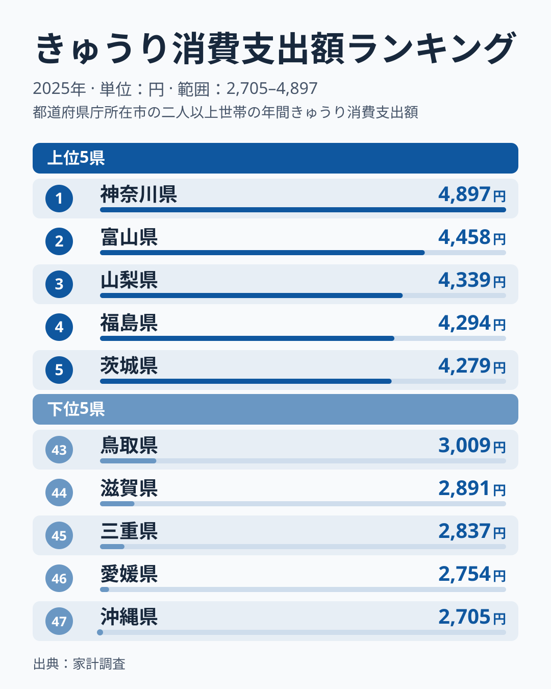
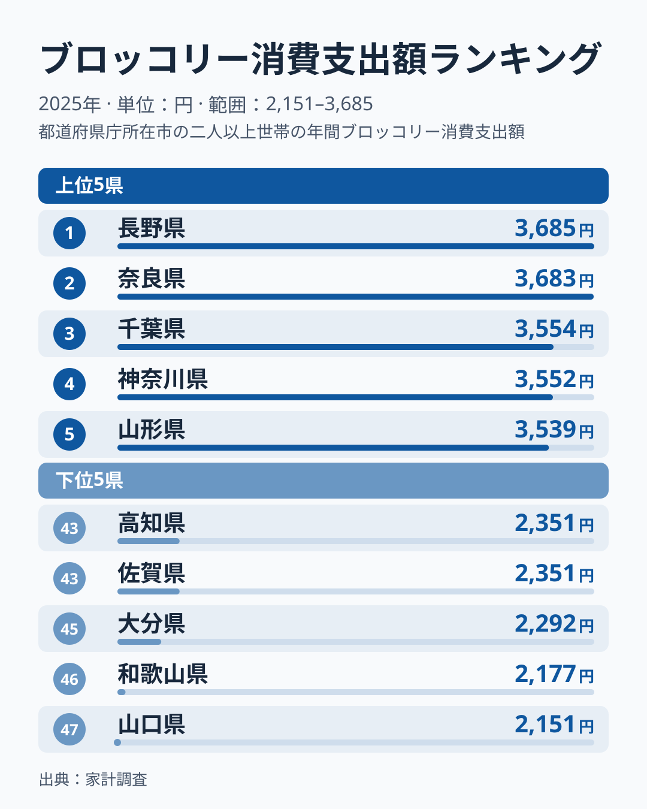
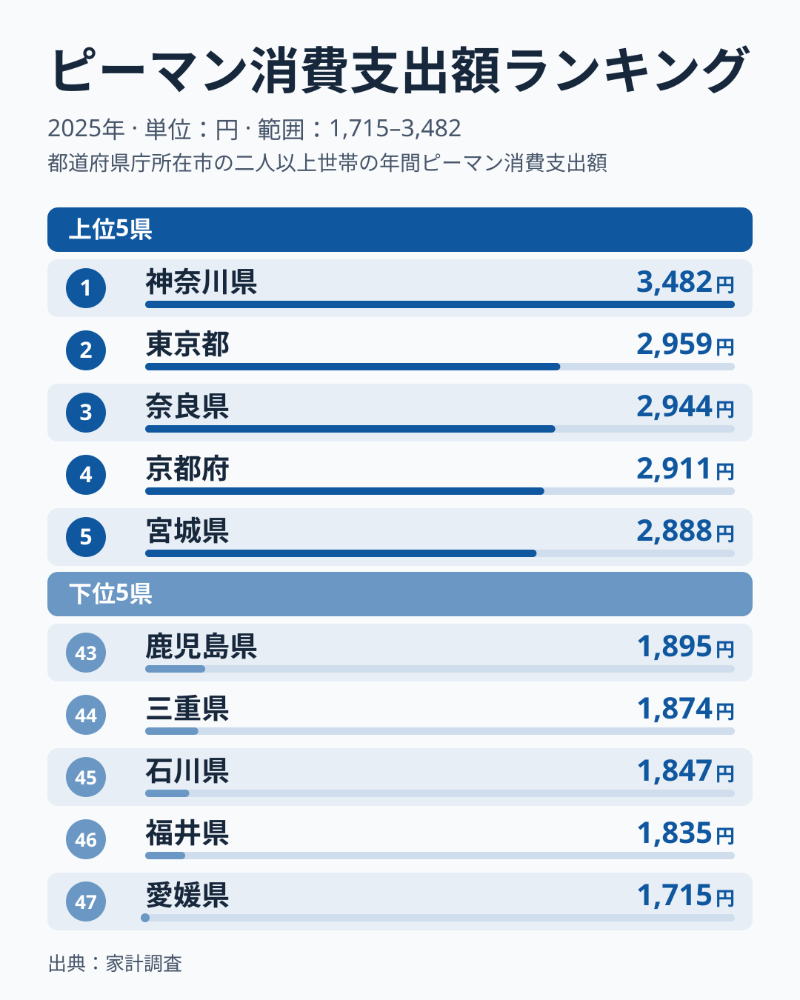

埼玉県というと東京のベッドタウンのイメージが強く、農業県という印象を持つ人は少ないかもしれません。ところが総務省「家計調査」の品目別データで、都道府県庁所在市のきゅうり・ブロッコリー・ピーマンの消費支出額を比べると、2024年は埼玉県が3品目そろって全国の首位でした。

では2025年はどうなったのでしょうか。結論から言うと、3品目とも1位ではなくなりました。きゅうりとピーマンは10位、ブロッコリーは12位で、首位はきゅうり・ピーマンが神奈川県、ブロッコリーが長野県です。ただし、順位が動いた理由は2025年のデータだけでは確定できません。この記事では3つの野菜を1つずつ見ながら、確認できる範囲である首位との差や上位の僅差の度合いに絞って、「日本一」の動きを整理します。

> [!NOTE]
> 本記事のデータは総務省統計局「家計調査（品目別）」2025年、都道府県庁所在市の二人以上世帯を対象にした消費支出額（円）です。世帯が1年間にその品目へ実際に支払った金額の平均で、購入量そのものではありません。市ごとの調査世帯数が限られるため、1年の順位は入れ替わりやすい指標です。理由に触れる部分は [仮説] として書き、断定はしません。

## きゅうり — 首位は神奈川4,897円、埼玉は10位

<source-link href="/ranking/cucumber-consumption-expenditure">きゅうり消費支出額ランキングをもっと見る</source-link>

きゅうりの消費支出額は、2025年は神奈川県が4,897円で全国1位でした。2位は富山県の4,458円、3位は山梨県の4,339円、4位は福島県の4,294円、5位は茨城県の4,279円と続きます。埼玉県は4,066円で10位です。最下位は沖縄県の2,705円で、1位との差は1.8倍でした。

上位には神奈川県のほか、富山・山梨・福島・茨城が並びます。神奈川・茨城は関東、富山・山梨は中部、福島は東北に属し、地方がまたがっています。下位は沖縄・愛媛・三重・滋賀・鳥取です。2024年は埼玉県が首位に立っていましたから、1年で順位が入れ替わったことになります。

[仮説] 埼玉県のきゅうり支出が2024年に首位となり、2025年に10位へ下がったのは、地域の食習慣が変わったというより、単年のぶれが大きかったためかもしれません。この仮説は、複数年の平均順位を並べれば確かめられます。

## ブロッコリー — 支出額は長野3,685円が首位、埼玉は12位

<source-link href="/ranking/broccoli-consumption-expenditure">ブロッコリー消費支出額ランキングをもっと見る</source-link>

ブロッコリーの消費支出額は、2025年は長野県が3,685円で全国1位でした。2位の奈良県は3,683円とわずか2円差で、3位千葉県の3,554円、4位神奈川県の3,552円、5位山形県の3,539円と続き、上位5県が3,500円台から3,600円台の狭い範囲にひしめきます。埼玉県は3,204円で12位です。最下位は山口県の2,151円で、1位との差は1.71倍でした。この記事の3品目の中では、最も差が小さい品目です。

2024年は、埼玉県がブロッコリーでも首位でした。埼玉県の3,204円は首位の3,685円と481円の開きがあり、上位の僅差の範囲には入っていません。上位がこれほど僅差で並ぶ品目では、首位は入れ替わりやすいという一般的な見方はできますが、埼玉県が12位になった理由まではこの記事のデータでは確かめられません。

[仮説] 埼玉県は深谷市周辺がブロッコリーの産地として知られており、地場産が店頭に並びやすいことが、支出の高さの背景にあるのかもしれません。ただしこの記事のデータには産地の情報がなく、産地との関係までは確かめていません。

## ピーマン — 首位は神奈川3,482円、埼玉は2,630円で10位

<source-link href="/ranking/green-pepper-consumption-expenditure">ピーマン消費支出額ランキングをもっと見る</source-link>

ピーマンの消費支出額は、2025年は神奈川県が3,482円で全国1位でした。2位は東京都の2,959円、3位は奈良県の2,944円、4位は京都府の2,911円、5位は宮城県の2,888円です。2位から5位は差が小さく並んでいますが、神奈川県は2位の東京都との差が523円あり、首位だけが抜けています。埼玉県は2,630円で10位でした。

最下位は愛媛県の1,715円で、1位との差は2.03倍と、3品目の中で最も大きい格差でした。下位は愛媛・福井・石川・三重・鹿児島が並びます。上位には神奈川県・東京都・京都府のほか奈良県や宮城県も入っており、都市部と地方が混在しています。この記事のデータからは、一貫した傾向は読み取れません。

2024年の埼玉県は首位でしたが、2025年は10位でした。きゅうりと同じく、[仮説] 単年のぶれの影響が大きく、ピーマンの順位から埼玉県の食習慣を断定するのは早いと考えられます。

> [!WARNING]
> ここで扱った支出額は金額であり、購入量や単価ではありません。同じ支出額でも、たくさん買ったのか高いものを買ったのかは、この3品目のデータだけでは区別できません。

## 3品目の1位が動いたあとに残るもの

2025年の3品目に共通するのは、1位がどれも埼玉県ではないという点です。きゅうりとピーマンは神奈川県、ブロッコリーは長野県が首位になりました。埼玉県は、きゅうり10位、ブロッコリー12位、ピーマン10位と、47都道府県庁所在市のうち上位4分の1程度に位置していますが、単年のデータだけで「野菜の支出が高めの県」と言い切ることはできません。

これは[長野の食卓](/blog/nagano-food-culture)のように、特定の品目で全国トップに立つ県と比べると、品目ごとに順位が入れ替わっている姿です。[仮説] 埼玉県は産地と大消費地の両方に近いことが、順位の動きやすさに関係しているのかもしれませんが、これはデータで確かめた内容ではありません。埼玉県の地域プロフィールは[埼玉県のページ](/areas/11000)でも確認できます。

> [!TIP]
> ブロッコリーは1位と2位が2円差で、上位5県が3,500円台から3,600円台に並んでいます。上位がこれだけ近い水準で並ぶ品目では、首位が入れ替わりやすいと考えられます。1年の1位だけで食文化を語らず、複数年を見る視点が有効です。関連する消費支出データは[経済カテゴリ一覧](/category/economy)でも確認できます。

## まとめ

- きゅうり消費支出額は神奈川県が4,897円で全国1位、埼玉県は4,066円で10位。2024年の首位から順位を下げた
- ブロッコリー消費支出額は長野県が3,685円で全国1位、埼玉県は3,204円で12位。上位5県は3,500円台から3,600円台に並ぶ
- ピーマン消費支出額は神奈川県が3,482円で全国1位、埼玉県は2,630円で10位。最下位愛媛県との差は2.03倍
- 3品目とも埼玉県は首位から動いた。順位の理由は2025年のデータだけでは確定できず、市別の値は単年のぶれが大きいため、[仮説] にとどめ、複数年で確かめる必要がある
