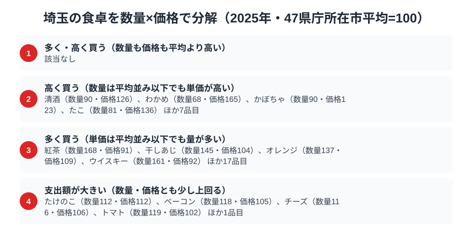

埼玉県というと東京のベッドタウンのイメージが強く、農業県という印象を持つ人は少ないかもしれません。ところが総務省「家計調査」の品目別データで、都道府県庁所在市のきゅうり・ブロッコリー・ピーマンの消費支出額を比べると、2024年は埼玉県が3品目そろって全国の首位でした。

では2025年はどうなったのでしょうか。結論から言うと、3品目とも1位ではなくなりました。きゅうりとピーマンは10位、ブロッコリーは12位で、首位はきゅうり・ピーマンが神奈川県、ブロッコリーが長野県です。一方で、ブロッコリーを買う量だけは2025年も埼玉県が全国1位でした。この記事では3つの野菜を1つずつ見ながら、「日本一」がなぜ1年で動いたのか、そして動かなかったものは何かを探ります。

> [!NOTE]
> 本記事のデータは総務省統計局「家計調査（品目別）」2025年、都道府県庁所在市の二人以上世帯を対象にした消費支出額（円）です。世帯が1年間にその品目へ実際に支払った金額の平均であり、購入量そのものではありません。

## きゅうり — 首位は神奈川4,897円、埼玉は831円差の10位

<source-link href="/ranking/cucumber-consumption-expenditure">きゅうり消費支出額ランキングをもっと見る</source-link>

きゅうりの消費支出額は、2025年は神奈川県が4,897円で全国1位でした。2位は富山県の4,458円、3位は山梨県の4,339円、4位は福島県の4,294円、5位は茨城県の4,279円と続きます。埼玉県は4,066円で10位、首位の神奈川県とは831円の差です。最下位は沖縄県の2,705円で、1位との差は1.8倍にとどまり、他の食品ランキングにありがちな極端な地域格差は見られません。

上位には神奈川県のほか、富山・山梨・福島・茨城と、関東・甲信越・北陸・東北の県が混ざって並びます。下位は沖縄・愛媛・三重・滋賀・鳥取で、西日本が目立ちます。2024年は埼玉県が4,826円で首位に立っていましたから、1年で順位が入れ替わり、埼玉県の額は760円ほど下がったことになります。

ここで気をつけたいのは、家計調査の市別の値は調査した世帯数が限られるため、1年ごとにぶれやすいという点です。[仮説] 埼玉県のきゅうり支出が2024年に突出して高く、2025年に10位へ下がったのは、地域の食習慣が変わったというより、単年のぶれが大きかったためかもしれません。この仮説は、複数年の平均順位を並べれば確かめられます。

## ブロッコリー — 支出額は長野3,685円が首位、埼玉は12位でも購入量は全国1位

<source-link href="/ranking/broccoli-consumption-expenditure">ブロッコリー消費支出額ランキングをもっと見る</source-link>

ブロッコリーの消費支出額は、2025年は長野県が3,685円で全国1位でした。2位の奈良県は3,683円とわずか2円差で、3位千葉県の3,554円、4位神奈川県の3,552円、5位山形県の3,539円と続き、上位5県が3,500円台から3,600円台の狭い範囲にひしめきます。埼玉県は3,204円で12位です。最下位は山口県の2,151円で、1位との差は1.71倍でした。

ただし、購入量に目を向けると景色が変わります。埼玉県のブロッコリーの購入量は2025年に6,381gで、47都道府県庁所在市の中で全国1位でした。2位は奈良県の6,176gです。2024年も埼玉県は6,629gで首位でしたから、購入量の1位は2年続けて保たれています。支出額が12位まで下がっても購入量が1位のまま動かないのは、埼玉県で単価が低めに買われているためです。

つまり埼玉県のブロッコリーは、「高く買っている」のではなく「たくさん買っている」食品だと言えます。[仮説] 埼玉県は深谷市周辺がブロッコリーの産地として知られており、地場産が店頭に並びやすいことが、安く大量に買える背景にあるのかもしれません。ただしこの記事のデータは購入量と金額だけで、産地との関係までは確かめていません。

## ピーマン — 首位は神奈川3,482円、埼玉は2,630円で10位

<source-link href="/ranking/green-pepper-consumption-expenditure">ピーマン消費支出額ランキングをもっと見る</source-link>

ピーマンの消費支出額は、2025年は神奈川県が3,482円で全国1位でした。2位は東京都の2,959円、3位は奈良県の2,944円、4位は京都府の2,911円、5位は宮城県の2,888円です。埼玉県は2,630円で10位でした。2位以下が横並びなのに対し、神奈川県は2位の東京都を大きく引き離しており、3品目の中でも首位が最も際立っています。

最下位は愛媛県の1,715円で、1位との差は2.03倍と、きゅうり・ブロッコリーより格差が広がりました。下位は愛媛・福井・石川・三重・鹿児島と、地方の県が並びます。上位には神奈川県・東京都・京都府といった大都市圏が目立つので、ピーマンについては生産地よりも都市部の購買行動が支出額を左右している可能性があります。

2024年の埼玉県は3,131円で首位でしたが、2025年は501円下がりました。きゅうりと同じく、[仮説] 単年のぶれの影響が大きく、ピーマンの順位から埼玉県の食習慣を断定するのは早いと考えられます。

> [!WARNING]
> 家計調査の品目別支出額は購入量ではなく金額です。市ごとの調査世帯数が少ないため、1年の順位は入れ替わりやすく、2024年に3品目で首位だった埼玉県が2025年に10位前後へ動いたのも、その性質の表れかもしれません。ここで扱った3品目以外の食品については、本記事では触れていません。

## 3品目の1位が動いたあとに残るもの

2025年の3品目に共通するのは、1位がどれも埼玉県ではないという点です。きゅうりとピーマンは神奈川県、ブロッコリーは長野県が首位になりました。それでも埼玉県は、3品目すべてで12位以内の上位に残っています。「日本一」ではなくなっても、野菜の支出が高めの県であることに変わりはありません。

これは[長野の食卓](/blog/nagano-food-culture)のように山間部の冷涼な気候を活かした特産品で全国トップに立つ県とは異なるパターンです。埼玉県は産地と大消費地の両方に近く、順位が1年ごとに動きやすい位置にあります。埼玉県の地域プロフィールは[埼玉県のページ](/areas/11000)でも確認できます。

> [!TIP]
> 3品目とも、首位から埼玉県までの差は数百円で、首位と最下位の差の3割強から5割弱にあたります。首位が1年で入れ替わるのは、その程度の差で十数県がひしめいているからです。1年の1位だけで食文化を語らず、複数年を見る視点が有効です。関連する消費支出データは[経済カテゴリ一覧](/category/economy)でも確認できます。

## 数量×価格で分解するさいたま市の食卓

<source-link href="/ranking/black-tea-consumption-quantity">紅茶消費量ランキングをもっと見る</source-link>

埼玉県の食料支出額を家計調査の品目別データで「数量指数」と「価格指数」に分解すると、対象138品目のうち数量・価格の両方が47都道府県庁所在市の平均を2割以上上回る品目は1つもありませんでした。埼玉県は支出額が高い品目でも、単価が突出して高いのではなく、購入する量が平均より多いことで支出額を押し上げているものが目立ちます。

この記事で見てきた3品目で、その性格がはっきり出たのはブロッコリーです。数量指数は136と平均を大きく上回る一方、価格指数は81と平均を下回ります。きゅうりは数量指数111・価格指数102、ピーマンは数量指数107・価格指数104で、どちらも量・単価とも平均よりわずかに高い程度です。ブロッコリーは「安くたくさん買う」型、きゅうりとピーマンは平均に近い型であり、埼玉県を野菜全般で量を買う県と一括りにはできません。

量が多い区分では、紅茶消費量が数量指数168で価格指数は91、ウイスキーが数量指数161で価格指数は92と、量が平均の6割以上多く、単価はやや安い品目が並びます。一方、「高く買う」区分の代表格は、わかめ（数量68・価格165）や清酒（数量90・価格126）、たこ（数量81・価格136）のように、量は平均以下でも単価の高いものを選ぶ品目です。

> [!TIP]
> 同じ「支出額が全国上位」でも、品目によって効いている指数は異なります。ブロッコリーは数量指数136・価格指数81の「たくさん買う」型ですが、わかめは数量指数68・価格指数165の「高く買う」型です。あるランキングで支出額が上位に来たとき、数量指数と価格指数のどちらが押し上げているかを確認すると、その地域が「量で稼いでいるのか」「単価で稼いでいるのか」を見分けられます。

指数は47都道府県庁所在市の単純平均を100とした相対値なので、たとえば136は平均より3割余り多く、81は平均より2割近く安いという意味になります。

> [!NOTE]
> ここでの数量指数・価格指数・支出指数は、家計調査の品目別データが揃う47都道府県庁所在市の単純平均を100とした相対値で、家計調査の全国平均値そのものではありません。価格指数は支出額を数量で割った単価の相対水準なので、地域で買われている品種やブランドの違いも含んだ数字です。対象は二人以上世帯・年間の消費支出額と消費量（2025年）です。

## まとめ

- きゅうり消費支出額は神奈川県が4,897円で全国1位、埼玉県は4,066円で10位。2024年の首位から順位を下げた
- ブロッコリー消費支出額は長野県が3,685円で全国1位、埼玉県は3,204円で12位。ただし購入量は埼玉県が6,381gで全国1位
- ピーマン消費支出額は神奈川県が3,482円で全国1位、埼玉県は2,630円で10位。最下位愛媛県との差は2.03倍
- 3品目とも埼玉県は上位12位以内に残る一方、1年で首位から動いた。市別の値は単年のぶれが大きいため、順位の理由は [仮説] にとどめ、複数年で確かめる必要がある
