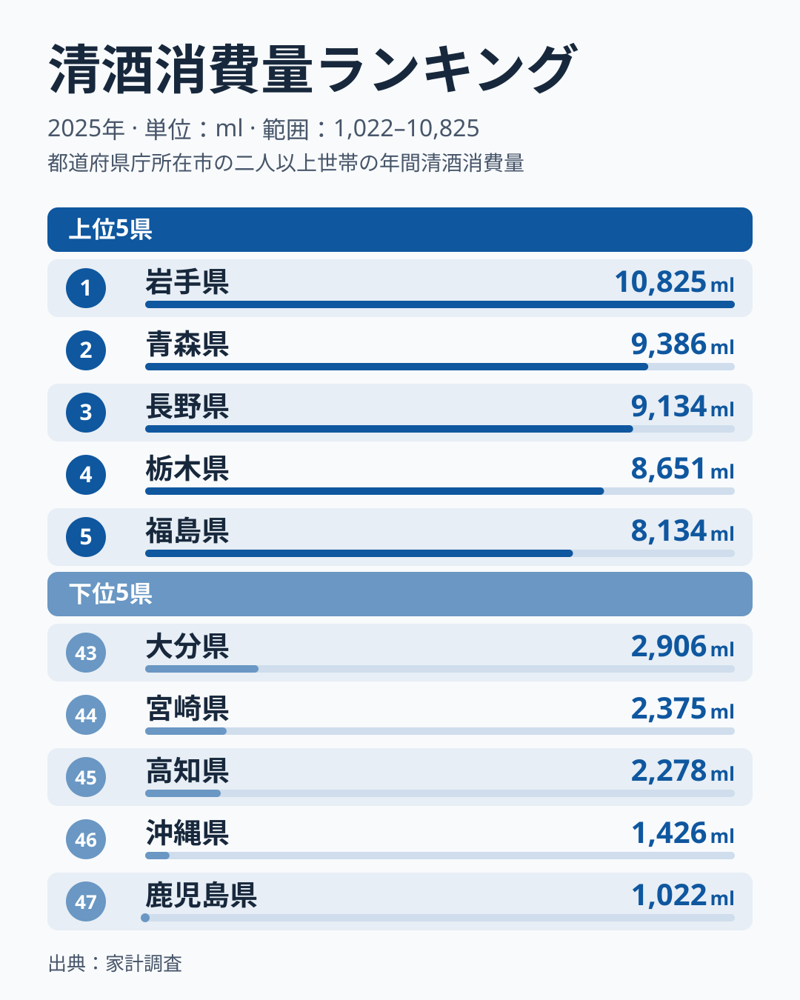
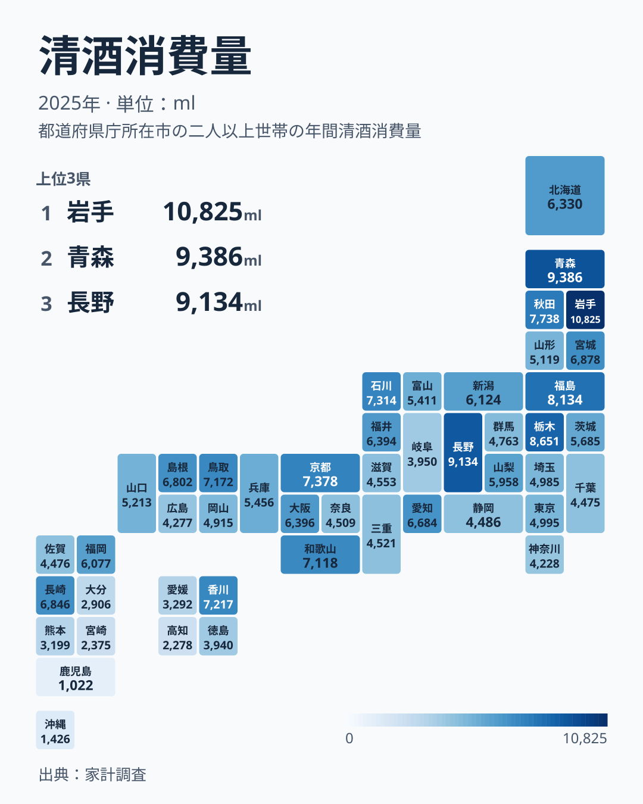

「日本酒の消費日本一といえば新潟」という印象は、2025年の家計調査では当てはまりません。県庁所在市の二人以上世帯が1年間に買った清酒は、1位が[岩手県](/areas/03000)の10,825ml、2位が青森県の9,386ml、3位が長野県の9,134mlでした。最下位は[鹿児島県](/areas/46000)の1,022mlで、1位との差は10.6倍です。新潟県は19位の6,124mlにとどまり、昨年首位だった福島県も8,134mlの5位に下がりました。

この記事では、2025年の顔ぶれを確かめたうえで、清酒の1位がなぜこれほど入れ替わるのか、入れ替わりの中で変わらないものは何かを、同じ指標の過去のデータから読み解きます。

> [!NOTE]
> 本データは総務省「家計調査」の二人以上の世帯で、対象は各都道府県の県庁所在市です。県全体の平均ではありません。「清酒消費量」は1世帯が1年間に購入した清酒の数量(ml)で、居酒屋などでの外食の飲酒は含まれません。

## 2025年の上位5県と下位5県

<source-link href="/ranking/sake-consumption-quantity">清酒消費量ランキングをもっと見る(全47都道府県)</source-link>

上位5県は岩手県、青森県、長野県、栃木県、福島県です。岩手県の10,825mlは、5位福島県の8,134mlを約2,700ml上回ります。上位に目を広げると、6位が秋田県の7,738ml、7位が京都府の7,378ml、8位が石川県の7,314ml、9位が香川県の7,217ml、10位が鳥取県の7,172mlと続き、東北6県のうち岩手・青森・福島・秋田の4県が上位10に入っています。一方で宮城県は12位、山形県は26位で、同じ東北でも順位は大きく分かれます。

下位5県は、47位の鹿児島県が1,022ml、46位の沖縄県が1,426ml、45位の高知県が2,278ml、44位の宮崎県が2,375ml、43位の大分県が2,906mlです。九州南部から沖縄、そして四国の高知県が並び、最下位の鹿児島県は1位岩手県の1割に届きません。上位と下位をつなぐ線は、おおまかに言えば北日本と南西日本の対比になっています。

ただし、この並びは「清酒を飲む県」と「飲まない県」を固定的に分けるものではありません。次の節で見るとおり、1位の県そのものが年ごとに入れ替わっているからです。

## 日本一は毎年のように入れ替わる

同じ指標を2007年から2025年まで並べると、1位の顔ぶれは次のように動いています。2018年以降の8年間の1位は、年ごとに次のとおりです。

- 2018年 秋田県
- 2019年 三重県
- 2020年 秋田県
- 2021年 新潟県
- 2022年 石川県
- 2023年 秋田県
- 2024年 福島県
- 2025年 岩手県

2007年から2025年までの19年間に1位になったのは8県で、秋田県が7回、新潟県が6回、島根県・青森県・三重県・石川県・福島県・岩手県が各1回です。前年から首位が変わったのは18組の前年比較のうち15組で、同じ県が続いたのは3組だけでした。題の問いには「はい、ほぼ毎年変わる」と答えられます。「新潟が長年の日本一」というイメージは、19年間で6回の首位という数字とは一致しますが、直近の8年間では2021年の1回しかありません。

2024年から2025年の動きを見ると、揺れの大きさが分かります。2024年の順位表と比べると、岩手県は33番目から首位へ、京都府は37番目から7番目へ、石川県は32番目から8番目へ上がりました。反対に、山形県は3番目から26番目へ、奈良県は7番目から33番目へ、兵庫県は6番目から23番目へ下がっています。47都道府県のうち25県が、1年で10位以上順位を動かしました。

> [!WARNING]
> 家計調査は県庁所在市の二人以上世帯を対象にした標本調査です。[仮説] 標本が限られるため、年ごとの顔ぶれの偏りが順位に出やすく、単年の1位は「その年に清酒をよく買った世帯が多かった」程度に読むのが安全です。検証には各市の標本世帯数と複数年の平均が必要で、この記事のデータだけでは確かめられません。

では、入れ替わりの中で変わらないものはあるでしょうか。2018年から2025年の8年間に上位10県へ入った回数を数えると、秋田県と福島県が7回、宮城県が6回、新潟県と岩手県が5回でした。単年の1位は動いても、東北と新潟の県が上位10の常連であることは変わりません。2025年の首位が岩手県だったことより、県庁所在市の世帯では東北の県が毎年のように上位を占めるという傾向のほうが、この指標の安定した特徴だといえます。

## 地図で見る清酒消費の地理

地図に並べると、1位の岩手県、2位の青森県、6位の秋田県が東北北部にまとまり、5位の福島県、12位の宮城県を加えて東北の大半が上位の側にあることが分かります。そこに長野県の3位と栃木県の4位が加わり、東日本の内陸にも高い県があります。西日本では京都府の7位、石川県の8位、香川県の9位、鳥取県の10位が上位10に入りますが、九州と四国では香川県の9位と長崎県の13位が目立つ一方、徳島・愛媛・熊本・大分・宮崎・高知・沖縄・鹿児島の8県は40位以下です。

東北でも順位がそろわない点は見落とせません。山形県は26位の5,119ml、宮城県は12位の6,878mlで、岩手県の半分弱から6割強の水準です。昨年は3番目だった山形県の急降下は、東北という地域のくくりだけでは1県ごとの順位を説明できないことを示しています。

[仮説] 寒冷地で燗酒を飲む習慣や、地酒の蔵元が多いことが、東北の消費量を押し上げている可能性があります。ただし、本データは購入数量だけで、気候や蔵元数との関係は検証していません。蔵元数や気温を県別に並べて照合することが、確かめる最初の一歩になります。

## 最下位グループ: 鹿児島・沖縄・高知・宮崎・大分

最下位の鹿児島県は1,022mlで、1位の岩手県の約9%です。沖縄県の1,426mlも首位の岩手県の約13%にあたります。19年間の最下位を数えると沖縄県が13回、鹿児島県が5回、大分県が1回で、清酒の購入量が少ない県は年を重ねても九州と沖縄に集中しています。1位が毎年変わるのと対照的に、最下位の顔ぶれは長い間ほとんど動いていません。

[仮説] 九州南部や沖縄では、焼酎や泡盛が日常の酒として清酒の代わりを担っている可能性があります。この記事のデータは清酒だけなので、焼酎の購入量とあわせた県別の比較が必要です。あわせて見る: [焼酎消費量の都道府県差を扱った記事](/blog/shochu-consumption-prefecture-gap) / [清酒消費支出額ランキング](/ranking/sake-consumption-expenditure)

最下位側の県を見るときは、購入量が少ないことが「飲酒量が少ない」ことを意味しない点にも注意が必要です。酒類の種類が違えば、同じ家計でも清酒の購入量は小さく出ます。[沖縄県の統計プロフィール](/areas/47000)で、他の指標も確かめてみてください。

## まとめ

- 2025年の1世帯あたり清酒消費量は岩手県の10,825mlが1位、最下位は鹿児島県の1,022mlで、差は10.6倍でした
- 昨年首位だった福島県は5位、「日本酒の本場」のイメージが強い新潟県は19位に下がりました
- 2007年から2025年の18組の前年比較のうち、首位が入れ替わったのは15組で、単年の順位は大きく揺れます
- 2018年以降の8年間で上位10の常連は、秋田県と福島県が各7回、宮城県が6回、新潟県と岩手県が各5回と東北・新潟の県です
- 最下位は19年間で沖縄県が13回、鹿児島県が5回、大分県が1回と、九州と沖縄の3県に限られました

清酒以外の食品や飲料の消費量は、[家計・消費カテゴリ](/category/economy)から都道府県別に見比べられます。
