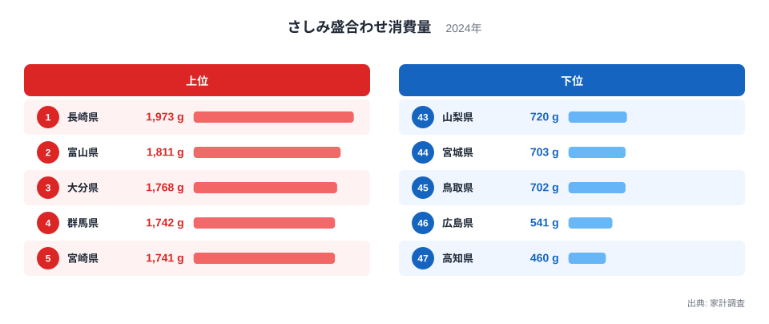
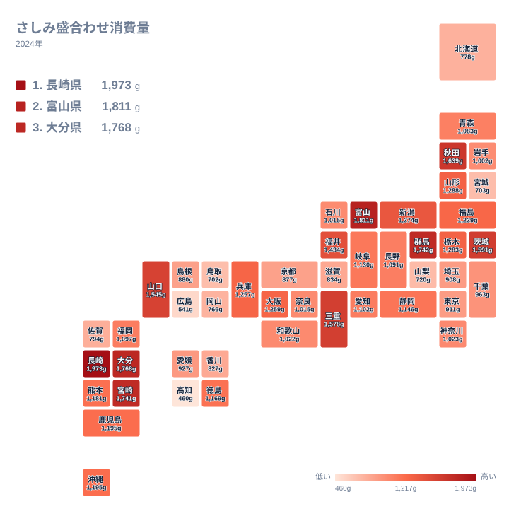

## 海に近い県が上位とは限らない

さしみ盛合わせは、複数の魚種を一皿に盛り合わせた商品です。家庭の食卓では、祝いごとや週末の夕食に選ばれることが多い品目です。では、どの県の家庭がもっとも多く買っているのでしょうか。

2024年の家計調査で1位だったのは長崎県で、1,973gでした。2位は富山県で1,811g、3位は大分県で1,768gです。4位の群馬県は1,742g、5位の宮崎県は1,741gで、上位5県のうち長崎県、大分県、宮崎県の3県は九州・沖縄に属します。

意外なのは、4位に群馬県が入っていることです。群馬県は海に面していない県ですが、さしみ盛合わせの購入量は多い部類に入ります。海の近さと消費量が単純に結びつくわけではないことが、この結果から見えてきます。

この記事では、上位と下位の顔ぶれを確認したうえで、食文化や産地、流通の事情からその差を考えます。

> [!NOTE]
> ここでの数値は、家計調査で把握された1世帯あたりの年間購入数量で、単位はgです。調査名は「さしみ盛合わせ消費量」です。外食で食べた分や、買わずに釣った魚などは含まれません。「食べた量」ではなく「家庭が買った量」だと考えてください。

## 上位と下位を並べると見える差

まず、上位5県と下位5県を図で見てみましょう。

<source-link href="/ranking/sashimi-platter-consumption-quantity">さしみ盛合わせ消費量ランキングをもっと見る</source-link>

上位は長崎県の1,973gを先頭に、1,700g台後半から1,800g台が並びます。一方、下位の最下位は高知県で460gです。次いで46位の広島県が541g、45位の鳥取県が702g、44位の宮城県が703g、43位の山梨県が720gと続きます。1位の長崎県と47位の高知県を比べると、1,973gと460gという大きな開きがあります。

注目したいのは、下位にも海に近い県が含まれていることです。高知県は鰹のたたきで知られ、広島県は牡蠣、宮城県は三陸の水産物で知られています。いずれも魚介が豊かな土地なのに、さしみ盛合わせの購入量は少ない側に位置します。

その理由の一つは、地元でとれる魚を盛り合わせ商品として買うのではなく、魚屋で1種類ずつ選んだり、家で切ったりする習慣が強いことかもしれません。盛り合わせという形の商品が、日常の買い物にどれだけ根づいているかが、数字に現れていると考えられます。

> [!TIP]
> 順位だけでなく、実際のgの差を見ましょう。たとえば3位の大分県は1,768g、4位の群馬県は1,742g、5位の宮崎県は1,741gで、上位は僅差で並んでいます。順位が一つ違っても、実質的な差は小さい場合があります。

## 九州に目立つ上位県と食文化

上位を見ると、九州・沖縄の存在感が目立ちます。長崎県が1位、大分県が3位、宮崎県が5位です。ほかにも鹿児島県が1,195gで17位、沖縄県が同じ1,195gで18位、熊本県が1,181gで19位に入っています。

長崎県は、漁港が多く、近海から遠洋まで多様な魚が水揚げされる県です。魚を刺身で食べる習慣が日常に深く根づいており、盛り合わせにも自然に手が伸びる環境があると考えられます。大分県も、豊後水道の魚を生かした食文化で知られています。宮崎県でも、新鮮な魚介を刺身で味わう風土があります。

一方で、九州でも福岡県は1,097gで24位、佐賀県は794gで40位と、位置づけは分かれます。同じ地方でも、上位に入る県と中位以下の県があるということです。地方という大きなくくりだけでは、消費の違いをすべて語れません。

長崎県の暮らしや統計に関心がある方は、[長崎県のデータ](/areas/42000)も合わせてご覧ください。

## 日本海側とは限らない、中部と関東の上位県

2位の富山県は、中部地方に属します。富山湾は多様な魚が水揚げされる漁場として知られ、地元の魚を刺身で食べる文化が根づいています。購入量が1,811gと多いのは、この食文化が家庭の買い物にも反映されているためだと考えられます。富山県の他の統計は[富山県のデータ](/areas/16000)でご覧いただけます。

中部には、ほかにも新潟県が1,374gで11位、福井県が1,434gで10位と、1,300g台から1,400g台の県があります。一方、同じ中部の山梨県は720gで43位、石川県は1,015gで29位と、県ごとのばらつきが大きいのが特徴です。

関東では、群馬県が1,742gで4位、茨城県が1,591gで7位です。栃木県も1,283gで13位に入っています。反対に、東京都は911gで34位、埼玉県は908gで35位、千葉県は963gで32位と、首都圏の中心部は中位より下に位置します。

茨城県は、太平洋に面した港があり、鮮魚の流通が比較的盛んです。ただ、海に面していない群馬県や栃木県が上位に入る点は、産地だけでは説明できません。盛り合わせ商品がスーパーで手軽に買えるかどうか、家庭で刺身を食卓に出す習慣があるかどうかといった、流通と暮らしの要素も影響していると考えられます。

> [!WARNING]
> 家計調査は、限られた世帯を対象とした標本調査です。県庁所在地など調査対象の都市の結果が、都道府県の値として扱われます。標本が少ない県では、年ごとの偏りが出やすいため、1年分の順位だけで県民性を決めつけるのは避けてください。

## 地理分布から読む西高東低ではない地図

次に、全国の分布を地図で見てみましょう。

地図を眺めると、はっきりした東西の線では分けられないことが分かります。九州の北西部や南東部に濃い色が集まる一方、北海道・東北の中でも、秋田県は1,639gで6位と上位に入っています。ところが、宮城県は703gで44位、北海道は778gで41位と下位に沈みます。

北海道は水産物の一大産地ですが、さしみ盛合わせの購入量は少ない側です。これは、産地の近くでは、盛り合わせ商品よりも、鮮魚や単品の刺身、寿司、海鮮丼など別の形で魚を楽しむ割合が高いからかもしれません。産地に近いほど、パック入りの盛り合わせを選ぶ必要性が薄れるとも考えられます。

近畿では、三重県が1,578gで8位、大阪府が1,259gで14位、兵庫県が1,257gで15位です。一方で、京都府は877gで37位、滋賀県は834gで38位と、同じ近畿でも差があります。中国では、山口県が1,545gで9位ですが、広島県は541gで46位、鳥取県は702gで45位です。四国は、徳島県が1,169gで20位、愛媛県が927gで33位、香川県が827gで39位、高知県が460gで47位となっています。

こうして並べると、隣り合う県でも大きく異なることが分かります。県境を越えただけで、さしみ盛合わせの位置づけが変わるということです。

## 関連品目との対比で考える

さしみ盛合わせは、鮮魚の購入量全体とは別の動きをすることがあります。魚を丸ごと買って家で調理する県もあれば、切り身や刺身のパックを中心に買う県もあります。盛り合わせは、手間をかけずに複数の魚種を楽しめる、いわば完成された商品です。

そのため、盛り合わせの購入量が多いことは、魚を食べる量が多いことと同じではありません。たとえば、高知県は鰹のたたきなど、単品で魚を楽しむ食文化が強い土地です。盛り合わせが少ないのは、魚を食べないからではなく、買い方が違うからだと読むのが自然です。

反対に、海のない群馬県や栃木県のように、鮮魚店に頻繁に通うことが難しい地域では、スーパーで手に入る盛り合わせ商品が、魚を食べる主要な手段になっている可能性があります。産地から離れているからこそ、パック商品としての需要が高いという見方もできます。

> [!TIP]
> 他の魚介類や食料品の統計と並べて見ると、買い方の違いがより鮮明になります。[同じカテゴリの統計一覧](/category/economy)から、関連する指標を探してみてください。

## データについて

この記事で使った数値は、2024年の家計調査による、さしみ盛合わせ消費量です。単位はgで、47都道府県すべての値が公表されています。

同じ値の県もあります。鹿児島県と沖縄県はともに1,195gで、順位は17位と18位に分かれています。また、石川県と奈良県はどちらも1,015gで、29位と30位です。こうした同値の県の順位は、小数点以下の違いなどで決まっていると考えられるため、実質的には同順位だと受け止めてください。

また、この統計は購入数量を示すもので、品質や価格は反映していません。高価な盛り合わせを少量買う家庭も、安価な盛り合わせを多く買う家庭も、この数値だけでは区別できません。

## まとめ 長崎県が1位、高知県が47位

2024年のさしみ盛合わせ消費量は、長崎県が1,973gで1位、富山県が1,811gで2位、大分県が1,768gで3位でした。最下位は高知県の460gで、次いで広島県が541g、鳥取県が702gです。

上位には九州・沖縄、中部、関東の県が混ざり、下位には産地として知られる県も含まれていました。海の近さだけでは消費量は説明できず、食文化、買い方、流通の事情が重なって、この差が生まれていると考えられます。

自分の住む県が上位か下位かを確かめたら、隣の県や、産地が似ている県とも比べてみてください。数字の背後にある暮らしの違いが、より身近に感じられるはずです。
