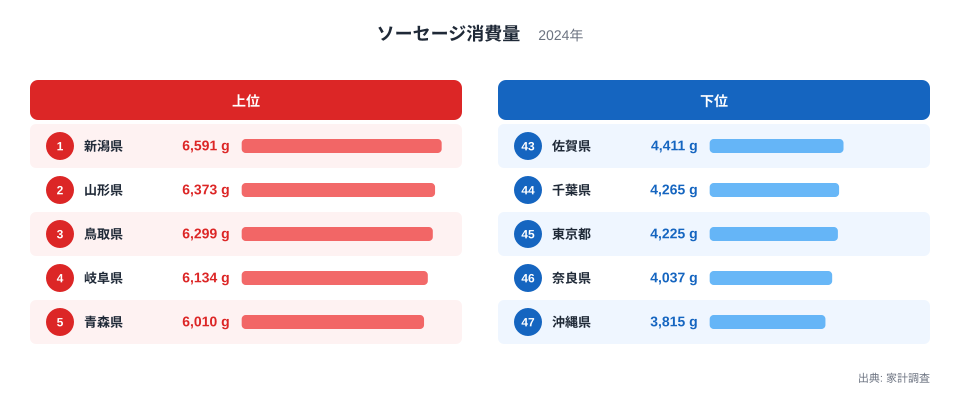
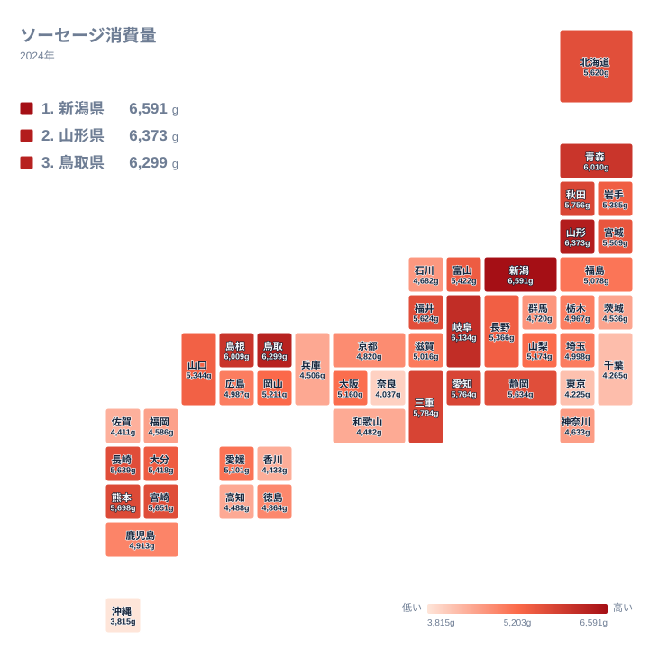

朝食の一皿にも、お弁当の彩りにも、おつまみにも使われるソーセージです。ところが県ごとに並べてみると、消費量にははっきりした差があります。2024年の家計調査で最も多かったのは新潟県の6,591gで、最も少なかったのは沖縄県の3,815gでした。

この記事では、まずランキングと地理分布から事実を確かめます。そのうえで、食文化・気候・産地といった視点で差の背景を考えます。ただし、このデータだけでは理由を特定できません。言えることと仮説にとどまることを分けて書き進めます。

## ソーセージ消費量の上位と下位

まず全体像を図で確認します。

<source-link href="/ranking/sausage-consumption-quantity">ソーセージ消費量ランキングをもっと見る</source-link>

1位は新潟県の6,591gです。2位は山形県の6,373g、3位は鳥取県の6,299g、4位は岐阜県の6,134g、5位は青森県の6,010gと続きます。上位5県のうち4県が、東北から日本海側にかけての地域に並んでいます。

下位に目を向けると、47位が沖縄県の3,815g、46位が奈良県の4,037g、45位が東京都の4,225g、44位が千葉県の4,265g、43位が佐賀県の4,411gです。首位と最下位の差は2,776gです。

新潟県がなぜ首位なのか、このデータだけでは答えを出せません。家計調査が示すのは購入量の結果であり、理由まで記録されているわけではないからです。後の節で、考えられる仮説を整理します。

> [!NOTE]
> ここでの数値は家計調査にもとづく、1世帯あたりの年間購入量(g)です。外食で食べた分や、ソーセージを使った惣菜・弁当の中に含まれる分は入りません。「県民がどれだけ食べたか」ではなく「家庭でどれだけ買ったか」を示す指標です。

## 上位に並ぶ日本海側・東北

上位を見ると、新潟県、山形県、鳥取県、島根県、青森県、秋田県といった、東北から日本海側の県が目立ちます。島根県は6位で6,009g、秋田県は9位で5,756gです。

こうした地域的なまとまりは、データから確かに読み取れます。一方で、理由はこのデータだけでは特定できません。冬の気候、買い物の習慣、食卓の組み立て方、地元の食品メーカーや小売の事情などが仮説として考えられますが、いずれも本データでは確かめられません。

[新潟県のデータ](/areas/15000)や[山形県のデータ](/areas/06000)とあわせて見ると、各県の他の統計との関係も探せます。仮説を検証するには、食料支出の内訳や世帯構成といった別の統計が必要です。

> [!TIP]
> 順位だけでなく、隣り合う順位の差にも注目してください。たとえば5位の青森県は6,010g、6位の島根県は6,009gで、差はわずか1gです。順位が一つ違うだけでは、消費の違いとまでは言えません。

## 地理分布で見る東西と海沿いの傾向

次に、都道府県の位置関係で分布を見てみます。

地図で眺めると、東北から北陸、山陰にかけての日本海側に濃い色が連なっています。一方で、関東の都市圏や近畿の一部、沖縄県には薄い色が目立ちます。

東海は上位から中位前半に集まっています。岐阜県が4位で6,134g、三重県が7位で5,784g、愛知県が8位で5,764g、静岡県が13位で5,634gです。北海道も15位で5,620gです。ハム・ソーセージの産地と消費量の高さが重なるかどうかは、産地の統計がないため、ここでは判断しません。

関東では、埼玉県が28位で4,998g、栃木県が30位で4,967g、神奈川県が36位で4,633g、茨城県が38位で4,536gと、中位から下位に分かれています。同じ関東でも幅があり、地域をひとまとめにしては語れません。

> [!WARNING]
> 家計調査は標本調査です。調査世帯は県庁所在地および政令指定都市を中心としているため、県全体の実態とは異なる可能性があります。また、年ごとの変動もありうるため、2024年の順位が毎年続くとは限りません。

## ほかの品目については何が言えるか

ソーセージは、ハムやベーコン、精肉などと並ぶ、たんぱく源の選択肢の一つです。ただし、今回使えるのはソーセージの購入量だけです。ハムや豚肉など関連品目のデータはないため、ある県でソーセージが少ない理由を、他の品目で補っているからだと説明することはできません。

たとえば沖縄県の3,815gは、全国で最も少ない値です。しかし、それが肉の消費全体の少なさを意味するのかは、このデータでは分かりません。品目を横に並べて比べるには、別の統計が必要です。

[同じカテゴリの統計一覧](/category/economy)から、関連する食品の消費量も確認できます。ソーセージだけで食文化を語らず、複数の品目を重ねて見ることで、地域差の輪郭がより確かなものになります。

## 中位の広がりと下位の連なり

真ん中あたりの様子を見ます。24位の大阪府は5,160g、25位の愛媛県は5,101g、26位の福島県は5,078gです。上位と下位の間に大きな断絶はなく、値はなだらかにつながっています。

下位も同じ構図です。41位の和歌山県は4,482g、42位の香川県は4,433g、43位の佐賀県は4,411g、44位の千葉県は4,265g、45位の東京都は4,225g、46位の奈良県は4,037gと、値が少しずつ下がっていきます。その連なりの端に、47位の沖縄県の3,815gがあります。

46位の奈良県との差は222gです。43位から46位までの間隔と比べて、飛び抜けて大きいわけではありません。沖縄県は、下位が連続的に低い中での最下位と読むのが適切です。

## データについて

この記事で扱う「ソーセージ消費量」は、家計調査(2024年)にもとづく1世帯あたりの購入数量で、単位はgです。順位は全47都道府県の値を大きい順に並べたものです。

> [!NOTE]
> 集計の対象は家庭内での購入です。ギフトで受け取った分や外食分は含まれず、世帯人数の違いも調整していません。そのため、単身世帯が多い地域では数値が小さく出る可能性があります。ただし、本データには世帯人数の情報がないため、実際にどの程度影響しているかは確かめられません。

## まとめ

2024年のソーセージ消費量は、新潟県が6,591gで1位、山形県が6,373gで2位、鳥取県が6,299gで3位でした。最下位は沖縄県の3,815gで、首位との差は2,776gです。上位には東北から日本海側の県が多く並びました。

ただし、新潟県が首位である理由は、このデータだけでは特定できません。気候や買い物の習慣、食卓の違いなどは仮説にとどまります。標本調査である以上、小さな順位差は慎重に読む必要があります。自分の県が何位か、隣の県とどう違うのかを確かめる入口として、ランキングを活用してください。
