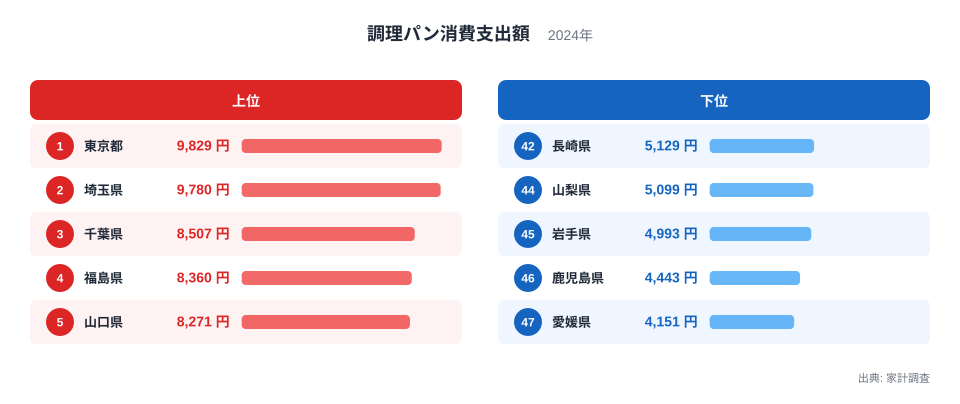
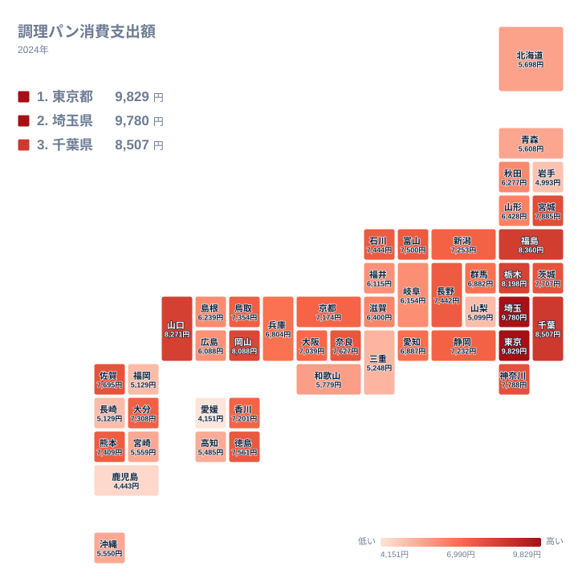

惣菜パンやサンドイッチ、ハンバーガー、ピザトーストのように、具材を挟んだり載せたりしたパンは、朝食にも昼食にも使いやすい食品です。家計調査では、こうしたパンが「調理パン」としてまとめられています。2024年の1世帯あたり年間支出額を都道府県別に見ると、同じ日本の中でも、調理パンにかけるお金には大きな開きがありました。

この記事では、調理パンへの支出が多い県と少ない県を実データで確認します。そのうえで、地方ごとの散らばりを見て、差の背景として考えられることを仮説として整理します。

## 首位は東京都、埼玉県がわずかな差で続く

まず、上位5県と下位5県を並べた図を見てください。

<source-link href="/ranking/savory-bread-consumption-expenditure">調理パンへの支出ランキングをもっと見る</source-link>

1位は東京都で9,829円です。2位は埼玉県で9,780円と、首位にごく近い水準でした。3位は千葉県で8,507円、4位は福島県で8,360円、5位は山口県で8,271円です。上位の顔ぶれを見ると、首都圏の都県が目立つ一方で、東北の福島県や中国地方の山口県も入っています。調理パンの支出は、大都市だけで決まるわけではないことがわかります。

一方、最下位は愛媛県で4,151円です。46位は鹿児島県で4,443円、45位は岩手県で4,993円、44位は山梨県で5,099円でした。福岡県と長崎県は、どちらも5,129円で並び、ともに42位です。

首位の東京都は9,829円、最下位の愛媛県は4,151円で、2倍を大きく超える開きがあります。毎日の食卓に欠かせない食品ではないとはいえ、これだけ差が出る点は興味深いところです。

> [!NOTE]
> ここでの「調理パン」は、惣菜パンやサンドイッチ、ハンバーガーなど、具材を使って調理されたパン類を指す家計調査の区分です。食パンや菓子パンとは別の項目で、支出額は1世帯あたりの年間金額です。人口の多さではなく、1世帯がいくら使ったかを示しています。

## 地図で見ると、関東の存在感が際立つ

次に、都道府県ごとの水準を地図で確認します。

地図で目を引くのは、関東の濃い色です。東京都、埼玉県、千葉県に加えて、栃木県が6位で8,198円、神奈川県が9位で7,788円、茨城県が10位で7,707円と、上位10位に関東の県が6つ入っています。群馬県だけは26位で6,882円と中位でした。関東の中にも差があるものの、全体として高い水準にあります。

東北では、福島県が4位、宮城県が8位で7,885円と上位に入る一方、岩手県は45位で4,993円です。同じ東北でも、山形県は28位で6,428円、秋田県は30位で6,277円、青森県は37位で5,608円と幅があります。地方でひとくくりにはできない、県ごとの個性が表れています。

中国地方では、山口県が5位、岡山県が7位で8,088円と上位です。鳥取県も18位で7,354円と中位より上でした。しかし、島根県は31位で6,239円、広島県は34位で6,088円と、同じ中国地方でも順位に開きがあります。

九州・沖縄では、佐賀県が11位で7,695円、熊本県が17位で7,409円、大分県が19位で7,308円と、中位より上の県が見られます。ところが、福岡県と長崎県はともに42位、鹿児島県は46位、沖縄県は39位で5,550円と、下位に沈む県も多くあります。九州・沖縄の中でも二極化しています。

> [!TIP]
> この指標では、同額の県が並ぶことがあります。福岡県と長崎県はともに5,129円で42位となり、次は44位の山梨県です。順位の数字が一つ飛ぶのはこのためです。また、1位の東京都と2位の埼玉県は9,829円と9,780円で、順位は違っても金額はほぼ並んでいます。順位だけで優劣を決めず、金額も確かめてください。

## 8,000円以上は7県、上位の金額帯を整理する

8,000円以上の県は7県あります。9,000円台は、東京都の9,829円と埼玉県の9,780円の2都県です。8,000円台は、千葉県の8,507円、福島県の8,360円、山口県の8,271円、栃木県の8,198円、岡山県の8,088円の5県です。

この7県のうち、関東の県は東京都、埼玉県、千葉県、栃木県の4つです。残る福島県は東北、山口県と岡山県は中国に属します。上位の金額帯に、関東以外の県が3つ入っている点は見逃せません。地方でも調理パンをよく買う県があり、パンの支出が大都市の専売特許ではないことがうかがえます。

下位に目を向けると、愛媛県の4,151円と鹿児島県の4,443円が際立っています。この2県は、45位の岩手県の4,993円と比べても低く、下位の中でも一段低い水準です。[東京都のデータ](/areas/13000)や[埼玉県のデータ](/areas/11000)のページで、ほかの指標も合わせて見ると、県ごとの特徴をつかみやすくなります。

> [!WARNING]
> 家計調査は標本調査であり、県庁所在市などを調査対象にした集計がもとになっています。県全体の消費行動を完全に代表しているわけではありません。調査世帯数も限られるため、順位の近い県どうしの差は、誤差の範囲に収まることがあります。ともに42位の福岡県と長崎県が同額であることも、その一例です。

## 差の背景として考えられること(仮説)

調理パンは、手軽に食べられる食品です。そのため、購入のしやすさや食事のスタイルが支出額に表れる可能性があります。ただし、以下はいずれも仮説であり、このデータだけで裏づけられるものではありません。

一つ目は、共働きや通勤・通学の時間帯との相性です。朝食や昼食を手早く済ませたい世帯では、惣菜パンやサンドイッチが選ばれやすくなると考えられます。東京都や埼玉県、千葉県、神奈川県といった首都圏は、通勤圏が広く、駅や商業施設にベーカリーや総菜売り場が多い地域です。こうした環境が、上位に並ぶ一因になっているかもしれません。

二つ目は、パン屋やコンビニエンスストア、スーパーのベーカリーの身近さです。調理パンは、焼きたてを店頭で買う商品でもあります。店が近いほど気軽に手に取りやすくなるでしょう。ただし、今回のデータは購入場所までは分けていないため、どの店で買われたかは確認できません。

三つ目は、主食の好みです。米飯を中心にした食卓が根づいている地域では、パン類の支出が控えめになる可能性があります。最下位の愛媛県や46位の鹿児島県、45位の岩手県は、調理パンへの支出が少ない側にあります。ただ、これが食文化の違いによるのか、麺類や惣菜など別の選択肢が強いのかは、このデータでは判断できません。

四つ目は、産地や歴史との結びつきです。山口県や岡山県、福島県など、首都圏の外でも上位に入る県があります。地元のパン屋や学校給食、ご当地の惣菜パンの文化が影響している可能性は考えられますが、根拠となる数値は手元にありません。

なお、食パンや菓子パンなど、関連する品目との比較は、この記事のデータには含まれていません。調理パンは「買ってそのまま食事になる」性格の食品ですが、他の品目との差を数値で語ることはできないため、ここでは触れるにとどめます。家計の全体像を見たい方は、[同じカテゴリの統計一覧](/category/economy)も参考にしてください。

## データについて

本記事で使った数値は、家計調査の「調理パン消費支出額」(2024年、単位は円)です。1世帯あたりの年間支出額で、都道府県別に47件が公表されています。

数字を読むときは、順位だけでなく金額の近さにも気を配ってください。上位2都県のように、順位は違っても金額がほぼ並ぶケースがあります。また、物価の違いや、購入する店の種類、世帯の人数構成といった要因は、この指標だけでは分けられません。支出額が多いことは、必ずしも消費量が多いことを意味しない点にも注意が必要です。

調理パンへの支出は、食文化や暮らし方、買い物環境が重なって生まれる数字だと考えられます。ランキングで気になる県を見つけたら、ぜひ県ごとのページで、ほかの統計とあわせて確かめてみてください。
