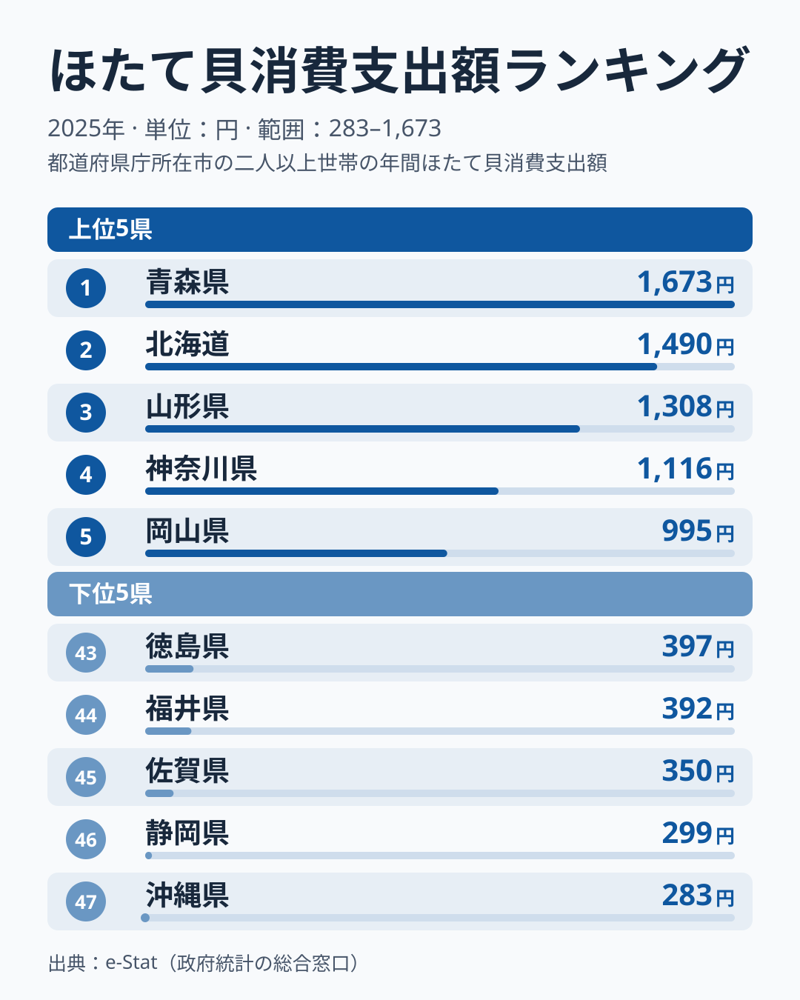

「同じ日本でも、住む県でほたて貝を食べる量がこんなに違う」――総務省の家計調査によると、2025年の1世帯あたりほたて貝消費支出額は、1位の青森県が1,673円、最下位の沖縄県が283円と、5.9倍の差があります。

ほたて貝といえば北海道のイメージが強いかもしれませんが、実際の消費支出でトップに立つのは青森県です。北海道は2位で1,490円、青森県との差は183円にとどまります。1,400円を超えるのはこの2道県だけで、3位の山形県は1,308円、4位の神奈川県は1,116円、5位以下は1,000円未満です。この記事では、産地の県が上位に並ぶ部分と、産地では説明できない順位を分けて、47都道府県のデータから読み解きます。

> [!NOTE]
> ほたて貝消費支出額は総務省「家計調査」に基づく、都道府県庁所在市（東京都は区部）の二人以上の世帯の年間支出額（円）です。県全体の値ではなく、実際に購入した金額であり、消費量そのもの（kg）とは異なります。ほたて貝として集計される品目の範囲は調査項目の定義によるため、この記事では贈答用や加工品がどこまで含まれるかを断定しません。

## 上位と下位の対比

<source-link href="/ranking/scallop-consumption-expenditure">ほたて貝消費支出額ランキングをもっと見る</source-link>

上位は、1位と2位の差が183円と小さく、この2道県だけが1,400円を超えています。3位以下は1,300円台から1,000円未満へ段階的に下がり、5位の時点で1,000円を割ります。[仮説] 青森・北海道の突出ぶりは、ほたて貝の主要産地であることと関係している可能性があります。[青森県の地域データ](/areas/02000)からも、水産業が地域の産業構造に占める位置を確認できます。

注目したいのは、3位山形県、4位神奈川県、5位岡山県です。三県とも主要な養殖産地ではありません。産地に近い東北でも、岩手県は9位で799円、秋田県は22位で606円と順位は分かれており、「産地の近く」だけでは説明がつきません。家計調査は県庁所在市の標本が小さく、単年のぶれが大きいため、この三県の順位から構造を断定することはできません。[仮説] 神奈川県は横浜市を含む大消費地で、鮮魚店や量販店での購入機会が多い可能性があります。山形県と岡山県については、このデータだけでは理由を説明できず、複数年の推移で確かめる必要があります。

## 最下位グループの傾向

下位は、43位の徳島県が397円、47位の沖縄県が283円と、43位から47位までが400円未満に収まっています。下位5県は四国（徳島県）、北陸（福井県）、東海（静岡県）、九州・沖縄（佐賀県・沖縄県）にまたがっており、特定の1地方だけに固まっていません。九州でも大分県は20位で630円、長崎県は24位で569円と、地方単位で「少ない」とは言えない構図です。

最下位の沖縄県は、地理的に本州の主要産地から遠く、輸送コストの面でほたて貝が割高になりやすい可能性があります。また、県産の魚類や海藻類が食卓の中心にあり、ほたて貝を選ぶ機会が相対的に少ないとも考えられます。[仮説] ただしこれは産地との距離と食文化からの推測であり、価格や購入頻度のデータで確かめたものではありません。

意外なのは46位の静岡県です。水産加工業が盛んな県として知られますが、ほたて貝の支出は299円にとどまります。[仮説] 加工・流通の拠点であることが、県庁所在市の家計の購入額に直結しない可能性を示唆しますが、1県の値だけでは確かめられません。

> [!WARNING]
> 家計調査は標本が小さく、年による変動があります。1年の順位は大きく入れ替わることがあるため、この記事の順位と金額はすべて2025年の値だけで読み、小さな差を構造的な違いとみなさないでください。前年の順位との比較は、この記事では扱っていません。

## 発見: 産地=消費地の傾向と、その限界

このランキングから見えてくるのは、上位2県が主要産地として知られる県であるという「産地=消費地」の傾向です。[仮説] ほたて貝は冷凍・加工技術の発達で全国流通が可能になったとはいえ、産地では鮮度の良い個体が地元市場に優先的に回り、贈答文化や直売所での購入機会も多いため、消費支出が高くなりやすいと考えられます。

一方で、この傾向は3位以下には当てはまりません。ほたて貝の突出は魚食全般の多さだけで説明できるものではなく、産地であることが関係している可能性があります。[仮説] 刺身・貝焼き味噌・バター焼きなどの郷土料理としてほたて貝が定着していることも、押し上げ要因として働いている可能性がありますが、他の魚介品目との相関を個別に検証する必要があります。魚介消費の地域差をさらに掘り下げた記事として、[かつおと牡蠣の消費地図を比べた記事](/blog/bonito-vs-oyster-fish-map)も参考になります。

> [!TIP]
> ほたて貝消費支出は「産地に近いほど高い」という単純な地理法則だけでは説明できません。神奈川県は4位で1,116円、東京都は13位で769円で、産地ではない県も上位から中位に入っています。[仮説] 大消費地として購入機会が多いことが関係している可能性がありますが、このデータだけでは確かめられません。

家計の水産物支出は地域の経済構造や食文化とも密接に関わっています。都道府県ごとの経済指標を横断的に見たい場合は、[経済カテゴリ一覧](/category/economy)から他の消費支出ランキングも確認できます。

## まとめ

- **1位は青森県で1,673円**：産地であることとの関係が考えられるが、このデータだけでは確かめられない
- **最下位は沖縄県で283円**：1位との差は5.9倍
- **2位は北海道で1,490円**：青森県との差は183円で、1,400円を超えるのは青森と北海道の2道県のみ
- **3位以下は産地だけで説明できない**：山形・神奈川・岡山が上位に入り、単年のぶれも大きい
- **下位は特定の地方に固まらない**：徳島・福井・佐賀・静岡・沖縄が並び、四国・北陸・東海・九州・沖縄にまたがる
