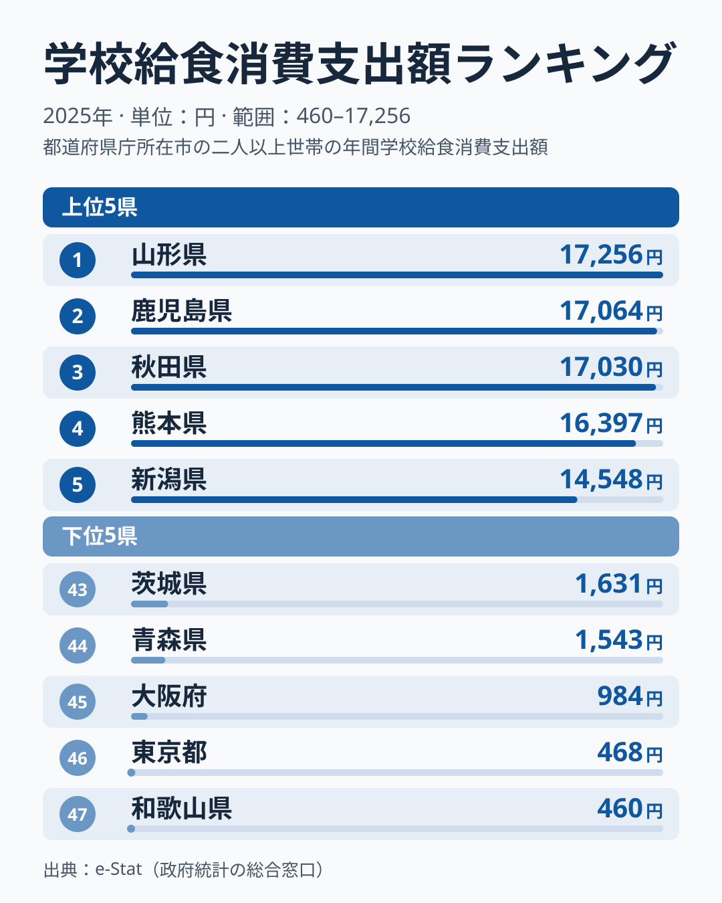
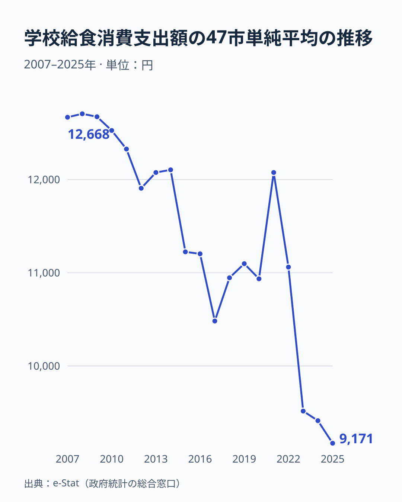

「給食費は全国どこでも同じくらい」と思っていませんか。実は都道府県庁所在市の家計調査を見ると、学校給食にかける年間支出額には最大約38倍もの開きがあります。2025年のデータで最も高いのは山形市の世帯の17,256円、最も低いのは和歌山市の世帯のわずか460円です。

同じ「学校給食」という項目なのに、なぜここまで差が出るのでしょうか。手がかりの一つとして考えられるのが、自治体による給食費の無償化・補助です。ただし、この記事のデータだけでは、無償化が原因だとは確かめられません。この記事では、上位・下位の顔ぶれと、47市の単純平均が2007年から2025年にかけてどう変化してきたかを合わせて見ながら、無償化の影響が考えられる点と、標本の揺れで説明される点を分けて整理します。

> [!NOTE]
> このランキングは総務省「家計調査」の品目別支出のうち、二人以上の世帯における「学校給食」の年間消費支出額（都道府県庁所在市。東京は東京23区）です。給食そのものの「質」や「量」ではなく、**世帯が実際に支払った金額**を集計した指標である点に注意してください。自治体が給食費を補助・無償化すれば、給食の中身が変わらなくても家計調査上の支出額は下がると考えられます。また、子どもがいない世帯も含めた二人以上世帯の平均です。

## 上位と下位、約38倍の格差

2025年の上位5都市は、山形が17,256円、鹿児島が17,064円、秋田が17,030円、熊本が16,397円、新潟が14,548円でした。地方の県庁所在市が目立ち、東京・大阪・名古屋といった三大都市圏の中心都市は上位に一つも入っていません。

一方の下位5都市は、茨城が1,631円、青森が1,543円、大阪が984円、東京が468円、和歌山が460円です。ここで注目したいのは、下位に大都市（東京・大阪）と地方都市（青森・和歌山・茨城）が混在している点です。人口密度や都市規模だけでは、この順位を説明できません。東京は46位で、約38倍の倍率の分母は最下位の和歌山市の460円です。

<source-link href="/ranking/school-lunch-consumption-expenditure">学校給食消費支出額ランキングをもっと見る</source-link>

[仮説] 上位の都市では、無償化・補助の広がりがまだ限定的で、保護者負担分がそのまま家計調査に反映されやすい可能性があります。実施率そのもののデータではないため、検証するには文部科学省の学校給食費無償化等実施状況調査で、山形市・秋田市などの実施状況を確認する必要があります。[山形県](/areas/06000)は人口減少に悩む地方県ですが、山形市の世帯の支出額は2019年の13,990円から2025年の17,256円まで、大きな急落なく上下しています。

## 無償化の影響が考えられる都市と、標本の揺れ

下位の都市では、支出額の急な低下が見られます。ただし、これを無償化の影響だと断定するには、自治体別の実施時期を確認する必要があります。

> [!WARNING]
> 家計調査は「世帯が支払った金額」を集計するため、自治体が給食費を無償化・補助すれば、たとえ給食の提供自体は続いていても支出額はゼロに近づくと考えられます。**支出額が低い＝給食の質が低い、というわけではありません。** 一方で、県庁所在市ごとの標本は小さく、年ごとの振れも大きい指標です。47市の2007年から2025年の前年比で、増減が50%を超えた動きは846件のうち69件ありました。支出額の低さを無償化と結びつけるときは、この振れを前提にしてください。

[東京都](/areas/13000)の東京23区の世帯は、2023年に5,189円だった支出額が、2024年には521円まで落ち込み、2025年も468円と低水準です。同時期、都内の一部の区で学校給食費の負担軽減・無償化の動きがあった可能性がありますが、この記事では実施時期を確認していません。検証するには、東京23区ごとの無償化の時期と対象範囲を確認する必要があります。

大阪市の世帯は、2019年の6,730円から2020年に4,084円、2021年に1,786円、2022年に746円と、2023年より前に先行して下がりました。その後は2023年に1,298円、2024年に1,384円、2025年に984円と低水準で推移しています。[和歌山県](/areas/30000)の和歌山市の世帯は、2022年の5,453円から2023年に1,427円、2024年にはわずか272円まで下がり、2025年は460円とやや戻したものの全国最下位です。茨城も2023年の8,980円から2024年に5,921円、2025年に1,631円へ下がり、2024年の下位5には入っていませんでしたが、2025年に新しく加わりました。

青森市の世帯は、2022年の12,155円から2023年に807円へと1年で93%落ち込み、2024年は1,390円、2025年は1,543円と少し戻しましたが、2022年の約13%にとどまります。ただし、大阪市も2022年の746円から2023年に1,298円へ戻し、和歌山市も2024年の272円から2025年の460円へ戻しており、低水準の中での上下は青森市だけではありません。

さらに、無償化では説明しにくい急落も同じデータにあります。鹿児島市の世帯は2022年の14,258円から2023年に5,766円へ急落し、2024年に16,537円へ戻りました。秋田市の世帯も2023年の13,045円から2024年に9,258円へ落ち込み、2025年に17,030円へ戻っています。2023年だけで、前年から3割を超えて減った市は13あります。無償化とは別に、標本の揺れが大きな順位の入れ替わりを生んでいると考えられます。

## 47市の単純平均も下がり、2023年以降は低水準

47都道府県庁所在市の学校給食消費支出額の単純平均は、2007年の12,668円から2020年の10,935円まで下がり、2021年に12,075円へ一度上がりました。2022年には11,061円でした。ところが2023年に9,516円、2024年に9,413円、2025年に9,171円と、2025年は2022年よりおよそ17%低くなっています。ここでいう「全国」の値は、家計調査が公表する全国値ではなく、47市の単純平均です。

[仮説] この低下は、給食費の無償化・補助を打ち出す自治体が増えていることと関係する可能性があります。検証するには、文部科学省の学校給食費無償化等実施状況調査で、自治体数の推移を年次別に確認する必要があります。標本の揺れの影響もあるため、47市の単純平均の動きだけで原因を決めることはできません。

[仮説] 山形・鹿児島・秋田・熊本のように高水準にある都市は、無償化の動きがまだ限定的か、あるいは給食の質・食材費に重点を置く方針を取っている可能性があります。ただし、鹿児島のように年によって大きく動く都市もあり、1年の順位から地域の方針を読み取るのは慎重であるべきです。家計にまつわる他の支出項目は[家計・くらしカテゴリ](/category/economy)からまとめて確認できます。

## まとめ

- **1位**は山形の17,256円、**最下位**は和歌山の460円で、**約38倍**の格差があります
- 下位グループには東京・大阪という大都市と、青森・和歌山・茨城という地方都市が混在し、人口規模だけでは説明できません
- 東京・和歌山・青森は2023年前後に、大阪は2020年から2022年に支出額が下がっており、**給食費の無償化・補助**が背景にある可能性があります（仮説、要検証）
- ただし、47市の前年比では50%を超える動きが846件中69件あり、標本の揺れが大きい指標です。鹿児島や秋田の急落は無償化では説明しにくいものです
- 47市の単純平均は2007年12,668円から2025年9,171円へ約28%減少し、特に2023年以降が低水準です
- 支出額が低い地域は「給食の質が低い」とは限らず、保護者の負担が軽い可能性もありますが、この記事のデータでは確かめられません
