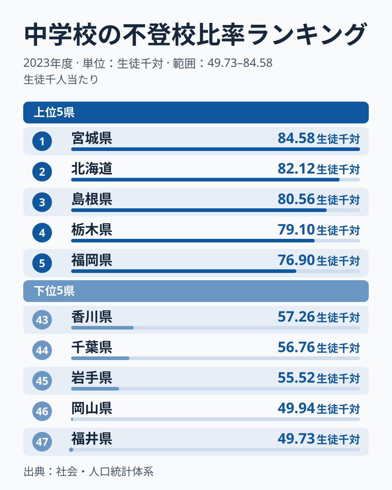
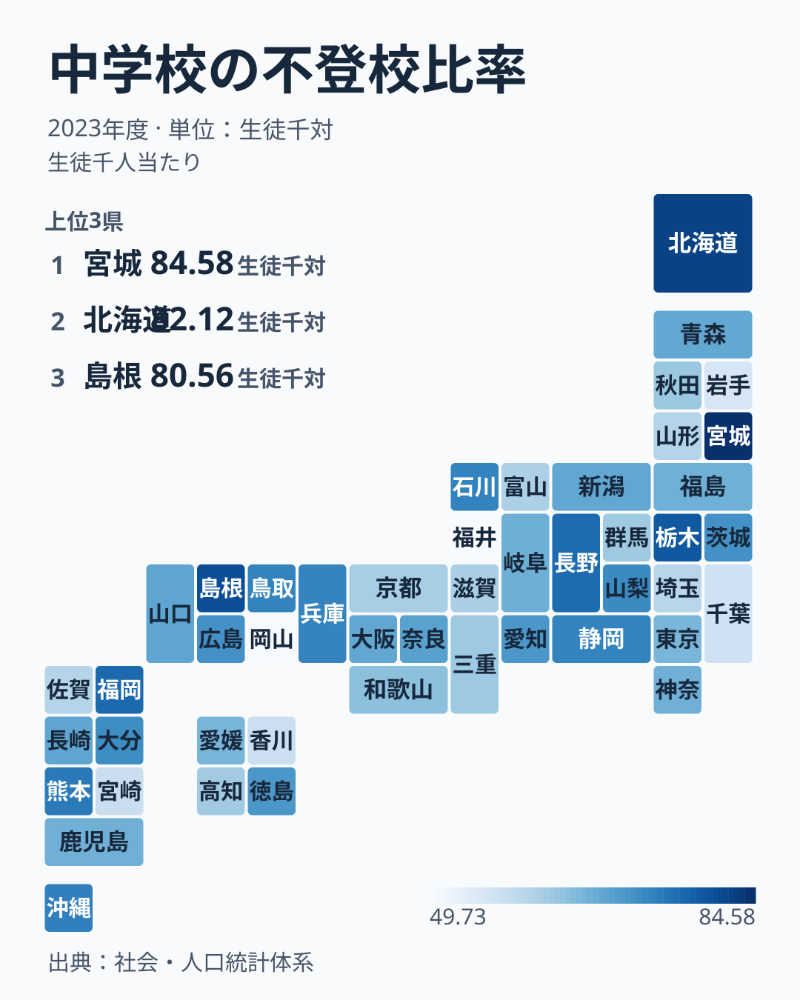
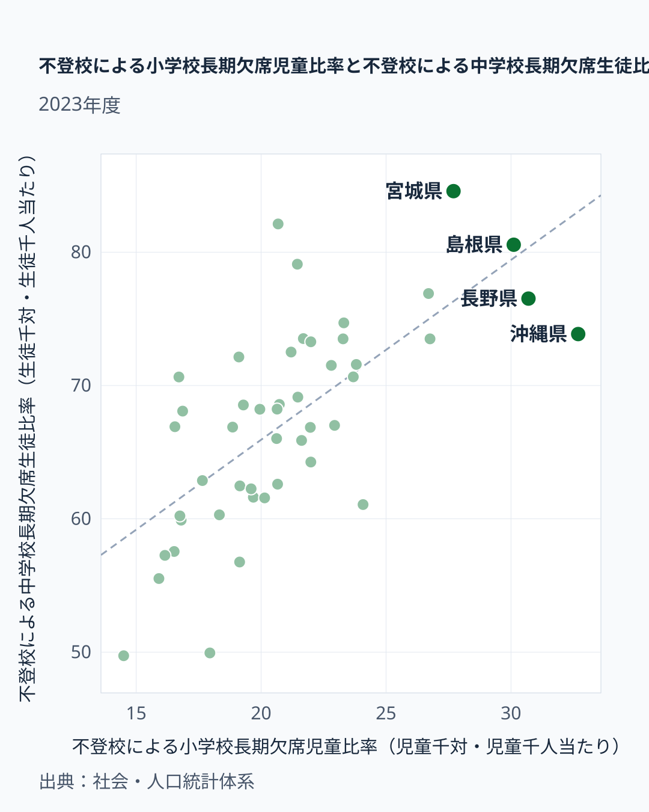
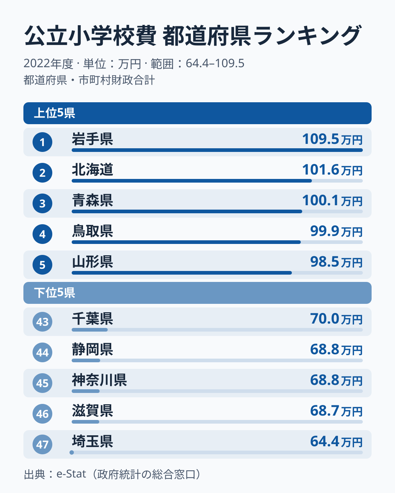

「不登校の子どもが過去最多を更新」と報じられる一方で、その多さは都道府県によって大きく異なります。2023年度の中学校の不登校比率は、宮城県が生徒1,000人当たり84.58人で最も多く、[福井県](/areas/18000)が49.73人で最も少なく、約1.7倍の差があります。福井県は小学校でも全国で最も少ない県です。

この記事の問いは「不登校が多い県はどこで、何と関係するか」です。先に答えを書くと、多いのは宮城・北海道・島根・栃木・福岡などで、大都市圏の都府県がそろって多いわけではありません。小学校で多い県は中学校でも多いという連動がはっきり見られる一方、1人当たりの公立小学校費とはほとんど連動していません。なぜ県によって差が出るのかは、このデータからは分かりません。以下では、ランキング・地図・散布図の順に、この答えの根拠と言える範囲を確かめます。

## 中学校不登校比率ランキング

ここで使うのは、社会・人口統計体系の「不登校による中学校長期欠席生徒比率」です。2023年度の中学校で不登校比率が最も高いのは宮城県で、生徒1,000人当たり84.58人です。2位は北海道の82.12人、3位は島根県の80.56人、4位は栃木県の79.10人、5位は福岡県の76.90人です。47都道府県の平均は67.39人で、上位5県はいずれも平均を9人以上上回っています。

最も低いのは福井県の49.73人で、46位は岡山県の49.94人、45位は[岩手県](/areas/03000)の55.52人です。1位の宮城県と最少の福井県では約1.7倍の差があります。下位の2県は50人を下回り、3番目に少ない岩手県とも5人以上離れています。

上位5県は東北・北海道・中国・関東・九州とばらばらの地方にあり、人口規模も異なります。人口の多い県では福岡県が5位に入っていますが、東京都は30位、大阪府は23位、神奈川県は28位、愛知県は17位で、大都市圏の都府県がそろって多いわけではありません。下位も福井・岡山・岩手と地方の県が並ぶため、「都市か地方か」という区分だけではこの並びを説明できません。

> [!NOTE]
> この比率は、年度間に30日以上欠席した児童生徒のうち、理由が「不登校」とされた人数を児童生徒1,000人当たりで表したものです。病気や経済的理由による欠席は含みません。欠席の理由をどれに分類するかは学校の判断によるため、計上の仕方が県によって違う可能性があり、県の差のすべてが子どもの状況の差とは限りません。

<source-link href="/ranking/junior-high-school-long-absence-ratio-nonattendance-over-30days-per-1000">中学校の不登校比率ランキングをもっと見る</source-link>

## 都道府県マップで見る分布

地図で色の濃淡を見ると、隣り合う県どうしでも色がそろっていないことが分かります。同じ東北でも、宮城県は1位ですが、岩手県は45位、山形県は40位、秋田県は32位です。東北という地方でひとくくりにすると、この差が見えなくなります。

日本海側の県も同じです。島根県は3位、石川県は9位、鳥取県は11位と多い側にある一方、福井県は47位、山形県は40位、富山県は38位と少ない側にあります。「日本海側は少ない」とも「日本海側は多い」とも言えず、県ごとに見る必要があります。

関東でも、栃木県は4位ですが、千葉県は44位、埼玉県は41位で、同じ関東の中で40位の開きがあります。九州では福岡県が5位、熊本県が7位と多い側にありますが、宮崎県は42位です。どの地方にも多い県と少ない県が混ざっており、地方ブロック単位の傾向としては捉えきれない散らばり方です。

この地図から言えるのは、不登校の多さが地方や人口規模で決まっているわけではない、というところまでです。地図だけでは、県ごとの差がどこから来るのかは分かりません。

## 小学校の不登校比率も福井が最少

小学校の不登校比率も確認しておきます。2023年度の47都道府県の平均は児童1,000人当たり21.08人で、中学校の67.39人の約3分の1です。

小学校で最も高いのは[沖縄県](/areas/47000)の32.69人で、次いで長野県の30.70人、島根県の30.11人です。中学校で1位だった宮城県は、小学校では4番目に多い27.70人です。

最も低いのは福井県の14.50人で、中学校と同じく全国最少です。次いで少ないのは岩手県の15.91人、香川県の16.15人で、岩手県は中学校でも45位でした。島根県は小学校でも中学校でも3番目に多く、宮城県は小学校で4番目、中学校で1位です。上位と下位の顔ぶれが小学校と中学校で重なっていることを、次の散布図で47都道府県すべてについて確かめます。

あわせて見る: [不登校による小学校長期欠席児童比率ランキング](/ranking/elementary-school-long-absence-ratio-nonattendance-over-30days-per-1000)

## 散布図で見る小学校と中学校の連動

横軸に小学校、縦軸に中学校の2023年度の不登校比率をとると、点は右上がりに並びます。相関係数は0.69で、小学校の不登校比率が高い県ほど、中学校の不登校比率も高いという正の相関です。

47都道府県の平均（小学校21.08人・中学校67.39人）で4つに分けると、各県の位置が分かります。

- **右上（小中とも平均以上）**: 16県。宮城・島根・長野・沖縄・福岡などが入ります
- **左下（小中とも平均未満）**: 18府県。福井・岩手・香川・岡山などが入ります
- **左上（小学校は平均未満、中学校は平均以上）**: 8道府県。北海道は小学校20.68人と平均並みですが、中学校は82.12人で2位です
- **右下（小学校は平均以上、中学校は平均未満）**: 5都府県。富山県は小学校が24.08人で7番目に多い一方、中学校は61.07人で38位です。東京都と神奈川県もここに入ります

47のうち34都道府県が、小中とも平均以上か、小中とも平均未満のどちらかに入ります。ただし北海道や富山県のように、小学校と中学校で位置が大きく違う県もあり、連動は全県に当てはまるわけではありません。

この相関は、同じ年度の県の並びがそろっていることを示すだけです。同じ子どもが小学校から中学校へ不登校を続けているのか、小学校での対応が中学校の不登校を減らすのかは、この1年分の県別データからは分かりません。それを確かめるには、同じ学年を追った複数年のデータが必要です。

## 公立小学校費と不登校の関係

問いの「何と関係するか」の候補として、児童1人当たりの公立小学校費も並べました。2022年度の1位は岩手県で1,095.3千円、2位は北海道で1,016.4千円、3位は青森県で1,001.4千円です。最も少ないのは埼玉県の644.3千円で、福井県は19位の841.5千円です。上位10県には東北の4県と北海道が入り、下位5県には埼玉・神奈川・千葉の首都圏の3県が入りますが、東京都は7位です。

この支出額と2023年度の中学校の不登校比率の相関係数は0.07、小学校の不登校比率との相関係数は-0.14で、どちらもほぼ関係が見られない水準です。支出1位の岩手県は中学校の不登校比率が45位と少ない側にある一方、支出2位の北海道は中学校で2位と多い側にあり、支出の多い県が不登校の少ない県になっているわけではありません。

公立小学校費には校舎の建設や改修の費用も含まれるため、その年の工事で額が大きく動くことがあります。支出を使い道ごとに分けた値と比べれば、もう一段詳しく確かめられますが、今回のデータにはその内訳がありません。

> [!WARNING]
> 公立小学校費は2022年度、不登校比率は2023年度の値で、集計年が1年ずれています。単年の支出額だけで「支援が手厚い県」と判断することはできません。

<source-link href="/ranking/per-child-public-elementary-school-expenditure-pref-municipal">公立小学校費（1人当たり）ランキングをもっと見る</source-link>

## まとめ

2023年度の不登校比率を、ランキング・地図・散布図で確かめました。

- **中学校で約1.7倍の差**: 宮城県が生徒1,000人当たり84.58人で最も多く、福井県が49.73人で最も少ない県です
- **大都市圏がそろって多いわけではない**: 福岡県は5位ですが、東京都は30位、大阪府は23位です。地方や人口規模ではこの並びを説明できません
- **福井県は小中とも最少**: 中学校49.73人・小学校14.50人で、どちらも全国で最も少ない県です
- **小学校と中学校の並びは連動する**: 相関係数は0.69で、小学校で多い県は中学校でも多い傾向があります。ただし北海道や富山県のように例外もあります
- **公立小学校費とはほぼ連動しない**: 中学校の不登校比率との相関係数は0.07でした

県ごとの差がなぜ生まれるのかは、このデータでは分かりません。計上の仕方の違いがありうることも踏まえ、数値は県の比較の出発点として使い、背景は各県の調査や支援の記録とあわせて確かめる必要があります。数値が低いことが「問題がない」ことを意味するわけでもなく、不登校の背景は子どもによって異なります。
